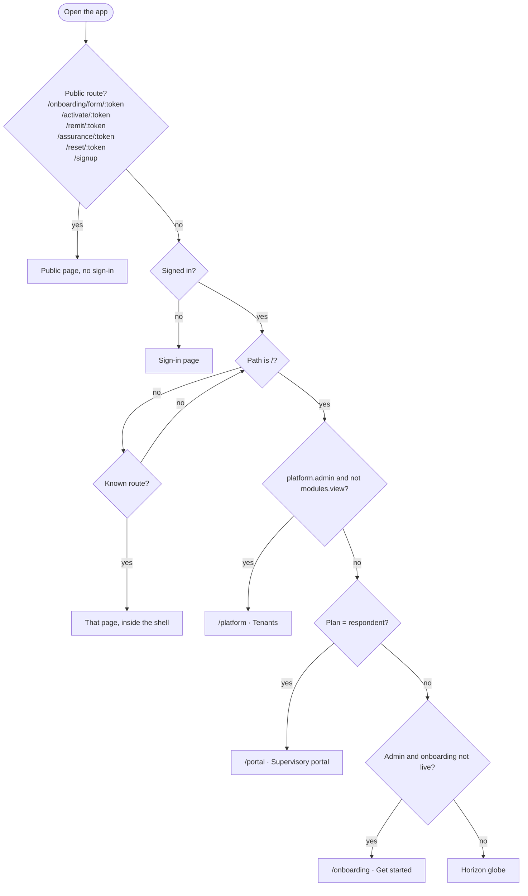
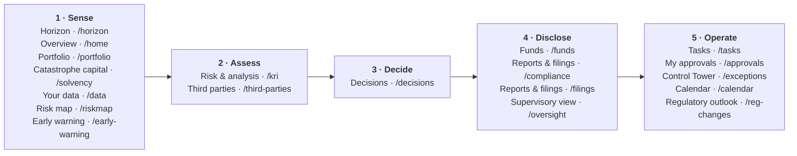
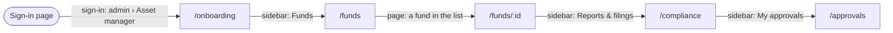

# App flow — Tellumen climate platform

> **Generated — do not edit by hand.** Written by `scripts/build_project_docs.py` from `web/src/App.tsx`, `web/src/components/Shell.tsx`, the hub tab components, and the role templates (`services/governance/tenant_provisioning.py`, `data/reference/supervision_profiles.json`, `scripts/seed_platform_operator.py`). Regenerate with `venv/bin/python -m scripts.build_project_docs --write`; the gate (`scripts/precommit.sh`) fails when this file differs from what the code produces now.

The web app has **6 public pages** (no sign-in) and **71 routes in the signed-in workspace** (68 pages, 2 redirects and the front door), all inside one shell with a sidebar. What a signed-in user sees is gated twice: by the organisation's sector (its type) and by the permissions of the user's roles. The sidebar follows the operational loop in numbered stages. Section 6 has the key journeys, each walked in the running app. This document describes the screens as they are; the standard every screen must meet is [DESIGN_BRIEF.md](DESIGN_BRIEF.md) §1.

## 1. The front door

Public routes: `/onboarding/form/:token` (IntakeForm), `/activate/:token` (Activate), `/remit/:token` (Remit), `/assurance/:token` (Assurance), `/reset/:token` (ResetPassword), `/signup` (Signup).

- Not signed in: the sign-in page (`Login`), whatever the path — except the public pages listed above, which work by link.
- Signed in, path `/`:
  - a platform operator (holds `platform.admin` but not `modules.view`) is sent to `/platform`;
  - an organisation on the `respondent` plan is sent to `/portal`;
  - an administrator (holds `admin.users.manage`) whose organisation's onboarding is available and not yet live
    (`GET /v1/admin/onboarding`) is sent to `/onboarding` (Get started);
  - everyone else sees Horizon (the globe).
- Any other unknown path is sent to `/`.
- Which menu the sidebar shows: the respondent menu for a `respondent`-plan organisation, the supervisor menu for an
  organisation of type `regulator`, the customer workspace menu otherwise.

## 2. The operational loop — the customer workspace sidebar

`GROUPS` in `web/src/components/Shell.tsx`: 5 numbered stages — Sense → Assess → Decide → Disclose → Operate — then *Set up* and *Platform*. ([SOFTWARE_DESCRIPTION.md](SOFTWARE_DESCRIPTION.md) §2 names the loop Sense → Score → Project → Act.) Each entry is one destination; related pages are tabs inside a hub (section 3). Stage numbers count only the stages a user can see.

Every entry with its gates. *Default roles* are the role templates a new customer tenant gets (`DEFAULT_ROLE_PERMS`) that pass the permission rule; the sector rule applies on top.

| Group | Entry | Route | Sectors | Permission rule | Default roles |
|---|---|---|---|---|---|
| Sense | Horizon | `/horizon` | every sector | `modules.view` | admin, analyst, approver, viewer, auditor |
| Sense | Overview | `/home` | manufacturer | `modules.view` | admin, analyst, approver, viewer, auditor |
| Sense | Portfolio | `/portfolio` | bank, insurer, asset_manager, reit | `modules.view` | admin, analyst, approver, viewer, auditor |
| Sense | Catastrophe capital | `/solvency` | insurer | `modules.view` | admin, analyst, approver, viewer, auditor |
| Sense | Your data | `/data` | bank, insurer, asset_manager, reit, manufacturer | `modules.view` | admin, analyst, approver, viewer, auditor |
| Sense | Risk map | `/riskmap` | manufacturer | `modules.view` | admin, analyst, approver, viewer, auditor |
| Sense | Early warning | `/early-warning` | manufacturer | `modules.view` | admin, analyst, approver, viewer, auditor |
| Assess | Risk & analysis | `/kri` | every sector | `modules.view` | admin, analyst, approver, viewer, auditor |
| Assess | Third parties | `/third-parties` | bank, insurer, asset_manager, reit, manufacturer | `modules.view` | admin, analyst, approver, viewer, auditor |
| Decide | Decisions | `/decisions` | bank, insurer, asset_manager, reit, manufacturer | `decisions.view` | admin, analyst, approver |
| Disclose | Funds | `/funds` | asset_manager | `reports.view` | admin, analyst, approver, viewer, auditor |
| Disclose | Reports & filings | `/compliance` | bank, insurer, asset_manager, reit | `reports.view` | admin, analyst, approver, viewer, auditor |
| Disclose | Reports & filings | `/filings` | manufacturer | `reports.view` | admin, analyst, approver, viewer, auditor |
| Disclose | Supervisory view | `/oversight` | every sector | `oversight.view` | admin, analyst, approver, viewer, auditor |
| Operate | Tasks | `/tasks` | every sector | `reports.view` | admin, analyst, approver, viewer, auditor |
| Operate | My approvals | `/approvals` | every sector | `approvals.view` | admin, analyst, approver |
| Operate | Control Tower | `/exceptions` | every sector | `ops.oversee` | admin, analyst, approver |
| Operate | Calendar | `/calendar` | every sector | `ops.oversee` | admin, analyst, approver |
| Operate | Regulatory outlook | `/reg-changes` | every sector | `modules.view` | admin, analyst, approver, viewer, auditor |
| Set up | My security | `/account-security` | every sector | `modules.view` | admin, analyst, approver, viewer, auditor |
| Set up | Settings & team | `/admin` | every sector | any of `admin.users.manage`, `approvals.view`, `admin.audit.view`, `admin.roles.manage`, `admin.approval_policy.manage` | admin, analyst, approver, auditor |
| Set up | Contracts | `/contracts` | every sector | `contracts.view` | admin, analyst, approver |
| Set up | Help & guides | `/docs` | every sector | `modules.view` | admin, analyst, approver, viewer, auditor |
| Platform | Tenants | `/platform` | every sector | `platform.admin` | — |
| Platform | Client intake | `/intake` | every sector | `onboarding.manage` | — |
| Platform | Change pipeline | `/reg-pipeline` | every sector | `platform.admin` | — |
| Platform | Reference data | `/reference-data` | every sector | `reference.release_review` | — |
| Platform | Calibrations | `/calibrations` | every sector | `calibration.review` | — |

## 3. Hubs — pages shown as tabs of one entry

A hub's tab strip shows a tab only where the sector (and, for the `SectionTabs` hubs, the permission) allows it. `SectionTabs` hides itself when one tab or none would show; the agriculture *Reports & filings* strip shows only for sector `manufacturer`.

**Your data** — `DATA_TABS` in `web/src/components/SectionTabs.tsx`; rendered on `/data`, `/data-dictionary`, `/foundation`, `/operations`, `/sourcing`, `/transmission`.

| Tab | Route | Sectors | Permission |
|---|---|---|---|
| Your data | `/data` | every sector |  |
| Our sites | `/operations` | manufacturer |  |
| Suppliers & crops | `/sourcing` | manufacturer |  |
| Data dictionary | `/data-dictionary` | every sector |  |
| Data sources | `/foundation` | manufacturer |  |
| Transmission | `/transmission` | every sector | `modules.view` |

**Settings & team** — `ADMIN_TABS` in `web/src/components/SectionTabs.tsx`; rendered on `/admin`, `/billing`, `/onboarding`, `/sso`.

| Tab | Route | Sectors | Permission |
|---|---|---|---|
| Settings & team | `/admin` | every sector |  |
| Get started | `/onboarding` | every sector |  |
| Single sign-on | `/sso` | every sector |  |
| Plan & billing | `/billing` | every sector |  |

**Help & guides** — `HELP_TABS` in `web/src/components/SectionTabs.tsx`; rendered on `/docs`, `/support`.

| Tab | Route | Sectors | Permission |
|---|---|---|---|
| Help & guides | `/docs` | every sector |  |
| Support | `/support` | every sector |  |

**Risk & analysis** — `TABS` in `web/src/components/ReviewTabs.tsx`; rendered on `/analytics`, `/coverage`, `/crop-coverage`, `/kri`, `/loss`, `/model-risk`, `/model-validation`, `/models`, `/track-record`, `/underwriting`.

| Tab | Route | Sectors | Permission |
|---|---|---|---|
| KRI dashboard | `/kri` | every sector |  |
| Analytics | `/analytics` | bank, asset_manager, reit |  |
| Loss | `/loss` | bank, insurer, asset_manager, reit, manufacturer |  |
| Climate track record | `/track-record` | every sector |  |
| Underwriting review | `/underwriting` | insurer |  |
| Model validation | `/model-validation` | every sector |  |
| Model-risk register | `/model-risk` | every sector |  |
| Hazard coverage | `/coverage` | every sector |  |
| Crop coverage | `/crop-coverage` | manufacturer |  |
| How we score | `/models` | manufacturer |  |

**Reports & filings (agriculture)** — `TABS` in `web/src/components/ReportTabs.tsx`; rendered on `/disclosure`, `/esrs`, `/eudr`, `/filings`, `/prior-filings`.

| Tab | Route | Sectors | Permission |
|---|---|---|---|
| Reports & filings | `/filings` | every sector |  |
| EUDR statements | `/eudr` | every sector |  |
| Supply disclosure | `/disclosure` | every sector |  |
| ESRS statement | `/esrs` | every sector |  |
| Prior filings | `/prior-filings` | every sector |  |

**Clients (operator)** — `TABS` in `web/src/components/OperatorTabs.tsx`; rendered on `/intake`, `/platform`.

| Tab | Route | Sectors | Permission |
|---|---|---|---|
| Tenants | `/platform` | every sector |  |
| Client intake | `/intake` | every sector |  |

## 4. Screens per role

The role templates below are what a new organisation is created with; an administrator holding `admin.roles.manage` can change an organisation's roles afterwards, so a live organisation may differ.

### 4.1 Customer workspaces (bank, insurer, asset manager, REIT, agriculture)

| Role | Permissions (`DEFAULT_ROLE_PERMS`) |
|---|---|
| `admin` | `modules.view`, `reports.view`, `reports.publish`, `pricing.view`, `pricing.approve`, `admin.users.manage`, `admin.roles.manage`, `admin.audit.view`, `admin.approval_policy.manage`, `approvals.create`, `approvals.view`, `approvals.decide`, `submissions.release`, `portal.use`, `contracts.view`, `contracts.manage`, `supply.locations.write`, `oversight.view`, `ops.oversee`, `decisions.view`, `board.attest` |
| `analyst` | `modules.view`, `reports.view`, `reports.publish`, `pricing.view`, `pricing.approve`, `admin.audit.view`, `approvals.create`, `approvals.view`, `submissions.release`, `portal.use`, `contracts.view`, `contracts.manage`, `supply.locations.write`, `oversight.view`, `ops.oversee`, `decisions.view` |
| `approver` | `modules.view`, `reports.view`, `reports.publish`, `pricing.view`, `pricing.approve`, `approvals.view`, `approvals.decide`, `submissions.release`, `portal.use`, `contracts.view`, `oversight.view`, `ops.oversee`, `decisions.view`, `board.attest` |
| `viewer` | `modules.view`, `reports.view`, `pricing.view`, `portal.use`, `oversight.view` |
| `auditor` | `modules.view`, `reports.view`, `oversight.view`, `admin.audit.view`, `portal.use` |

The sidebar each role sees, per sector (group › entries):

**bank**

- `admin`: *1 · Sense* › Horizon, Portfolio, Your data · *2 · Assess* › Risk & analysis, Third parties · *3 · Decide* › Decisions · *4 · Disclose* › Reports & filings, Supervisory view · *5 · Operate* › Tasks, My approvals, Control Tower, Calendar, Regulatory outlook · *Set up* › My security, Settings & team, Contracts, Help & guides
- `analyst`: *1 · Sense* › Horizon, Portfolio, Your data · *2 · Assess* › Risk & analysis, Third parties · *3 · Decide* › Decisions · *4 · Disclose* › Reports & filings, Supervisory view · *5 · Operate* › Tasks, My approvals, Control Tower, Calendar, Regulatory outlook · *Set up* › My security, Settings & team, Contracts, Help & guides
- `approver`: *1 · Sense* › Horizon, Portfolio, Your data · *2 · Assess* › Risk & analysis, Third parties · *3 · Decide* › Decisions · *4 · Disclose* › Reports & filings, Supervisory view · *5 · Operate* › Tasks, My approvals, Control Tower, Calendar, Regulatory outlook · *Set up* › My security, Settings & team, Contracts, Help & guides
- `viewer`: *1 · Sense* › Horizon, Portfolio, Your data · *2 · Assess* › Risk & analysis, Third parties · *3 · Disclose* › Reports & filings, Supervisory view · *4 · Operate* › Tasks, Regulatory outlook · *Set up* › My security, Help & guides
- `auditor`: *1 · Sense* › Horizon, Portfolio, Your data · *2 · Assess* › Risk & analysis, Third parties · *3 · Disclose* › Reports & filings, Supervisory view · *4 · Operate* › Tasks, Regulatory outlook · *Set up* › My security, Settings & team, Help & guides

**insurer**

- `admin`: *1 · Sense* › Horizon, Portfolio, Catastrophe capital, Your data · *2 · Assess* › Risk & analysis, Third parties · *3 · Decide* › Decisions · *4 · Disclose* › Reports & filings, Supervisory view · *5 · Operate* › Tasks, My approvals, Control Tower, Calendar, Regulatory outlook · *Set up* › My security, Settings & team, Contracts, Help & guides
- `analyst`: *1 · Sense* › Horizon, Portfolio, Catastrophe capital, Your data · *2 · Assess* › Risk & analysis, Third parties · *3 · Decide* › Decisions · *4 · Disclose* › Reports & filings, Supervisory view · *5 · Operate* › Tasks, My approvals, Control Tower, Calendar, Regulatory outlook · *Set up* › My security, Settings & team, Contracts, Help & guides
- `approver`: *1 · Sense* › Horizon, Portfolio, Catastrophe capital, Your data · *2 · Assess* › Risk & analysis, Third parties · *3 · Decide* › Decisions · *4 · Disclose* › Reports & filings, Supervisory view · *5 · Operate* › Tasks, My approvals, Control Tower, Calendar, Regulatory outlook · *Set up* › My security, Settings & team, Contracts, Help & guides
- `viewer`: *1 · Sense* › Horizon, Portfolio, Catastrophe capital, Your data · *2 · Assess* › Risk & analysis, Third parties · *3 · Disclose* › Reports & filings, Supervisory view · *4 · Operate* › Tasks, Regulatory outlook · *Set up* › My security, Help & guides
- `auditor`: *1 · Sense* › Horizon, Portfolio, Catastrophe capital, Your data · *2 · Assess* › Risk & analysis, Third parties · *3 · Disclose* › Reports & filings, Supervisory view · *4 · Operate* › Tasks, Regulatory outlook · *Set up* › My security, Settings & team, Help & guides

**asset_manager**

- `admin`: *1 · Sense* › Horizon, Portfolio, Your data · *2 · Assess* › Risk & analysis, Third parties · *3 · Decide* › Decisions · *4 · Disclose* › Funds, Reports & filings, Supervisory view · *5 · Operate* › Tasks, My approvals, Control Tower, Calendar, Regulatory outlook · *Set up* › My security, Settings & team, Contracts, Help & guides
- `analyst`: *1 · Sense* › Horizon, Portfolio, Your data · *2 · Assess* › Risk & analysis, Third parties · *3 · Decide* › Decisions · *4 · Disclose* › Funds, Reports & filings, Supervisory view · *5 · Operate* › Tasks, My approvals, Control Tower, Calendar, Regulatory outlook · *Set up* › My security, Settings & team, Contracts, Help & guides
- `approver`: *1 · Sense* › Horizon, Portfolio, Your data · *2 · Assess* › Risk & analysis, Third parties · *3 · Decide* › Decisions · *4 · Disclose* › Funds, Reports & filings, Supervisory view · *5 · Operate* › Tasks, My approvals, Control Tower, Calendar, Regulatory outlook · *Set up* › My security, Settings & team, Contracts, Help & guides
- `viewer`: *1 · Sense* › Horizon, Portfolio, Your data · *2 · Assess* › Risk & analysis, Third parties · *3 · Disclose* › Funds, Reports & filings, Supervisory view · *4 · Operate* › Tasks, Regulatory outlook · *Set up* › My security, Help & guides
- `auditor`: *1 · Sense* › Horizon, Portfolio, Your data · *2 · Assess* › Risk & analysis, Third parties · *3 · Disclose* › Funds, Reports & filings, Supervisory view · *4 · Operate* › Tasks, Regulatory outlook · *Set up* › My security, Settings & team, Help & guides

**reit**

- `admin`: *1 · Sense* › Horizon, Portfolio, Your data · *2 · Assess* › Risk & analysis, Third parties · *3 · Decide* › Decisions · *4 · Disclose* › Reports & filings, Supervisory view · *5 · Operate* › Tasks, My approvals, Control Tower, Calendar, Regulatory outlook · *Set up* › My security, Settings & team, Contracts, Help & guides
- `analyst`: *1 · Sense* › Horizon, Portfolio, Your data · *2 · Assess* › Risk & analysis, Third parties · *3 · Decide* › Decisions · *4 · Disclose* › Reports & filings, Supervisory view · *5 · Operate* › Tasks, My approvals, Control Tower, Calendar, Regulatory outlook · *Set up* › My security, Settings & team, Contracts, Help & guides
- `approver`: *1 · Sense* › Horizon, Portfolio, Your data · *2 · Assess* › Risk & analysis, Third parties · *3 · Decide* › Decisions · *4 · Disclose* › Reports & filings, Supervisory view · *5 · Operate* › Tasks, My approvals, Control Tower, Calendar, Regulatory outlook · *Set up* › My security, Settings & team, Contracts, Help & guides
- `viewer`: *1 · Sense* › Horizon, Portfolio, Your data · *2 · Assess* › Risk & analysis, Third parties · *3 · Disclose* › Reports & filings, Supervisory view · *4 · Operate* › Tasks, Regulatory outlook · *Set up* › My security, Help & guides
- `auditor`: *1 · Sense* › Horizon, Portfolio, Your data · *2 · Assess* › Risk & analysis, Third parties · *3 · Disclose* › Reports & filings, Supervisory view · *4 · Operate* › Tasks, Regulatory outlook · *Set up* › My security, Settings & team, Help & guides

**manufacturer**

- `admin`: *1 · Sense* › Horizon, Overview, Your data, Risk map, Early warning · *2 · Assess* › Risk & analysis, Third parties · *3 · Decide* › Decisions · *4 · Disclose* › Reports & filings, Supervisory view · *5 · Operate* › Tasks, My approvals, Control Tower, Calendar, Regulatory outlook · *Set up* › My security, Settings & team, Contracts, Help & guides
- `analyst`: *1 · Sense* › Horizon, Overview, Your data, Risk map, Early warning · *2 · Assess* › Risk & analysis, Third parties · *3 · Decide* › Decisions · *4 · Disclose* › Reports & filings, Supervisory view · *5 · Operate* › Tasks, My approvals, Control Tower, Calendar, Regulatory outlook · *Set up* › My security, Settings & team, Contracts, Help & guides
- `approver`: *1 · Sense* › Horizon, Overview, Your data, Risk map, Early warning · *2 · Assess* › Risk & analysis, Third parties · *3 · Decide* › Decisions · *4 · Disclose* › Reports & filings, Supervisory view · *5 · Operate* › Tasks, My approvals, Control Tower, Calendar, Regulatory outlook · *Set up* › My security, Settings & team, Contracts, Help & guides
- `viewer`: *1 · Sense* › Horizon, Overview, Your data, Risk map, Early warning · *2 · Assess* › Risk & analysis, Third parties · *3 · Disclose* › Reports & filings, Supervisory view · *4 · Operate* › Tasks, Regulatory outlook · *Set up* › My security, Help & guides
- `auditor`: *1 · Sense* › Horizon, Overview, Your data, Risk map, Early warning · *2 · Assess* › Risk & analysis, Third parties · *3 · Disclose* › Reports & filings, Supervisory view · *4 · Operate* › Tasks, Regulatory outlook · *Set up* › My security, Settings & team, Help & guides

### 4.2 Supervisor workspace (organisation type `regulator`)

`REG_GROUPS` in `Shell.tsx`; role templates from `data/reference/supervision_profiles.json` (`roles`).

| Entry | Route | Permission rule |
|---|---|---|
| Regulations | `/supervisor/mandates` | `supervisor.population.view` |
| Population | `/supervised` | `supervisor.population.view` |
| Exposure map | `/supervisor/map` | `supervisor.population.view` |
| Analytics | `/supervisor/analytics` | `supervisor.benchmark.view` |
| Peer benchmark | `/supervisor/benchmark` | `supervisor.benchmark.view` |
| Independent lens | `/supervisor/lens` | `supervisor.entity.file` |
| Requests & findings | `/supervisor/requests` | `supervisor.requests.manage` |
| Settings | `/admin` | any of `admin.users.manage`, `admin.roles.manage`, `admin.audit.view`, `modules.view` |
| My security | `/account-security` | `modules.view` |

| Role | Permissions | Sidebar |
|---|---|---|
| `supervisor` | `modules.view`, `supervisor.population.view`, `supervisor.entity.view`, `supervisor.entity.file`, `supervisor.sites.view`, `supervisor.requests.manage`, `supervisor.findings.manage` | Regulations, Population, Exposure map, Independent lens, Requests & findings · Settings, My security |
| `risk_analyst` | `modules.view`, `supervisor.population.view`, `supervisor.benchmark.view`, `supervisor.entity.view`, `supervisor.entity.file`, `supervisor.export` | Regulations, Population, Exposure map, Analytics, Peer benchmark, Independent lens · Settings, My security |
| `data_steward` | `modules.view`, `supervisor.population.view`, `supervisor.intake.manage`, `supervisor.validation.manage`, `supervisor.deadlines.manage` | Regulations, Population, Exposure map · Settings, My security |
| `inspector` | `modules.view`, `supervisor.population.view`, `supervisor.entity.view`, `supervisor.entity.file`, `supervisor.sites.view`, `supervisor.requests.manage`, `supervisor.findings.manage`, `supervisor.evidence.export`, `supervisor.remit` | Regulations, Population, Exposure map, Independent lens, Requests & findings · Settings, My security |
| `policy` | `modules.view`, `supervisor.population.view`, `supervisor.benchmark.view`, `supervisor.methodology.view`, `supervisor.mandates.manage` | Regulations, Population, Exposure map, Analytics, Peer benchmark · Settings, My security |
| `head` | `modules.view`, `supervisor.population.view`, `supervisor.benchmark.view`, `supervisor.entity.view`, `supervisor.dashboard.view`, `supervisor.assignments.manage`, `supervisor.scope.manage`, `supervisor.mandates.manage`, `supervisor.deadlines.manage`, `supervisor.remit`, `supervisor.evidence.export` | Regulations, Population, Exposure map, Analytics, Peer benchmark · Settings, My security |
| `admin` | `modules.view`, `admin.users.manage`, `admin.roles.manage`, `admin.audit.view`, `supervisor.population.view`, `supervisor.assignments.manage`, `supervisor.scope.manage`, `supervisor.mandates.manage`, `supervisor.deadlines.manage`, `supervisor.remit`, `supervisor.evidence.export` | Regulations, Population, Exposure map · Settings, My security |

### 4.3 Respondent (a supervised entity on the `respondent` plan)

| Role | Permissions | Sidebar |
|---|---|---|
| `respondent` | `respondent.portal`, `reports.view`, `reports.publish`, `admin.users.manage` | Supervisory portal, My security |

### 4.4 Platform operator (Tellumen staff, organisation type `platform`)

| Role | Permissions (`scripts/seed_platform_operator.py`) | Sidebar |
|---|---|---|
| `platform-operator` | `platform.admin`, `portal.use`, `onboarding.manage`, `approvals.view`, `approvals.create`, `approvals.decide`, `reference.release_review` | *1 · Operate* › My approvals · *Set up* › Settings & team · *Platform* › Tenants, Client intake, Change pipeline, Reference data |

## 5. All routes in the workspace

| Route | Renders | File | Reached from |
|---|---|---|---|
| `/` | front door (section 1) |  |  |
| `/horizon` | `Horizon` | `web/src/pages/Horizon.tsx` | sidebar › Sense › Horizon |
| `/home` | `Home` | `web/src/pages/Home.tsx` | sidebar › Sense › Overview |
| `/disclosure` | `Disclosure` | `web/src/pages/Disclosure.tsx` | Reports & filings (agriculture) › Supply disclosure |
| `/eudr` | `Eudr` | `web/src/pages/Eudr.tsx` | Reports & filings (agriculture) › EUDR statements |
| `/csrd` | redirect → `/esrs` |  |  |
| `/esrs` | `EsrsStatement` | `web/src/pages/EsrsStatement.tsx` | Reports & filings (agriculture) › ESRS statement |
| `/tasks` | `Tasks` | `web/src/pages/Tasks.tsx` | sidebar › Operate › Tasks |
| `/exceptions` | `Exceptions` | `web/src/pages/Exceptions.tsx` | sidebar › Operate › Control Tower |
| `/oversight` | `Oversight` | `web/src/pages/Oversight.tsx` | sidebar › Disclose › Supervisory view |
| `/calendar` | `Calendar` | `web/src/pages/Calendar.tsx` | sidebar › Operate › Calendar |
| `/kri` | `Kri` | `web/src/pages/Kri.tsx` | sidebar › Assess › Risk & analysis; Risk & analysis › KRI dashboard |
| `/transmission` | `Transmission` | `web/src/pages/Transmission.tsx` | Your data › Transmission |
| `/reg-changes` | `RegChanges` | `web/src/pages/RegChanges.tsx` | sidebar › Operate › Regulatory outlook |
| `/reg-pipeline` | `RegPipeline` | `web/src/pages/RegPipeline.tsx` | sidebar › Platform › Change pipeline |
| `/data-dictionary` | `DataDictionary` | `web/src/pages/DataDictionary.tsx` | Your data › Data dictionary |
| `/filings` | `Filings` | `web/src/pages/Filings.tsx` | sidebar › Disclose › Reports & filings; Reports & filings (agriculture) › Reports & filings |
| `/approvals` | `Approvals` | `web/src/pages/Approvals.tsx` | sidebar › Operate › My approvals |
| `/supervised` | `Supervised` | `web/src/pages/Supervised.tsx` | sidebar › Population |
| `/supervised/:orgId` | `EntityFile` | `web/src/pages/EntityFile.tsx` |  |
| `/supervised/:orgId/intake` | `SupervisorIntake` | `web/src/pages/SupervisorIntake.tsx` |  |
| `/supervised/:orgId/lens` | `SupervisorLens` | `web/src/pages/SupervisorLens.tsx` |  |
| `/supervised/:orgId/plausibility` | `SupervisorPlausibility` | `web/src/pages/SupervisorPlausibility.tsx` |  |
| `/supervisor/map` | `SupervisorMap` | `web/src/pages/SupervisorMap.tsx` | sidebar › Exposure map |
| `/supervisor/mandates` | `SupervisorMandates` | `web/src/pages/SupervisorMandates.tsx` | sidebar › Regulations |
| `/portal` | `RespondentPortal` | `web/src/pages/RespondentPortal.tsx` | sidebar › Supervisory portal |
| `/supervisor/benchmark` | `SupervisorBenchmark` | `web/src/pages/SupervisorBenchmark.tsx` | sidebar › Peer benchmark |
| `/supervisor/lens` | `SupervisorLensPopulation` | `web/src/pages/SupervisorLensPopulation.tsx` | sidebar › Independent lens |
| `/supervisor/analytics` | `SupervisorAnalytics` | `web/src/pages/SupervisorAnalytics.tsx` | sidebar › Analytics |
| `/supervisor/requests` | `SupervisorRequests` | `web/src/pages/SupervisorRequests.tsx` | sidebar › Requests & findings |
| `/audit` | `Audit` | `web/src/pages/Audit.tsx` |  |
| `/admin` | `Admin` | `web/src/pages/Admin.tsx` | sidebar › Settings › Settings; Settings & team › Settings & team |
| `/contracts` | `Contracts` | `web/src/pages/Contracts.tsx` | sidebar › Set up › Contracts |
| `/onboarding` | `Onboarding` | `web/src/pages/Onboarding.tsx` | Settings & team › Get started |
| `/sso` | `SingleSignOn` | `web/src/pages/SingleSignOn.tsx` | Settings & team › Single sign-on |
| `/billing` | `Billing` | `web/src/pages/Billing.tsx` | Settings & team › Plan & billing |
| `/account-security` | `AccountSecurity` | `web/src/pages/AccountSecurity.tsx` | sidebar › My security |
| `/intake` | `IntakeReview` | `web/src/pages/IntakeReview.tsx` | sidebar › Platform › Client intake; Clients (operator) › Client intake |
| `/platform` | `Platform` | `web/src/pages/Platform.tsx` | sidebar › Platform › Tenants; Clients (operator) › Tenants |
| `/reference-data` | `ReferenceReleases` | `web/src/pages/ReferenceReleases.tsx` | sidebar › Platform › Reference data |
| `/calibrations` | `Calibrations` | `web/src/pages/Calibrations.tsx` | sidebar › Platform › Calibrations |
| `/loss` | `Loss` | `web/src/pages/Loss.tsx` | Risk & analysis › Loss |
| `/cogs` | `Cogs` | `web/src/pages/Cogs.tsx` |  |
| `/portfolio` | `Portfolio` | `web/src/pages/Portfolio.tsx` | sidebar › Sense › Portfolio |
| `/solvency` | `Solvency` | `web/src/pages/Solvency.tsx` | sidebar › Sense › Catastrophe capital |
| `/track-record` | `TrackRecord` | `web/src/pages/TrackRecord.tsx` | Risk & analysis › Climate track record |
| `/underwriting` | `UnderwritingReview` | `web/src/pages/UnderwritingReview.tsx` | Risk & analysis › Underwriting review |
| `/model-validation` | `ModelValidation` | `web/src/pages/ModelValidation.tsx` | Risk & analysis › Model validation |
| `/model-risk` | `ModelRisk` | `web/src/pages/ModelRisk.tsx` | Risk & analysis › Model-risk register |
| `/third-parties` | `ThirdParties` | `web/src/pages/ThirdParties.tsx` | sidebar › Assess › Third parties |
| `/coverage` | `Coverage` | `web/src/pages/Coverage.tsx` | Risk & analysis › Hazard coverage |
| `/crop-coverage` | `CropCoverage` | `web/src/pages/CropCoverage.tsx` | Risk & analysis › Crop coverage |
| `/funds` | `Funds` | `web/src/pages/Funds.tsx` | sidebar › Disclose › Funds |
| `/funds/:id` | `FundDetail` | `web/src/pages/FundDetail.tsx` |  |
| `/compliance` | `Compliance` | `web/src/pages/Compliance.tsx` | sidebar › Disclose › Reports & filings |
| `/prior-filings` | `PriorFilings` | `web/src/pages/PriorFilings.tsx` | Reports & filings (agriculture) › Prior filings |
| `/data` | `DataHub` | `web/src/pages/DataHub.tsx` | sidebar › Sense › Your data; Your data › Your data |
| `/analytics` | `Analytics` | `web/src/pages/Analytics.tsx` | Risk & analysis › Analytics |
| `/decisions` | `Decisions` | `web/src/pages/Decisions.tsx` | sidebar › Decide › Decisions |
| `/sourcing` | `Sourcing` | `web/src/pages/Sourcing.tsx` | Your data › Suppliers & crops |
| `/operations` | `Operations` | `web/src/pages/Operations.tsx` | Your data › Our sites |
| `/detail/site/:id` | `DetailView` (kind="site") | `web/src/pages/DetailView.tsx` |  |
| `/detail/plot/:id` | `DetailView` (kind="plot") | `web/src/pages/DetailView.tsx` |  |
| `/detail/commodity/:id` | `CommodityDetail` | `web/src/pages/CommodityDetail.tsx` |  |
| `/riskmap` | `RiskMap` | `web/src/pages/RiskMap.tsx` | sidebar › Sense › Risk map |
| `/early-warning` | `EarlyWarning` | `web/src/pages/EarlyWarning.tsx` | sidebar › Sense › Early warning |
| `/models` | `Models` | `web/src/pages/Models.tsx` | Risk & analysis › How we score |
| `/foundation` | `DataFoundation` | `web/src/pages/DataFoundation.tsx` | Your data › Data sources |
| `/support` | `Support` | `web/src/pages/Support.tsx` | Help & guides › Support |
| `/docs` | `Docs` | `web/src/pages/Docs.tsx` | sidebar › Set up › Help & guides; Help & guides › Help & guides |
| `*` | redirect → `/` |  |  |

10 pages are in neither the sidebar nor a hub tab — they are opened from inside other pages (detail views, sub-pages): `/supervised/:orgId`, `/supervised/:orgId/intake`, `/supervised/:orgId/lens`, `/supervised/:orgId/plausibility`, `/audit`, `/cogs`, `/funds/:id`, `/detail/site/:id`, `/detail/plot/:id`, `/detail/commodity/:id`.

## 6. Key journeys (walked in the running app)

Each journey was walked in the running app on the date shown, signed in through the sign-in page's one-click demo sectors (no password typed). *Seen* is what the page showed. The generator checks every step's route against the routes above and every sidebar or tab label against the configuration, so a renamed or removed screen stops it until the journey is walked again.

### 6.1 Bank analyst: sign in, then the operational loop

*Who:* analyst of the bank demo tenant (Meridian Bank, role `analyst` only) · *walked:* 2026-10-16

```mermaid
flowchart LR
  IN(["Sign-in page"])
  N0["/"]
  IN -- "sign-in: analyst › Bank" --> N0
  N1["/portfolio"]
  N0 -- "sidebar: Portfolio" --> N1
  N2["/kri"]
  N1 -- "sidebar: Risk & analysis" --> N2
  N3["/loss"]
  N2 -- "tab: Loss" --> N3
  N4["/decisions"]
  N3 -- "sidebar: Decisions" --> N4
  N5["/compliance"]
  N4 -- "sidebar: Reports & filings" --> N5
  N6["/tasks"]
  N5 -- "sidebar: Tasks" --> N6
  N7["/approvals"]
  N6 -- "sidebar: My approvals" --> N7
```

| Step | Route | How | Seen |
|---|---|---|---|
| 1 | `/` | sign-in: analyst › Bank | Horizon globe, headed 'HORIZON · MERIDIAN BANK (DEMO)'; the sidebar held exactly the entries section 4.1 lists for analyst / bank |
| 2 | `/portfolio` | sidebar: Portfolio | page 'Portfolio' |
| 3 | `/kri` | sidebar: Risk & analysis | page 'KRI dashboard' |
| 4 | `/loss` | tab: Loss | page 'Loss from the hazard itself' |
| 5 | `/decisions` | sidebar: Decisions | page 'Forward-risk decisions' |
| 6 | `/compliance` | sidebar: Reports & filings | page 'Reports & filings' |
| 7 | `/tasks` | sidebar: Tasks | page 'Tasks' |
| 8 | `/approvals` | sidebar: My approvals | page 'Approvals' |

### 6.2 Agriculture analyst: sites, risk and filings

*Who:* analyst of the agriculture demo tenant (Terra Foods) · *walked:* 2026-10-16

```mermaid
flowchart LR
  IN(["Sign-in page"])
  N0["/"]
  IN -- "sign-in: analyst › Agriculture" --> N0
  N1["/home"]
  N0 -- "sidebar: Overview" --> N1
  N2["/data"]
  N1 -- "sidebar: Your data" --> N2
  N3["/sourcing"]
  N2 -- "tab: Suppliers & crops" --> N3
  N4["/riskmap"]
  N3 -- "sidebar: Risk map" --> N4
  N5["/early-warning"]
  N4 -- "sidebar: Early warning" --> N5
  N6["/filings"]
  N5 -- "sidebar: Reports & filings" --> N6
  N7["/eudr"]
  N6 -- "tab: EUDR statements" --> N7
  N8["/esrs"]
  N7 -- "tab: ESRS statement" --> N8
```

| Step | Route | How | Seen |
|---|---|---|---|
| 1 | `/` | sign-in: analyst › Agriculture | Horizon globe, headed 'HORIZON · TERRA FOODS (DEMO)'; the sidebar held exactly the entries section 4.1 lists for analyst / manufacturer |
| 2 | `/home` | sidebar: Overview | page 'Overview' |
| 3 | `/data` | sidebar: Your data | page 'Your data' with the tabs Your data, Our sites, Suppliers & crops, Data dictionary, Data sources, Transmission |
| 4 | `/sourcing` | tab: Suppliers & crops | page 'Sourcing book' |
| 5 | `/riskmap` | sidebar: Risk map | page 'Risk map' |
| 6 | `/early-warning` | sidebar: Early warning | page 'Early warning' |
| 7 | `/filings` | sidebar: Reports & filings | page 'Filings' with the tabs Reports & filings, EUDR statements, Supply disclosure, ESRS statement, Prior filings |
| 8 | `/eudr` | tab: EUDR statements | page 'EUDR due diligence statements' |
| 9 | `/esrs` | tab: ESRS statement | page 'ESRS sustainability statement' |

### 6.3 Asset-manager administrator: first-run funnel, a fund, filings

*Who:* admin of the asset-manager demo tenant (Nordkap Asset Management, role `admin` only) · *walked:* 2026-10-16

| Step | Route | How | Seen |
|---|---|---|---|
| 1 | `/onboarding` | sign-in: admin › Asset manager | sent from / to Get started (the first-run rule of section 1); the sidebar held exactly the entries section 4.1 lists for admin / asset_manager |
| 2 | `/funds` | sidebar: Funds | page 'Funds' with the list of the organisation's funds |
| 3 | `/funds/:id` | page: a fund in the list | the fund's page, headed with its name and 'SFDR Art. 8' |
| 4 | `/compliance` | sidebar: Reports & filings | page 'Reports & filings' |
| 5 | `/approvals` | sidebar: My approvals | page 'Approvals' |

### 6.4 Banking supervisor (line supervisor): population, entity file, follow-up

*Who:* approver of the banking-supervisor demo tenant (EU Banking Supervisor, role `supervisor` only) · *walked:* 2026-10-16

```mermaid
flowchart LR
  IN(["Sign-in page"])
  N0["/"]
  IN -- "sign-in: approver › Banking supervisor" --> N0
  N1["/supervisor/mandates"]
  N0 -- "sidebar: Regulations" --> N1
  N2["/supervised"]
  N1 -- "sidebar: Population" --> N2
  N3["/supervised/:orgId"]
  N2 -- "page: an entity in the list" --> N3
  N4["/supervisor/map"]
  N3 -- "sidebar: Exposure map" --> N4
  N5["/supervisor/requests"]
  N4 -- "sidebar: Requests & findings" --> N5
```

| Step | Route | How | Seen |
|---|---|---|---|
| 1 | `/` | sign-in: approver › Banking supervisor | Horizon globe, headed 'HORIZON · EU BANKING SUPERVISOR (DEMO)'; the sidebar held exactly the entries section 4.2 lists for role supervisor |
| 2 | `/supervisor/mandates` | sidebar: Regulations | page 'Mandates and who they apply to' |
| 3 | `/supervised` | sidebar: Population | page 'Supervised population' |
| 4 | `/supervised/:orgId` | page: an entity in the list | the entity file, headed with the entity's name |
| 5 | `/supervisor/map` | sidebar: Exposure map | page 'Where the supervised exposure sits' |
| 6 | `/supervisor/requests` | sidebar: Requests & findings | page 'Engage and follow up' |

### 6.5 Administrator: settings, onboarding, single sign-on, billing, own security

*Who:* admin of the bank demo tenant (Meridian Bank; this user holds the roles `admin` and `analyst`) · *walked:* 2026-10-16

```mermaid
flowchart LR
  IN(["Sign-in page"])
  N0["/"]
  IN -- "sign-in: admin › Bank" --> N0
  N1["/admin"]
  N0 -- "sidebar: Settings & team" --> N1
  N2["/onboarding"]
  N1 -- "tab: Get started" --> N2
  N3["/sso"]
  N2 -- "tab: Single sign-on" --> N3
  N4["/billing"]
  N3 -- "tab: Plan & billing" --> N4
  N5["/account-security"]
  N4 -- "sidebar: My security" --> N5
```

| Step | Route | How | Seen |
|---|---|---|---|
| 1 | `/` | sign-in: admin › Bank | Horizon globe (the Get-started funnel did not apply) |
| 2 | `/admin` | sidebar: Settings & team | page 'Control center' |
| 3 | `/onboarding` | tab: Get started | page 'Go-live checklist' |
| 4 | `/sso` | tab: Single sign-on | page 'Single sign-on & provisioning' |
| 5 | `/billing` | tab: Plan & billing | page 'Plan & billing' |
| 6 | `/account-security` | sidebar: My security | page 'Security' |

**Not walked:**

- Platform operator (Tenants, Client intake, Change pipeline, Reference data, Calibrations): the sign-in page has no one-click demo sector for the operator, and walking it would mean typing a password.
- Respondent portal (`/portal`): no one-click demo sector signs in as a respondent.
- The public token pages (`/onboarding/form/:token`, `/activate/:token`, `/remit/:token`, `/assurance/:token`, `/reset/:token`): each needs a token issued to a real recipient.
