# Backend schema — Tellumen climate platform

> **Generated — do not edit by hand.** Written by `scripts/build_project_docs.py` from the PostgreSQL catalogue of a scratch database the migration files build to head (`scripts/project_docs/catalogue.py`). Regenerate with `venv/bin/python -m scripts.build_project_docs --write`; the gate (`scripts/precommit.sh`) fails when this file differs from what the code produces now.

The database as the migrations build it: **263 tables** (1 in `migration_meta`, 262 in `public`), 14 views, 3163 table columns, 362 foreign keys, 98 unique constraints, 332 check constraints, 303 further indexes and 57 triggers (50 of them on a function that raises an exception). Built by 321 migration revisions in `core/db/migrations/versions/`, head `pcaf_mortgages_20261025`. Extensions present: plpgsql.

It supersedes the earlier hand-drawn map [docs/board/database_blueprint.html](board/database_blueprint.html), which is kept unchanged as a record. Architecture, tenancy enforcement and deployment are described in [SOFTWARE_DESCRIPTION.md](SOFTWARE_DESCRIPTION.md) §5–§7.

**Reading the column tables.** *Null* is whether the column accepts NULL; *Default* is the expression PostgreSQL stores; *FK → t.c* is a foreign key; a table's further constraints, indexes and triggers are listed under its columns.

## Contents

1. [Domains](#1-domains)
2. [Tenancy and access control](#2-tenancy-and-access-control)
3. [Append-only and guard triggers](#3-append-only-and-guard-triggers)
4. [Tables by domain](#4-tables-by-domain)
5. [Views](#5-views)
6. [Functions](#6-functions)

## 1. Domains

A declared grouping (`scripts/project_docs/domains.py`; the database records none). Every table is in exactly one domain, and a table in none stops the generator. *→ Tenants* and *→ Identity* count the domain's foreign keys into those two domains.

| Domain | Tables | Columns | Foreign keys inside the domain | → Tenants | → Identity | Tables with a raising trigger |
|---|---|---|---|---|---|---|
| Identity & access | 17 | 124 | 13 | 5 | 0 | 0 |
| Tenants, onboarding & commercial | 13 | 147 | 10 | 0 | 3 | 0 |
| Golden score layer & hazard data | 21 | 234 | 2 | 1 | 0 | 1 |
| Hazard events & zones | 5 | 64 | 1 | 0 | 0 | 0 |
| Models & validation | 9 | 120 | 4 | 1 | 1 | 3 |
| Loss engine | 6 | 90 | 2 | 1 | 1 | 6 |
| Financial books (bank, insurer, real estate, portfolio) | 25 | 403 | 13 | 14 | 6 | 2 |
| Asset management (issuers, securities, funds) | 23 | 271 | 22 | 14 | 2 | 1 |
| EUDR | 14 | 176 | 7 | 7 | 0 | 13 |
| Agri-food supply chain & crops | 26 | 340 | 15 | 7 | 3 | 5 |
| Regulatory reporting & filings | 26 | 368 | 16 | 19 | 15 | 7 |
| Regulatory change monitoring (CRCS) | 7 | 67 | 0 | 1 | 2 | 1 |
| Supervision | 18 | 204 | 5 | 21 | 12 | 1 |
| Workflow, decisions & controls | 23 | 278 | 7 | 19 | 26 | 1 |
| Data intake & integration | 16 | 190 | 7 | 9 | 7 | 3 |
| Reference data, FX, settings & audit | 14 | 87 | 1 | 2 | 2 | 2 |

Foreign keys between the other domains (an arrow points from the referencing domain to the referenced one; the label is the number of foreign keys; links into Tenants and Identity are in the table above):

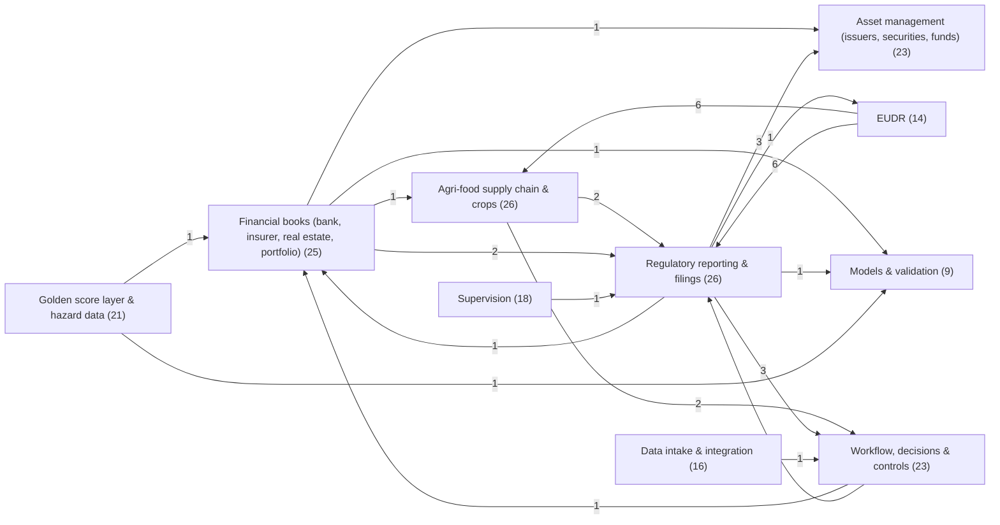

## 2. Tenancy and access control

The tenant table is `organizations`. **123 of the other 262 tables** carry an `org_id` column; 106 of them declare it a foreign key to `organizations`, and in 15 it accepts NULL. Counting every column, **119 tables** hold at least one foreign key to `organizations`; the columns other than `org_id` that do so are `actor_org_id` (1), `provisioned_org_id` (1), `recipient_org_id` (1), `regulator_org_id` (10), `subject_org_id` (3), `supervised_org_id` (6). **0 tables** have row-level security enabled and **0** row-level policies exist (`pg_class.relrowsecurity`, `pg_policies`): the database does not filter rows by tenant itself. How the application scopes reads and writes to the signed-in organisation and checks permissions: [SOFTWARE_DESCRIPTION.md §6](SOFTWARE_DESCRIPTION.md#6-security-multi-tenancy--access-control).

| Domain | Tables | With org_id | org_id → organizations | org_id nullable | Any foreign key → organizations |
|---|---|---|---|---|---|
| Identity & access | 17 | 8 | 5 | 2 | 5 |
| Tenants, onboarding & commercial | 13 | 7 | 6 | 0 | 7 |
| Golden score layer & hazard data | 21 | 1 | 1 | 0 | 1 |
| Hazard events & zones | 5 | 0 | 0 | 0 | 0 |
| Models & validation | 9 | 2 | 1 | 0 | 1 |
| Loss engine | 6 | 1 | 1 | 0 | 1 |
| Financial books (bank, insurer, real estate, portfolio) | 25 | 15 | 13 | 0 | 13 |
| Asset management (issuers, securities, funds) | 23 | 14 | 14 | 5 | 14 |
| EUDR | 14 | 8 | 7 | 0 | 7 |
| Agri-food supply chain & crops | 26 | 6 | 6 | 0 | 6 |
| Regulatory reporting & filings | 26 | 22 | 19 | 1 | 19 |
| Regulatory change monitoring (CRCS) | 7 | 2 | 1 | 1 | 1 |
| Supervision | 18 | 2 | 2 | 0 | 14 |
| Workflow, decisions & controls | 23 | 19 | 19 | 3 | 19 |
| Data intake & integration | 16 | 12 | 9 | 1 | 9 |
| Reference data, FX, settings & audit | 14 | 4 | 2 | 2 | 2 |

Tables whose `org_id` has no foreign key to `organizations` (17): `asset_conflicts`, `asset_observations`, `customer_contract`, `engine_runs`, `entity_source_refs`, `entity_structure_imports`, `ingest_batch_events`, `org_calc_settings_equity_retired_20261001`, `org_calc_settings_retired_20260930`, `org_reporting_settings_retired_20261001`, `refresh_token`, `reg_alert`, `reporting_entities`, `saml_assertion_seen`, `sc_eudr_dds`, `source_systems`, `user_activation`.

Tables whose `org_id` accepts NULL (15): `access_audit_log`, `approval_policy`, `decision_playbook`, `email_outbox`, `fund_sfdr_filings`, `issuer_emissions`, `issuer_esg_metrics`, `issuer_taxonomy_kpi`, `kri_threshold`, `org_calc_settings_equity_retired_20261001`, `org_calc_settings_retired_20260930`, `org_reporting_settings_retired_20261001`, `reference_resolution_log`, `regulatory_change`, `roles`.

Identity and access tables with the tenant table (key columns and their foreign keys):

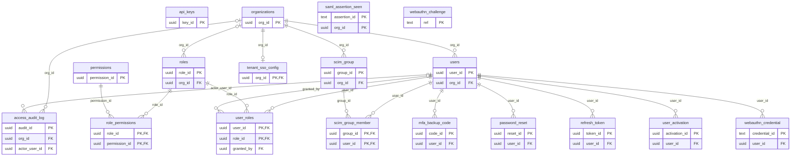

**Permission catalogue** — the 44 rows the migrations insert into `permissions` (roles are per organisation and hold permissions through `role_permissions`):

| Code | Description |
|---|---|
| `admin.approval_policy.manage` | View and edit the approval matrix (which actions need 4-eyes) |
| `admin.audit.view` | View the audit trail |
| `admin.roles.manage` | Edit roles and the permission matrix |
| `admin.users.manage` | Create, edit and disable users |
| `approvals.create` | Submit a maker request for approval |
| `approvals.decide` | Approve or reject a request (checker) |
| `approvals.view` | View the approvals queue |
| `board.attest` | Attest a board climate-risk pack as a named board or committee member |
| `calibration.review` | Tellumen platform operator — decide the publication of a crop calibration (its downside and upside verdicts) recorded by the calibration pipeline |
| `contracts.manage` | Upload, replace and remove customer contracts |
| `contracts.view` | View and download the organization's signed customer contracts |
| `decisions.view` | See and work the Decisions surface (reprice / engage / act) |
| `modules.view` | View and use the analytical modules |
| `onboarding.manage` | Create, review and provision client intakes |
| `ops.oversee` | Operate the control surfaces — Control Tower exceptions and the compliance calendar |
| `oversight.view` | See the Supervisory view — how a regulator will read your data |
| `platform.admin` | Tellumen platform operator — read across all customer tenants |
| `portal.use` | Raise and view service-portal requests |
| `pricing.approve` | Approve a pricing change |
| `pricing.view` | View pricing outputs |
| `reference.release_review` | Tellumen platform operator — review, propose and approve a reference data release (e.g. FAOSTAT crop production) before it lands |
| `reports.publish` | Publish/finalise a disclosure report |
| `reports.view` | View disclosure reports |
| `respondent.portal` | Use the supervisory portal: acknowledge, state attributes, submit templates, answer requests |
| `submissions.release` | Release a regulatory disclosure submission (checker) |
| `supervisor.assignments.manage` | Assign supervised entities to the people who work them |
| `supervisor.benchmark.view` | See peer benchmarks across the supervised population |
| `supervisor.dashboard.view` | See the division-head dashboard |
| `supervisor.deadlines.manage` | Set and publish filing deadlines to the supervised population |
| `supervisor.entity.file` | Open the entity file (exposure, peer position, access history) |
| `supervisor.entity.view` | Open a supervised entity's released filings |
| `supervisor.evidence.export` | Export an evidence pack for a case |
| `supervisor.export` | Export population analyses |
| `supervisor.findings.manage` | Record findings and track remediation |
| `supervisor.intake.manage` | Work the filing intake register |
| `supervisor.mandates.manage` | Enable, adapt and acknowledge regulatory mandates for this authority |
| `supervisor.methodology.view` | See methodology, calibration tiers and model validation evidence |
| `supervisor.population.view` | See the supervised population and its submission status |
| `supervisor.remit` | Remit an evidence pack to another authority, college or committee under a governed share |
| `supervisor.requests.manage` | Raise and track information requests to supervised entities |
| `supervisor.scope.manage` | Add and end the entities this authority supervises |
| `supervisor.sites.view` | See individual sites of an entity that granted site-level access |
| `supervisor.validation.manage` | Run validation / plausibility checks on submissions |
| `supply.locations.write` | Add, edit and delete operational sites and sourcing plots |

## 3. Append-only and guard triggers

50 triggers on 46 tables run a function that raises an exception — it refuses the statement it fires on (the condition is in the function). The message is quoted as the function writes it (`%` is filled in at run time).

| Table | Trigger | Fires | Function | Raises |
|---|---|---|---|---|
| `asset_building_matches` | `trg_asset_building_matches_guard` | BEFORE DELETE OR UPDATE | `public.guard_asset_building_matches` | asset_building_matches is append-only: a new match is a new row; the latest is the highest match_id |
| `asset_observations` | `trg_asset_obs_worm` | BEFORE DELETE OR UPDATE | `public.prevent_asset_observation_mutation` | asset_observations is the history of what each source stated; % is blocked |
| `bank_disclosure_submissions` | `prevent_delete_bank_submissions` | BEFORE DELETE | `public.prevent_submission_mutation` | bank_disclosure_submissions: % submissions are immutable · bank_disclosure_submissions: DELETE is not permitted; reject instead · bank_disclosure_submissions: invalid status transition % -&gt; % · bank_disclosure_submissions: only snapshot/scenario/horizon/approval_request_id may change while draft · bank_disclosure_submissions: rejection requires a checker · bank_disclosure_submissions: release requires a checker distinct from the maker · bank_disclosure_submissions: released_at must be set on release |
| `bank_disclosure_submissions` | `prevent_update_bank_submissions` | BEFORE UPDATE | `public.prevent_submission_mutation` | bank_disclosure_submissions: % submissions are immutable · bank_disclosure_submissions: DELETE is not permitted; reject instead · bank_disclosure_submissions: invalid status transition % -&gt; % · bank_disclosure_submissions: only snapshot/scenario/horizon/approval_request_id may change while draft · bank_disclosure_submissions: rejection requires a checker · bank_disclosure_submissions: release requires a checker distinct from the maker · bank_disclosure_submissions: released_at must be set on release |
| `canonical_scores` | `prevent_delete_canonical_scores` | BEFORE DELETE | `public.prevent_canonical_score_mutation` | canonical_scores is append-only: DELETE is not permitted · canonical_scores is append-only: only setting valid_to (retirement) is permitted · canonical_scores: retired rows are immutable · canonical_scores: score payload is immutable; only valid_to may change |
| `canonical_scores` | `prevent_update_canonical_scores` | BEFORE UPDATE | `public.prevent_canonical_score_mutation` | canonical_scores is append-only: DELETE is not permitted · canonical_scores is append-only: only setting valid_to (retirement) is permitted · canonical_scores: retired rows are immutable · canonical_scores: score payload is immutable; only valid_to may change |
| `crop_calibration_runs` | `trg_crop_calibration_runs_guard` | BEFORE DELETE OR UPDATE | `public.guard_crop_calibration_run` | a calibration run's figures never change — only its status and decision · crop_calibration_runs is append-only: a run is the record of one evaluation |
| `crop_calibration_specs` | `trg_crop_calibration_specs_guard` | BEFORE UPDATE | `public.guard_crop_calibration_spec` | a calibration recipe never changes — a new recipe replaces it (only retirement is set) |
| `crop_release_checks` | `trg_crop_release_checks_append_only` | BEFORE DELETE OR UPDATE | `public.prevent_crop_release_check_mutation` | crop_release_checks is append-only: a check is what the publisher answered at the time |
| `crop_yield_release_rows` | `trg_crop_release_rows_append_only` | BEFORE DELETE OR UPDATE | `public.prevent_crop_release_row_mutation` | crop_yield_release_rows is append-only: a release is the publisher's file as received |
| `csrd_reporting_role` | `trg_csrd_role_worm` | BEFORE DELETE OR UPDATE | `public.prevent_csrd_role_mutation` | csrd_reporting_role is append-only: state the role again |
| `eet_publications` | `trg_eet_publications_guard` | BEFORE DELETE OR UPDATE | `public.eet_publications_guard` | eet_publications is append-only: a prepared EET version never changes · eet_publications is append-only: a published EET is never deleted · eet_publications: a % EET version cannot change status |
| `engine_runs` | `trg_engine_run_worm` | BEFORE DELETE OR UPDATE | `public.prevent_engine_run_mutation` | engine_runs is the record of what a filing was computed from; % is blocked |
| `eudr_concern` | `trg_eudr_concern_worm` | BEFORE DELETE OR UPDATE | `public.prevent_eudr_concern_mutation` | eudr_concern is append-only: record it again |
| `eudr_concern_step` | `trg_eudr_concern_step_worm` | BEFORE DELETE OR UPDATE | `public.prevent_eudr_concern_step_mutation` | eudr_concern_step is append-only: record it again |
| `eudr_dds_event` | `trg_eudr_dds_event_worm` | BEFORE DELETE OR UPDATE | `public.prevent_eudr_dds_event_mutation` | eudr_dds_event is append-only: record it again |
| `eudr_dds_reference` | `trg_eudr_dds_reference_worm` | BEFORE DELETE OR UPDATE | `public.prevent_eudr_dds_reference_mutation` | eudr_dds_reference is append-only: record it again |
| `eudr_declaration_identifier` | `trg_eudr_declaration_identifier_worm` | BEFORE DELETE OR UPDATE | `public.prevent_eudr_declaration_identifier_mutation` | eudr_declaration_identifier is append-only: record it again |
| `eudr_legality_evidence` | `trg_eudr_legality_evidence_worm` | BEFORE DELETE OR UPDATE | `public.prevent_eudr_legality_evidence_mutation` | eudr_legality_evidence is append-only: record it again |
| `eudr_movement` | `trg_eudr_movement_frozen` | BEFORE DELETE OR UPDATE | `public.prevent_filed_movement_change` | movement % is in a statement under review or filed: it cannot change |
| `eudr_movement_plot` | `trg_eudr_movement_plot_frozen` | BEFORE INSERT OR DELETE OR UPDATE | `public.prevent_filed_movement_plot_change` | movement % is in a statement under review or filed: its plots cannot change |
| `eudr_plot_assessment` | `trg_eudr_plot_assessment_worm` | BEFORE DELETE OR UPDATE | `public.prevent_eudr_plot_assessment_mutation` | eudr_plot_assessment is append-only: record it again |
| `eudr_risk_assessment` | `trg_eudr_risk_assessment_worm` | BEFORE DELETE OR UPDATE | `public.prevent_eudr_risk_assessment_mutation` | eudr_risk_assessment is append-only: record it again |
| `eudr_trade_record` | `trg_eudr_trade_record_worm` | BEFORE DELETE OR UPDATE | `public.prevent_eudr_trade_record_mutation` | eudr_trade_record is append-only: record it again |
| `eudr_undertaking_statement` | `trg_eudr_undertaking_statement_worm` | BEFORE DELETE OR UPDATE | `public.prevent_eudr_undertaking_statement_mutation` | eudr_undertaking_statement is append-only: record it again |
| `flood_protection_samples` | `trg_flood_protection_samples_guard` | BEFORE DELETE OR UPDATE | `public.guard_flood_protection_samples` | flood_protection_samples is append-only: a new layer version adds new rows |
| `fx_client_rates` | `trg_fx_client_rates_worm` | BEFORE DELETE OR UPDATE | `public.fx_client_rates_worm` | fx_client_rates is append-only (submit a new rate) — % is blocked |
| `fx_rate_history` | `trg_fx_rate_history_worm` | BEFORE DELETE OR UPDATE | `public.fx_rate_history_worm` | fx_rate_history is append-only — % is blocked |
| `hazard_intensity_samples` | `trg_hazard_intensity_samples_guard` | BEFORE DELETE OR UPDATE | `public.guard_hazard_intensity_samples` | hazard_intensity_samples is append-only: a new layer version adds new rows |
| `ingest_batch_events` | `trg_ingest_event_worm` | BEFORE DELETE OR UPDATE | `public.prevent_ingest_event_mutation` | ingest_batch_events is an append-only history; % is blocked |
| `intake_files` | `trg_intake_file_protect` | BEFORE DELETE OR UPDATE | `public.protect_intake_file` | intake_files identity and inspection results are immutable; only a scan result may be added · intake_files is the evidence of what a customer sent; DELETE is blocked |
| `intake_mapping_profiles` | `trg_mapping_profile_worm` | BEFORE DELETE OR UPDATE | `public.prevent_mapping_profile_mutation` | intake_mapping_profiles are versioned and immutable — save a new version; % is blocked |
| `loss_ep_points` | `trg_loss_ep_points_guard` | BEFORE DELETE OR UPDATE | `public.guard_loss_ep_points` | loss_ep_points is append-only: a curve belongs to its run |
| `loss_results` | `trg_loss_results_guard` | BEFORE DELETE OR UPDATE | `public.guard_loss_results` | loss_results is append-only: results belong to their run |
| `loss_runs` | `trg_loss_runs_guard` | BEFORE DELETE OR UPDATE | `public.guard_loss_runs` | loss_runs is append-only: a loss run is the record of one computation |
| `provided_datapoint` | `trg_provided_closed_period` | BEFORE INSERT | `public.refuse_closed_period_value` | the period ending % is closed for this undertaking: a new value is a restatement and needs its reason |
| `reg_case_message` | `trg_case_msg_worm` | BEFORE DELETE OR UPDATE | `public.prevent_case_message_mutation` | reg_case_message is an append-only correspondence record; % is blocked |
| `regspec_signoff` | `tr_regspec_signoff_worm` | BEFORE DELETE OR UPDATE | `public.regspec_signoff_append_only` | regspec_signoff is append-only |
| `regulatory_filing` | `trg_filing_transition` | BEFORE UPDATE | `public.guard_filing_transition` | filing % has its reference number — it can no longer be rejected (IR 2024/3084 Art. 8(1)) · filing % is % and can only be accepted or superseded, not changed to % · filing % is % — its frozen content cannot change (restate via supersession) · filing % is % — only a draft or returned filing can be withdrawn · filing % is accepted when its declaration identifier is recorded (EUDR → simplified declaration) · filing % is accepted when its reference number is recorded (EUDR → the shipment) · filing % is withdrawn — it cannot change · filing % was used as a reference in a grouping — it can no longer be withdrawn (IR 2024/3084 Art. 4a(7)) |
| `regulatory_filing_event` | `trg_filing_event_worm` | BEFORE DELETE OR UPDATE | `public.prevent_filing_event_mutation` | regulatory_filing_event is an append-only lifecycle log; % is blocked |
| `regulatory_task_event` | `trg_task_event_worm` | BEFORE DELETE OR UPDATE | `public.prevent_task_event_mutation` | regulatory_task_event is append-only; % is blocked |
| `report_snapshots` | `trg_report_snapshot_worm` | BEFORE DELETE OR UPDATE | `public.prevent_report_snapshot_mutation` | report_snapshots is an append-only immutable filing record; % is blocked |
| `reporting_period_close` | `trg_period_close_worm` | BEFORE DELETE OR UPDATE | `public.prevent_period_close_mutation` | reporting_period_close is append-only: a closed period is changed only by restatement |
| `sc_crop_calendar_score` | `prevent_delete_crop_calendar` | BEFORE DELETE | `public.prevent_crop_calendar_mutation` | sc_crop_calendar_score is append-only: DELETE is not permitted · sc_crop_calendar_score is append-only: only setting valid_to (retirement) is permitted · sc_crop_calendar_score: payload is immutable; only valid_to may change · sc_crop_calendar_score: retired rows are immutable |
| `sc_crop_calendar_score` | `prevent_update_crop_calendar` | BEFORE UPDATE | `public.prevent_crop_calendar_mutation` | sc_crop_calendar_score is append-only: DELETE is not permitted · sc_crop_calendar_score is append-only: only setting valid_to (retirement) is permitted · sc_crop_calendar_score: payload is immutable; only valid_to may change · sc_crop_calendar_score: retired rows are immutable |
| `sc_eudr_dds` | `trg_legacy_dds_readonly` | BEFORE INSERT OR DELETE OR UPDATE | `public.prevent_legacy_dds_mutation` | sc_eudr_dds holds statements assembled before the EUDR rebuild: read-only (a statement is now a filing) |
| `site_period_values` | `trg_site_period_values_closed` | BEFORE INSERT | `public.refuse_closed_period_value` | the period ending % is closed for this undertaking: a new value is a restatement and needs its reason |
| `site_period_values` | `trg_site_period_values_worm` | BEFORE DELETE OR UPDATE | `public.prevent_site_period_value_mutation` | site_period_values is append-only: state a new value instead |
| `validation_run` | `trg_validation_run_immutable` | BEFORE DELETE OR UPDATE | `public.prevent_validation_mutation` | validation records are append-only (audit evidence): % on % is not allowed |
| `validation_sample` | `trg_validation_sample_immutable` | BEFORE DELETE OR UPDATE | `public.prevent_validation_mutation` | validation records are append-only (audit evidence): % on % is not allowed |

The other 7 triggers raise nothing (they maintain a column or write history):

| Table | Trigger | Fires | Function |
|---|---|---|---|
| `asset_conflicts` | `trg_asset_conflict_resolved_seq` | BEFORE INSERT OR UPDATE | `public.asset_conflict_resolved_seq` |
| `canonical_scores` | `audit_scores_insert` | AFTER INSERT | `public.audit_canonical_score` |
| `fx_rates` | `trg_fx_rates_history` | BEFORE DELETE OR UPDATE | `public.fx_rates_keep_history` |
| `ingest_batches` | `trg_ingest_batch_imported_seq` | BEFORE INSERT OR UPDATE | `public.ingest_batch_imported_seq` |
| `reg_submission_case` | `trg_case_touch` | BEFORE UPDATE | `public.touch_case_updated` |
| `regulatory_change` | `trg_change_touch` | BEFORE UPDATE | `public.touch_change_updated` |
| `regulatory_task` | `trg_task_touch` | BEFORE UPDATE | `public.touch_task_updated` |

## 4. Tables by domain

### 4.1 Identity & access (17 tables)

```mermaid
erDiagram
  access_audit_log {
    uuid audit_id PK
    uuid org_id FK
    uuid actor_user_id FK
  }
  api_keys {
    uuid key_id PK
  }
  mfa_backup_code {
    uuid code_id PK
    uuid user_id FK
  }
  password_reset {
    uuid reset_id PK
    uuid user_id FK
  }
  permissions {
    uuid permission_id PK
  }
  refresh_token {
    uuid token_id PK
    uuid user_id FK
  }
  role_permissions {
    uuid role_id PK,FK
    uuid permission_id PK,FK
  }
  roles {
    uuid role_id PK
    uuid org_id FK
  }
  saml_assertion_seen {
    text assertion_id PK
    uuid org_id PK
  }
  scim_group {
    uuid group_id PK
    uuid org_id FK
  }
  scim_group_member {
    uuid group_id PK,FK
    uuid user_id PK,FK
  }
  tenant_sso_config {
    uuid org_id PK,FK
  }
  user_activation {
    uuid activation_id PK
    uuid user_id FK
  }
  user_roles {
    uuid user_id PK,FK
    uuid role_id PK,FK
    uuid granted_by FK
  }
  users {
    uuid user_id PK
    uuid org_id FK
  }
  webauthn_challenge {
    text ref PK
  }
  webauthn_credential {
    text credential_id PK
    uuid user_id FK
  }
  users |o--o{ access_audit_log : "actor_user_id"
  users ||--o{ mfa_backup_code : "user_id"
  users ||--o{ password_reset : "user_id"
  users ||--o{ refresh_token : "user_id"
  permissions ||--o{ role_permissions : "permission_id"
  roles ||--o{ role_permissions : "role_id"
  scim_group ||--o{ scim_group_member : "group_id"
  users ||--o{ scim_group_member : "user_id"
  users ||--o{ user_activation : "user_id"
  users |o--o{ user_roles : "granted_by"
  roles ||--o{ user_roles : "role_id"
  users ||--o{ user_roles : "user_id"
  users ||--o{ webauthn_credential : "user_id"
```

5 of these tables reference `organizations` (not drawn).

#### `access_audit_log`

| Column | Type | Null | Default | Key / notes |
|---|---|---|---|---|
| `audit_id` | uuid | no | `gen_random_uuid()` | PK |
| `org_id` | uuid | yes |  | FK → organizations.org_id (on delete set null) |
| `actor_user_id` | uuid | yes |  | FK → users.user_id (on delete set null) |
| `action` | character varying(80) | no |  |  |
| `target_type` | character varying(80) | yes |  |  |
| `target_id` | character varying(120) | yes |  |  |
| `detail` | jsonb | yes |  |  |
| `ip` | character varying(64) | yes |  |  |
| `user_agent` | text | yes |  |  |
| `created_at` | timestamp with time zone | no | `now()` |  |
| `seq` | bigint | no |  | unique; identity (always) |

- Index: `CREATE INDEX ix_access_audit_action ON public.access_audit_log USING btree (action)`
- Index: `CREATE INDEX ix_access_audit_actor ON public.access_audit_log USING btree (actor_user_id)`
- Index: `CREATE INDEX ix_access_audit_log_by_seq ON public.access_audit_log USING btree (org_id, seq)`
- Index: `CREATE INDEX ix_access_audit_org_time ON public.access_audit_log USING btree (org_id, created_at DESC)`

#### `api_keys`

| Column | Type | Null | Default | Key / notes |
|---|---|---|---|---|
| `key_id` | uuid | no |  | PK |
| `customer_id` | uuid | no |  |  |
| `key_hash` | text | no |  | unique |
| `key_prefix` | character varying(12) | no |  |  |
| `name` | text | no |  |  |
| `is_active` | boolean | no | `true` |  |
| `created_at` | timestamp with time zone | no | `now()` |  |
| `last_used_at` | timestamp with time zone | yes |  |  |
| `expires_at` | timestamp with time zone | yes |  |  |

- Index: `CREATE INDEX ix_api_keys_customer_id ON public.api_keys USING btree (customer_id)`
- Index: `CREATE INDEX ix_api_keys_key_hash ON public.api_keys USING btree (key_hash)`

#### `mfa_backup_code`

| Column | Type | Null | Default | Key / notes |
|---|---|---|---|---|
| `code_id` | uuid | no | `gen_random_uuid()` | PK |
| `user_id` | uuid | no |  | FK → users.user_id (on delete cascade) |
| `code_hash` | text | no |  |  |
| `used_at` | timestamp with time zone | yes |  |  |
| `created_at` | timestamp with time zone | no | `now()` |  |

- Index: `CREATE INDEX ix_mfa_backup_user ON public.mfa_backup_code USING btree (user_id)`

#### `password_reset`

| Column | Type | Null | Default | Key / notes |
|---|---|---|---|---|
| `reset_id` | uuid | no | `gen_random_uuid()` | PK |
| `user_id` | uuid | no |  | FK → users.user_id (on delete cascade) |
| `token_hash` | text | no |  |  |
| `status` | character varying(20) | no | `'pending'::character varying` |  |
| `expires_at` | timestamp with time zone | no |  |  |
| `created_at` | timestamp with time zone | no | `now()` |  |
| `used_at` | timestamp with time zone | yes |  |  |

- Check `password_reset_status_check`: `CHECK (((status)::text = ANY ((ARRAY['pending'::character varying, 'used'::character varying, 'expired'::character varying])::text[])))`
- Index: `CREATE INDEX ix_password_reset_token ON public.password_reset USING btree (token_hash)`

#### `permissions`

| Column | Type | Null | Default | Key / notes |
|---|---|---|---|---|
| `permission_id` | uuid | no | `gen_random_uuid()` | PK |
| `code` | character varying(80) | no |  | unique |
| `description` | text | yes |  |  |

#### `refresh_token`

| Column | Type | Null | Default | Key / notes |
|---|---|---|---|---|
| `token_id` | uuid | no | `gen_random_uuid()` | PK |
| `user_id` | uuid | no |  | FK → users.user_id (on delete cascade) |
| `org_id` | uuid | no |  |  |
| `token_hash` | text | no |  |  |
| `status` | character varying(20) | no | `'active'::character varying` |  |
| `replaced_by` | uuid | yes |  |  |
| `user_agent` | text | yes |  |  |
| `ip` | text | yes |  |  |
| `expires_at` | timestamp with time zone | no |  |  |
| `created_at` | timestamp with time zone | no | `now()` |  |
| `last_used_at` | timestamp with time zone | yes |  |  |

- Check `refresh_token_status_check`: `CHECK (((status)::text = ANY ((ARRAY['active'::character varying, 'rotated'::character varying, 'revoked'::character varying])::text[])))`
- Index: `CREATE INDEX ix_refresh_token_hash ON public.refresh_token USING btree (token_hash)`
- Index: `CREATE INDEX ix_refresh_token_user ON public.refresh_token USING btree (user_id)`

#### `role_permissions`

| Column | Type | Null | Default | Key / notes |
|---|---|---|---|---|
| `role_id` | uuid | no |  | PK; FK → roles.role_id (on delete cascade) |
| `permission_id` | uuid | no |  | PK; FK → permissions.permission_id (on delete cascade) |

- Primary key: (role_id, permission_id)

#### `roles`

| Column | Type | Null | Default | Key / notes |
|---|---|---|---|---|
| `role_id` | uuid | no | `gen_random_uuid()` | PK |
| `org_id` | uuid | yes |  | FK → organizations.org_id (on delete cascade) |
| `name` | character varying(50) | no |  |  |
| `description` | text | yes |  |  |
| `is_system` | boolean | no | `false` |  |
| `created_at` | timestamp with time zone | no | `now()` |  |

- Unique `roles_org_id_name_key`: (org_id, name)

#### `saml_assertion_seen`

| Column | Type | Null | Default | Key / notes |
|---|---|---|---|---|
| `assertion_id` | text | no |  | PK |
| `org_id` | uuid | no |  | PK |
| `seen_at` | timestamp with time zone | no | `now()` |  |

- Primary key: (org_id, assertion_id)

#### `scim_group`

| Column | Type | Null | Default | Key / notes |
|---|---|---|---|---|
| `group_id` | uuid | no | `gen_random_uuid()` | PK |
| `org_id` | uuid | no |  | FK → organizations.org_id (on delete cascade) |
| `external_id` | text | yes |  |  |
| `display_name` | text | no |  |  |
| `mapped_role` | character varying(50) | yes |  |  |
| `created_at` | timestamp with time zone | no | `now()` |  |

- Index: `CREATE UNIQUE INDEX ux_scim_group_org_name ON public.scim_group USING btree (org_id, lower(display_name))`

#### `scim_group_member`

| Column | Type | Null | Default | Key / notes |
|---|---|---|---|---|
| `group_id` | uuid | no |  | PK; FK → scim_group.group_id (on delete cascade) |
| `user_id` | uuid | no |  | PK; FK → users.user_id (on delete cascade) |

- Primary key: (group_id, user_id)

#### `tenant_sso_config`

| Column | Type | Null | Default | Key / notes |
|---|---|---|---|---|
| `org_id` | uuid | no |  | PK; FK → organizations.org_id (on delete cascade) |
| `protocol` | character varying(10) | no | `'oidc'::character varying` |  |
| `enabled` | boolean | no | `false` |  |
| `oidc_issuer` | text | yes |  |  |
| `oidc_client_id` | text | yes |  |  |
| `oidc_client_secret` | text | yes |  |  |
| `allowed_email_domain` | character varying(255) | yes |  |  |
| `jit_provisioning` | boolean | no | `true` |  |
| `default_role` | character varying(50) | no | `'viewer'::character varying` |  |
| `scim_enabled` | boolean | no | `false` |  |
| `scim_token_hash` | text | yes |  |  |
| `created_at` | timestamp with time zone | no | `now()` |  |
| `updated_at` | timestamp with time zone | no | `now()` |  |
| `saml_idp_entity_id` | text | yes |  |  |
| `saml_idp_sso_url` | text | yes |  |  |
| `saml_idp_x509_cert` | text | yes |  |  |
| `password_login_disabled` | boolean | no | `false` |  |
| `saml_idp_slo_url` | text | yes |  |  |

- Check `tenant_sso_config_protocol_check`: `CHECK (((protocol)::text = ANY ((ARRAY['oidc'::character varying, 'saml'::character varying])::text[])))`
- Index: `CREATE INDEX ix_tenant_sso_scim_token ON public.tenant_sso_config USING btree (scim_token_hash)`

#### `user_activation`

| Column | Type | Null | Default | Key / notes |
|---|---|---|---|---|
| `activation_id` | uuid | no | `gen_random_uuid()` | PK |
| `user_id` | uuid | no |  | FK → users.user_id (on delete cascade) |
| `org_id` | uuid | no |  |  |
| `token_hash` | text | no |  |  |
| `status` | character varying(20) | no | `'pending'::character varying` |  |
| `expires_at` | timestamp with time zone | no |  |  |
| `created_at` | timestamp with time zone | no | `now()` |  |
| `used_at` | timestamp with time zone | yes |  |  |

- Check `user_activation_status_check`: `CHECK (((status)::text = ANY ((ARRAY['pending'::character varying, 'used'::character varying, 'expired'::character varying])::text[])))`
- Index: `CREATE INDEX ix_user_activation_token ON public.user_activation USING btree (token_hash)`
- Index: `CREATE INDEX ix_user_activation_user ON public.user_activation USING btree (user_id)`

#### `user_roles`

| Column | Type | Null | Default | Key / notes |
|---|---|---|---|---|
| `user_id` | uuid | no |  | PK; FK → users.user_id (on delete cascade) |
| `role_id` | uuid | no |  | PK; FK → roles.role_id (on delete cascade) |
| `granted_at` | timestamp with time zone | no | `now()` |  |
| `granted_by` | uuid | yes |  | FK → users.user_id |

- Primary key: (user_id, role_id)

#### `users`

| Column | Type | Null | Default | Key / notes |
|---|---|---|---|---|
| `user_id` | uuid | no |  | PK |
| `org_id` | uuid | no |  | FK → organizations.org_id (on delete cascade) |
| `email` | character varying(255) | no |  |  |
| `role` | character varying(50) | no |  |  |
| `created_at` | timestamp with time zone | yes | `now()` |  |
| `full_name` | character varying(255) | yes |  |  |
| `hashed_password` | text | yes |  |  |
| `status` | character varying(20) | no | `'active'::character varying` |  |
| `last_login_at` | timestamp with time zone | yes |  |  |
| `mfa_secret` | text | yes |  |  |
| `mfa_enrolled_at` | timestamp with time zone | yes |  |  |
| `external_id` | text | yes |  |  |
| `auth_provider` | character varying(20) | no | `'local'::character varying` |  |
| `failed_login_count` | integer | no | `0` |  |
| `locked_until` | timestamp with time zone | yes |  |  |
| `token_version` | integer | no | `0` |  |

- Unique `users_org_id_email_key`: (org_id, email)
- Check `users_status_check`: `CHECK (((status)::text = ANY ((ARRAY['active'::character varying, 'disabled'::character varying, 'invited'::character varying])::text[])))`
- Index: `CREATE INDEX ix_users_external_id ON public.users USING btree (org_id, external_id)`

#### `webauthn_challenge`

| Column | Type | Null | Default | Key / notes |
|---|---|---|---|---|
| `ref` | text | no |  | PK |
| `challenge` | text | no |  |  |
| `kind` | character varying(20) | no |  |  |
| `expires_at` | timestamp with time zone | no |  |  |
| `created_at` | timestamp with time zone | no | `now()` |  |

#### `webauthn_credential`

| Column | Type | Null | Default | Key / notes |
|---|---|---|---|---|
| `credential_id` | text | no |  | PK |
| `user_id` | uuid | no |  | FK → users.user_id (on delete cascade) |
| `public_key` | bytea | no |  |  |
| `sign_count` | bigint | no | `0` |  |
| `name` | text | yes |  |  |
| `transports` | text | yes |  |  |
| `created_at` | timestamp with time zone | no | `now()` |  |
| `last_used_at` | timestamp with time zone | yes |  |  |

- Index: `CREATE INDEX ix_webauthn_cred_user ON public.webauthn_credential USING btree (user_id)`

### 4.2 Tenants, onboarding & commercial (13 tables)

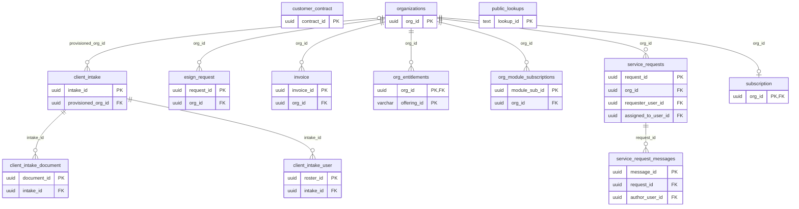

7 of these tables reference `organizations` (not drawn).

Foreign keys to other domains:

| Table | Columns | References | Domain |
|---|---|---|---|
| `service_request_messages` | author_user_id | `users` | Identity & access |
| `service_requests` | assigned_to_user_id | `users` | Identity & access |
| `service_requests` | requester_user_id | `users` | Identity & access |

#### `client_intake`

| Column | Type | Null | Default | Key / notes |
|---|---|---|---|---|
| `intake_id` | uuid | no | `gen_random_uuid()` | PK |
| `company_name` | character varying(255) | no |  |  |
| `org_type` | character varying(50) | no |  |  |
| `country` | character varying(2) | yes |  |  |
| `region` | character varying(20) | no | `'EU'::character varying` |  |
| `legal_name` | character varying(300) | yes |  |  |
| `lei` | character varying(20) | yes |  |  |
| `filing_contact_email` | character varying(200) | yes |  |  |
| `aum_eur` | numeric(18,2) | yes |  |  |
| `employees` | integer | yes |  |  |
| `contact_name` | character varying(255) | yes |  |  |
| `contact_email` | character varying(255) | no |  |  |
| `modules` | jsonb | no | `'[]'::jsonb` |  |
| `status` | character varying(20) | no | `'draft'::character varying` |  |
| `token_hash` | text | yes |  |  |
| `token_expires_at` | timestamp with time zone | yes |  |  |
| `provisioned_org_id` | uuid | yes |  | FK → organizations.org_id (on delete set null) |
| `notes` | text | yes |  |  |
| `created_by` | uuid | yes |  |  |
| `created_at` | timestamp with time zone | no | `now()` |  |
| `submitted_at` | timestamp with time zone | yes |  |  |
| `provisioned_at` | timestamp with time zone | yes |  |  |

- Check `client_intake_status_check`: `CHECK (((status)::text = ANY ((ARRAY['draft'::character varying, 'invited'::character varying, 'submitted'::character varying, 'in_review'::character varying, 'provisioned'::character varying, 'rejected'::character varying])::text[])))`
- Index: `CREATE INDEX ix_client_intake_status ON public.client_intake USING btree (status)`
- Index: `CREATE INDEX ix_client_intake_token ON public.client_intake USING btree (token_hash)`

#### `client_intake_document`

| Column | Type | Null | Default | Key / notes |
|---|---|---|---|---|
| `document_id` | uuid | no | `gen_random_uuid()` | PK |
| `intake_id` | uuid | no |  | FK → client_intake.intake_id (on delete cascade) |
| `kind` | character varying(30) | no | `'other'::character varying` |  |
| `title` | character varying(300) | yes |  |  |
| `filename` | character varying(300) | yes |  |  |
| `content_type` | character varying(120) | yes |  |  |
| `data` | bytea | no |  |  |
| `size_bytes` | integer | no | `0` |  |
| `to_vault` | boolean | no | `false` |  |
| `contract_type` | character varying(30) | yes |  |  |
| `uploaded_at` | timestamp with time zone | no | `now()` |  |

- Index: `CREATE INDEX ix_client_intake_document_intake ON public.client_intake_document USING btree (intake_id)`

#### `client_intake_user`

| Column | Type | Null | Default | Key / notes |
|---|---|---|---|---|
| `roster_id` | uuid | no | `gen_random_uuid()` | PK |
| `intake_id` | uuid | no |  | FK → client_intake.intake_id (on delete cascade) |
| `email` | character varying(255) | no |  |  |
| `full_name` | character varying(255) | yes |  |  |
| `role` | character varying(50) | no | `'viewer'::character varying` |  |
| `created_user_id` | uuid | yes |  |  |
| `created_at` | timestamp with time zone | no | `now()` |  |
| `seq` | bigint | no |  | unique; identity (always) |

- Index: `CREATE INDEX ix_client_intake_user_by_seq ON public.client_intake_user USING btree (intake_id, seq)`
- Index: `CREATE INDEX ix_client_intake_user_intake ON public.client_intake_user USING btree (intake_id)`

#### `customer_contract`

| Column | Type | Null | Default | Key / notes |
|---|---|---|---|---|
| `contract_id` | uuid | no | `gen_random_uuid()` | PK |
| `org_id` | uuid | no |  |  |
| `title` | text | no |  |  |
| `counterparty` | text | yes |  |  |
| `contract_type` | character varying(30) | no | `'other'::character varying` |  |
| `status` | character varying(20) | no | `'active'::character varying` |  |
| `signed_date` | date | yes |  |  |
| `effective_date` | date | yes |  |  |
| `expiry_date` | date | yes |  |  |
| `filename` | text | no |  |  |
| `content_type` | text | yes |  |  |
| `size_bytes` | integer | no | `0` |  |
| `data` | bytea | no |  |  |
| `uploaded_by` | uuid | yes |  |  |
| `created_at` | timestamp with time zone | no | `now()` |  |

- Index: `CREATE INDEX ix_customer_contract_org ON public.customer_contract USING btree (org_id, created_at DESC)`

#### `esign_request`

| Column | Type | Null | Default | Key / notes |
|---|---|---|---|---|
| `request_id` | uuid | no | `gen_random_uuid()` | PK |
| `org_id` | uuid | no |  | FK → organizations.org_id (on delete cascade) |
| `title` | text | no |  |  |
| `signer_email` | text | no |  |  |
| `provider` | character varying(20) | no | `'manual'::character varying` |  |
| `external_id` | text | yes |  |  |
| `status` | character varying(20) | no | `'pending'::character varying` |  |
| `contract_id` | uuid | yes |  |  |
| `created_by` | uuid | yes |  |  |
| `created_at` | timestamp with time zone | no | `now()` |  |
| `completed_at` | timestamp with time zone | yes |  |  |

- Check `esign_request_status_check`: `CHECK (((status)::text = ANY ((ARRAY['pending'::character varying, 'sent'::character varying, 'completed'::character varying, 'declined'::character varying, 'canceled'::character varying])::text[])))`
- Index: `CREATE INDEX ix_esign_org ON public.esign_request USING btree (org_id, created_at DESC)`

#### `invoice`

| Column | Type | Null | Default | Key / notes |
|---|---|---|---|---|
| `invoice_id` | uuid | no | `gen_random_uuid()` | PK |
| `org_id` | uuid | no |  | FK → organizations.org_id (on delete cascade) |
| `number` | character varying(40) | no |  |  |
| `amount_cents` | integer | no | `0` |  |
| `currency` | character varying(3) | no | `'EUR'::character varying` |  |
| `status` | character varying(20) | no | `'open'::character varying` |  |
| `period_start` | timestamp with time zone | yes |  |  |
| `period_end` | timestamp with time zone | yes |  |  |
| `created_at` | timestamp with time zone | no | `now()` |  |
| `paid_at` | timestamp with time zone | yes |  |  |

- Check `invoice_status_check`: `CHECK (((status)::text = ANY ((ARRAY['open'::character varying, 'paid'::character varying, 'void'::character varying])::text[])))`
- Index: `CREATE INDEX ix_invoice_org ON public.invoice USING btree (org_id, created_at DESC)`

#### `org_entitlements`

| Column | Type | Null | Default | Key / notes |
|---|---|---|---|---|
| `org_id` | uuid | no |  | PK; FK → organizations.org_id (on delete cascade) |
| `offering_id` | character varying(50) | no |  | PK |
| `enabled` | boolean | no | `true` |  |

- Primary key: (org_id, offering_id)

#### `org_module_subscriptions`

| Column | Type | Null | Default | Key / notes |
|---|---|---|---|---|
| `module_sub_id` | uuid | no |  | PK |
| `org_id` | uuid | no |  | FK → organizations.org_id (on delete cascade) |
| `module_id` | uuid | no |  |  |
| `module_name` | character varying(255) | yes |  |  |
| `module_description` | text | yes |  |  |
| `annual_module_cost_eur` | numeric(15,2) | yes |  |  |
| `billing_start_date` | date | yes |  |  |
| `billing_end_date` | date | yes |  |  |
| `status` | character varying(50) | yes |  |  |
| `created_at` | timestamp with time zone | yes | `now()` |  |
| `updated_at` | timestamp with time zone | yes | `now()` |  |

- Unique `org_module_subscriptions_org_id_module_id_key`: (org_id, module_id)

#### `organizations`

| Column | Type | Null | Default | Key / notes |
|---|---|---|---|---|
| `org_id` | uuid | no |  | PK |
| `name` | character varying(255) | no |  | unique |
| `type` | character varying(50) | no |  |  |
| `country` | character varying(2) | no |  |  |
| `aum_eur` | numeric(18,2) | yes |  |  |
| `employees` | integer | yes |  |  |
| `created_at` | timestamp with time zone | yes | `now()` |  |
| `updated_at` | timestamp with time zone | yes | `now()` |  |
| `lei` | character varying(20) | yes |  |  |
| `legal_name` | character varying(300) | yes |  |  |
| `filing_contact_email` | character varying(200) | yes |  |  |
| `eori` | character varying | yes |  |  |
| `operator_address` | character varying | yes |  |  |
| `region` | character varying(20) | no | `'EU'::character varying` |  |
| `plan` | character varying(20) | no | `'trial'::character varying` |  |
| `trial_ends_at` | timestamp with time zone | yes |  |  |
| `environment` | character varying(20) | no | `'production'::character varying` |  |

- Check `ck_organizations_country_iso`: `CHECK (((country IS NULL) OR (((country)::text ~ '^[A-Z]{2}$'::text) AND ((country)::text <> ALL ((ARRAY['UK'::character varying, 'EL'::character varying])::text[])))))`

#### `public_lookups`

| Column | Type | Null | Default | Key / notes |
|---|---|---|---|---|
| `lookup_id` | text | no |  | PK |
| `raw_address` | text | yes |  |  |
| `latitude` | numeric(8,5) | no |  |  |
| `longitude` | numeric(8,5) | no |  |  |
| `h3_cell_r8` | character varying(20) | no |  |  |
| `status` | character varying(20) | no | `'computing'::character varying` |  |
| `requested_at` | timestamp with time zone | no | `now()` |  |
| `completed_at` | timestamp with time zone | yes |  |  |
| `hazard_type` | character varying(20) | yes |  |  |

- Index: `CREATE INDEX idx_public_lookups_cell_hazard ON public.public_lookups USING btree (h3_cell_r8, hazard_type, status)`
- Index: `CREATE INDEX idx_public_lookups_h3 ON public.public_lookups USING btree (h3_cell_r8)`
- Index: `CREATE INDEX idx_public_lookups_requested ON public.public_lookups USING btree (requested_at)`

#### `service_request_messages`

| Column | Type | Null | Default | Key / notes |
|---|---|---|---|---|
| `message_id` | uuid | no | `gen_random_uuid()` | PK |
| `request_id` | uuid | no |  | FK → service_requests.request_id (on delete cascade) |
| `author_user_id` | uuid | yes |  | FK → users.user_id (on delete set null) |
| `author_side` | character varying(12) | no |  |  |
| `body` | text | no |  |  |
| `created_at` | timestamp with time zone | no | `now()` |  |

- Check `service_request_messages_author_side_check`: `CHECK (((author_side)::text = ANY ((ARRAY['customer'::character varying, 'support'::character varying])::text[])))`
- Index: `CREATE INDEX ix_srm_request_time ON public.service_request_messages USING btree (request_id, created_at)`

#### `service_requests`

| Column | Type | Null | Default | Key / notes |
|---|---|---|---|---|
| `request_id` | uuid | no | `gen_random_uuid()` | PK |
| `org_id` | uuid | no |  | FK → organizations.org_id (on delete cascade) |
| `requester_user_id` | uuid | yes |  | FK → users.user_id (on delete set null) |
| `category` | character varying(40) | no |  |  |
| `subject` | character varying(200) | no |  |  |
| `body` | text | yes |  |  |
| `priority` | character varying(20) | no | `'normal'::character varying` |  |
| `status` | character varying(20) | no | `'open'::character varying` |  |
| `created_at` | timestamp with time zone | no | `now()` |  |
| `updated_at` | timestamp with time zone | no | `now()` |  |
| `assigned_to_user_id` | uuid | yes |  | FK → users.user_id (on delete set null) |
| `first_response_at` | timestamp with time zone | yes |  |  |
| `resolved_at` | timestamp with time zone | yes |  |  |

- Check `service_requests_priority_check`: `CHECK (((priority)::text = ANY ((ARRAY['low'::character varying, 'normal'::character varying, 'high'::character varying, 'urgent'::character varying])::text[])))`
- Check `service_requests_status_check`: `CHECK (((status)::text = ANY ((ARRAY['open'::character varying, 'in_progress'::character varying, 'resolved'::character varying])::text[])))`
- Index: `CREATE INDEX ix_service_requests_org_status ON public.service_requests USING btree (org_id, status)`

#### `subscription`

| Column | Type | Null | Default | Key / notes |
|---|---|---|---|---|
| `org_id` | uuid | no |  | PK; FK → organizations.org_id (on delete cascade) |
| `plan` | character varying(20) | no | `'trial'::character varying` |  |
| `seats` | integer | no | `5` |  |
| `status` | character varying(20) | no | `'trialing'::character varying` |  |
| `billing_mode` | character varying(20) | no | `'manual'::character varying` |  |
| `current_period_start` | timestamp with time zone | yes |  |  |
| `current_period_end` | timestamp with time zone | yes |  |  |
| `stripe_customer_id` | text | yes |  |  |
| `stripe_subscription_id` | text | yes |  |  |
| `created_at` | timestamp with time zone | no | `now()` |  |
| `updated_at` | timestamp with time zone | no | `now()` |  |

- Check `subscription_status_check`: `CHECK (((status)::text = ANY ((ARRAY['trialing'::character varying, 'active'::character varying, 'past_due'::character varying, 'canceled'::character varying])::text[])))`

### 4.3 Golden score layer & hazard data (21 tables)

```mermaid
erDiagram
  aqueduct_basins {
    uuid load_id PK,FK
    text string_id PK
  }
  aqueduct_loads {
    uuid load_id PK
  }
  canonical_scores {
    uuid score_id PK
    uuid model_id FK
    timestamptz scored_at PK
  }
  climate_risk_scores {
    uuid score_id PK
    uuid org_id FK
    uuid asset_id FK
  }
  climatology_baseline {
    varchar h3_cell PK
    smallint month PK
  }
  coastal_erosion_cell {
    text h3_cell PK
    text rcp PK
    integer year PK
  }
  coastal_exposure {
    varchar h3_cell PK
  }
  frost_baseline {
    varchar h3_cell PK
    integer month PK
  }
  glacial_lake_cell {
    text h3_cell PK
  }
  hazard_relevance {
    text hazard_type PK
    text asset_class PK
    text model_version_prefix PK
  }
  ml_features_drought {
    uuid feature_id PK
    timestamptz observed_at PK
  }
  ml_features_flood {
    uuid feature_id PK
    timestamptz observed_at PK
  }
  ml_features_heat {
    uuid feature_id PK
    timestamptz observed_at PK
  }
  ml_features_wildfire {
    uuid feature_id PK
    timestamptz observed_at PK
  }
  protected_dataset_loads {
    uuid load_id PK
  }
  protected_h3_cell {
    text h3_cell PK
    uuid load_id PK,FK
  }
  satellite_observations {
    uuid observation_id PK
  }
  soil_moisture_baseline {
    varchar h3_cell PK
    integer month PK
  }
  station_extremes {
    text station_id PK
  }
  terrain_cell {
    text h3_cell PK
  }
  tide_gauge_extremes {
    text record_id PK
    integer year PK
    integer month PK
  }
  aqueduct_loads ||--o{ aqueduct_basins : "load_id"
  protected_dataset_loads ||--o{ protected_h3_cell : "load_id"
```

1 of these tables reference `organizations` (not drawn).

Foreign keys to other domains:

| Table | Columns | References | Domain |
|---|---|---|---|
| `canonical_scores` | model_id | `model_registry` | Models & validation |
| `climate_risk_scores` | asset_id | `bank_assets` | Financial books (bank, insurer, real estate, portfolio) |

#### `aqueduct_basins`

| Column | Type | Null | Default | Key / notes |
|---|---|---|---|---|
| `load_id` | uuid | no |  | PK; FK → aqueduct_loads.load_id (on delete cascade) |
| `string_id` | text | no |  | PK |
| `pfaf_id` | bigint | yes |  |  |
| `gid_1` | text | yes |  |  |
| `name_0` | text | yes |  |  |
| `name_1` | text | yes |  |  |
| `bws_raw` | double precision | yes |  |  |
| `bws_cat` | smallint | yes |  |  |
| `bws_label` | text | yes |  |  |
| `bwd_raw` | double precision | yes |  |  |
| `bwd_cat` | smallint | yes |  |  |
| `bwd_label` | text | yes |  |  |
| `minx` | double precision | no |  |  |
| `miny` | double precision | no |  |  |
| `maxx` | double precision | no |  |  |
| `maxy` | double precision | no |  |  |
| `geom_wkb` | bytea | no |  |  |

- Primary key: (load_id, string_id)
- Index: `CREATE INDEX ix_aqueduct_bbox ON public.aqueduct_basins USING btree (load_id, minx, maxx, miny, maxy)`

#### `aqueduct_loads`

| Column | Type | Null | Default | Key / notes |
|---|---|---|---|---|
| `load_id` | uuid | no | `gen_random_uuid()` | PK |
| `version` | text | no |  |  |
| `data_vintage` | date | yes |  |  |
| `source` | text | no |  |  |
| `sha256` | text | yes |  |  |
| `n_basins` | integer | yes |  |  |
| `loaded_at` | timestamp with time zone | no | `now()` |  |
| `retired_at` | timestamp with time zone | yes |  |  |

- Index: `CREATE UNIQUE INDEX ux_aqueduct_load_current ON public.aqueduct_loads USING btree ((true)) WHERE (retired_at IS NULL)`

#### `canonical_scores`

| Column | Type | Null | Default | Key / notes |
|---|---|---|---|---|
| `score_id` | uuid | no | `gen_random_uuid()` | PK |
| `h3_cell` | character varying(20) | no |  |  |
| `h3_resolution` | smallint | no | `'8'::smallint` |  |
| `hazard_type` | character varying(50) | no |  |  |
| `scenario` | character varying(50) | no |  |  |
| `time_horizon` | character varying(20) | no |  |  |
| `risk_score` | numeric(5,2) | no |  |  |
| `risk_bucket` | character varying(5) | no |  |  |
| `risk_nature` | character varying(20) | yes |  |  |
| `model_id` | uuid | yes |  | FK → model_registry.model_id |
| `model_version` | character varying(50) | no |  |  |
| `data_vintage` | timestamp with time zone | no |  |  |
| `shap_factors` | jsonb | yes |  |  |
| `observation_ids` | uuid[] | yes |  |  |
| `valid_from` | timestamp with time zone | no | `now()` |  |
| `valid_to` | timestamp with time zone | yes |  |  |
| `scored_at` | timestamp with time zone | no | `now()` | PK |
| `score_ci_lower` | numeric | yes |  |  |
| `score_ci_upper` | numeric | yes |  |  |
| `score_velocity_6h` | numeric | yes |  |  |
| `score_velocity_24h` | numeric | yes |  |  |
| `score_velocity_48h` | numeric | yes |  |  |
| `ensemble_scores` | jsonb | yes |  |  |
| `compound_flag` | boolean | yes |  |  |
| `regulatory_fingerprint` | text | yes |  |  |
| `score_lane` | character varying(12) | no | `'standing'::character varying` |  |

- Primary key: (score_id, scored_at)
- Check `canonical_scores_score_lane_check`: `CHECK (((score_lane)::text = ANY ((ARRAY['standing'::character varying, 'nowcast'::character varying])::text[])))`
- Check `ck_canonical_hazard_vocab`: `CHECK (((hazard_type)::text = ANY ((ARRAY['flood'::character varying, 'coastal_flood'::character varying, 'heat_acute'::character varying, 'heat_chronic'::character varying, 'wildfire'::character varying, 'drought'::character varying, 'storm'::character varying, 'windstorm'::character varying, 'seismic'::character varying, 'volcanic'::character varying, 'pollution'::character varying, 'frost'::character varying, 'cold_wave'::character varying, 'soil_water'::character varying, 'heavy_precip'::character varying, 'landslide'::character varying, 'temp_variability'::character varying, 'precip_variability'::character varying, 'changing_temp'::character varying, 'changing_precip'::character varying, 'changing_wind'::character varying, 'subsidence'::character varying, 'permafrost'::character varying, 'soil_erosion'::character varying, 'coastal_erosion'::character varying, 'saline_intrusion'::character varying, 'glacial_lake_outburst'::character varying, 'ocean_acidification'::character varying, 'avalanche'::character varying, 'solifluction'::character varying, 'soil_degradation'::character varying, 'severe_convective'::character varying])::text[]))) NOT VALID`
- Check `ck_canonical_horizon_vocab`: `CHECK (((time_horizon)::text = ANY ((ARRAY['current'::character varying, '2030'::character varying, '2050'::character varying, '2100'::character varying])::text[]))) NOT VALID`
- Check `ck_canonical_scenario_vocab`: `CHECK (((scenario)::text = ANY ((ARRAY['baseline'::character varying, 'orderly_1_5c'::character varying, 'disorderly_2c'::character varying, 'hot_house_3_5c'::character varying])::text[]))) NOT VALID`
- Check `ck_risk_score_range`: `CHECK (((risk_score >= (0)::numeric) AND (risk_score <= (100)::numeric)))`
- Index: `CREATE INDEX ix_canonical_scores_cell_scored_at ON public.canonical_scores USING btree (h3_cell, scored_at DESC) WHERE (valid_to IS NULL)`
- Index: `CREATE INDEX ix_canonical_scores_current_scored_at ON public.canonical_scores USING btree (scored_at DESC) WHERE (valid_to IS NULL)`
- Index: `CREATE INDEX ix_canonical_scores_lane_current ON public.canonical_scores USING btree (h3_cell, hazard_type, scenario, time_horizon, score_lane) WHERE (valid_to IS NULL)`
- Index: `CREATE UNIQUE INDEX ux_canonical_active_key ON public.canonical_scores USING btree (h3_cell, hazard_type, scenario, time_horizon, score_lane) WHERE (valid_to IS NULL)`
- Trigger `audit_scores_insert`: AFTER INSERT for each row → `public.audit_canonical_score`
- Trigger `prevent_delete_canonical_scores`: BEFORE DELETE for each row → `public.prevent_canonical_score_mutation`
- Trigger `prevent_update_canonical_scores`: BEFORE UPDATE for each row → `public.prevent_canonical_score_mutation`

#### `climate_risk_scores`

| Column | Type | Null | Default | Key / notes |
|---|---|---|---|---|
| `score_id` | uuid | no |  | PK |
| `org_id` | uuid | no |  | FK → organizations.org_id (on delete cascade) |
| `asset_id` | uuid | no |  | FK → bank_assets.asset_id (on delete cascade) |
| `overall_risk_score` | numeric(5,2) | yes |  |  |
| `physical_risk_score` | numeric(5,2) | yes |  |  |
| `transition_risk_score` | numeric(5,2) | yes |  |  |
| `financial_materiality_score` | numeric(5,2) | yes |  |  |
| `regulatory_risk_score` | numeric(5,2) | yes |  |  |
| `risk_category` | character varying(50) | yes |  |  |
| `confidence_level_pct` | numeric(5,2) | yes |  |  |
| `sensitivity_to_carbon_price` | numeric(5,2) | yes |  |  |
| `sensitivity_to_physical_events` | numeric(5,2) | yes |  |  |
| `assessment_date` | date | yes |  |  |
| `assessment_model_version` | character varying(50) | yes |  |  |
| `created_at` | timestamp with time zone | yes | `now()` |  |

- Unique `climate_risk_scores_org_id_asset_id_assessment_date_key`: (org_id, asset_id, assessment_date)
- Index: `CREATE INDEX idx_risk_scores_org_category ON public.climate_risk_scores USING btree (org_id, risk_category)`

#### `climatology_baseline`

| Column | Type | Null | Default | Key / notes |
|---|---|---|---|---|
| `h3_cell` | character varying(20) | no |  | PK |
| `month` | smallint | no |  | PK |
| `temp_mean_k` | numeric(7,3) | yes |  |  |
| `temp_std_k` | numeric(7,3) | yes |  |  |
| `precip_mean_mm` | numeric(9,3) | yes |  |  |
| `precip_std_mm` | numeric(9,3) | yes |  |  |
| `baseline_period` | character varying(20) | no | `'1991-2020'::character varying` |  |
| `lat` | numeric(8,5) | no |  |  |
| `lon` | numeric(8,5) | no |  |  |
| `computed_at` | timestamp with time zone | no | `now()` |  |

- Primary key: (h3_cell, month)
- Index: `CREATE INDEX idx_climatology_baseline_cell ON public.climatology_baseline USING btree (h3_cell)`
- Index: `CREATE INDEX idx_climatology_baseline_latlon ON public.climatology_baseline USING btree (lat, lon)`

#### `coastal_erosion_cell`

| Column | Type | Null | Default | Key / notes |
|---|---|---|---|---|
| `h3_cell` | text | no |  | PK |
| `rcp` | text | no |  | PK |
| `year` | integer | no |  | PK |
| `retreat_m` | real | no |  |  |
| `data_vintage` | text | yes |  |  |

- Primary key: (h3_cell, rcp, year)

#### `coastal_exposure`

| Column | Type | Null | Default | Key / notes |
|---|---|---|---|---|
| `h3_cell` | character varying | no |  | PK |
| `latitude` | double precision | yes |  |  |
| `longitude` | double precision | yes |  |  |
| `elevation_m` | double precision | yes |  |  |
| `dist_to_coast_km` | double precision | yes |  |  |
| `is_coastal` | boolean | yes |  |  |
| `source` | character varying | yes |  |  |
| `fetched_at` | timestamp with time zone | yes |  |  |
| `subsidence_mm_yr` | double precision | yes |  |  |

#### `frost_baseline`

| Column | Type | Null | Default | Key / notes |
|---|---|---|---|---|
| `h3_cell` | character varying | no |  | PK |
| `month` | integer | no |  | PK |
| `lat` | double precision | no |  |  |
| `lon` | double precision | no |  |  |
| `tmin_mean_c` | double precision | no |  |  |
| `tmin_std_c` | double precision | yes |  |  |
| `coldest_night_c` | double precision | no |  |  |
| `baseline_period` | character varying | no |  |  |
| `computed_at` | timestamp with time zone | no |  |  |

- Primary key: (h3_cell, month)
- Index: `CREATE INDEX idx_frost_baseline_latlon ON public.frost_baseline USING btree (lat, lon)`

#### `glacial_lake_cell`

| Column | Type | Null | Default | Key / notes |
|---|---|---|---|---|
| `h3_cell` | text | no |  | PK |
| `lake_area_km2` | real | no |  |  |
| `lake_elev_m` | real | yes |  |  |
| `dist_km` | real | no |  |  |
| `data_vintage` | text | yes |  |  |

#### `hazard_relevance`

| Column | Type | Null | Default | Key / notes |
|---|---|---|---|---|
| `hazard_type` | text | no |  | PK |
| `asset_class` | text | no |  | PK |
| `headline` | boolean | no |  |  |
| `note` | text | yes |  |  |
| `scale_kind` | text | yes |  |  |
| `model_version_prefix` | text | no | `''::text` | PK |

- Primary key: (hazard_type, asset_class, model_version_prefix)

#### `ml_features_drought`

| Column | Type | Null | Default | Key / notes |
|---|---|---|---|---|
| `feature_id` | uuid | no | `gen_random_uuid()` | PK |
| `h3_cell` | character varying(20) | no |  |  |
| `observed_at` | timestamp with time zone | no |  | PK |
| `spi_3month` | numeric | yes |  |  |
| `spei_3month` | numeric | yes |  |  |
| `soil_moisture_percentile` | numeric | yes |  |  |
| `precipitation_deficit_mm` | numeric | yes |  |  |
| `evapotranspiration_mm` | numeric | yes |  |  |
| `ndvi_index` | numeric | yes |  |  |
| `ndvi_anomaly_vs_baseline` | numeric | yes |  |  |
| `era5_temp_anomaly_c` | numeric | yes |  |  |
| `days_since_significant_rain` | integer | yes |  |  |
| `reservoir_storage_pct` | numeric | yes |  |  |
| `drought_occurred` | boolean | yes |  |  |
| `label_source` | character varying(100) | yes |  |  |
| `created_at` | timestamp with time zone | no | `now()` |  |

- Primary key: (feature_id, observed_at)
- Index: `CREATE INDEX idx_drought_features_cell ON public.ml_features_drought USING btree (h3_cell, observed_at DESC)`

#### `ml_features_flood`

| Column | Type | Null | Default | Key / notes |
|---|---|---|---|---|
| `feature_id` | uuid | no | `gen_random_uuid()` | PK |
| `h3_cell` | character varying(20) | no |  |  |
| `observed_at` | timestamp with time zone | no |  | PK |
| `sar_backscatter_db` | numeric | yes |  |  |
| `backscatter_anomaly_7d` | numeric | yes |  |  |
| `glofas_discharge_m3s` | numeric | yes |  |  |
| `discharge_vs_return_2yr` | numeric | yes |  |  |
| `dem_elevation_m` | numeric | yes |  |  |
| `dem_slope_degrees` | numeric | yes |  |  |
| `distance_to_water_km` | numeric | yes |  |  |
| `soil_saturation_index` | numeric | yes |  |  |
| `precipitation_7d_mm` | numeric | yes |  |  |
| `era5_historical_flood_freq` | numeric | yes |  |  |
| `flood_occurred` | boolean | yes |  |  |
| `label_source` | character varying(100) | yes |  |  |
| `created_at` | timestamp with time zone | no | `now()` |  |

- Primary key: (feature_id, observed_at)

#### `ml_features_heat`

| Column | Type | Null | Default | Key / notes |
|---|---|---|---|---|
| `feature_id` | uuid | no | `gen_random_uuid()` | PK |
| `h3_cell` | character varying(20) | no |  |  |
| `observed_at` | timestamp with time zone | no |  | PK |
| `lst_kelvin` | numeric | yes |  |  |
| `lst_anomaly_vs_baseline` | numeric | yes |  |  |
| `era5_temp_2m_c` | numeric | yes |  |  |
| `era5_temp_30yr_mean` | numeric | yes |  |  |
| `era5_temp_trend_per_decade` | numeric | yes |  |  |
| `urban_heat_island_factor` | numeric | yes |  |  |
| `population_density` | numeric | yes |  |  |
| `days_above_35c_ytd` | integer | yes |  |  |
| `heat_event_occurred` | boolean | yes |  |  |
| `label_source` | character varying(100) | yes |  |  |
| `created_at` | timestamp with time zone | no | `now()` |  |

- Primary key: (feature_id, observed_at)

#### `ml_features_wildfire`

| Column | Type | Null | Default | Key / notes |
|---|---|---|---|---|
| `feature_id` | uuid | no | `gen_random_uuid()` | PK |
| `h3_cell` | character varying(20) | no |  |  |
| `observed_at` | timestamp with time zone | no |  | PK |
| `firms_frp_mw` | numeric | yes |  |  |
| `firms_confidence_pct` | integer | yes |  |  |
| `effis_fire_weather_index` | numeric | yes |  |  |
| `ndvi_index` | numeric | yes |  |  |
| `ndvi_anomaly_vs_baseline` | numeric | yes |  |  |
| `gfs_wind_speed_ms` | numeric | yes |  |  |
| `gfs_relative_humidity_pct` | numeric | yes |  |  |
| `days_since_last_rain` | integer | yes |  |  |
| `fire_occurred` | boolean | yes |  |  |
| `label_source` | character varying(100) | yes |  |  |
| `created_at` | timestamp with time zone | no | `now()` |  |

- Primary key: (feature_id, observed_at)

#### `protected_dataset_loads`

| Column | Type | Null | Default | Key / notes |
|---|---|---|---|---|
| `load_id` | uuid | no | `gen_random_uuid()` | PK |
| `dataset` | text | no |  |  |
| `data_vintage` | date | yes |  |  |
| `source` | text | yes |  |  |
| `n_cells` | integer | yes |  |  |
| `loaded_at` | timestamp with time zone | no | `now()` |  |
| `retired_at` | timestamp with time zone | yes |  |  |

- Index: `CREATE UNIQUE INDEX ux_protected_load_current ON public.protected_dataset_loads USING btree (dataset) WHERE (retired_at IS NULL)`

#### `protected_h3_cell`

| Column | Type | Null | Default | Key / notes |
|---|---|---|---|---|
| `h3_cell` | text | no |  | PK |
| `h3_res` | smallint | no | `8` |  |
| `dataset` | text | no | `'natura2000'::text` |  |
| `within_km` | double precision | no | `0` |  |
| `site_ref` | text | yes |  |  |
| `data_vintage` | date | yes |  |  |
| `load_id` | uuid | no |  | PK; FK → protected_dataset_loads.load_id (on delete cascade) |

- Primary key: (load_id, h3_cell)
- Index: `CREATE INDEX ix_protected_h3_cell ON public.protected_h3_cell USING btree (h3_cell)`
- Index: `CREATE INDEX ix_protected_h3_dataset ON public.protected_h3_cell USING btree (dataset)`

#### `satellite_observations`

| Column | Type | Null | Default | Key / notes |
|---|---|---|---|---|
| `observation_id` | uuid | no | `gen_random_uuid()` | PK |
| `h3_cell` | character varying(20) | no |  |  |
| `h3_resolution` | smallint | no | `'8'::smallint` |  |
| `source_provider` | character varying(100) | no |  |  |
| `hazard_type` | character varying(50) | no |  |  |
| `observed_at` | timestamp with time zone | no |  |  |
| `ingested_at` | timestamp with time zone | no | `now()` |  |
| `raw_value` | numeric | yes |  |  |
| `raw_unit` | character varying(50) | yes |  |  |
| `quality_flag` | smallint | no | `'0'::smallint` |  |
| `quality_notes` | text | yes |  |  |
| `cog_uri` | text | yes |  |  |
| `adapter_version` | character varying(50) | no |  |  |

- Check `ck_obs_hazard_vocab`: `CHECK (((hazard_type)::text = ANY ((ARRAY['flood'::character varying, 'coastal_flood'::character varying, 'heat_acute'::character varying, 'heat_chronic'::character varying, 'wildfire'::character varying, 'drought'::character varying, 'storm'::character varying, 'windstorm'::character varying, 'seismic'::character varying, 'volcanic'::character varying, 'pollution'::character varying, 'frost'::character varying, 'cold_wave'::character varying, 'soil_water'::character varying, 'heavy_precip'::character varying, 'landslide'::character varying, 'temp_variability'::character varying, 'precip_variability'::character varying, 'changing_temp'::character varying, 'changing_precip'::character varying, 'changing_wind'::character varying, 'subsidence'::character varying, 'permafrost'::character varying, 'soil_erosion'::character varying, 'coastal_erosion'::character varying, 'saline_intrusion'::character varying, 'glacial_lake_outburst'::character varying, 'ocean_acidification'::character varying, 'avalanche'::character varying, 'solifluction'::character varying, 'soil_degradation'::character varying, 'severe_convective'::character varying])::text[]))) NOT VALID`

#### `soil_moisture_baseline`

| Column | Type | Null | Default | Key / notes |
|---|---|---|---|---|
| `h3_cell` | character varying | no |  | PK |
| `month` | integer | no |  | PK |
| `lat` | double precision | no |  |  |
| `lon` | double precision | no |  |  |
| `sm_mean` | double precision | no |  |  |
| `sm_std` | double precision | yes |  |  |
| `baseline_period` | character varying | no |  |  |
| `computed_at` | timestamp with time zone | no |  |  |

- Primary key: (h3_cell, month)
- Index: `CREATE INDEX idx_soil_moisture_baseline_latlon ON public.soil_moisture_baseline USING btree (lat, lon)`

#### `station_extremes`

| Column | Type | Null | Default | Key / notes |
|---|---|---|---|---|
| `station_id` | text | no |  | PK |
| `name` | text | yes |  |  |
| `region` | text | no |  |  |
| `latitude` | double precision | no |  |  |
| `longitude` | double precision | no |  |  |
| `h3_cell` | text | no |  |  |
| `n_years` | integer | no |  |  |
| `coldest_1in10_c` | double precision | yes |  |  |
| `design_c` | double precision | yes |  |  |
| `tmax_annual_max_c` | double precision | yes |  |  |
| `hot_days_per_yr` | double precision | yes |  |  |
| `prcp_1day_max_mm` | double precision | yes |  |  |
| `prcp_p99_mm` | double precision | yes |  |  |
| `source` | text | no |  |  |
| `fetched_at` | timestamp with time zone | no | `now()` |  |

#### `terrain_cell`

| Column | Type | Null | Default | Key / notes |
|---|---|---|---|---|
| `h3_cell` | text | no |  | PK |
| `slope_deg` | real | no |  |  |
| `elevation_m` | real | no |  |  |

#### `tide_gauge_extremes`

| Column | Type | Null | Default | Key / notes |
|---|---|---|---|---|
| `record_id` | text | no |  | PK |
| `station_name` | text | yes |  |  |
| `country` | text | yes |  |  |
| `agency` | text | yes |  |  |
| `lat` | double precision | no |  |  |
| `lon` | double precision | no |  |  |
| `year` | integer | no |  | PK |
| `month` | integer | no |  | PK |
| `max_m` | double precision | no |  |  |
| `mean_m` | double precision | no |  |  |
| `dist_to_coast_km` | double precision | yes |  |  |

- Primary key: (record_id, year, month)
- Index: `CREATE INDEX ix_tide_gauge_extremes_latlon ON public.tide_gauge_extremes USING btree (lat, lon)`

### 4.4 Hazard events & zones (5 tables)

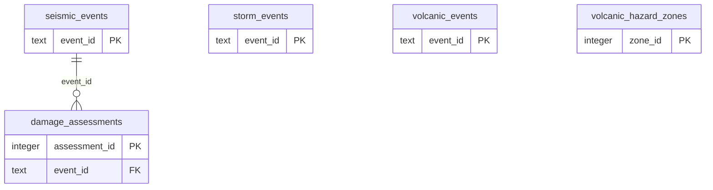

#### `damage_assessments`

| Column | Type | Null | Default | Key / notes |
|---|---|---|---|---|
| `assessment_id` | integer | no |  | PK; identity (always) |
| `event_id` | text | no |  | FK → seismic_events.event_id (on delete cascade) |
| `h3_cell` | character varying(20) | no |  |  |
| `damage_probability` | numeric(5,4) | no |  |  |
| `log_ratio_db` | numeric(8,4) | yes |  |  |
| `confidence` | character varying(10) | yes |  |  |
| `distance_km` | numeric(7,2) | yes |  |  |
| `method` | character varying(50) | yes |  |  |
| `pre_pass_time` | timestamp with time zone | yes |  |  |
| `post_pass_time` | timestamp with time zone | yes |  |  |
| `assessed_at` | timestamp with time zone | no | `now()` |  |

- Unique `uq_damage_event_cell`: (event_id, h3_cell)
- Index: `CREATE INDEX idx_damage_cell ON public.damage_assessments USING btree (h3_cell)`
- Index: `CREATE INDEX idx_damage_event ON public.damage_assessments USING btree (event_id)`
- Index: `CREATE INDEX idx_damage_probability ON public.damage_assessments USING btree (damage_probability)`

#### `seismic_events`

| Column | Type | Null | Default | Key / notes |
|---|---|---|---|---|
| `event_id` | text | no |  | PK |
| `magnitude` | numeric(4,2) | no |  |  |
| `mag_type` | character varying(10) | yes |  |  |
| `depth_km` | numeric(7,2) | yes |  |  |
| `epicentre_lat` | numeric(8,5) | no |  |  |
| `epicentre_lon` | numeric(8,5) | no |  |  |
| `epicentre_h3` | character varying(20) | yes |  |  |
| `origin_time` | timestamp with time zone | no |  |  |
| `region_name` | text | yes |  |  |
| `source_catalog` | character varying(50) | yes |  |  |
| `review_status` | character varying(20) | yes |  |  |
| `ingested_at` | timestamp with time zone | no | `now()` |  |
| `damage_assessment_status` | character varying(30) | yes |  |  |

- Index: `CREATE INDEX idx_seismic_events_epicentre ON public.seismic_events USING btree (epicentre_h3)`
- Index: `CREATE INDEX idx_seismic_events_magnitude ON public.seismic_events USING btree (magnitude)`
- Index: `CREATE INDEX idx_seismic_events_origin ON public.seismic_events USING btree (origin_time)`

#### `storm_events`

| Column | Type | Null | Default | Key / notes |
|---|---|---|---|---|
| `event_id` | text | no |  | PK |
| `storm_id` | character varying(20) | no |  |  |
| `storm_name` | text | no |  |  |
| `season_year` | integer | yes |  |  |
| `basin` | character varying(4) | yes |  |  |
| `observation_time` | timestamp with time zone | no |  |  |
| `lat` | numeric(8,5) | no |  |  |
| `lon` | numeric(8,5) | no |  |  |
| `h3_cell` | character varying(20) | yes |  |  |
| `max_wind_kt` | numeric(6,2) | yes |  |  |
| `central_pressure_mb` | numeric(7,2) | yes |  |  |
| `rmw_km` | numeric(7,2) | yes |  |  |
| `sshs_category` | smallint | yes |  |  |
| `source_catalog` | character varying(50) | yes |  |  |
| `ingested_at` | timestamp with time zone | no | `now()` |  |

- Index: `CREATE INDEX idx_storm_events_h3 ON public.storm_events USING btree (h3_cell)`
- Index: `CREATE INDEX idx_storm_events_latlon ON public.storm_events USING btree (lat, lon)`
- Index: `CREATE INDEX idx_storm_events_storm ON public.storm_events USING btree (storm_id)`
- Index: `CREATE INDEX idx_storm_events_time ON public.storm_events USING btree (observation_time)`

#### `volcanic_events`

| Column | Type | Null | Default | Key / notes |
|---|---|---|---|---|
| `event_id` | text | no |  | PK |
| `volcano_number` | integer | no |  |  |
| `volcano_name` | text | no |  |  |
| `vei` | smallint | yes |  |  |
| `activity_type` | character varying(20) | yes |  |  |
| `start_year` | integer | yes |  |  |
| `start_month` | smallint | yes |  |  |
| `start_day` | smallint | yes |  |  |
| `end_year` | integer | yes |  |  |
| `end_month` | smallint | yes |  |  |
| `end_day` | smallint | yes |  |  |
| `epicentre_lat` | numeric(8,5) | no |  |  |
| `epicentre_lon` | numeric(8,5) | no |  |  |
| `epicentre_h3` | character varying(20) | yes |  |  |
| `source_catalog` | character varying(50) | yes |  |  |
| `ingested_at` | timestamp with time zone | no | `now()` |  |

- Index: `CREATE INDEX idx_volcanic_events_epicentre ON public.volcanic_events USING btree (epicentre_h3)`
- Index: `CREATE INDEX idx_volcanic_events_start_year ON public.volcanic_events USING btree (start_year)`
- Index: `CREATE INDEX idx_volcanic_events_volcano ON public.volcanic_events USING btree (volcano_number)`

#### `volcanic_hazard_zones`

| Column | Type | Null | Default | Key / notes |
|---|---|---|---|---|
| `zone_id` | integer | no |  | PK; identity (always) |
| `volcano_number` | integer | no |  |  |
| `volcano_name` | text | no |  |  |
| `zone_type` | character varying(20) | no |  |  |
| `radius_km` | numeric(6,2) | no |  |  |
| `vei_reference` | smallint | yes |  |  |
| `source` | character varying(30) | no |  |  |
| `notes` | text | yes |  |  |
| `created_at` | timestamp with time zone | no | `now()` |  |

- Unique `uq_volcanic_zone_volcano_type`: (volcano_number, zone_type)
- Index: `CREATE INDEX idx_volcanic_zones_volcano ON public.volcanic_hazard_zones USING btree (volcano_number)`

### 4.5 Models & validation (9 tables)

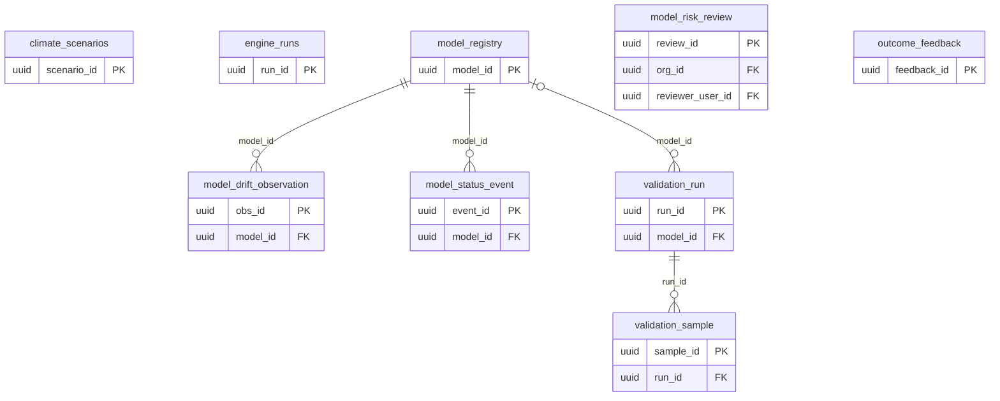

1 of these tables reference `organizations` (not drawn).

Foreign keys to other domains:

| Table | Columns | References | Domain |
|---|---|---|---|
| `model_risk_review` | reviewer_user_id | `users` | Identity & access |

#### `climate_scenarios`

| Column | Type | Null | Default | Key / notes |
|---|---|---|---|---|
| `scenario_id` | uuid | no |  | PK |
| `scenario_name` | character varying(100) | no |  |  |
| `pathway` | character varying(20) | no |  | unique |
| `temperature_increase_celsius` | numeric(5,2) | yes |  |  |
| `carbon_price_eur_per_ton_2030` | numeric(10,2) | yes |  |  |
| `carbon_price_eur_per_ton_2050` | numeric(10,2) | yes |  |  |
| `renewable_energy_cost_decline_pct_2030` | numeric(5,2) | yes |  |  |
| `electric_vehicle_adoption_pct_2030` | numeric(5,2) | yes |  |  |
| `energy_efficiency_improvement_pct` | numeric(5,2) | yes |  |  |
| `short_term_year` | integer | yes |  |  |
| `medium_term_year` | integer | yes |  |  |
| `long_term_year` | integer | yes |  |  |
| `scenario_source` | character varying(100) | yes |  |  |
| `baseline_year` | integer | yes |  |  |
| `created_at` | timestamp with time zone | yes | `now()` |  |

#### `engine_runs`

| Column | Type | Null | Default | Key / notes |
|---|---|---|---|---|
| `run_id` | uuid | no | `gen_random_uuid()` | PK |
| `org_id` | uuid | no |  |  |
| `report_type` | text | no |  |  |
| `purpose` | text | no |  |  |
| `entity_ids` | jsonb | yes |  |  |
| `view` | text | no | `'joint'::text` |  |
| `basis` | jsonb | no |  |  |
| `inputs` | jsonb | no |  |  |
| `inputs_sha256` | text | no |  |  |
| `outputs` | jsonb | no |  |  |
| `checks` | jsonb | no |  |  |
| `status` | text | no |  |  |
| `created_by` | uuid | yes |  |  |
| `created_at` | timestamp with time zone | no | `now()` |  |

- Check `ck_engine_run_status`: `CHECK ((status = ANY (ARRAY['pass'::text, 'warn'::text])))`
- Index: `CREATE INDEX ix_engine_runs_org ON public.engine_runs USING btree (org_id, report_type, created_at DESC)`
- Trigger `trg_engine_run_worm`: BEFORE DELETE OR UPDATE for each row → `public.prevent_engine_run_mutation`

#### `model_drift_observation`

| Column | Type | Null | Default | Key / notes |
|---|---|---|---|---|
| `obs_id` | uuid | no | `gen_random_uuid()` | PK |
| `model_id` | uuid | no |  | FK → model_registry.model_id |
| `hazard_type` | character varying(50) | no |  |  |
| `kind` | character varying(20) | no |  |  |
| `metric` | character varying(40) | no |  |  |
| `value` | numeric(10,5) | no |  |  |
| `threshold` | numeric(10,5) | yes |  |  |
| `breached` | boolean | no | `false` |  |
| `drift_window` | character varying(40) | yes |  |  |
| `note` | text | yes |  |  |
| `created_at` | timestamp with time zone | no | `now()` |  |
| `seq` | bigint | no |  | unique; identity (always) |

- Index: `CREATE INDEX ix_model_drift_hazard ON public.model_drift_observation USING btree (hazard_type, created_at)`
- Index: `CREATE INDEX ix_model_drift_observation_by_seq ON public.model_drift_observation USING btree (hazard_type, seq)`

#### `model_registry`

| Column | Type | Null | Default | Key / notes |
|---|---|---|---|---|
| `model_id` | uuid | no |  | PK |
| `model_version` | character varying(50) | no |  | unique |
| `hazard_type` | character varying(50) | no |  |  |
| `algorithm` | character varying(100) | no |  |  |
| `training_data_vintage` | date | no |  |  |
| `training_cell_count` | integer | yes |  |  |
| `validation_auc` | numeric(4,3) | yes |  |  |
| `is_active` | boolean | no | `false` |  |
| `activated_at` | timestamp with time zone | yes |  |  |
| `activated_by` | character varying(255) | yes |  |  |
| `created_at` | timestamp with time zone | no | `now()` |  |
| `validation_avg_precision` | numeric(6,5) | yes |  |  |
| `validation_note` | text | yes |  |  |
| `lifecycle_status` | character varying(20) | no | `'candidate'::character varying` |  |
| `r2_oos` | numeric(5,4) | yes |  |  |
| `calibration_note` | text | yes |  |  |
| `approved_at` | timestamp with time zone | yes |  |  |
| `approved_by` | character varying(255) | yes |  |  |
| `retired_at` | timestamp with time zone | yes |  |  |
| `superseded_by` | uuid | yes |  |  |
| `seq` | bigint | no |  | unique; identity (always) |

- Index: `CREATE INDEX ix_model_registry_by_seq ON public.model_registry USING btree (hazard_type, seq)`

#### `model_risk_review`

| Column | Type | Null | Default | Key / notes |
|---|---|---|---|---|
| `review_id` | uuid | no | `gen_random_uuid()` | PK |
| `org_id` | uuid | no |  | FK → organizations.org_id (on delete cascade) |
| `model_ref` | text | no |  |  |
| `reviewer_user_id` | uuid | no |  | FK → users.user_id |
| `conclusion` | text | no |  |  |
| `comment` | text | yes |  |  |
| `evidence_sha256` | text | no |  |  |
| `next_review_by` | date | yes |  |  |
| `reviewed_at` | timestamp with time zone | no | `now()` |  |
| `seq` | bigint | no |  | unique; identity (always) |

- Index: `CREATE INDEX ix_model_risk_review ON public.model_risk_review USING btree (org_id, model_ref, reviewed_at DESC)`
- Index: `CREATE INDEX ix_model_risk_review_seq ON public.model_risk_review USING btree (org_id, model_ref, seq DESC)`

#### `model_status_event`

| Column | Type | Null | Default | Key / notes |
|---|---|---|---|---|
| `event_id` | uuid | no | `gen_random_uuid()` | PK |
| `model_id` | uuid | no |  | FK → model_registry.model_id |
| `hazard_type` | character varying(50) | no |  |  |
| `from_status` | character varying(20) | yes |  |  |
| `to_status` | character varying(20) | no |  |  |
| `actor` | character varying(255) | yes |  |  |
| `reason` | text | yes |  |  |
| `r2_oos` | numeric(5,4) | yes |  |  |
| `created_at` | timestamp with time zone | no | `now()` |  |
| `seq` | bigint | no |  | unique; identity (always) |

- Index: `CREATE INDEX ix_model_status_event_by_seq ON public.model_status_event USING btree (model_id, seq)`
- Index: `CREATE INDEX ix_model_status_event_model ON public.model_status_event USING btree (model_id, created_at)`

#### `outcome_feedback`

| Column | Type | Null | Default | Key / notes |
|---|---|---|---|---|
| `feedback_id` | uuid | no | `gen_random_uuid()` | PK |
| `score_id` | uuid | no |  |  |
| `h3_cell` | character varying(20) | no |  |  |
| `hazard_type` | character varying(50) | no |  |  |
| `predicted_score` | numeric(5,2) | no |  |  |
| `predicted_bucket` | character varying(5) | no |  |  |
| `event_occurred` | boolean | no |  |  |
| `confirmed_intensity` | numeric | yes |  |  |
| `intensity_unit` | character varying(50) | yes |  |  |
| `outcome_source` | character varying(100) | no |  |  |
| `outcome_observed_at` | timestamp with time zone | no |  |  |
| `prediction_lead_days` | integer | yes |  |  |
| `recorded_at` | timestamp with time zone | no | `now()` |  |

#### `validation_run`

| Column | Type | Null | Default | Key / notes |
|---|---|---|---|---|
| `run_id` | uuid | no | `gen_random_uuid()` | PK |
| `model_id` | uuid | yes |  | FK → model_registry.model_id |
| `hazard_type` | character varying(50) | no |  |  |
| `scope` | character varying(80) | yes |  |  |
| `horizon` | character varying(20) | yes |  |  |
| `kind` | character varying(20) | no |  |  |
| `method` | character varying(30) | no |  |  |
| `target_source` | character varying(120) | no |  |  |
| `n_samples` | integer | no |  |  |
| `metrics` | jsonb | no |  |  |
| `skill_grade` | character varying(20) | no |  |  |
| `passed_gate` | boolean | no |  |  |
| `gate` | character varying(60) | yes |  |  |
| `notes` | text | yes |  |  |
| `code_version` | character varying(60) | yes |  |  |
| `data_vintage` | character varying(60) | yes |  |  |
| `created_by` | character varying(255) | yes |  |  |
| `created_at` | timestamp with time zone | no | `now()` |  |
| `seq` | bigint | no |  | unique; identity (always) |

- Index: `CREATE INDEX ix_validation_run_hazard ON public.validation_run USING btree (hazard_type, created_at)`
- Index: `CREATE INDEX ix_validation_run_hazard_seq ON public.validation_run USING btree (hazard_type, seq DESC)`
- Trigger `trg_validation_run_immutable`: BEFORE DELETE OR UPDATE for each row → `public.prevent_validation_mutation`

#### `validation_sample`

| Column | Type | Null | Default | Key / notes |
|---|---|---|---|---|
| `sample_id` | uuid | no | `gen_random_uuid()` | PK |
| `run_id` | uuid | no |  | FK → validation_run.run_id |
| `label` | character varying(120) | yes |  |  |
| `predicted` | numeric(12,4) | yes |  |  |
| `observed` | numeric(12,4) | yes |  |  |
| `meta` | jsonb | yes |  |  |

- Index: `CREATE INDEX ix_validation_sample_run ON public.validation_sample USING btree (run_id)`
- Trigger `trg_validation_sample_immutable`: BEFORE DELETE OR UPDATE for each row → `public.prevent_validation_mutation`

### 4.6 Loss engine (6 tables)

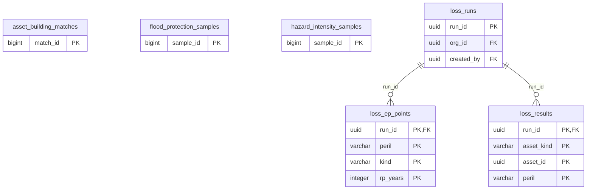

1 of these tables reference `organizations` (not drawn).

Foreign keys to other domains:

| Table | Columns | References | Domain |
|---|---|---|---|
| `loss_runs` | created_by | `users` | Identity & access |

#### `asset_building_matches`

| Column | Type | Null | Default | Key / notes |
|---|---|---|---|---|
| `match_id` | bigint | no |  | PK; identity (always) |
| `asset_kind` | character varying(20) | no |  |  |
| `asset_id` | uuid | no |  |  |
| `source_key` | character varying(64) | no |  |  |
| `source_version` | character varying(40) | no |  |  |
| `status` | character varying(20) | no |  |  |
| `building_ref` | text | yes |  |  |
| `footprint_area_m2` | double precision | yes |  |  |
| `height_m` | double precision | yes |  |  |
| `distance_m` | double precision | yes |  |  |
| `matched_at` | timestamp with time zone | no | `now()` |  |

- Check `asset_building_matches_asset_kind_check`: `CHECK (((asset_kind)::text = ANY ((ARRAY['portfolio_entity'::character varying, 'company_site'::character varying])::text[])))`
- Check `asset_building_matches_check`: `CHECK ((((status)::text = 'matched'::text) = ((building_ref IS NOT NULL) AND (footprint_area_m2 IS NOT NULL) AND (distance_m IS NOT NULL))))`
- Check `asset_building_matches_distance_m_check`: `CHECK ((distance_m >= (0)::double precision))`
- Check `asset_building_matches_footprint_area_m2_check`: `CHECK ((footprint_area_m2 > (0)::double precision))`
- Check `asset_building_matches_height_m_check`: `CHECK ((height_m > (0)::double precision))`
- Check `asset_building_matches_status_check`: `CHECK (((status)::text = ANY ((ARRAY['matched'::character varying, 'no_building'::character varying, 'outside_coverage'::character varying])::text[])))`
- Index: `CREATE INDEX ix_asset_building_matches_asset ON public.asset_building_matches USING btree (asset_kind, asset_id, match_id)`
- Trigger `trg_asset_building_matches_guard`: BEFORE DELETE OR UPDATE for each row → `public.guard_asset_building_matches`

#### `flood_protection_samples`

| Column | Type | Null | Default | Key / notes |
|---|---|---|---|---|
| `sample_id` | bigint | no |  | PK; identity (always) |
| `layer_key` | character varying(64) | no |  |  |
| `layer_version` | character varying(40) | no |  |  |
| `latitude` | double precision | no |  |  |
| `longitude` | double precision | no |  |  |
| `status` | character varying(16) | no |  |  |
| `design_rp_years` | double precision | yes |  |  |
| `sampled_at` | timestamp with time zone | no | `now()` |  |
| `design_rp_high_years` | double precision | yes |  |  |

- Check `flood_protection_samples_check`: `CHECK ((((status)::text = 'sampled'::text) = (design_rp_years IS NOT NULL)))`
- Check `flood_protection_samples_design_rp_years_check`: `CHECK ((design_rp_years >= (1)::double precision))`
- Check `flood_protection_samples_latitude_check`: `CHECK (((latitude >= ('-90'::integer)::double precision) AND (latitude <= (90)::double precision)))`
- Check `flood_protection_samples_longitude_check`: `CHECK (((longitude >= ('-180'::integer)::double precision) AND (longitude <= (180)::double precision)))`
- Check `flood_protection_samples_range`: `CHECK (((design_rp_high_years IS NULL) OR (((status)::text = 'sampled'::text) AND (design_rp_high_years > design_rp_years))))`
- Check `flood_protection_samples_status_check`: `CHECK (((status)::text = ANY ((ARRAY['sampled'::character varying, 'no_value'::character varying, 'outside_coverage'::character varying, 'not_a_level'::character varying])::text[])))`
- Index: `CREATE UNIQUE INDEX ux_flood_protection_sample ON public.flood_protection_samples USING btree (layer_key, layer_version, latitude, longitude)`
- Trigger `trg_flood_protection_samples_guard`: BEFORE DELETE OR UPDATE for each row → `public.guard_flood_protection_samples`

#### `hazard_intensity_samples`

| Column | Type | Null | Default | Key / notes |
|---|---|---|---|---|
| `sample_id` | bigint | no |  | PK; identity (always) |
| `layer_key` | character varying(64) | no |  |  |
| `layer_version` | character varying(40) | no |  |  |
| `latitude` | double precision | no |  |  |
| `longitude` | double precision | no |  |  |
| `h3_cell` | character varying(20) | no |  |  |
| `rp_years` | integer | no |  |  |
| `status` | character varying(16) | no |  |  |
| `value` | double precision | yes |  |  |
| `cell_fraction` | double precision | yes |  |  |
| `cell_mean` | double precision | yes |  |  |
| `sampled_at` | timestamp with time zone | no | `now()` |  |
| `scenario` | character varying(20) | no | `'present'::character varying` |  |
| `period` | character varying(12) | no | `'present'::character varying` |  |
| `climate_model` | character varying(40) | no | `''::character varying` |  |
| `caution` | text | yes |  |  |

- Check `hazard_intensity_samples_cell_fraction_check`: `CHECK (((cell_fraction >= (0)::double precision) AND (cell_fraction <= (1)::double precision)))`
- Check `hazard_intensity_samples_cell_mean_check`: `CHECK ((cell_mean >= (0)::double precision))`
- Check `hazard_intensity_samples_check`: `CHECK ((((status)::text = 'sampled'::text) = (value IS NOT NULL)))`
- Check `hazard_intensity_samples_check1`: `CHECK ((((status)::text = 'sampled'::text) OR ((cell_fraction IS NULL) AND (cell_mean IS NULL))))`
- Check `hazard_intensity_samples_latitude_check`: `CHECK (((latitude >= ('-90'::integer)::double precision) AND (latitude <= (90)::double precision)))`
- Check `hazard_intensity_samples_longitude_check`: `CHECK (((longitude >= ('-180'::integer)::double precision) AND (longitude <= (180)::double precision)))`
- Check `hazard_intensity_samples_rp_years_check`: `CHECK ((rp_years > 1))`
- Check `hazard_intensity_samples_status_check`: `CHECK (((status)::text = ANY ((ARRAY['sampled'::character varying, 'outside_coverage'::character varying])::text[])))`
- Check `hazard_intensity_samples_value_check`: `CHECK ((value >= (0)::double precision))`
- Index: `CREATE INDEX ix_hazard_intensity_cell ON public.hazard_intensity_samples USING btree (h3_cell, layer_key, layer_version)`
- Index: `CREATE UNIQUE INDEX ux_hazard_intensity_sample ON public.hazard_intensity_samples USING btree (layer_key, layer_version, latitude, longitude, rp_years, scenario, period, climate_model)`
- Trigger `trg_hazard_intensity_samples_guard`: BEFORE DELETE OR UPDATE for each row → `public.guard_hazard_intensity_samples`

#### `loss_ep_points`

| Column | Type | Null | Default | Key / notes |
|---|---|---|---|---|
| `run_id` | uuid | no |  | PK; FK → loss_runs.run_id |
| `peril` | character varying(32) | no |  | PK |
| `kind` | character varying(4) | no |  | PK |
| `rp_years` | integer | no |  | PK |
| `loss_eur` | numeric(18,2) | no |  |  |
| `basis` | character varying(24) | no |  |  |

- Primary key: (run_id, peril, kind, rp_years)
- Check `loss_ep_points_basis_check`: `CHECK (((basis)::text = ANY ((ARRAY['event_set'::character varying, 'stated_dependence'::character varying])::text[])))`
- Check `loss_ep_points_kind_check`: `CHECK (((kind)::text = ANY ((ARRAY['aep'::character varying, 'oep'::character varying])::text[])))`
- Check `loss_ep_points_loss_eur_check`: `CHECK ((loss_eur >= (0)::numeric))`
- Check `loss_ep_points_rp_years_check`: `CHECK ((rp_years > 1))`
- Trigger `trg_loss_ep_points_guard`: BEFORE DELETE OR UPDATE for each row → `public.guard_loss_ep_points`

#### `loss_results`

| Column | Type | Null | Default | Key / notes |
|---|---|---|---|---|
| `run_id` | uuid | no |  | PK; FK → loss_runs.run_id |
| `asset_kind` | character varying(20) | no |  | PK |
| `asset_id` | uuid | no |  | PK |
| `peril` | character varying(32) | no |  | PK |
| `exposed_value_eur` | numeric(18,2) | yes |  |  |
| `occupancy` | character varying(20) | yes |  |  |
| `curve_key` | character varying(80) | yes |  |  |
| `eal_eur` | numeric(18,2) | yes |  |  |
| `loss_at_rp` | jsonb | yes |  |  |
| `gap` | text | yes |  |  |
| `standing` | character varying(12) | yes |  |  |
| `eal_low_eur` | numeric(18,2) | yes |  |  |
| `eal_high_eur` | numeric(18,2) | yes |  |  |
| `eal_same_source_today_eur` | numeric(18,2) | yes |  |  |
| `model_eal` | jsonb | yes |  |  |
| `flood_layer` | character varying(64) | yes |  |  |
| `protection_rp_years` | double precision | yes |  |  |
| `protection_basis` | text | yes |  |  |
| `eal_defended_eur` | numeric(18,2) | yes |  |  |
| `eal_defended_low_eur` | numeric(18,2) | yes |  |  |
| `eal_defended_high_eur` | numeric(18,2) | yes |  |  |
| `caution` | text | yes |  |  |
| `gap_code` | character varying(80) | yes |  |  |
| `gap_params` | jsonb | yes |  |  |
| `protection_code` | character varying(60) | yes |  |  |
| `caution_code` | character varying(60) | yes |  |  |
| `eal_ratio` | double precision | yes |  |  |
| `eal_ratio_low` | double precision | yes |  |  |
| `eal_ratio_high` | double precision | yes |  |  |
| `eal_defended_ratio` | double precision | yes |  |  |
| `eal_defended_ratio_low` | double precision | yes |  |  |
| `eal_defended_ratio_high` | double precision | yes |  |  |
| `ratio_at_rp` | jsonb | yes |  |  |
| `protection_rp_high_years` | double precision | yes |  |  |
| `value_basis` | jsonb | yes |  |  |

- Primary key: (run_id, asset_kind, asset_id, peril)
- Check `ck_loss_results_range`: `CHECK (((gap IS NOT NULL) OR ((eal_eur IS NOT NULL) AND (eal_low_eur IS NOT NULL) AND (eal_high_eur IS NOT NULL) AND (eal_low_eur <= eal_eur) AND (eal_eur <= eal_high_eur)) OR ((eal_ratio IS NOT NULL) AND (eal_ratio_low IS NOT NULL) AND (eal_ratio_high IS NOT NULL) AND (eal_ratio_low <= eal_ratio) AND (eal_ratio <= eal_ratio_high))))`
- Check `ck_loss_results_standing`: `CHECK (((gap IS NULL) = (standing IS NOT NULL)))`
- Check `loss_results_asset_kind_check`: `CHECK (((asset_kind)::text = ANY ((ARRAY['portfolio_entity'::character varying, 'company_site'::character varying, 'issuer_site'::character varying])::text[])))`
- Check `loss_results_defended_needs_figure`: `CHECK (((eal_defended_eur IS NULL) OR ((eal_eur IS NOT NULL) AND (protection_rp_years IS NOT NULL) AND (eal_defended_eur <= eal_eur))))`
- Check `loss_results_defended_range`: `CHECK ((((eal_defended_eur IS NULL) = ((eal_defended_low_eur IS NULL) AND (eal_defended_high_eur IS NULL))) OR ((protection_rp_high_years IS NOT NULL) AND (eal_defended_eur IS NULL) AND (eal_defended_low_eur IS NOT NULL) AND (eal_defended_high_eur IS NOT NULL) AND (eal_defended_low_eur <= eal_defended_high_eur) AND (eal_eur IS NOT NULL) AND (eal_defended_high_eur <= eal_high_eur))))`
- Check `loss_results_defended_ratio`: `CHECK (((eal_defended_ratio IS NULL) OR ((eal_ratio IS NOT NULL) AND (protection_rp_years IS NOT NULL) AND (eal_defended_ratio <= eal_ratio))))`
- Check `loss_results_defended_ratio_range`: `CHECK ((((eal_defended_ratio IS NULL) = ((eal_defended_ratio_low IS NULL) AND (eal_defended_ratio_high IS NULL))) OR ((protection_rp_high_years IS NOT NULL) AND (eal_defended_ratio IS NULL) AND (eal_defended_ratio_low IS NOT NULL) AND (eal_defended_ratio_high IS NOT NULL) AND (eal_defended_ratio_low <= eal_defended_ratio_high) AND (eal_ratio IS NOT NULL) AND (eal_defended_ratio_high <= eal_ratio_high))))`
- Check `loss_results_eal_defended_eur_check`: `CHECK ((eal_defended_eur >= (0)::numeric))`
- Check `loss_results_eal_defended_high_eur_check`: `CHECK ((eal_defended_high_eur >= (0)::numeric))`
- Check `loss_results_eal_defended_low_eur_check`: `CHECK ((eal_defended_low_eur >= (0)::numeric))`
- Check `loss_results_eal_defended_ratio_check`: `CHECK (((eal_defended_ratio >= (0)::double precision) AND (eal_defended_ratio <= (1)::double precision)))`
- Check `loss_results_eal_defended_ratio_high_check`: `CHECK (((eal_defended_ratio_high >= (0)::double precision) AND (eal_defended_ratio_high <= (1)::double precision)))`
- Check `loss_results_eal_defended_ratio_low_check`: `CHECK (((eal_defended_ratio_low >= (0)::double precision) AND (eal_defended_ratio_low <= (1)::double precision)))`
- Check `loss_results_eal_eur_check`: `CHECK ((eal_eur >= (0)::numeric))`
- Check `loss_results_eal_high_eur_check`: `CHECK ((eal_high_eur >= (0)::numeric))`
- Check `loss_results_eal_low_eur_check`: `CHECK ((eal_low_eur >= (0)::numeric))`
- Check `loss_results_eal_ratio_check`: `CHECK (((eal_ratio >= (0)::double precision) AND (eal_ratio <= (1)::double precision)))`
- Check `loss_results_eal_ratio_high_check`: `CHECK (((eal_ratio_high >= (0)::double precision) AND (eal_ratio_high <= (1)::double precision)))`
- Check `loss_results_eal_ratio_low_check`: `CHECK (((eal_ratio_low >= (0)::double precision) AND (eal_ratio_low <= (1)::double precision)))`
- Check `loss_results_eal_same_source_today_eur_check`: `CHECK ((eal_same_source_today_eur >= (0)::numeric))`
- Check `loss_results_exposed_value_eur_check`: `CHECK ((exposed_value_eur >= (0)::numeric))`
- Check `loss_results_figure`: `CHECK (((gap IS NULL) = ((eal_eur IS NOT NULL) OR (eal_ratio IS NOT NULL))))`
- Check `loss_results_figure_inputs`: `CHECK (((gap IS NOT NULL) OR ((curve_key IS NOT NULL) AND (((exposed_value_eur IS NOT NULL) AND (loss_at_rp IS NOT NULL)) OR (ratio_at_rp IS NOT NULL)))))`
- Check `loss_results_figure_unit`: `CHECK ((((eal_ratio IS NOT NULL) = ((gap IS NULL) AND ((asset_kind)::text = 'issuer_site'::text))) AND ((eal_ratio IS NULL) OR ((eal_eur IS NULL) AND (exposed_value_eur IS NULL) AND (loss_at_rp IS NULL)))))`
- Check `loss_results_gap_code_with_gap`: `CHECK (((gap_code IS NULL) OR (gap IS NOT NULL)))`
- Check `loss_results_occupancy_check`: `CHECK (((occupancy)::text = ANY ((ARRAY['residential'::character varying, 'commercial'::character varying, 'industrial'::character varying, 'transport'::character varying, 'infrastructure'::character varying, 'agriculture'::character varying])::text[])))`
- Check `loss_results_protection_range`: `CHECK (((protection_rp_high_years IS NULL) OR (protection_rp_high_years > protection_rp_years)))`
- Check `loss_results_protection_rp_years_check`: `CHECK ((protection_rp_years >= (1)::double precision))`
- Check `loss_results_standing_check`: `CHECK (((standing)::text = ANY ((ARRAY['published'::character varying, 'held'::character varying, 'untested'::character varying])::text[])))`
- Trigger `trg_loss_results_guard`: BEFORE DELETE OR UPDATE for each row → `public.guard_loss_results`

#### `loss_runs`

| Column | Type | Null | Default | Key / notes |
|---|---|---|---|---|
| `run_id` | uuid | no | `gen_random_uuid()` | PK |
| `seq` | bigint | no |  | unique; identity (always) |
| `org_id` | uuid | no |  | FK → organizations.org_id |
| `book` | character varying(32) | no |  |  |
| `scenario` | character varying(32) | no |  |  |
| `time_horizon` | character varying(16) | no |  |  |
| `as_of` | date | no |  |  |
| `engine_version` | character varying(40) | no |  |  |
| `inputs` | jsonb | no |  |  |
| `n_assets` | integer | no |  |  |
| `n_gaps` | integer | no |  |  |
| `created_by` | uuid | yes |  | FK → users.user_id |
| `created_at` | timestamp with time zone | no | `now()` |  |

- Check `loss_runs_book_check`: `CHECK (((book)::text = ANY ((ARRAY['banking'::character varying, 'insurance'::character varying, 'insurer_investments'::character varying, 'realestate'::character varying, 'assetmgmt'::character varying, 'company_sites'::character varying, 'issuer_sites'::character varying])::text[])))`
- Check `loss_runs_check`: `CHECK (((n_gaps >= 0) AND (n_gaps <= n_assets)))`
- Check `loss_runs_n_assets_check`: `CHECK ((n_assets >= 0))`
- Check `loss_runs_scenario_check`: `CHECK (((scenario)::text = ANY ((ARRAY['baseline'::character varying, 'orderly_1_5c'::character varying, 'disorderly_2c'::character varying, 'hot_house_3_5c'::character varying])::text[])))`
- Check `loss_runs_time_horizon_check`: `CHECK (((time_horizon)::text = ANY ((ARRAY['current'::character varying, '2030'::character varying, '2050'::character varying, '2080'::character varying, '2100'::character varying])::text[])))`
- Index: `CREATE INDEX ix_loss_runs_org ON public.loss_runs USING btree (org_id, book, seq)`
- Trigger `trg_loss_runs_guard`: BEFORE DELETE OR UPDATE for each row → `public.guard_loss_runs`

### 4.7 Financial books (bank, insurer, real estate, portfolio) (25 tables)

```mermaid
erDiagram
  asset_conflicts {
    uuid conflict_id PK
    bigint client_observation_id FK
    bigint tellumen_observation_id FK
  }
  asset_observations {
    bigint observation_id PK
  }
  bank_asset_valuations {
    uuid asset_id PK,FK
    uuid overridden_by FK
  }
  bank_assets {
    uuid asset_id PK
    uuid org_id FK
  }
  bank_building_energy {
    uuid energy_id PK
    uuid org_id FK
    uuid entity_id FK
  }
  bank_counterparties {
    uuid counterparty_id PK
    uuid org_id FK
    uuid issuer_id FK
  }
  climate_hazard_exposure {
    uuid exposure_id PK
    uuid org_id FK
    uuid asset_id FK
  }
  customer_locations {
    uuid location_id PK
  }
  ext_banking {
    uuid entity_id PK,FK
  }
  ext_insurance {
    uuid entity_id PK,FK
  }
  ext_realestate {
    uuid entity_id PK,FK
  }
  gl_balance {
    uuid gl_id PK
    uuid org_id FK
  }
  insurance_policies {
    uuid policy_id PK
    uuid org_id FK
  }
  insurance_policy_triggers {
    uuid policy_id PK,FK
    uuid updated_by FK
  }
  insurer_incurred_losses {
    uuid loss_id PK
    uuid org_id FK
    uuid created_by FK
  }
  loan_arrears {
    uuid arrears_id PK
    uuid org_id FK
  }
  parametric_contracts {
    uuid contract_id PK
  }
  portfolio_entities {
    uuid entity_id PK
    uuid org_id FK
    uuid subject_org_id FK
    uuid intragroup_entity_id FK
  }
  portfolio_entity_valuations {
    uuid entity_id PK,FK
    uuid overridden_by FK
  }
  realestate_properties {
    uuid property_id PK
    uuid org_id FK
  }
  realestate_property_valuations {
    uuid property_id PK,FK
    uuid overridden_by FK
  }
  scenario_financial_impact {
    uuid impact_id PK
    uuid org_id FK
    uuid asset_id FK
    uuid scenario_id FK
  }
  site_period_values {
    uuid value_id PK
    uuid org_id FK
    uuid site_id FK
    uuid reporting_entity_id FK
  }
  third_party {
    uuid third_party_id PK
    uuid org_id FK
    uuid created_by FK
  }
  trigger_events {
    uuid trigger_id PK
    uuid contract_id FK
  }
  asset_observations |o--o{ asset_conflicts : "client_observation_id"
  asset_observations |o--o{ asset_conflicts : "tellumen_observation_id"
  bank_assets ||--o| bank_asset_valuations : "asset_id"
  portfolio_entities ||--o{ bank_building_energy : "entity_id"
  bank_assets ||--o{ climate_hazard_exposure : "asset_id"
  portfolio_entities ||--o| ext_banking : "entity_id"
  portfolio_entities ||--o| ext_insurance : "entity_id"
  portfolio_entities ||--o| ext_realestate : "entity_id"
  portfolio_entities ||--o| insurance_policy_triggers : "policy_id"
  portfolio_entities ||--o| portfolio_entity_valuations : "entity_id"
  realestate_properties ||--o| realestate_property_valuations : "property_id"
  bank_assets ||--o{ scenario_financial_impact : "asset_id"
  parametric_contracts ||--o{ trigger_events : "contract_id"
```

13 of these tables reference `organizations` (not drawn).

Foreign keys to other domains:

| Table | Columns | References | Domain |
|---|---|---|---|
| `bank_asset_valuations` | overridden_by | `users` | Identity & access |
| `bank_counterparties` | issuer_id | `issuers` | Asset management (issuers, securities, funds) |
| `insurance_policy_triggers` | updated_by | `users` | Identity & access |
| `insurer_incurred_losses` | created_by | `users` | Identity & access |
| `portfolio_entities` | intragroup_entity_id | `reporting_entities` | Regulatory reporting & filings |
| `portfolio_entity_valuations` | overridden_by | `users` | Identity & access |
| `realestate_property_valuations` | overridden_by | `users` | Identity & access |
| `scenario_financial_impact` | scenario_id | `climate_scenarios` | Models & validation |
| `site_period_values` | reporting_entity_id | `reporting_entities` | Regulatory reporting & filings |
| `site_period_values` | site_id | `sc_company_sites` | Agri-food supply chain & crops |
| `third_party` | created_by | `users` | Identity & access |

#### `asset_conflicts`

| Column | Type | Null | Default | Key / notes |
|---|---|---|---|---|
| `conflict_id` | uuid | no | `gen_random_uuid()` | PK |
| `org_id` | uuid | no |  |  |
| `asset_table` | text | no |  |  |
| `asset_id` | uuid | no |  |  |
| `field` | text | no |  |  |
| `client_observation_id` | bigint | yes |  | FK → asset_observations.observation_id |
| `tellumen_observation_id` | bigint | yes |  | FK → asset_observations.observation_id |
| `client_value` | jsonb | yes |  |  |
| `tellumen_value` | jsonb | yes |  |  |
| `rule` | text | no |  |  |
| `status` | text | no | `'open'::text` |  |
| `resolution` | text | yes |  |  |
| `note` | text | yes |  |  |
| `resolved_by` | uuid | yes |  |  |
| `resolved_at` | timestamp with time zone | yes |  |  |
| `approval_request_id` | uuid | yes |  |  |
| `created_at` | timestamp with time zone | no | `now()` |  |
| `resolved_seq` | bigint | yes |  |  |
| `seq` | bigint | no |  | unique; identity (always) |

- Check `ck_asset_conflict_resolution`: `CHECK (((resolution IS NULL) OR (resolution = ANY (ARRAY['client'::text, 'tellumen'::text, 'explained'::text, 'agreed'::text]))))`
- Check `ck_asset_conflict_resolved`: `CHECK (((status = 'resolved'::text) = (resolution IS NOT NULL)))`
- Check `ck_asset_conflict_resolved_seq`: `CHECK (((status = 'resolved'::text) = (resolved_seq IS NOT NULL)))`
- Check `ck_asset_conflict_status`: `CHECK ((status = ANY (ARRAY['open'::text, 'awaiting_approval'::text, 'resolved'::text])))`
- Index: `CREATE INDEX ix_asset_conflict_decided ON public.asset_conflicts USING btree (asset_table, asset_id, field, resolved_seq DESC) WHERE (status = 'resolved'::text)`
- Index: `CREATE INDEX ix_asset_conflict_org ON public.asset_conflicts USING btree (org_id, status)`
- Index: `CREATE INDEX ix_asset_conflicts_by_seq ON public.asset_conflicts USING btree (org_id, seq)`
- Index: `CREATE UNIQUE INDEX ux_asset_conflict_open ON public.asset_conflicts USING btree (asset_table, asset_id, field) WHERE (status <> 'resolved'::text)`
- Trigger `trg_asset_conflict_resolved_seq`: BEFORE INSERT OR UPDATE for each row → `public.asset_conflict_resolved_seq`

#### `asset_observations`

| Column | Type | Null | Default | Key / notes |
|---|---|---|---|---|
| `observation_id` | bigint | no | `nextval('asset_observations_observation_id_seq'::regclass)` | PK |
| `org_id` | uuid | no |  |  |
| `asset_table` | text | no |  |  |
| `asset_id` | uuid | no |  |  |
| `field` | text | no |  |  |
| `value` | jsonb | yes |  |  |
| `source` | text | no |  |  |
| `method` | text | no |  |  |
| `origin` | text | yes |  |  |
| `as_of` | date | yes |  |  |
| `observed_at` | timestamp with time zone | no | `now()` |  |

- Check `ck_asset_obs_source`: `CHECK ((source = ANY (ARRAY['client'::text, 'tellumen'::text])))`
- Index: `CREATE INDEX ix_asset_obs_fact ON public.asset_observations USING btree (org_id, asset_table, asset_id, field, source, observation_id DESC)`
- Index: `CREATE INDEX ix_asset_obs_origin ON public.asset_observations USING btree (origin)`
- Trigger `trg_asset_obs_worm`: BEFORE DELETE OR UPDATE for each row → `public.prevent_asset_observation_mutation`

#### `bank_asset_valuations`

| Column | Type | Null | Default | Key / notes |
|---|---|---|---|---|
| `asset_id` | uuid | no |  | PK; FK → bank_assets.asset_id (on delete cascade) |
| `override_discount_pct` | numeric(5,2) | yes |  |  |
| `overridden_by` | uuid | yes |  | FK → users.user_id (on delete set null) |
| `overridden_at` | timestamp with time zone | yes |  |  |
| `reason` | text | yes |  |  |

#### `bank_assets`

| Column | Type | Null | Default | Key / notes |
|---|---|---|---|---|
| `asset_id` | uuid | no |  | PK |
| `org_id` | uuid | no |  | FK → organizations.org_id (on delete cascade) |
| `asset_name` | character varying(255) | no |  |  |
| `asset_type` | character varying(50) | no |  |  |
| `latitude` | numeric(10,6) | yes |  |  |
| `longitude` | numeric(10,6) | yes |  |  |
| `h3_cell` | character varying(20) | yes |  |  |
| `region` | character varying(100) | yes |  |  |
| `country` | character varying(2) | yes |  |  |
| `asset_value_eur` | numeric(18,2) | yes |  |  |
| `annual_revenue_eur` | numeric(18,2) | yes |  |  |
| `construction_year` | integer | yes |  |  |
| `expected_lifespan_years` | integer | yes |  |  |
| `sector` | character varying(100) | yes |  |  |
| `nace_code` | character varying(10) | yes |  |  |
| `gics_code` | character varying(10) | yes |  |  |
| `taxonomy_status` | character varying(50) | yes |  |  |
| `taxonomy_activity` | character varying(255) | yes |  |  |
| `dnsh_assessment` | jsonb | yes |  |  |
| `energy_consumption_mwh` | numeric(15,2) | yes |  |  |
| `ghg_emissions_scope1_tco2e` | numeric(15,2) | yes |  |  |
| `ghg_emissions_scope2_tco2e` | numeric(15,2) | yes |  |  |
| `ghg_emissions_scope3_tco2e` | numeric(15,2) | yes |  |  |
| `carbon_intensity_tco2e_per_meur` | numeric(10,2) | yes |  |  |
| `insurance_coverage_eur` | numeric(18,2) | yes |  |  |
| `insurance_coverage_pct` | numeric(5,2) | yes |  |  |
| `resilience_rating` | character varying(10) | yes |  |  |
| `created_at` | timestamp with time zone | yes | `now()` |  |
| `updated_at` | timestamp with time zone | yes | `now()` |  |
| `data_source` | character varying(100) | yes |  |  |
| `outstanding_loan_balance_eur` | numeric(18,2) | yes |  |  |
| `loan_origination_date` | date | yes |  |  |
| `entity_id` | uuid | yes |  |  |

- Unique `bank_assets_org_id_asset_id_key`: (org_id, asset_id)
- Index: `CREATE INDEX idx_bank_assets_org_location ON public.bank_assets USING btree (org_id, h3_cell)`
- Index: `CREATE INDEX idx_bank_assets_org_sector ON public.bank_assets USING btree (org_id, sector)`
- Index: `CREATE INDEX idx_bank_assets_timestamp ON public.bank_assets USING btree (org_id, created_at)`
- Index: `CREATE INDEX ix_bank_assets_entity_id ON public.bank_assets USING btree (entity_id)`

#### `bank_building_energy`

> PCAF mortgages: a mortgaged building's energy use per energy source (Part A §5.5)

| Column | Type | Null | Default | Key / notes |
|---|---|---|---|---|
| `energy_id` | uuid | no | `gen_random_uuid()` | PK |
| `org_id` | uuid | no |  | FK → organizations.org_id (on delete cascade) |
| `entity_id` | uuid | no |  | FK → portfolio_entities.entity_id (on delete cascade) |
| `energy_source` | text | no |  |  |
| `energy_basis` | text | no |  |  |
| `annual_kwh` | numeric(18,3) | yes |  |  |
| `kwh_per_m2` | numeric(12,3) | yes |  |  |
| `buildings` | integer | yes |  |  |
| `emission_factor_kg_per_kwh` | numeric(12,6) | yes |  |  |
| `emission_factor_type` | text | yes |  |  |
| `emission_factor_source` | text | yes |  |  |
| `energy_year` | integer | yes |  |  |
| `created_at` | timestamp with time zone | no | `now()` |  |
| `updated_at` | timestamp with time zone | no | `now()` |  |

- Unique `ux_bank_building_energy`: (entity_id, energy_source)
- Check `bank_building_energy_annual_kwh_check`: `CHECK ((annual_kwh >= (0)::numeric))`
- Check `bank_building_energy_buildings_check`: `CHECK ((buildings >= 1))`
- Check `bank_building_energy_emission_factor_kg_per_kwh_check`: `CHECK ((emission_factor_kg_per_kwh >= (0)::numeric))`
- Check `bank_building_energy_emission_factor_type_check`: `CHECK ((emission_factor_type = ANY (ARRAY['supplier_specific'::text, 'average'::text])))`
- Check `bank_building_energy_energy_basis_check`: `CHECK ((energy_basis = ANY (ARRAY['metered'::text, 'energy_label'::text, 'statistics_per_m2'::text, 'statistics_per_building'::text])))`
- Check `bank_building_energy_energy_source_check`: `CHECK ((energy_source = ANY (ARRAY['natural_gas'::text, 'heating_oil'::text, 'lpg'::text, 'coal'::text, 'electricity'::text, 'district_heating'::text, 'district_cooling'::text])))`
- Check `bank_building_energy_energy_year_check`: `CHECK (((energy_year >= 1990) AND (energy_year <= 2100)))`
- Check `bank_building_energy_kwh_per_m2_check`: `CHECK ((kwh_per_m2 >= (0)::numeric))`
- Check `ck_bank_building_energy_factor`: `CHECK (((emission_factor_kg_per_kwh IS NULL) OR (emission_factor_type IS NOT NULL)))`
- Check `ck_bank_building_energy_figure`: `CHECK ((((energy_basis = 'metered'::text) AND (annual_kwh IS NOT NULL) AND (kwh_per_m2 IS NULL) AND (buildings IS NULL)) OR ((energy_basis = ANY (ARRAY['energy_label'::text, 'statistics_per_m2'::text])) AND (kwh_per_m2 IS NOT NULL) AND (annual_kwh IS NULL) AND (buildings IS NULL)) OR ((energy_basis = 'statistics_per_building'::text) AND (annual_kwh IS NOT NULL) AND (buildings IS NOT NULL) AND (kwh_per_m2 IS NULL))))`
- Index: `CREATE INDEX ix_bank_building_energy_org ON public.bank_building_energy USING btree (org_id)`

#### `bank_counterparties`

| Column | Type | Null | Default | Key / notes |
|---|---|---|---|---|
| `counterparty_id` | uuid | no | `gen_random_uuid()` | PK |
| `org_id` | uuid | no |  | FK → organizations.org_id (on delete cascade) |
| `counterparty_ref` | character varying(20) | no |  |  |
| `counterparty_name` | text | yes |  |  |
| `issuer_id` | uuid | yes |  | FK → issuers.issuer_id |
| `total_liabilities_eur` | numeric(20,2) | yes |  |  |
| `total_liabilities_date` | date | yes |  |  |
| `money_source` | jsonb | yes |  |  |
| `liabilities_conflict` | jsonb | yes |  |  |
| `created_at` | timestamp with time zone | no | `now()` |  |
| `updated_at` | timestamp with time zone | no | `now()` |  |
| `revenue_eur` | numeric(20,2) | yes |  |  |
| `revenue_period_end` | date | yes |  |  |

- Unique `ux_bank_counterparties_ref`: (org_id, counterparty_ref)
- Check `bank_counterparties_counterparty_ref_check`: `CHECK ((btrim((counterparty_ref)::text) <> ''::text))`
- Check `ck_bank_cp_conflict`: `CHECK (((liabilities_conflict IS NULL) OR ((total_liabilities_eur IS NULL) AND (jsonb_typeof(liabilities_conflict) = 'array'::text))))`
- Check `ck_bank_cp_revenue`: `CHECK ((((revenue_eur IS NULL) AND (revenue_period_end IS NULL)) OR ((revenue_eur > (0)::numeric) AND (revenue_period_end IS NOT NULL))))`
- Check `ck_bank_cp_total_liabilities`: `CHECK (((total_liabilities_eur IS NULL) OR ((total_liabilities_eur > (0)::numeric) AND (total_liabilities_date IS NOT NULL))))`
- Index: `CREATE INDEX ix_bank_counterparties_issuer ON public.bank_counterparties USING btree (issuer_id)`

#### `climate_hazard_exposure`

| Column | Type | Null | Default | Key / notes |
|---|---|---|---|---|
| `exposure_id` | uuid | no |  | PK |
| `org_id` | uuid | no |  | FK → organizations.org_id (on delete cascade) |
| `asset_id` | uuid | no |  | FK → bank_assets.asset_id (on delete cascade) |
| `hazard_type` | character varying(50) | no |  |  |
| `exposure_level` | character varying(20) | yes |  |  |
| `physical_risk_score` | numeric(5,2) | yes |  | DEPRECATED: project from canonical_scores via v_bank_asset_physical_risk. Stored value retained only for transition/backfill. |
| `hazard_probability_pct` | numeric(5,2) | yes |  |  |
| `hazard_intensity` | numeric(10,2) | yes |  |  |
| `expected_annual_loss_eur` | numeric(15,2) | yes |  |  |
| `conditional_var_95_eur` | numeric(15,2) | yes |  |  |
| `revenue_impact_pct` | numeric(5,2) | yes |  |  |
| `capex_adaptation_required_eur` | numeric(15,2) | yes |  |  |
| `eu_taxonomy_physical_resilience` | numeric(5,2) | yes |  |  |
| `basel_physical_risk_weight_pct` | numeric(5,2) | yes |  |  |
| `scenario_1_5c_probability_pct` | numeric(5,2) | yes |  |  |
| `scenario_2c_probability_pct` | numeric(5,2) | yes |  |  |
| `scenario_4c_probability_pct` | numeric(5,2) | yes |  |  |
| `assessment_date` | date | yes |  |  |
| `assessment_model` | character varying(100) | yes |  |  |
| `created_at` | timestamp with time zone | yes | `now()` |  |

- Unique `climate_hazard_exposure_org_id_asset_id_hazard_type_key`: (org_id, asset_id, hazard_type)
- Index: `CREATE INDEX idx_hazard_org_risk ON public.climate_hazard_exposure USING btree (org_id, physical_risk_score)`
- Index: `CREATE INDEX idx_hazard_org_type ON public.climate_hazard_exposure USING btree (org_id, hazard_type)`

#### `customer_locations`

| Column | Type | Null | Default | Key / notes |
|---|---|---|---|---|
| `location_id` | uuid | no | `gen_random_uuid()` | PK |
| `customer_id` | uuid | no |  |  |
| `location_name` | character varying(500) | yes |  |  |
| `latitude` | numeric(10,7) | yes |  |  |
| `longitude` | numeric(10,7) | yes |  |  |
| `h3_cell_r8` | character varying(20) | yes |  |  |
| `h3_cell_r7` | character varying(20) | yes |  |  |
| `asset_type` | character varying(100) | yes |  |  |
| `asset_value` | numeric(18,2) | yes |  |  |
| `currency` | character varying(3) | yes |  |  |
| `registered_at` | timestamp with time zone | no | `now()` |  |
| `is_active` | boolean | no | `true` |  |

#### `ext_banking`

| Column | Type | Null | Default | Key / notes |
|---|---|---|---|---|
| `entity_id` | uuid | no |  | PK; FK → portfolio_entities.entity_id (on delete cascade) |
| `annual_revenue_eur` | numeric(18,2) | yes |  |  |
| `expected_lifespan_years` | integer | yes |  |  |
| `gics_code` | character varying(20) | yes |  |  |
| `taxonomy_status` | character varying(30) | yes |  |  |
| `taxonomy_activity` | character varying(200) | yes |  |  |
| `dnsh_assessment` | jsonb | yes |  |  |
| `energy_consumption_mwh` | numeric(18,2) | yes |  |  |
| `ghg_emissions_scope1_tco2e` | numeric(18,2) | yes |  |  |
| `ghg_emissions_scope2_tco2e` | numeric(18,2) | yes |  |  |
| `ghg_emissions_scope3_tco2e` | numeric(18,2) | yes |  |  |
| `carbon_intensity_tco2e_per_meur` | numeric(18,2) | yes |  |  |
| `insurance_coverage_eur` | numeric(18,2) | yes |  |  |
| `insurance_coverage_pct` | numeric(5,2) | yes |  |  |
| `resilience_rating` | character varying(20) | yes |  |  |
| `data_source` | character varying(100) | yes |  |  |
| `outstanding_loan_balance_eur` | numeric(18,2) | yes |  |  |
| `loan_origination_date` | date | yes |  |  |
| `residual_maturity_years` | numeric(5,2) | yes |  |  |
| `epc_label` | character varying(2) | yes |  |  |
| `ifrs9_stage` | character varying(1) | yes |  |  |
| `emission_intensity` | double precision | yes |  |  |
| `counterparty_evic_eur` | numeric | yes |  |  |
| `counterparty_govt_level` | text | yes |  |  |
| `no_stated_maturity` | boolean | yes |  |  |
| `money_source` | jsonb | yes |  |  |
| `counterparty_sector` | text | yes |  |  |
| `immovable_collateral` | text | yes |  |  |
| `accumulated_impairment_eur` | numeric(18,2) | yes |  |  |
| `pab_excluded` | boolean | yes |  |  |
| `ccm_sustainable` | boolean | yes |  |  |
| `emissions_company_reported` | boolean | yes |  |  |
| `instrument_type` | text | yes |  |  |
| `counterparty_subsector` | text | yes |  |  |
| `nfrd_subject` | boolean | yes |  |  |
| `loan_purpose` | text | yes |  |  |
| `trading_book` | boolean | yes |  |  |
| `taxonomy_objective` | text | yes |  |  |
| `taxonomy_contribution` | text | yes |  |  |
| `specialised_lending` | boolean | yes |  |  |
| `ep_score_kwh_m2` | numeric(10,2) | yes |  |  |
| `ep_score_estimated` | boolean | yes |  |  |
| `csrd_subject` | boolean | yes |  |  |
| `building_value_eur` | numeric(18,2) | yes |  | The collateral building's own value, land excluded (E171) |
| `pcaf_asset_class` | text | yes |  | The loan's PCAF asset class (Part A, 3rd ed., chapter 5): sets its attribution |
| `property_value_at_origination_eur` | numeric(18,2) | yes |  | PCAF mortgages: the property value at loan origination (the attribution denominator) |
| `property_value_fixed_eur` | numeric(18,2) | yes |  | PCAF mortgages: the latest property value, fixed, where the value at origination cannot be obtained |
| `floor_area_m2` | numeric(12,2) | yes |  |  |

- Check `ck_ext_banking_counterparty_subsector`: `CHECK ((counterparty_subsector = ANY (ARRAY['investment_firm'::text, 'management_company'::text, 'insurance_undertaking'::text])))`
- Check `ck_ext_banking_cp_sector`: `CHECK ((counterparty_sector = ANY (ARRAY['central_bank'::text, 'general_government'::text, 'credit_institution'::text, 'other_financial_corporation'::text, 'non_financial_corporation'::text, 'household'::text])))`
- Check `ck_ext_banking_ep_score`: `CHECK ((ep_score_kwh_m2 >= (0)::numeric))`
- Check `ck_ext_banking_floor_area`: `CHECK ((floor_area_m2 > (0)::numeric))`
- Check `ck_ext_banking_immovable`: `CHECK ((immovable_collateral = ANY (ARRAY['residential'::text, 'commercial'::text, 'repossessed'::text, 'none'::text])))`
- Check `ck_ext_banking_instrument_type`: `CHECK ((instrument_type = ANY (ARRAY['loans_and_advances'::text, 'debt_securities'::text, 'equity_instruments'::text, 'derivatives'::text, 'on_demand_interbank'::text, 'cash'::text, 'other_assets'::text])))`
- Check `ck_ext_banking_loan_purpose`: `CHECK ((loan_purpose = ANY (ARRAY['building_renovation'::text, 'motor_vehicle'::text, 'housing'::text, 'other'::text])))`
- Check `ck_ext_banking_pcaf_asset_class`: `CHECK ((pcaf_asset_class = ANY (ARRAY['listed_equity_corporate_bonds'::text, 'business_loans_unlisted_equity'::text, 'project_finance'::text, 'commercial_real_estate'::text, 'mortgages'::text, 'motor_vehicle_loans'::text, 'use_of_proceeds'::text, 'securitization_structured_products'::text, 'sovereign_debt'::text, 'sub_sovereign_debt'::text])))`
- Check `ck_ext_banking_taxonomy_contribution`: `CHECK ((taxonomy_contribution = ANY (ARRAY['transitional'::text, 'enabling'::text, 'adaptation'::text, 'none'::text])))`
- Check `ck_ext_banking_taxonomy_objective`: `CHECK ((taxonomy_objective = ANY (ARRAY['ccm'::text, 'cca'::text, 'wtr'::text, 'ce'::text, 'ppc'::text, 'bio'::text])))`
- Check `ck_ext_banking_value_at_origination`: `CHECK ((property_value_at_origination_eur > (0)::numeric))`
- Check `ck_ext_banking_value_fixed`: `CHECK ((property_value_fixed_eur > (0)::numeric))`
- Check `ext_banking_building_value_eur_check`: `CHECK ((building_value_eur > (0)::numeric))`

#### `ext_insurance`

| Column | Type | Null | Default | Key / notes |
|---|---|---|---|---|
| `entity_id` | uuid | no |  | PK; FK → portfolio_entities.entity_id (on delete cascade) |
| `deductible_pct` | numeric(5,4) | no | `0.02` |  |
| `building_value_eur` | numeric(18,2) | yes |  |  |
| `contents_value_eur` | numeric(18,2) | yes |  |  |
| `business_interruption_value_eur` | numeric(18,2) | yes |  |  |
| `motor_sum_insured_eur` | numeric(18,2) | yes |  |  |

#### `ext_realestate`

| Column | Type | Null | Default | Key / notes |
|---|---|---|---|---|
| `entity_id` | uuid | no |  | PK; FK → portfolio_entities.entity_id (on delete cascade) |
| `annual_noi_eur` | numeric(18,2) | no |  |  |
| `epc_rating` | character varying(2) | yes |  |  |
| `annual_gross_rental_revenue_eur` | numeric | yes |  |  |
| `ped_top15_evidence` | boolean | yes |  |  |
| `meets_new_building_criteria` | boolean | yes |  |  |
| `heating_rated_output_kw` | numeric(10,1) | yes |  |  |
| `energy_performance_monitoring` | boolean | yes |  |  |
| `adaptation_plan_in_place` | boolean | yes |  |  |
| `sum_insured_eur` | numeric | yes |  |  |
| `building_value_eur` | numeric(18,2) | yes |  | The building's own value, land excluded (E171) |

- Check `ck_ext_realestate_heating_kw`: `CHECK ((heating_rated_output_kw >= (0)::numeric))`
- Check `ext_realestate_building_value_eur_check`: `CHECK ((building_value_eur > (0)::numeric))`
- Check `ext_realestate_epc_rating_check`: `CHECK ((((epc_rating)::text = ANY ((ARRAY['A'::character varying, 'B'::character varying, 'C'::character varying, 'D'::character varying, 'E'::character varying, 'F'::character varying, 'G'::character varying])::text[])) OR (epc_rating IS NULL)))`
- Check `ext_realestate_sum_insured_eur_check`: `CHECK ((sum_insured_eur > (0)::numeric))`

#### `gl_balance`

| Column | Type | Null | Default | Key / notes |
|---|---|---|---|---|
| `gl_id` | uuid | no |  | PK |
| `org_id` | uuid | no |  | FK → organizations.org_id (on delete cascade) |
| `batch_id` | uuid | no |  |  |
| `account_code` | character varying(60) | no |  |  |
| `account_name` | character varying(200) | yes |  |  |
| `balance_eur` | numeric | no |  |  |
| `control_for` | character varying(40) | yes |  |  |
| `as_of_date` | date | yes |  |  |
| `uploaded_by` | uuid | yes |  |  |
| `uploaded_at` | timestamp with time zone | yes | `now()` |  |
| `money_source` | jsonb | yes |  |  |
| `seq` | bigint | no |  | unique; identity (always) |

- Index: `CREATE INDEX idx_gl_balance_org_batch ON public.gl_balance USING btree (org_id, batch_id)`
- Index: `CREATE INDEX ix_gl_balance_seq ON public.gl_balance USING btree (org_id, seq DESC)`

#### `insurance_policies`

| Column | Type | Null | Default | Key / notes |
|---|---|---|---|---|
| `policy_id` | uuid | no | `gen_random_uuid()` | PK |
| `org_id` | uuid | no |  | FK → organizations.org_id (on delete cascade) |
| `policy_name` | character varying(160) | no |  |  |
| `policy_type` | character varying(40) | no | `'property'::character varying` |  |
| `latitude` | double precision | yes |  |  |
| `longitude` | double precision | yes |  |  |
| `h3_cell` | character varying(20) | yes |  |  |
| `country` | character varying(2) | yes |  |  |
| `region` | character varying(80) | yes |  |  |
| `sum_insured_eur` | numeric(16,2) | no |  |  |
| `deductible_pct` | numeric(5,4) | no | `0.02` |  |
| `created_at` | timestamp with time zone | no | `now()` |  |
| `building_value_eur` | numeric(16,2) | yes |  |  |
| `contents_value_eur` | numeric(16,2) | yes |  |  |
| `business_interruption_value_eur` | numeric(16,2) | yes |  |  |
| `construction_type` | character varying(30) | yes |  |  |
| `year_built` | integer | yes |  |  |
| `number_of_stories` | integer | yes |  |  |
| `entity_id` | uuid | yes |  |  |

- Check `insurance_policies_construction_type_chk`: `CHECK (((construction_type IS NULL) OR ((construction_type)::text = ANY ((ARRAY['frame'::character varying, 'joisted_masonry'::character varying, 'non_combustible'::character varying, 'masonry_non_combustible'::character varying, 'fire_resistive'::character varying])::text[]))))`
- Index: `CREATE INDEX ix_insurance_policies_entity_id ON public.insurance_policies USING btree (entity_id)`
- Index: `CREATE INDEX ix_insurance_policies_h3 ON public.insurance_policies USING btree (h3_cell)`
- Index: `CREATE INDEX ix_insurance_policies_org ON public.insurance_policies USING btree (org_id)`

#### `insurance_policy_triggers`

| Column | Type | Null | Default | Key / notes |
|---|---|---|---|---|
| `policy_id` | uuid | no |  | PK; FK → portfolio_entities.entity_id (on delete cascade) |
| `hazard_type` | character varying(30) | no |  |  |
| `attachment_score` | numeric(5,2) | no |  |  |
| `exhaustion_score` | numeric(5,2) | no |  |  |
| `updated_by` | uuid | yes |  | FK → users.user_id (on delete set null) |
| `updated_at` | timestamp with time zone | no | `now()` |  |

- Check `insurance_policy_triggers_check`: `CHECK ((exhaustion_score > attachment_score))`

#### `insurer_incurred_losses`

| Column | Type | Null | Default | Key / notes |
|---|---|---|---|---|
| `loss_id` | uuid | no | `gen_random_uuid()` | PK |
| `org_id` | uuid | no |  | FK → organizations.org_id (on delete cascade) |
| `period_start` | date | no |  |  |
| `period_end` | date | no |  |  |
| `peril` | character varying(30) | no |  |  |
| `gross_incurred_loss_eur` | numeric(18,2) | no |  |  |
| `net_incurred_loss_eur` | numeric(18,2) | yes |  |  |
| `source` | character varying(20) | no | `'client'::character varying` |  |
| `created_by` | uuid | yes |  | FK → users.user_id (on delete set null) |
| `reported_at` | timestamp with time zone | no | `now()` |  |
| `region` | character varying(60) | yes |  |  |
| `modelled` | boolean | yes |  |  |
| `money_source` | jsonb | yes |  |  |

- Check `insurer_incurred_losses_check`: `CHECK ((period_end >= period_start))`
- Check `insurer_incurred_losses_gross_incurred_loss_eur_check`: `CHECK ((gross_incurred_loss_eur >= (0)::numeric))`
- Check `insurer_incurred_losses_net_incurred_loss_eur_check`: `CHECK (((net_incurred_loss_eur IS NULL) OR (net_incurred_loss_eur >= (0)::numeric)))`
- Index: `CREATE INDEX ix_insurer_incurred_losses_org_period ON public.insurer_incurred_losses USING btree (org_id, period_start DESC)`

#### `loan_arrears`

| Column | Type | Null | Default | Key / notes |
|---|---|---|---|---|
| `arrears_id` | uuid | no |  | PK |
| `org_id` | uuid | no |  | FK → organizations.org_id (on delete cascade) |
| `batch_id` | uuid | no |  |  |
| `loan_ref` | character varying(80) | no |  |  |
| `borrower_name` | character varying(200) | yes |  |  |
| `crop` | character varying(60) | yes |  |  |
| `region` | character varying(120) | yes |  |  |
| `exposure_eur` | numeric | yes |  |  |
| `days_past_due` | integer | no |  |  |
| `as_of_date` | date | yes |  |  |
| `uploaded_by` | uuid | yes |  |  |
| `uploaded_at` | timestamp with time zone | yes | `now()` |  |
| `country` | character varying(3) | yes |  |  |
| `money_source` | jsonb | yes |  |  |
| `seq` | bigint | no |  | unique; identity (always) |

- Index: `CREATE INDEX idx_loan_arrears_org_batch ON public.loan_arrears USING btree (org_id, batch_id)`
- Index: `CREATE INDEX ix_loan_arrears_seq ON public.loan_arrears USING btree (org_id, seq DESC)`

#### `parametric_contracts`

| Column | Type | Null | Default | Key / notes |
|---|---|---|---|---|
| `contract_id` | uuid | no | `gen_random_uuid()` | PK |
| `customer_id` | uuid | no |  |  |
| `contract_ref` | character varying(100) | no |  | unique |
| `hazard_type` | character varying(50) | no |  |  |
| `coverage_h3_cells` | character varying[] | yes |  |  |
| `trigger_threshold` | numeric(5,2) | no |  |  |
| `payout_currency` | character varying(3) | no |  |  |
| `payout_amount` | numeric(18,2) | no |  |  |
| `contract_start` | date | no |  |  |
| `contract_end` | date | no |  |  |
| `webhook_endpoint` | text | no |  |  |
| `maker_user_id` | character varying(255) | no |  |  |
| `maker_at` | timestamp with time zone | no |  |  |
| `checker_user_id` | character varying(255) | no |  |  |
| `checker_at` | timestamp with time zone | no |  |  |
| `is_active` | boolean | no | `false` |  |
| `activated_at` | timestamp with time zone | yes |  |  |
| `created_at` | timestamp with time zone | no | `now()` |  |

#### `portfolio_entities`

| Column | Type | Null | Default | Key / notes |
|---|---|---|---|---|
| `entity_id` | uuid | no |  | PK |
| `org_id` | uuid | no |  | FK → organizations.org_id (on delete cascade) |
| `vertical` | character varying(20) | no |  |  |
| `entity_name` | character varying(200) | no |  |  |
| `entity_type` | character varying(60) | yes |  |  |
| `sector` | character varying(100) | yes |  |  |
| `nace_code` | character varying(10) | yes |  |  |
| `latitude` | double precision | yes |  |  |
| `longitude` | double precision | yes |  |  |
| `h3_cell` | character varying(20) | yes |  |  |
| `country` | character varying(2) | yes |  |  |
| `region` | character varying(100) | yes |  |  |
| `primary_value_eur` | numeric(18,2) | no |  |  |
| `construction_type` | character varying(40) | yes |  |  |
| `year_built` | integer | yes |  |  |
| `number_of_stories` | integer | yes |  |  |
| `created_at` | timestamp with time zone | no | `now()` |  |
| `updated_at` | timestamp with time zone | no | `now()` |  |
| `borrower_entity_id` | character varying(20) | yes |  |  |
| `minimum_safeguards_status` | character varying(20) | yes |  |  |
| `reporting_entity_id` | uuid | yes |  |  |
| `source` | character varying(24) | no | `'own'::character varying` |  |
| `subject_org_id` | uuid | yes |  | FK → organizations.org_id (on delete cascade) |
| `location_precision` | character varying(24) | yes |  |  |
| `source_ref` | text | yes |  |  |
| `external_ref` | text | yes |  |  |
| `money_source` | jsonb | yes |  |  |
| `intragroup_entity_id` | uuid | yes |  | FK → reporting_entities.entity_id (on delete set null) |
| `postal_code` | text | yes |  |  |
| `occupancy` | character varying(20) | yes |  |  |

- Check `ck_pe_source`: `CHECK (((source)::text = ANY ((ARRAY['own'::character varying, 'supervisor_shadow'::character varying])::text[])))`
- Check `ck_portfolio_entities_country_iso`: `CHECK (((country IS NULL) OR (((country)::text ~ '^[A-Z]{2}$'::text) AND ((country)::text <> ALL ((ARRAY['UK'::character varying, 'EL'::character varying])::text[])))))`
- Check `ck_portfolio_entities_postal_code`: `CHECK ((postal_code ~ '^[0-9A-Z][0-9A-Z -]{0,11}$'::text))`
- Check `portfolio_entities_minimum_safeguards_status_check`: `CHECK ((((minimum_safeguards_status)::text = ANY ((ARRAY['compliant'::character varying, 'non_compliant'::character varying])::text[])) OR (minimum_safeguards_status IS NULL)))`
- Check `portfolio_entities_occupancy_check`: `CHECK (((occupancy)::text = ANY ((ARRAY['residential'::character varying, 'commercial'::character varying, 'industrial'::character varying, 'transport'::character varying, 'infrastructure'::character varying, 'agriculture'::character varying])::text[])))`
- Check `portfolio_entities_vertical_check`: `CHECK (((vertical)::text = ANY ((ARRAY['banking'::character varying, 'insurance'::character varying, 'realestate'::character varying, 'assetmgmt'::character varying])::text[])))`
- Index: `CREATE INDEX ix_pe_shadow ON public.portfolio_entities USING btree (org_id, subject_org_id) WHERE ((source)::text = 'supervisor_shadow'::text)`
- Index: `CREATE INDEX ix_portfolio_entities_borrower ON public.portfolio_entities USING btree (org_id, borrower_entity_id)`
- Index: `CREATE INDEX ix_portfolio_entities_h3 ON public.portfolio_entities USING btree (h3_cell)`
- Index: `CREATE INDEX ix_portfolio_entities_intragroup ON public.portfolio_entities USING btree (intragroup_entity_id) WHERE (intragroup_entity_id IS NOT NULL)`
- Index: `CREATE INDEX ix_portfolio_entities_org ON public.portfolio_entities USING btree (org_id)`
- Index: `CREATE INDEX ix_portfolio_entities_org_vertical_source ON public.portfolio_entities USING btree (org_id, vertical, source)`
- Index: `CREATE INDEX ix_portfolio_entities_reporting ON public.portfolio_entities USING btree (reporting_entity_id)`
- Index: `CREATE INDEX ix_portfolio_entities_vertical ON public.portfolio_entities USING btree (vertical)`
- Index: `CREATE UNIQUE INDEX ux_pe_external_ref ON public.portfolio_entities USING btree (org_id, vertical, external_ref) WHERE ((external_ref IS NOT NULL) AND ((source)::text = 'own'::text))`

#### `portfolio_entity_valuations`

| Column | Type | Null | Default | Key / notes |
|---|---|---|---|---|
| `entity_id` | uuid | no |  | PK; FK → portfolio_entities.entity_id (on delete cascade) |
| `override_discount_pct` | numeric(5,2) | no |  |  |
| `overridden_by` | uuid | yes |  | FK → users.user_id |
| `overridden_at` | timestamp with time zone | no | `now()` |  |
| `reason` | text | yes |  |  |

#### `realestate_properties`

| Column | Type | Null | Default | Key / notes |
|---|---|---|---|---|
| `property_id` | uuid | no | `gen_random_uuid()` | PK |
| `org_id` | uuid | no |  | FK → organizations.org_id (on delete cascade) |
| `property_name` | character varying(160) | no |  |  |
| `property_type` | character varying(40) | no | `'office'::character varying` |  |
| `latitude` | double precision | yes |  |  |
| `longitude` | double precision | yes |  |  |
| `h3_cell` | character varying(20) | yes |  |  |
| `country` | character varying(2) | yes |  |  |
| `region` | character varying(80) | yes |  |  |
| `property_value_eur` | numeric(16,2) | no |  |  |
| `annual_noi_eur` | numeric(16,2) | no |  |  |
| `construction_type` | character varying(30) | yes |  |  |
| `year_built` | integer | yes |  |  |
| `number_of_stories` | integer | yes |  |  |
| `created_at` | timestamp with time zone | no | `now()` |  |
| `entity_id` | uuid | yes |  |  |

- Index: `CREATE INDEX ix_realestate_properties_entity_id ON public.realestate_properties USING btree (entity_id)`
- Index: `CREATE INDEX ix_realestate_properties_h3 ON public.realestate_properties USING btree (h3_cell)`
- Index: `CREATE INDEX ix_realestate_properties_org ON public.realestate_properties USING btree (org_id)`

#### `realestate_property_valuations`

| Column | Type | Null | Default | Key / notes |
|---|---|---|---|---|
| `property_id` | uuid | no |  | PK; FK → realestate_properties.property_id (on delete cascade) |
| `override_discount_pct` | numeric(5,2) | no |  |  |
| `overridden_by` | uuid | yes |  | FK → users.user_id |
| `overridden_at` | timestamp with time zone | no | `now()` |  |
| `reason` | text | yes |  |  |

#### `scenario_financial_impact`

| Column | Type | Null | Default | Key / notes |
|---|---|---|---|---|
| `impact_id` | uuid | no |  | PK |
| `org_id` | uuid | no |  | FK → organizations.org_id (on delete cascade) |
| `asset_id` | uuid | no |  | FK → bank_assets.asset_id (on delete cascade) |
| `scenario_id` | uuid | no |  | FK → climate_scenarios.scenario_id (on delete cascade) |
| `time_horizon` | character varying(20) | no |  |  |
| `base_revenue_eur` | numeric(18,2) | yes |  |  |
| `demand_shift_pct` | numeric(5,2) | yes |  |  |
| `price_impact_pct` | numeric(5,2) | yes |  |  |
| `projected_revenue_eur` | numeric(18,2) | yes |  |  |
| `revenue_impact_eur` | numeric(18,2) | yes |  |  |
| `base_opex_eur` | numeric(18,2) | yes |  |  |
| `input_cost_inflation_pct` | numeric(5,2) | yes |  |  |
| `regulatory_compliance_cost_eur` | numeric(15,2) | yes |  |  |
| `adaptation_capex_eur` | numeric(15,2) | yes |  |  |
| `projected_opex_eur` | numeric(18,2) | yes |  |  |
| `opex_impact_eur` | numeric(18,2) | yes |  |  |
| `stranded_asset_risk_pct` | numeric(5,2) | yes |  |  |
| `asset_impairment_eur` | numeric(15,2) | yes |  |  |
| `discount_rate_pct` | numeric(5,2) | yes |  |  |
| `climate_risk_premium_pct` | numeric(5,2) | yes |  |  |
| `net_present_value_eur` | numeric(18,2) | yes |  |  |
| `npv_change_from_base_pct` | numeric(5,2) | yes |  |  |
| `financial_impact_materiality_pct` | numeric(5,2) | yes |  |  |
| `is_material` | boolean | yes |  |  |
| `created_at` | timestamp with time zone | yes | `now()` |  |

- Unique `scenario_financial_impact_org_id_asset_id_scenario_id_time__key`: (org_id, asset_id, scenario_id, time_horizon)
- Index: `CREATE INDEX idx_scenario_impact_material ON public.scenario_financial_impact USING btree (org_id, is_material)`
- Index: `CREATE INDEX idx_scenario_impact_org ON public.scenario_financial_impact USING btree (org_id, scenario_id)`

#### `site_period_values`

> carrying_amount: at period_end (balance sheet); net_revenue: over the year ending period_end. Append-only: the live value is the latest statement (highest seq).

| Column | Type | Null | Default | Key / notes |
|---|---|---|---|---|
| `value_id` | uuid | no | `gen_random_uuid()` | PK |
| `seq` | bigint | no |  | unique; identity (always) |
| `org_id` | uuid | no |  | FK → organizations.org_id (on delete cascade) |
| `site_id` | uuid | no |  | FK → sc_company_sites.site_id (on delete restrict) |
| `reporting_entity_id` | uuid | yes |  | FK → reporting_entities.entity_id (on delete restrict) |
| `period_end` | date | no |  |  |
| `measure` | text | no |  |  |
| `amount` | numeric | no |  |  |
| `currency` | character(3) | no |  |  |
| `amount_eur` | numeric | no |  |  |
| `money_source` | jsonb | yes |  |  |
| `source` | text | no |  |  |
| `batch_id` | uuid | yes |  |  |
| `restatement_reason` | text | yes |  |  |
| `recorded_by` | uuid | yes |  |  |
| `recorded_at` | timestamp with time zone | no | `now()` |  |

- Check `ck_site_period_amount`: `CHECK ((amount >= (0)::numeric))`
- Check `ck_site_period_amount_eur`: `CHECK ((amount_eur >= (0)::numeric))`
- Check `ck_site_period_measure`: `CHECK ((measure = ANY (ARRAY['carrying_amount'::text, 'net_revenue'::text, 'carrying_amount_adapted'::text])))`
- Index: `CREATE INDEX ix_site_period_values ON public.site_period_values USING btree (org_id, period_end, measure, site_id, seq DESC)`
- Trigger `trg_site_period_values_closed`: BEFORE INSERT for each row → `public.refuse_closed_period_value`
- Trigger `trg_site_period_values_worm`: BEFORE DELETE OR UPDATE for each row → `public.prevent_site_period_value_mutation`

#### `third_party`

| Column | Type | Null | Default | Key / notes |
|---|---|---|---|---|
| `third_party_id` | uuid | no | `gen_random_uuid()` | PK |
| `org_id` | uuid | no |  | FK → organizations.org_id (on delete cascade) |
| `name` | text | no |  |  |
| `kind` | text | no |  |  |
| `service` | text | yes |  |  |
| `criticality` | text | no | `'important'::text` |  |
| `address` | text | yes |  |  |
| `country` | text | yes |  |  |
| `latitude` | double precision | no |  |  |
| `longitude` | double precision | no |  |  |
| `h3_cell` | text | no |  |  |
| `geocode_precision` | text | yes |  |  |
| `contract_ref` | text | yes |  |  |
| `note` | text | yes |  |  |
| `active` | boolean | no | `true` |  |
| `created_by` | uuid | yes |  | FK → users.user_id |
| `created_at` | timestamp with time zone | no | `now()` |  |
| `ended_at` | timestamp with time zone | yes |  |  |

- Index: `CREATE INDEX ix_third_party_org ON public.third_party USING btree (org_id) WHERE active`

#### `trigger_events`

| Column | Type | Null | Default | Key / notes |
|---|---|---|---|---|
| `trigger_id` | uuid | no | `gen_random_uuid()` | PK |
| `contract_id` | uuid | no |  | FK → parametric_contracts.contract_id |
| `score_id` | uuid | no |  |  |
| `h3_cell` | character varying(20) | no |  |  |
| `hazard_type` | character varying(50) | no |  |  |
| `canonical_score` | numeric(5,2) | no |  |  |
| `trigger_threshold` | numeric(5,2) | no |  |  |
| `observation_ids` | uuid[] | yes |  |  |
| `shap_factors` | jsonb | no |  |  |
| `model_version` | character varying(50) | no |  |  |
| `fired_at` | timestamp with time zone | no | `now()` |  |
| `webhook_status` | character varying(50) | yes |  |  |
| `webhook_response` | jsonb | yes |  |  |

### 4.8 Asset management (issuers, securities, funds) (23 tables)

```mermaid
erDiagram
  assetmgmt_holding_valuations {
    uuid holding_id PK,FK
    uuid overridden_by FK
  }
  assetmgmt_holdings {
    uuid holding_id PK
    uuid org_id FK
  }
  eet_publications {
    uuid publication_id PK
    uuid org_id FK
  }
  fund_eet_answers {
    uuid fund_id PK,FK
    text field_name PK
  }
  fund_positions {
    uuid position_id PK
    uuid fund_id FK
    uuid security_id FK
  }
  fund_sfdr_filings {
    uuid filing_id PK
    uuid fund_id FK
    uuid org_id FK
  }
  fund_share_classes {
    uuid share_class_id PK
    uuid org_id FK
    uuid fund_id FK
  }
  fund_voluntary_pai {
    uuid fund_id PK,FK
    uuid org_id FK
    varchar indicator_key PK
  }
  funds {
    uuid fund_id PK
    uuid org_id FK
    uuid parent_fund_id FK
  }
  issuer_data_confirmations {
    uuid confirmation_id PK
    uuid org_id FK
    uuid issuer_id FK
  }
  issuer_emissions {
    uuid emission_id PK
    uuid issuer_id FK
    uuid org_id FK
  }
  issuer_esg_metrics {
    uuid esg_id PK
    uuid issuer_id FK
    uuid org_id FK
  }
  issuer_facilities {
    uuid facility_id PK
    uuid issuer_id FK
  }
  issuer_site_candidates {
    uuid candidate_id PK
    uuid issuer_id FK
    uuid decided_by FK
    uuid facility_id FK
  }
  issuer_taxonomy_kpi {
    uuid kpi_id PK
    uuid issuer_id FK
    uuid org_id FK
  }
  issuer_transition_scores_retired_20260930 {
    uuid transition_score_id PK
    uuid issuer_id FK
  }
  issuer_voluntary_pai {
    uuid issuer_id PK,FK
    uuid org_id PK,FK
    varchar indicator_key PK
    integer reporting_year PK
  }
  issuers {
    uuid issuer_id PK
  }
  org_eet_answers {
    uuid org_id PK,FK
    text field_name PK
  }
  reference_resolution_log {
    uuid log_id PK
    uuid issuer_id FK
    uuid security_id FK
    uuid org_id FK
  }
  securities {
    uuid security_id PK
    uuid issuer_id FK
  }
  sfdr_batch_items {
    uuid batch_id PK,FK
    uuid fund_id PK,FK
  }
  sfdr_batch_runs {
    uuid batch_id PK
    uuid org_id FK
  }
  assetmgmt_holdings ||--o| assetmgmt_holding_valuations : "holding_id"
  funds ||--o{ fund_eet_answers : "fund_id"
  funds ||--o{ fund_positions : "fund_id"
  securities ||--o{ fund_positions : "security_id"
  funds ||--o{ fund_sfdr_filings : "fund_id"
  funds ||--o{ fund_share_classes : "fund_id"
  funds ||--o{ fund_voluntary_pai : "fund_id"
  funds |o--o{ funds : "parent_fund_id"
  issuers ||--o{ issuer_data_confirmations : "issuer_id"
  issuers ||--o{ issuer_emissions : "issuer_id"
  issuers ||--o{ issuer_esg_metrics : "issuer_id"
  issuers ||--o{ issuer_facilities : "issuer_id"
  issuer_facilities |o--o{ issuer_site_candidates : "facility_id"
  issuers ||--o{ issuer_site_candidates : "issuer_id"
  issuers ||--o{ issuer_taxonomy_kpi : "issuer_id"
  issuers ||--o{ issuer_transition_scores_retired_20260930 : "issuer_id"
  issuers ||--o{ issuer_voluntary_pai : "issuer_id"
  issuers |o--o{ reference_resolution_log : "issuer_id"
  securities |o--o{ reference_resolution_log : "security_id"
  issuers ||--o{ securities : "issuer_id"
  sfdr_batch_runs ||--o{ sfdr_batch_items : "batch_id"
  funds ||--o{ sfdr_batch_items : "fund_id"
```

14 of these tables reference `organizations` (not drawn).

Foreign keys to other domains:

| Table | Columns | References | Domain |
|---|---|---|---|
| `assetmgmt_holding_valuations` | overridden_by | `users` | Identity & access |
| `issuer_site_candidates` | decided_by | `users` | Identity & access |

#### `assetmgmt_holding_valuations`

| Column | Type | Null | Default | Key / notes |
|---|---|---|---|---|
| `holding_id` | uuid | no |  | PK; FK → assetmgmt_holdings.holding_id (on delete cascade) |
| `override_discount_pct` | numeric(5,2) | no |  |  |
| `overridden_by` | uuid | yes |  | FK → users.user_id |
| `overridden_at` | timestamp with time zone | no | `now()` |  |
| `reason` | text | yes |  |  |

#### `assetmgmt_holdings`

| Column | Type | Null | Default | Key / notes |
|---|---|---|---|---|
| `holding_id` | uuid | no | `gen_random_uuid()` | PK |
| `org_id` | uuid | no |  | FK → organizations.org_id (on delete cascade) |
| `holding_name` | character varying(160) | no |  |  |
| `sector` | character varying(100) | yes |  |  |
| `nace_code` | character varying(10) | yes |  |  |
| `latitude` | double precision | yes |  |  |
| `longitude` | double precision | yes |  |  |
| `h3_cell` | character varying(20) | yes |  |  |
| `country` | character varying(2) | yes |  |  |
| `region` | character varying(80) | yes |  |  |
| `position_value_eur` | numeric(18,2) | no |  |  |
| `created_at` | timestamp with time zone | no | `now()` |  |
| `entity_id` | uuid | yes |  |  |

- Index: `CREATE INDEX ix_assetmgmt_holdings_entity_id ON public.assetmgmt_holdings USING btree (entity_id)`
- Index: `CREATE INDEX ix_assetmgmt_holdings_h3 ON public.assetmgmt_holdings USING btree (h3_cell)`
- Index: `CREATE INDEX ix_assetmgmt_holdings_org ON public.assetmgmt_holdings USING btree (org_id)`

#### `eet_publications`

| Column | Type | Null | Default | Key / notes |
|---|---|---|---|---|
| `publication_id` | uuid | no | `gen_random_uuid()` | PK |
| `org_id` | uuid | no |  | FK → organizations.org_id (on delete cascade) |
| `version` | integer | no |  |  |
| `eet_version` | text | no |  |  |
| `uses` | jsonb | no |  |  |
| `reference_date` | date | no |  |  |
| `payload` | jsonb | no |  |  |
| `completeness` | jsonb | no |  |  |
| `payload_sha256` | text | no |  |  |
| `status` | text | no | `'pending'::text` |  |
| `prepared_by` | uuid | yes |  |  |
| `prepared_at` | timestamp with time zone | no | `now()` |  |
| `approval_request_id` | uuid | yes |  |  |
| `decided_by` | uuid | yes |  |  |
| `decided_at` | timestamp with time zone | yes |  |  |
| `decision_reason` | text | yes |  |  |

- Unique `eet_publications_org_id_version_key`: (org_id, version)
- Check `eet_publications_status_check`: `CHECK ((status = ANY (ARRAY['pending'::text, 'published'::text, 'rejected'::text])))`
- Trigger `trg_eet_publications_guard`: BEFORE DELETE OR UPDATE for each row → `public.eet_publications_guard`

#### `fund_eet_answers`

| Column | Type | Null | Default | Key / notes |
|---|---|---|---|---|
| `fund_id` | uuid | no |  | PK; FK → funds.fund_id (on delete cascade) |
| `field_name` | text | no |  | PK |
| `value` | text | no |  |  |
| `updated_by` | uuid | yes |  |  |
| `updated_at` | timestamp with time zone | no | `now()` |  |

- Primary key: (fund_id, field_name)

#### `fund_positions`

| Column | Type | Null | Default | Key / notes |
|---|---|---|---|---|
| `position_id` | uuid | no | `gen_random_uuid()` | PK |
| `fund_id` | uuid | no |  | FK → funds.fund_id (on delete cascade) |
| `security_id` | uuid | no |  | FK → securities.security_id (on delete cascade) |
| `quantity` | numeric(24,6) | yes |  |  |
| `market_value_native` | numeric(20,2) | yes |  | value in fund_positions.currency, as sent (NULL when a position was aggregated from lots in several currencies) |
| `market_value_eur` | numeric(20,2) | no |  |  |
| `weight_pct` | numeric(9,6) | yes |  |  |
| `as_of_date` | date | no |  |  |
| `created_at` | timestamp with time zone | no | `now()` |  |
| `currency` | character varying(3) | no | `'EUR'::character varying` |  |
| `money_source` | jsonb | yes |  |  |

- Unique `fund_positions_fund_id_security_id_as_of_date_key`: (fund_id, security_id, as_of_date)
- Index: `CREATE INDEX ix_positions_fund ON public.fund_positions USING btree (fund_id, as_of_date)`
- Index: `CREATE INDEX ix_positions_security ON public.fund_positions USING btree (security_id)`

#### `fund_sfdr_filings`

| Column | Type | Null | Default | Key / notes |
|---|---|---|---|---|
| `filing_id` | uuid | no | `gen_random_uuid()` | PK |
| `fund_id` | uuid | no |  | FK → funds.fund_id (on delete cascade) |
| `org_id` | uuid | yes |  | FK → organizations.org_id (on delete set null) |
| `reference_year` | integer | no |  |  |
| `period_start` | date | yes |  |  |
| `period_end` | date | yes |  |  |
| `statement` | jsonb | no |  |  |
| `narrative_summary` | text | yes |  |  |
| `filed_by` | character varying(200) | yes |  |  |
| `filed_at` | timestamp with time zone | no | `now()` |  |
| `status` | character varying(12) | no | `'filed'::character varying` |  |
| `created_at` | timestamp with time zone | no | `now()` |  |

- Unique `fund_sfdr_filings_fund_id_reference_year_key`: (fund_id, reference_year)
- Check `fund_sfdr_filings_status_check`: `CHECK (((status)::text = ANY ((ARRAY['filed'::character varying, 'superseded'::character varying])::text[])))`
- Index: `CREATE INDEX ix_sfdr_filings_fund_year ON public.fund_sfdr_filings USING btree (fund_id, reference_year DESC)`

#### `fund_share_classes`

| Column | Type | Null | Default | Key / notes |
|---|---|---|---|---|
| `share_class_id` | uuid | no | `gen_random_uuid()` | PK |
| `org_id` | uuid | no |  | FK → organizations.org_id (on delete cascade) |
| `fund_id` | uuid | no |  | FK → funds.fund_id (on delete cascade) |
| `isin` | character(12) | no |  |  |
| `name` | text | no |  |  |
| `currency` | character(3) | no |  |  |
| `hedged` | boolean | no | `false` |  |
| `distribution` | text | no |  |  |
| `launch_date` | date | yes |  |  |
| `status` | text | no | `'active'::text` |  |
| `created_by` | uuid | yes |  |  |
| `created_at` | timestamp with time zone | no | `now()` |  |
| `updated_by` | uuid | yes |  |  |
| `updated_at` | timestamp with time zone | no | `now()` |  |

- Unique `fund_share_classes_org_id_isin_key`: (org_id, isin)
- Check `fund_share_classes_distribution_check`: `CHECK ((distribution = ANY (ARRAY['accumulating'::text, 'distributing'::text])))`
- Check `fund_share_classes_status_check`: `CHECK ((status = ANY (ARRAY['active'::text, 'closed'::text])))`
- Index: `CREATE INDEX ix_fund_share_classes_fund ON public.fund_share_classes USING btree (fund_id)`

#### `fund_voluntary_pai`

| Column | Type | Null | Default | Key / notes |
|---|---|---|---|---|
| `fund_id` | uuid | no |  | PK; FK → funds.fund_id (on delete cascade) |
| `org_id` | uuid | no |  | FK → organizations.org_id (on delete cascade) |
| `indicator_key` | character varying(60) | no |  | PK |
| `created_at` | timestamp with time zone | no | `now()` |  |

- Primary key: (fund_id, indicator_key)

#### `funds`

| Column | Type | Null | Default | Key / notes |
|---|---|---|---|---|
| `fund_id` | uuid | no | `gen_random_uuid()` | PK |
| `org_id` | uuid | no |  | FK → organizations.org_id (on delete cascade) |
| `name` | character varying(200) | no |  |  |
| `fund_type` | character varying(30) | no | `'fund'::character varying` |  |
| `parent_fund_id` | uuid | yes |  | FK → funds.fund_id (on delete cascade) |
| `sfdr_classification` | character varying(12) | yes |  |  |
| `base_currency` | character varying(3) | no | `'EUR'::character varying` |  |
| `created_at` | timestamp with time zone | no | `now()` |  |
| `updated_at` | timestamp with time zone | no | `now()` |  |
| `lei` | character varying(20) | yes |  |  |

- Check `funds_fund_type_check`: `CHECK (((fund_type)::text = ANY ((ARRAY['fund'::character varying, 'sub_portfolio'::character varying, 'mandate'::character varying, 'fund_of_funds'::character varying])::text[])))`
- Check `funds_sfdr_classification_check`: `CHECK ((((sfdr_classification)::text = ANY ((ARRAY['article_6'::character varying, 'article_8'::character varying, 'article_9'::character varying])::text[])) OR (sfdr_classification IS NULL)))`
- Index: `CREATE INDEX ix_funds_org ON public.funds USING btree (org_id)`
- Index: `CREATE INDEX ix_funds_parent ON public.funds USING btree (parent_fund_id)`

#### `issuer_data_confirmations`

| Column | Type | Null | Default | Key / notes |
|---|---|---|---|---|
| `confirmation_id` | uuid | no | `gen_random_uuid()` | PK |
| `org_id` | uuid | no |  | FK → organizations.org_id (on delete cascade) |
| `issuer_id` | uuid | no |  | FK → issuers.issuer_id (on delete cascade) |
| `field` | text | no |  |  |
| `value` | numeric | no |  |  |
| `estimate` | numeric | yes |  |  |
| `reason` | text | no |  |  |
| `confirmed_by` | uuid | yes |  |  |
| `confirmed_at` | timestamp with time zone | no | `now()` |  |

- Index: `CREATE INDEX ix_issuer_data_conf ON public.issuer_data_confirmations USING btree (org_id, issuer_id, field)`

#### `issuer_emissions`

| Column | Type | Null | Default | Key / notes |
|---|---|---|---|---|
| `emission_id` | uuid | no | `gen_random_uuid()` | PK |
| `issuer_id` | uuid | no |  | FK → issuers.issuer_id (on delete cascade) |
| `reporting_year` | integer | no |  |  |
| `scope1_tco2e` | numeric(20,2) | yes |  |  |
| `scope2_tco2e` | numeric(20,2) | yes |  |  |
| `scope3_tco2e` | numeric(20,2) | yes |  |  |
| `revenue_eur` | numeric(20,2) | yes |  |  |
| `source` | character varying(40) | no | `'disclosed'::character varying` |  |
| `created_at` | timestamp with time zone | no | `now()` |  |
| `estimation_method` | character varying(80) | yes |  |  |
| `data_vintage` | date | yes |  |  |
| `org_id` | uuid | yes |  | FK → organizations.org_id (on delete cascade) |
| `evic_eur` | numeric(20,2) | yes |  |  |
| `money_source` | jsonb | yes |  |  |
| `physical_asset_value_eur` | numeric(20,2) | yes |  |  |

- Check `issuer_emissions_physical_asset_value_eur_check`: `CHECK ((physical_asset_value_eur > (0)::numeric))`
- Check `issuer_emissions_source_check`: `CHECK (((source)::text = ANY ((ARRAY['disclosed'::character varying, 'estimated'::character varying, 'cdp'::character varying, 'vendor'::character varying, 'client'::character varying])::text[])))`
- Index: `CREATE INDEX ix_emissions_issuer ON public.issuer_emissions USING btree (issuer_id)`
- Index: `CREATE INDEX ix_emissions_org ON public.issuer_emissions USING btree (org_id)`
- Index: `CREATE UNIQUE INDEX ux_emissions_global ON public.issuer_emissions USING btree (issuer_id, reporting_year, source) WHERE (org_id IS NULL)`
- Index: `CREATE UNIQUE INDEX ux_emissions_org ON public.issuer_emissions USING btree (issuer_id, reporting_year, source, org_id) WHERE (org_id IS NOT NULL)`

#### `issuer_esg_metrics`

| Column | Type | Null | Default | Key / notes |
|---|---|---|---|---|
| `esg_id` | uuid | no | `gen_random_uuid()` | PK |
| `issuer_id` | uuid | no |  | FK → issuers.issuer_id (on delete cascade) |
| `org_id` | uuid | yes |  | FK → organizations.org_id (on delete cascade) |
| `reporting_year` | integer | no |  |  |
| `non_renewable_energy_pct` | numeric(6,3) | yes |  |  |
| `energy_intensity_gwh_per_meur` | numeric(12,4) | yes |  |  |
| `biodiversity_sensitive_ops` | boolean | yes |  |  |
| `emissions_to_water_tonnes` | numeric(20,2) | yes |  |  |
| `hazardous_waste_tonnes` | numeric(20,2) | yes |  |  |
| `ungc_oecd_violation` | boolean | yes |  |  |
| `ungc_oecd_no_monitoring` | boolean | yes |  |  |
| `gender_pay_gap_pct` | numeric(6,3) | yes |  |  |
| `board_female_pct` | numeric(6,3) | yes |  |  |
| `controversial_weapons` | boolean | yes |  |  |
| `source` | character varying(20) | no | `'client'::character varying` |  |
| `data_vintage` | date | yes |  |  |
| `created_at` | timestamp with time zone | no | `now()` |  |
| `dnsh_ok` | boolean | yes |  |  |
| `min_safeguards_ok` | boolean | yes |  |  |
| `energy_consumption_gwh` | numeric(20,4) | yes |  |  |
| `non_renewable_consumption_pct` | numeric(6,3) | yes |  |  |
| `non_renewable_production_pct` | numeric(6,3) | yes |  |  |

- Check `issuer_esg_metrics_source_check`: `CHECK (((source)::text = ANY ((ARRAY['client'::character varying, 'vendor'::character varying, 'disclosed'::character varying])::text[])))`
- Index: `CREATE INDEX ix_esg_issuer ON public.issuer_esg_metrics USING btree (issuer_id)`
- Index: `CREATE UNIQUE INDEX ux_esg_org ON public.issuer_esg_metrics USING btree (issuer_id, reporting_year) WHERE (org_id IS NULL)`
- Index: `CREATE UNIQUE INDEX ux_esg_org_scoped ON public.issuer_esg_metrics USING btree (issuer_id, reporting_year, org_id) WHERE (org_id IS NOT NULL)`

#### `issuer_facilities`

| Column | Type | Null | Default | Key / notes |
|---|---|---|---|---|
| `facility_id` | uuid | no | `gen_random_uuid()` | PK |
| `issuer_id` | uuid | no |  | FK → issuers.issuer_id (on delete cascade) |
| `name` | character varying(200) | yes |  |  |
| `facility_type` | character varying(40) | yes |  |  |
| `latitude` | double precision | yes |  |  |
| `longitude` | double precision | yes |  |  |
| `h3_cell` | character varying(20) | yes |  |  |
| `country` | character varying(2) | yes |  |  |
| `region` | character varying(100) | yes |  |  |
| `materiality_weight` | numeric(8,6) | no | `0` |  |
| `weight_basis` | character varying(20) | no | `'equal'::character varying` |  |
| `created_at` | timestamp with time zone | no | `now()` |  |
| `source` | character varying(30) | no | `'manual'::character varying` |  |
| `source_ref` | character varying(160) | yes |  |  |
| `data_vintage` | date | yes |  |  |
| `confidence` | numeric(4,3) | yes |  |  |
| `match_basis` | character varying(20) | yes |  |  |
| `owner_share` | numeric(9,6) | yes |  |  |
| `site_facts` | jsonb | yes |  |  |

- Check `issuer_facilities_confidence_check`: `CHECK (((confidence IS NULL) OR ((confidence >= (0)::numeric) AND (confidence <= (1)::numeric))))`
- Check `issuer_facilities_match_basis_check`: `CHECK (((match_basis)::text = ANY ((ARRAY['register_lei'::character varying, 'reviewed_name'::character varying])::text[])))`
- Check `issuer_facilities_not_stated_zero`: `CHECK ((((weight_basis)::text <> 'not_stated'::text) OR (materiality_weight = (0)::numeric)))`
- Check `issuer_facilities_owner_share_check`: `CHECK (((owner_share > (0)::numeric) AND (owner_share <= (1)::numeric)))`
- Check `issuer_facilities_register_weight`: `CHECK (((match_basis IS NULL) OR (((weight_basis)::text = 'not_stated'::text) AND (materiality_weight = (0)::numeric) AND (source_ref IS NOT NULL) AND (site_facts IS NOT NULL))))`
- Check `issuer_facilities_source_check`: `CHECK (((source)::text = ANY ((ARRAY['climate_trace'::character varying, 'gem'::character varying, 'osm'::character varying, 'disclosure'::character varying, 'client'::character varying, 'manual'::character varying, 'eea_ied'::character varying])::text[])))`
- Check `issuer_facilities_weight_basis_check`: `CHECK (((weight_basis)::text = ANY ((ARRAY['revenue'::character varying, 'assets'::character varying, 'production_capacity'::character varying, 'headcount'::character varying, 'equal'::character varying, 'not_stated'::character varying])::text[])))`
- Index: `CREATE INDEX ix_facilities_h3 ON public.issuer_facilities USING btree (h3_cell)`
- Index: `CREATE INDEX ix_facilities_issuer ON public.issuer_facilities USING btree (issuer_id)`
- Index: `CREATE UNIQUE INDEX ux_facilities_register_site ON public.issuer_facilities USING btree (issuer_id, source, source_ref) WHERE (match_basis IS NOT NULL)`

#### `issuer_site_candidates`

| Column | Type | Null | Default | Key / notes |
|---|---|---|---|---|
| `candidate_id` | uuid | no | `gen_random_uuid()` | PK |
| `issuer_id` | uuid | no |  | FK → issuers.issuer_id (on delete cascade) |
| `register` | character varying(20) | no |  |  |
| `register_ref` | character varying(160) | no |  |  |
| `register_vintage` | character varying(80) | no |  |  |
| `name` | character varying(300) | yes |  |  |
| `latitude` | double precision | no |  |  |
| `longitude` | double precision | no |  |  |
| `country` | character varying(2) | yes |  |  |
| `site_facts` | jsonb | no |  |  |
| `owner_named` | character varying(300) | no |  |  |
| `matched_lei` | character varying(20) | no |  |  |
| `matched_name` | character varying(300) | no |  |  |
| `relation` | character varying(30) | no |  |  |
| `rule` | character varying(200) | no |  |  |
| `status` | character varying(12) | no | `'pending'::character varying` |  |
| `decided_by` | uuid | yes |  | FK → users.user_id |
| `decided_at` | timestamp with time zone | yes |  |  |
| `note` | text | yes |  |  |
| `facility_id` | uuid | yes |  | FK → issuer_facilities.facility_id |
| `created_at` | timestamp with time zone | no | `now()` |  |

- Unique `issuer_site_candidates_issuer_id_register_register_ref_key`: (issuer_id, register, register_ref)
- Check `issuer_site_candidates_check`: `CHECK ((((status)::text = 'pending'::text) = ((decided_by IS NULL) AND (decided_at IS NULL))))`
- Check `issuer_site_candidates_check1`: `CHECK ((((status)::text = 'confirmed'::text) = (facility_id IS NOT NULL)))`
- Check `issuer_site_candidates_latitude_check`: `CHECK (((latitude >= ('-90'::integer)::double precision) AND (latitude <= (90)::double precision)))`
- Check `issuer_site_candidates_longitude_check`: `CHECK (((longitude >= ('-180'::integer)::double precision) AND (longitude <= (180)::double precision)))`
- Check `issuer_site_candidates_register_check`: `CHECK (((register)::text = 'eea_ied'::text))`
- Check `issuer_site_candidates_relation_check`: `CHECK (((relation)::text = ANY ((ARRAY['issuer'::character varying, 'consolidated_entity'::character varying])::text[])))`
- Check `issuer_site_candidates_status_check`: `CHECK (((status)::text = ANY ((ARRAY['pending'::character varying, 'confirmed'::character varying, 'rejected'::character varying])::text[])))`
- Index: `CREATE INDEX ix_site_candidates_status ON public.issuer_site_candidates USING btree (status, issuer_id)`

#### `issuer_taxonomy_kpi`

| Column | Type | Null | Default | Key / notes |
|---|---|---|---|---|
| `kpi_id` | uuid | no | `gen_random_uuid()` | PK |
| `issuer_id` | uuid | no |  | FK → issuers.issuer_id (on delete cascade) |
| `org_id` | uuid | yes |  | FK → organizations.org_id (on delete cascade) |
| `reporting_year` | integer | no |  |  |
| `basis` | text | no |  |  |
| `objective` | text | no |  |  |
| `eligible_pct` | numeric(7,4) | yes |  |  |
| `aligned_pct` | numeric(7,4) | yes |  |  |
| `transitional_pct` | numeric(7,4) | yes |  |  |
| `enabling_pct` | numeric(7,4) | yes |  |  |
| `source` | text | no | `'client'::text` |  |
| `data_vintage` | timestamp with time zone | no | `now()` |  |
| `fossil_gas_aligned_pct` | numeric(7,4) | yes |  |  |
| `nuclear_aligned_pct` | numeric(7,4) | yes |  |  |

- Unique `ux_issuer_taxonomy_kpi`: (issuer_id, org_id, reporting_year, basis, objective)
- Check `ck_issuer_taxonomy_kpi_gas_nuclear`: `CHECK (((aligned_pct IS NULL) OR ((COALESCE(fossil_gas_aligned_pct, (0)::numeric) + COALESCE(nuclear_aligned_pct, (0)::numeric)) <= aligned_pct)))`
- Check `ck_issuer_taxonomy_kpi_of_aligned`: `CHECK (((aligned_pct IS NULL) OR ((COALESCE(transitional_pct, (0)::numeric) <= aligned_pct) AND (COALESCE(enabling_pct, (0)::numeric) <= aligned_pct))))`
- Check `ck_issuer_taxonomy_kpi_parts`: `CHECK (((aligned_pct IS NULL) OR (eligible_pct IS NULL) OR (aligned_pct <= eligible_pct)))`
- Check `issuer_taxonomy_kpi_aligned_pct_check`: `CHECK (((aligned_pct >= (0)::numeric) AND (aligned_pct <= (100)::numeric)))`
- Check `issuer_taxonomy_kpi_basis_check`: `CHECK ((basis = ANY (ARRAY['turnover'::text, 'capex'::text, 'opex'::text])))`
- Check `issuer_taxonomy_kpi_eligible_pct_check`: `CHECK (((eligible_pct >= (0)::numeric) AND (eligible_pct <= (100)::numeric)))`
- Check `issuer_taxonomy_kpi_enabling_pct_check`: `CHECK (((enabling_pct >= (0)::numeric) AND (enabling_pct <= (100)::numeric)))`
- Check `issuer_taxonomy_kpi_fossil_gas_aligned_pct_check`: `CHECK (((fossil_gas_aligned_pct >= (0)::numeric) AND (fossil_gas_aligned_pct <= (100)::numeric)))`
- Check `issuer_taxonomy_kpi_nuclear_aligned_pct_check`: `CHECK (((nuclear_aligned_pct >= (0)::numeric) AND (nuclear_aligned_pct <= (100)::numeric)))`
- Check `issuer_taxonomy_kpi_objective_check`: `CHECK ((objective = ANY (ARRAY['ccm'::text, 'cca'::text, 'wtr'::text, 'ce'::text, 'ppc'::text, 'bio'::text, 'all'::text])))`
- Check `issuer_taxonomy_kpi_reporting_year_check`: `CHECK (((reporting_year >= 2021) AND (reporting_year <= 2100)))`
- Check `issuer_taxonomy_kpi_transitional_pct_check`: `CHECK (((transitional_pct >= (0)::numeric) AND (transitional_pct <= (100)::numeric)))`
- Index: `CREATE INDEX ix_issuer_taxonomy_kpi_org ON public.issuer_taxonomy_kpi USING btree (org_id, reporting_year)`

#### `issuer_transition_scores_retired_20260930`

| Column | Type | Null | Default | Key / notes |
|---|---|---|---|---|
| `transition_score_id` | uuid | no | `gen_random_uuid()` | PK |
| `issuer_id` | uuid | no |  | FK → issuers.issuer_id (on delete cascade) |
| `scenario` | character varying(50) | no |  |  |
| `time_horizon` | character varying(20) | no |  |  |
| `transition_risk_score` | numeric(5,2) | no |  |  |
| `risk_bucket` | character varying(5) | no |  |  |
| `carbon_intensity_tco2e_per_meur` | numeric(18,4) | yes |  |  |
| `stranded_asset_pct` | numeric(6,3) | yes |  |  |
| `carbon_price_impact_eur` | numeric(20,2) | yes |  |  |
| `model_version` | character varying(50) | no |  |  |
| `data_vintage` | timestamp with time zone | no |  |  |
| `valid_from` | timestamp with time zone | no | `now()` |  |
| `valid_to` | timestamp with time zone | yes |  |  |
| `created_at` | timestamp with time zone | no | `now()` |  |

- Check `issuer_transition_scores_transition_risk_score_check`: `CHECK (((transition_risk_score >= (0)::numeric) AND (transition_risk_score <= (100)::numeric)))`
- Index: `CREATE UNIQUE INDEX ux_transition_current ON public.issuer_transition_scores_retired_20260930 USING btree (issuer_id, scenario, time_horizon) WHERE (valid_to IS NULL)`

#### `issuer_voluntary_pai`

| Column | Type | Null | Default | Key / notes |
|---|---|---|---|---|
| `issuer_id` | uuid | no |  | PK; FK → issuers.issuer_id (on delete cascade) |
| `org_id` | uuid | no |  | PK; FK → organizations.org_id (on delete cascade) |
| `indicator_key` | character varying(60) | no |  | PK |
| `reporting_year` | integer | no |  | PK |
| `value_num` | numeric(20,4) | yes |  |  |
| `value_bool` | boolean | yes |  |  |
| `source` | character varying(20) | no | `'client'::character varying` |  |
| `data_vintage` | timestamp with time zone | no | `now()` |  |

- Primary key: (issuer_id, org_id, indicator_key, reporting_year)
- Index: `CREATE INDEX ix_issuer_voluntary_pai_key ON public.issuer_voluntary_pai USING btree (indicator_key)`

#### `issuers`

| Column | Type | Null | Default | Key / notes |
|---|---|---|---|---|
| `issuer_id` | uuid | no | `gen_random_uuid()` | PK |
| `lei` | character varying(20) | yes |  | unique |
| `name` | character varying(300) | no |  |  |
| `issuer_type` | character varying(20) | no | `'corporate'::character varying` |  |
| `country` | character varying(2) | yes |  |  |
| `sector` | character varying(100) | yes |  |  |
| `nace_code` | character varying(10) | yes |  |  |
| `gics_sector` | character varying(60) | yes |  |  |
| `created_at` | timestamp with time zone | no | `now()` |  |
| `updated_at` | timestamp with time zone | no | `now()` |  |
| `source` | character varying(20) | no | `'manual'::character varying` |  |
| `data_vintage` | date | yes |  |  |
| `resolved_at` | timestamp with time zone | yes |  |  |

- Check `issuers_issuer_type_check`: `CHECK (((issuer_type)::text = ANY ((ARRAY['corporate'::character varying, 'sovereign'::character varying, 'securitized'::character varying, 'supranational'::character varying, 'municipal'::character varying])::text[])))`
- Check `issuers_source_check`: `CHECK (((source)::text = ANY ((ARRAY['gleif'::character varying, 'client'::character varying, 'manual'::character varying, 'estimated'::character varying, 'vendor'::character varying])::text[])))`
- Index: `CREATE INDEX ix_issuers_country ON public.issuers USING btree (country)`
- Index: `CREATE INDEX ix_issuers_nace ON public.issuers USING btree (nace_code)`

#### `org_eet_answers`

| Column | Type | Null | Default | Key / notes |
|---|---|---|---|---|
| `org_id` | uuid | no |  | PK; FK → organizations.org_id (on delete cascade) |
| `field_name` | text | no |  | PK |
| `value` | text | no |  |  |
| `updated_by` | uuid | yes |  |  |
| `updated_at` | timestamp with time zone | no | `now()` |  |

- Primary key: (org_id, field_name)

#### `reference_resolution_log`

| Column | Type | Null | Default | Key / notes |
|---|---|---|---|---|
| `log_id` | uuid | no | `gen_random_uuid()` | PK |
| `isin` | character varying(12) | no |  |  |
| `status` | character varying(12) | no |  |  |
| `issuer_id` | uuid | yes |  | FK → issuers.issuer_id (on delete set null) |
| `security_id` | uuid | yes |  | FK → securities.security_id (on delete set null) |
| `lei` | character varying(20) | yes |  |  |
| `source` | character varying(20) | no | `'gleif'::character varying` |  |
| `data_vintage` | date | yes |  |  |
| `detail` | text | yes |  |  |
| `org_id` | uuid | yes |  | FK → organizations.org_id (on delete set null) |
| `created_at` | timestamp with time zone | no | `now()` |  |

- Check `reference_resolution_log_status_check`: `CHECK (((status)::text = ANY ((ARRAY['resolved'::character varying, 'cached'::character varying, 'unmatched'::character varying, 'error'::character varying])::text[])))`
- Index: `CREATE INDEX ix_resolution_log_created ON public.reference_resolution_log USING btree (created_at DESC)`
- Index: `CREATE INDEX ix_resolution_log_isin ON public.reference_resolution_log USING btree (isin)`
- Index: `CREATE INDEX ix_resolution_log_org ON public.reference_resolution_log USING btree (org_id)`

#### `securities`

| Column | Type | Null | Default | Key / notes |
|---|---|---|---|---|
| `security_id` | uuid | no | `gen_random_uuid()` | PK |
| `isin` | character varying(12) | yes |  | unique |
| `cusip` | character varying(9) | yes |  |  |
| `sedol` | character varying(7) | yes |  |  |
| `ticker` | character varying(20) | yes |  |  |
| `name` | character varying(300) | no |  |  |
| `issuer_id` | uuid | no |  | FK → issuers.issuer_id (on delete cascade) |
| `asset_class` | character varying(20) | no | `'equity'::character varying` |  |
| `currency` | character varying(3) | yes |  |  |
| `is_lookthrough` | boolean | no | `false` |  |
| `created_at` | timestamp with time zone | no | `now()` |  |
| `source` | character varying(20) | no | `'manual'::character varying` |  |
| `data_vintage` | date | yes |  |  |

- Check `securities_asset_class_check`: `CHECK (((asset_class)::text = ANY ((ARRAY['equity'::character varying, 'corporate_bond'::character varying, 'sovereign_bond'::character varying, 'securitized'::character varying, 'etf'::character varying, 'fund'::character varying, 'other'::character varying])::text[])))`
- Check `securities_check`: `CHECK (((isin IS NOT NULL) OR (cusip IS NOT NULL) OR (sedol IS NOT NULL) OR (ticker IS NOT NULL)))`
- Check `securities_source_check`: `CHECK (((source)::text = ANY ((ARRAY['gleif'::character varying, 'client'::character varying, 'manual'::character varying, 'vendor'::character varying])::text[])))`
- Index: `CREATE INDEX ix_securities_cusip ON public.securities USING btree (cusip)`
- Index: `CREATE INDEX ix_securities_issuer ON public.securities USING btree (issuer_id)`

#### `sfdr_batch_items`

| Column | Type | Null | Default | Key / notes |
|---|---|---|---|---|
| `batch_id` | uuid | no |  | PK; FK → sfdr_batch_runs.batch_id (on delete cascade) |
| `fund_id` | uuid | no |  | PK; FK → funds.fund_id (on delete cascade) |
| `fund_name` | character varying(200) | yes |  |  |
| `status` | character varying(12) | no | `'pending'::character varying` |  |
| `computed` | integer | yes |  |  |
| `partial` | integer | yes |  |  |
| `not_available` | integer | yes |  |  |
| `ready_to_file` | boolean | yes |  |  |
| `error` | text | yes |  |  |
| `updated_at` | timestamp with time zone | no | `now()` |  |

- Primary key: (batch_id, fund_id)
- Check `sfdr_batch_items_status_check`: `CHECK (((status)::text = ANY ((ARRAY['pending'::character varying, 'running'::character varying, 'done'::character varying, 'error'::character varying])::text[])))`
- Index: `CREATE INDEX ix_sfdr_batch_items_status ON public.sfdr_batch_items USING btree (batch_id, status)`

#### `sfdr_batch_runs`

| Column | Type | Null | Default | Key / notes |
|---|---|---|---|---|
| `batch_id` | uuid | no | `gen_random_uuid()` | PK |
| `org_id` | uuid | no |  | FK → organizations.org_id (on delete cascade) |
| `reference_year` | integer | no |  |  |
| `status` | character varying(12) | no | `'pending'::character varying` |  |
| `total_funds` | integer | no | `0` |  |
| `created_at` | timestamp with time zone | no | `now()` |  |
| `updated_at` | timestamp with time zone | no | `now()` |  |

- Check `sfdr_batch_runs_status_check`: `CHECK (((status)::text = ANY ((ARRAY['pending'::character varying, 'running'::character varying, 'completed'::character varying, 'failed'::character varying])::text[])))`
- Index: `CREATE INDEX ix_sfdr_batch_runs_org ON public.sfdr_batch_runs USING btree (org_id)`

### 4.9 EUDR (14 tables)

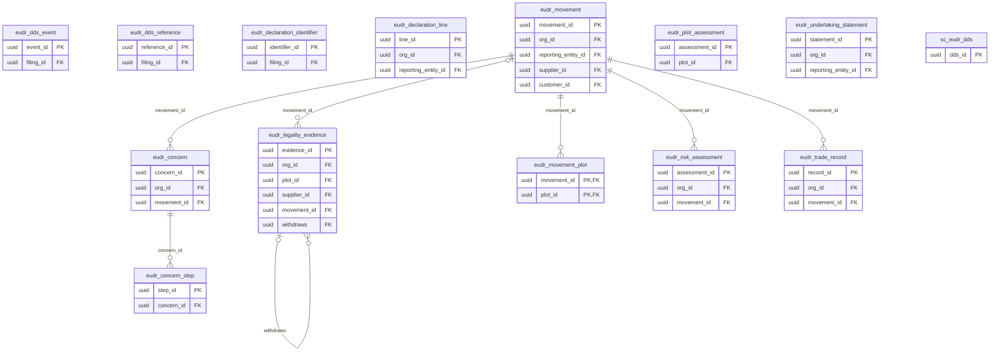

7 of these tables reference `organizations` (not drawn).

Foreign keys to other domains:

| Table | Columns | References | Domain |
|---|---|---|---|
| `eudr_dds_event` | filing_id | `regulatory_filing` | Regulatory reporting & filings |
| `eudr_dds_reference` | filing_id | `regulatory_filing` | Regulatory reporting & filings |
| `eudr_declaration_identifier` | filing_id | `regulatory_filing` | Regulatory reporting & filings |
| `eudr_declaration_line` | reporting_entity_id | `reporting_entities` | Regulatory reporting & filings |
| `eudr_legality_evidence` | plot_id | `sc_sourcing_plots` | Agri-food supply chain & crops |
| `eudr_legality_evidence` | supplier_id | `sc_suppliers` | Agri-food supply chain & crops |
| `eudr_movement` | customer_id | `sc_customers` | Agri-food supply chain & crops |
| `eudr_movement` | reporting_entity_id | `reporting_entities` | Regulatory reporting & filings |
| `eudr_movement` | supplier_id | `sc_suppliers` | Agri-food supply chain & crops |
| `eudr_movement_plot` | plot_id | `sc_sourcing_plots` | Agri-food supply chain & crops |
| `eudr_plot_assessment` | plot_id | `sc_sourcing_plots` | Agri-food supply chain & crops |
| `eudr_undertaking_statement` | reporting_entity_id | `reporting_entities` | Regulatory reporting & filings |

#### `eudr_concern`

| Column | Type | Null | Default | Key / notes |
|---|---|---|---|---|
| `concern_id` | uuid | no | `gen_random_uuid()` | PK |
| `seq` | bigint | no |  | unique; identity (always) |
| `org_id` | uuid | no |  | FK → organizations.org_id (on delete cascade) |
| `movement_id` | uuid | no |  | FK → eudr_movement.movement_id (on delete restrict) |
| `kind` | text | no |  |  |
| `received_on` | date | no |  |  |
| `detail` | text | no |  |  |
| `recorded_by` | uuid | yes |  |  |
| `recorded_at` | timestamp with time zone | no | `now()` |  |

- Check `ck_eudr_concern_kind`: `CHECK ((kind = ANY (ARRAY['new_information'::text, 'substantiated_concern'::text])))`
- Index: `CREATE INDEX ix_eudr_concern ON public.eudr_concern USING btree (movement_id, seq)`
- Trigger `trg_eudr_concern_worm`: BEFORE DELETE OR UPDATE for each row → `public.prevent_eudr_concern_mutation`

#### `eudr_concern_step`

| Column | Type | Null | Default | Key / notes |
|---|---|---|---|---|
| `step_id` | uuid | no | `gen_random_uuid()` | PK |
| `seq` | bigint | no |  | unique; identity (always) |
| `concern_id` | uuid | no |  | FK → eudr_concern.concern_id (on delete restrict) |
| `kind` | text | no |  |  |
| `on_date` | date | no |  |  |
| `conclusion` | text | yes |  |  |
| `detail` | text | yes |  |  |
| `recorded_by` | uuid | yes |  |  |
| `recorded_at` | timestamp with time zone | no | `now()` |  |

- Check `ck_eudr_step_conclusion`: `CHECK ((conclusion = ANY (ARRAY['negligible'::text, 'not_negligible'::text])))`
- Check `ck_eudr_step_kind`: `CHECK ((kind = ANY (ARRAY['authorities_informed'::text, 'downstream_informed'::text, 'verified'::text])))`
- Check `ck_eudr_step_verified`: `CHECK (((kind = 'verified'::text) = (conclusion IS NOT NULL)))`
- Index: `CREATE INDEX ix_eudr_concern_step ON public.eudr_concern_step USING btree (concern_id, seq)`
- Trigger `trg_eudr_concern_step_worm`: BEFORE DELETE OR UPDATE for each row → `public.prevent_eudr_concern_step_mutation`

#### `eudr_dds_event`

| Column | Type | Null | Default | Key / notes |
|---|---|---|---|---|
| `event_id` | uuid | no | `gen_random_uuid()` | PK |
| `seq` | bigint | no |  | unique; identity (always) |
| `filing_id` | uuid | no |  | FK → regulatory_filing.filing_id (on delete restrict) |
| `kind` | text | no |  |  |
| `at` | timestamp with time zone | no | `now()` |  |
| `until` | timestamp with time zone | yes |  |  |
| `detail` | text | yes |  |  |
| `recorded_by` | uuid | yes |  |  |

- Check `ck_eudr_event_kind`: `CHECK ((kind = ANY (ARRAY['reference_received'::text, 'grouped'::text, 'check_notified'::text, 'check_ended'::text, 'placed_or_exported'::text, 'given_to_customs'::text, 'window_extended'::text, 'rejected'::text])))`
- Check `ck_eudr_event_until`: `CHECK (((kind = 'window_extended'::text) = (until IS NOT NULL)))`
- Index: `CREATE INDEX ix_eudr_dds_event ON public.eudr_dds_event USING btree (filing_id, seq)`
- Trigger `trg_eudr_dds_event_worm`: BEFORE DELETE OR UPDATE for each row → `public.prevent_eudr_dds_event_mutation`

#### `eudr_dds_reference`

| Column | Type | Null | Default | Key / notes |
|---|---|---|---|---|
| `reference_id` | uuid | no | `gen_random_uuid()` | PK |
| `seq` | bigint | no |  | unique; identity (always) |
| `filing_id` | uuid | no |  | FK → regulatory_filing.filing_id (on delete restrict) |
| `reference_number` | text | no |  | unique |
| `verification_number` | text | yes |  |  |
| `source` | text | no |  |  |
| `received_at` | timestamp with time zone | no | `now()` |  |
| `recorded_by` | uuid | yes |  |  |

- Check `ck_eudr_ref_source`: `CHECK ((source = ANY (ARRAY['information_system'::text, 'manual_entry'::text, 'contingency'::text])))`
- Index: `CREATE INDEX ix_eudr_dds_reference ON public.eudr_dds_reference USING btree (filing_id, seq DESC)`
- Trigger `trg_eudr_dds_reference_worm`: BEFORE DELETE OR UPDATE for each row → `public.prevent_eudr_dds_reference_mutation`

#### `eudr_declaration_identifier`

| Column | Type | Null | Default | Key / notes |
|---|---|---|---|---|
| `identifier_id` | uuid | no | `gen_random_uuid()` | PK |
| `seq` | bigint | no |  | unique; identity (always) |
| `filing_id` | uuid | no |  | FK → regulatory_filing.filing_id (on delete restrict); unique |
| `declaration_identifier` | text | no |  |  |
| `verification_number` | text | yes |  |  |
| `source` | text | no |  |  |
| `received_at` | timestamp with time zone | no | `now()` |  |
| `recorded_by` | uuid | yes |  |  |

- Check `ck_eudr_decl_source`: `CHECK ((source = ANY (ARRAY['information_system'::text, 'manual_entry'::text, 'contingency'::text, 'member_state'::text])))`
- Trigger `trg_eudr_declaration_identifier_worm`: BEFORE DELETE OR UPDATE for each row → `public.prevent_eudr_declaration_identifier_mutation`

#### `eudr_declaration_line`

| Column | Type | Null | Default | Key / notes |
|---|---|---|---|---|
| `line_id` | uuid | no | `gen_random_uuid()` | PK |
| `seq` | bigint | no |  | unique; identity (always) |
| `org_id` | uuid | no |  | FK → organizations.org_id (on delete cascade) |
| `reporting_entity_id` | uuid | yes |  | FK → reporting_entities.entity_id (on delete restrict) |
| `hs_code` | text | no |  |  |
| `description` | text | no |  |  |
| `trade_name` | text | yes |  |  |
| `customs_flow` | boolean | no |  |  |
| `est_net_mass_kg` | numeric | yes |  |  |
| `mass_deviation_pct` | numeric | yes |  |  |
| `supplementary_unit` | text | yes |  |  |
| `supplementary_qty` | numeric | yes |  |  |
| `volume_m3` | numeric | yes |  |  |
| `items_count` | integer | yes |  |  |
| `scope_in` | boolean | yes |  |  |
| `scope_basis` | text | yes |  |  |
| `recorded_by` | uuid | yes |  |  |
| `recorded_at` | timestamp with time zone | no | `now()` |  |
| `removed_at` | timestamp with time zone | yes |  |  |

- Check `ck_eudr_line_dev`: `CHECK (((mass_deviation_pct IS NULL) OR (mass_deviation_pct >= (0)::numeric)))`
- Check `ck_eudr_line_hs`: `CHECK ((hs_code ~ '^[0-9]{4,10}$'::text))`
- Check `ck_eudr_line_items`: `CHECK (((items_count IS NULL) OR (items_count > 0)))`
- Check `ck_eudr_line_mass`: `CHECK (((est_net_mass_kg IS NULL) OR (est_net_mass_kg > (0)::numeric)))`
- Check `ck_eudr_line_quantity`: `CHECK (((est_net_mass_kg IS NOT NULL) OR (volume_m3 IS NOT NULL) OR (items_count IS NOT NULL)))`
- Check `ck_eudr_line_scope`: `CHECK (((scope_in IS NULL) = (scope_basis IS NULL)))`
- Check `ck_eudr_line_vol`: `CHECK (((volume_m3 IS NULL) OR (volume_m3 > (0)::numeric)))`
- Index: `CREATE INDEX ix_eudr_declaration_line ON public.eudr_declaration_line USING btree (org_id, reporting_entity_id, seq)`

#### `eudr_legality_evidence`

| Column | Type | Null | Default | Key / notes |
|---|---|---|---|---|
| `evidence_id` | uuid | no | `gen_random_uuid()` | PK |
| `seq` | bigint | no |  | unique; identity (always) |
| `org_id` | uuid | no |  | FK → organizations.org_id (on delete cascade) |
| `plot_id` | uuid | yes |  | FK → sc_sourcing_plots.plot_id (on delete restrict) |
| `supplier_id` | uuid | yes |  | FK → sc_suppliers.supplier_id (on delete restrict) |
| `movement_id` | uuid | yes |  | FK → eudr_movement.movement_id (on delete restrict) |
| `aspect` | text | no |  |  |
| `document_kind` | text | no |  |  |
| `document_ref` | text | yes |  |  |
| `file_sha256` | text | yes |  |  |
| `issued_by` | text | yes |  |  |
| `valid_from` | date | yes |  |  |
| `valid_until` | date | yes |  |  |
| `note` | text | yes |  |  |
| `withdraws` | uuid | yes |  | FK → eudr_legality_evidence.evidence_id |
| `recorded_by` | uuid | yes |  |  |
| `recorded_at` | timestamp with time zone | no | `now()` |  |

- Check `ck_eudr_aspect`: `CHECK ((aspect = ANY (ARRAY['land_use_rights'::text, 'environmental_protection'::text, 'forest_rules'::text, 'third_party_rights'::text, 'labour_rights'::text, 'human_rights'::text, 'fpic'::text, 'tax_anticorruption_trade_customs'::text, 'flegt_licence'::text])))`
- Check `ck_eudr_evidence_dates`: `CHECK (((valid_from IS NULL) OR (valid_until IS NULL) OR (valid_from <= valid_until)))`
- Check `ck_eudr_evidence_subject`: `CHECK ((num_nonnulls(plot_id, supplier_id, movement_id) = 1))`
- Index: `CREATE INDEX ix_eudr_evidence ON public.eudr_legality_evidence USING btree (org_id, seq DESC)`
- Trigger `trg_eudr_legality_evidence_worm`: BEFORE DELETE OR UPDATE for each row → `public.prevent_eudr_legality_evidence_mutation`

#### `eudr_movement`

| Column | Type | Null | Default | Key / notes |
|---|---|---|---|---|
| `movement_id` | uuid | no | `gen_random_uuid()` | PK |
| `seq` | bigint | no |  | unique; identity (always) |
| `org_id` | uuid | no |  | FK → organizations.org_id (on delete cascade) |
| `reporting_entity_id` | uuid | yes |  | FK → reporting_entities.entity_id (on delete restrict) |
| `external_ref` | text | yes |  |  |
| `kind` | text | no |  |  |
| `actor_role` | text | no |  |  |
| `planned_on` | date | no |  |  |
| `hs_code` | text | no |  |  |
| `description` | text | no |  |  |
| `trade_name` | text | yes |  |  |
| `scientific_names` | text[] | yes |  |  |
| `customs_flow` | boolean | no |  |  |
| `net_mass_kg` | numeric | yes |  |  |
| `mass_deviation_pct` | numeric | yes |  |  |
| `supplementary_unit` | text | yes |  |  |
| `supplementary_qty` | numeric | yes |  |  |
| `volume_m3` | numeric | yes |  |  |
| `items_count` | integer | yes |  |  |
| `supplier_id` | uuid | yes |  | FK → sc_suppliers.supplier_id (on delete restrict) |
| `customer_id` | uuid | yes |  | FK → sc_customers.customer_id (on delete restrict) |
| `upstream_refs` | text[] | yes |  |  |
| `created_by` | uuid | yes |  |  |
| `created_at` | timestamp with time zone | no | `now()` |  |
| `scope_in` | boolean | yes |  |  |
| `scope_basis` | text | yes |  |  |
| `supplier_role` | text | yes |  |  |

- Unique `ux_eudr_movement_ref`: (org_id, external_ref)
- Check `ck_eudr_customs_mass`: `CHECK (((NOT customs_flow) OR (net_mass_kg IS NOT NULL)))`
- Check `ck_eudr_dev`: `CHECK (((mass_deviation_pct IS NULL) OR ((mass_deviation_pct >= (0)::numeric) AND (mass_deviation_pct <= (100)::numeric))))`
- Check `ck_eudr_hs`: `CHECK ((hs_code ~ '^[0-9]{4}([0-9]{2}){0,3}$'::text))`
- Check `ck_eudr_items`: `CHECK (((items_count IS NULL) OR (items_count > 0)))`
- Check `ck_eudr_kind`: `CHECK ((kind = ANY (ARRAY['placing'::text, 'making_available'::text, 'export'::text])))`
- Check `ck_eudr_mass`: `CHECK (((net_mass_kg IS NULL) OR (net_mass_kg > (0)::numeric)))`
- Check `ck_eudr_quantity`: `CHECK (((net_mass_kg IS NOT NULL) OR (volume_m3 IS NOT NULL) OR (items_count IS NOT NULL)))`
- Check `ck_eudr_role`: `CHECK ((actor_role = ANY (ARRAY['operator'::text, 'micro_small_primary_operator'::text, 'downstream_operator'::text, 'trader'::text])))`
- Check `ck_eudr_scope_basis`: `CHECK (((scope_in IS NULL) OR (scope_basis IS NOT NULL)))`
- Check `ck_eudr_supp`: `CHECK (((supplementary_qty IS NULL) OR (supplementary_qty > (0)::numeric)))`
- Check `ck_eudr_supp_pair`: `CHECK (((supplementary_unit IS NULL) = (supplementary_qty IS NULL)))`
- Check `ck_eudr_supplier_role`: `CHECK ((supplier_role = ANY (ARRAY['operator'::text, 'downstream_operator'::text, 'trader'::text])))`
- Check `ck_eudr_vol`: `CHECK (((volume_m3 IS NULL) OR (volume_m3 > (0)::numeric)))`
- Index: `CREATE INDEX ix_eudr_movement ON public.eudr_movement USING btree (org_id, planned_on)`
- Trigger `trg_eudr_movement_frozen`: BEFORE DELETE OR UPDATE for each row → `public.prevent_filed_movement_change`

#### `eudr_movement_plot`

| Column | Type | Null | Default | Key / notes |
|---|---|---|---|---|
| `movement_id` | uuid | no |  | PK; FK → eudr_movement.movement_id (on delete cascade) |
| `plot_id` | uuid | no |  | PK; FK → sc_sourcing_plots.plot_id (on delete restrict) |
| `production_from` | date | no |  |  |
| `production_to` | date | no |  |  |

- Primary key: (movement_id, plot_id)
- Check `ck_eudr_production`: `CHECK ((production_from <= production_to))`
- Trigger `trg_eudr_movement_plot_frozen`: BEFORE INSERT OR DELETE OR UPDATE for each row → `public.prevent_filed_movement_plot_change`

#### `eudr_plot_assessment`

| Column | Type | Null | Default | Key / notes |
|---|---|---|---|---|
| `assessment_id` | uuid | no | `gen_random_uuid()` | PK |
| `seq` | bigint | no |  | unique; identity (always) |
| `plot_id` | uuid | no |  | FK → sc_sourcing_plots.plot_id (on delete restrict) |
| `dataset` | text | no |  |  |
| `dataset_version` | text | no |  |  |
| `geometry_sha256` | text | no |  |  |
| `cutoff` | date | no |  |  |
| `outcome` | text | no |  |  |
| `loss_ha` | numeric | yes |  |  |
| `first_loss_year` | integer | yes |  |  |
| `reason` | text | yes |  |  |
| `method` | jsonb | no | `'{}'::jsonb` |  |
| `assessed_at` | timestamp with time zone | no | `now()` |  |
| `assessed_by` | uuid | yes |  |  |

- Check `ck_eudr_loss`: `CHECK (((loss_ha IS NULL) OR (loss_ha >= (0)::numeric)))`
- Check `ck_eudr_outcome`: `CHECK ((outcome = ANY (ARRAY['no_loss_detected'::text, 'loss_after_cutoff'::text, 'not_assessable'::text])))`
- Check `ck_eudr_unassessable`: `CHECK (((outcome <> 'not_assessable'::text) OR (reason IS NOT NULL)))`
- Index: `CREATE INDEX ix_eudr_plot_assessment ON public.eudr_plot_assessment USING btree (plot_id, seq DESC)`
- Trigger `trg_eudr_plot_assessment_worm`: BEFORE DELETE OR UPDATE for each row → `public.prevent_eudr_plot_assessment_mutation`

#### `eudr_risk_assessment`

| Column | Type | Null | Default | Key / notes |
|---|---|---|---|---|
| `assessment_id` | uuid | no | `gen_random_uuid()` | PK |
| `seq` | bigint | no |  | unique; identity (always) |
| `org_id` | uuid | no |  | FK → organizations.org_id (on delete cascade) |
| `movement_id` | uuid | no |  | FK → eudr_movement.movement_id (on delete restrict) |
| `path` | text | no |  |  |
| `criteria` | jsonb | no | `'{}'::jsonb` |  |
| `conclusion` | text | no |  |  |
| `mitigation` | jsonb | no | `'{}'::jsonb` |  |
| `circumvention_mixing` | text | yes |  |  |
| `requested_by` | uuid | no |  |  |
| `approved_by` | uuid | no |  |  |
| `approval_request_id` | uuid | yes |  |  |
| `recorded_at` | timestamp with time zone | no | `now()` |  |

- Check `ck_eudr_conclusion`: `CHECK ((conclusion = ANY (ARRAY['negligible'::text, 'not_negligible'::text])))`
- Check `ck_eudr_path`: `CHECK ((path = ANY (ARRAY['full'::text, 'simplified'::text])))`
- Check `ck_eudr_risk_four_eyes`: `CHECK ((requested_by <> approved_by))`
- Check `ck_eudr_simplified_mixing`: `CHECK (((path <> 'simplified'::text) OR (circumvention_mixing IS NOT NULL)))`
- Index: `CREATE INDEX ix_eudr_risk ON public.eudr_risk_assessment USING btree (movement_id, seq DESC)`
- Trigger `trg_eudr_risk_assessment_worm`: BEFORE DELETE OR UPDATE for each row → `public.prevent_eudr_risk_assessment_mutation`

#### `eudr_trade_record`

| Column | Type | Null | Default | Key / notes |
|---|---|---|---|---|
| `record_id` | uuid | no | `gen_random_uuid()` | PK |
| `seq` | bigint | no |  | unique; identity (always) |
| `org_id` | uuid | no |  | FK → organizations.org_id (on delete cascade) |
| `movement_id` | uuid | no |  | FK → eudr_movement.movement_id (on delete restrict) |
| `payload` | jsonb | no |  |  |
| `payload_sha256` | character(64) | no |  |  |
| `keep_until` | date | no |  |  |
| `recorded_by` | uuid | yes |  |  |
| `recorded_at` | timestamp with time zone | no | `now()` |  |

- Index: `CREATE INDEX ix_eudr_trade_record ON public.eudr_trade_record USING btree (movement_id, seq)`
- Trigger `trg_eudr_trade_record_worm`: BEFORE DELETE OR UPDATE for each row → `public.prevent_eudr_trade_record_mutation`

#### `eudr_undertaking_statement`

| Column | Type | Null | Default | Key / notes |
|---|---|---|---|---|
| `statement_id` | uuid | no | `gen_random_uuid()` | PK |
| `seq` | bigint | no |  | unique; identity (always) |
| `org_id` | uuid | no |  | FK → organizations.org_id (on delete cascade) |
| `reporting_entity_id` | uuid | yes |  | FK → reporting_entities.entity_id (on delete restrict) |
| `effective_from` | date | no |  |  |
| `size_class` | text | no |  |  |
| `established_on` | date | yes |  |  |
| `country` | character(2) | no |  |  |
| `eori` | text | yes |  |  |
| `basis` | text | yes |  |  |
| `requested_by` | uuid | no |  |  |
| `approved_by` | uuid | no |  |  |
| `approval_request_id` | uuid | yes |  |  |
| `recorded_at` | timestamp with time zone | no | `now()` |  |
| `address` | text | yes |  |  |
| `primary_own_produce` | boolean | yes |  |  |
| `other_system` | text | yes |  |  |
| `is_registration` | text | yes |  |  |

- Check `ck_eudr_country`: `CHECK ((country ~ '^[A-Z]{2}$'::text))`
- Check `ck_eudr_eori`: `CHECK (((eori IS NULL) OR (eori ~ '^[A-Z]{2}[A-Z0-9]{1,15}$'::text)))`
- Check `ck_eudr_size`: `CHECK ((size_class = ANY (ARRAY['micro'::text, 'small'::text, 'medium'::text, 'large'::text])))`
- Check `ck_eudr_statement_four_eyes`: `CHECK ((requested_by <> approved_by))`
- Index: `CREATE INDEX ix_eudr_statement ON public.eudr_undertaking_statement USING btree (org_id, reporting_entity_id, effective_from, seq DESC)`
- Trigger `trg_eudr_undertaking_statement_worm`: BEFORE DELETE OR UPDATE for each row → `public.prevent_eudr_undertaking_statement_mutation`

#### `sc_eudr_dds`

| Column | Type | Null | Default | Key / notes |
|---|---|---|---|---|
| `dds_id` | uuid | no | `gen_random_uuid()` | PK |
| `org_id` | uuid | no |  |  |
| `status` | character varying | no | `'draft'::character varying` |  |
| `reference_number` | character varying | yes |  |  |
| `verification_number` | character varying | yes |  |  |
| `payload` | jsonb | no |  |  |
| `blockers` | jsonb | yes |  |  |
| `plot_count` | integer | yes |  |  |
| `covered_count` | integer | yes |  |  |
| `created_by` | uuid | yes |  |  |
| `created_at` | timestamp with time zone | no | `now()` |  |
| `filed_at` | timestamp with time zone | yes |  |  |
| `reference_captured_at` | timestamp with time zone | yes |  |  |

- Index: `CREATE INDEX ix_sc_eudr_dds_org_id ON public.sc_eudr_dds USING btree (org_id)`
- Trigger `trg_legacy_dds_readonly`: BEFORE INSERT OR DELETE OR UPDATE for each row → `public.prevent_legacy_dds_mutation`

### 4.10 Agri-food supply chain & crops (26 tables)

```mermaid
erDiagram
  commodity_price_index {
    uuid price_id PK
  }
  crop_calibration_coverage {
    varchar commodity PK
    varchar origin PK
    uuid spec_id FK
    varchar region PK
  }
  crop_calibration_runs {
    uuid run_id PK
    uuid spec_id FK
    uuid approval_request_id FK
    uuid decided_by FK
  }
  crop_calibration_specs {
    uuid spec_id PK
  }
  crop_release_checks {
    bigint check_id PK
  }
  crop_weather_builds {
    uuid build_id PK
  }
  crop_weather_monthly {
    uuid build_id PK,FK
    varchar target PK,FK
    date month PK
  }
  crop_weather_targets {
    uuid build_id PK,FK
    varchar target PK
  }
  crop_yield_observations {
    uuid obs_id PK
  }
  crop_yield_release_rows {
    uuid release_id PK,FK
    varchar commodity PK
    varchar country PK
    integer season_year PK
    varchar region_code PK
  }
  crop_yield_releases {
    uuid release_id PK
    uuid approval_request_id FK
    uuid decided_by FK
  }
  sc_bom_lines {
    uuid bom_line_id PK
    uuid product_id FK
    uuid commodity_id FK
  }
  sc_commodities {
    uuid commodity_id PK
  }
  sc_commodity_calibration {
    uuid commodity_id PK,FK
    varchar origin PK
  }
  sc_commodity_challenger {
    uuid commodity_id PK
    varchar origin PK
    varchar hazard_driver PK
  }
  sc_commodity_fit {
    uuid commodity_id PK
    varchar origin PK
    varchar hazard_driver PK
    uuid spec_id FK
    uuid run_id FK
  }
  sc_commodity_overrides {
    uuid org_id PK,FK
    uuid commodity_id PK,FK
    uuid overridden_by FK
  }
  sc_commodity_prices {
    varchar commodity PK
    integer year PK
    integer month PK
    varchar source PK
  }
  sc_commodity_stocks {
    varchar commodity PK
    integer market_year PK
    varchar source PK
  }
  sc_company_sites {
    uuid site_id PK
    uuid org_id FK
    uuid entity_id FK
  }
  sc_crop_calendar_score {
    uuid score_id PK
    timestamptz scored_at PK
  }
  sc_customers {
    uuid customer_id PK
    uuid org_id FK
  }
  sc_model_validation {
    uuid validation_id PK
    uuid commodity_id FK
  }
  sc_products {
    uuid product_id PK
    uuid org_id FK
  }
  sc_sourcing_plots {
    uuid plot_id PK
    uuid org_id FK
    uuid supplier_id FK
    uuid commodity_id FK
    uuid entity_id FK
    uuid subject_org_id FK
  }
  sc_suppliers {
    uuid supplier_id PK
    uuid org_id FK
    uuid commodity_id FK
  }
  crop_calibration_specs |o--o{ crop_calibration_coverage : "spec_id"
  crop_calibration_specs ||--o{ crop_calibration_runs : "spec_id"
  crop_weather_targets ||--o{ crop_weather_monthly : "build_id, target"
  crop_weather_builds ||--o{ crop_weather_targets : "build_id"
  crop_yield_releases ||--o{ crop_yield_release_rows : "release_id"
  sc_commodities ||--o{ sc_bom_lines : "commodity_id"
  sc_products ||--o{ sc_bom_lines : "product_id"
  sc_commodities ||--o{ sc_commodity_calibration : "commodity_id"
  crop_calibration_runs |o--o{ sc_commodity_fit : "run_id"
  crop_calibration_specs |o--o{ sc_commodity_fit : "spec_id"
  sc_commodities ||--o{ sc_commodity_overrides : "commodity_id"
  sc_commodities |o--o{ sc_model_validation : "commodity_id"
  sc_commodities ||--o{ sc_sourcing_plots : "commodity_id"
  sc_suppliers |o--o{ sc_sourcing_plots : "supplier_id"
  sc_commodities |o--o{ sc_suppliers : "commodity_id"
```

6 of these tables reference `organizations` (not drawn).

Foreign keys to other domains:

| Table | Columns | References | Domain |
|---|---|---|---|
| `crop_calibration_runs` | approval_request_id | `approval_requests` | Workflow, decisions & controls |
| `crop_calibration_runs` | decided_by | `users` | Identity & access |
| `crop_yield_releases` | approval_request_id | `approval_requests` | Workflow, decisions & controls |
| `crop_yield_releases` | decided_by | `users` | Identity & access |
| `sc_commodity_overrides` | overridden_by | `users` | Identity & access |
| `sc_company_sites` | entity_id | `reporting_entities` | Regulatory reporting & filings |
| `sc_sourcing_plots` | entity_id | `reporting_entities` | Regulatory reporting & filings |

#### `commodity_price_index`

| Column | Type | Null | Default | Key / notes |
|---|---|---|---|---|
| `price_id` | uuid | no |  | PK |
| `source` | character varying(60) | no |  |  |
| `commodity` | character varying(60) | no |  |  |
| `period_ym` | character varying(7) | no |  |  |
| `index_value` | numeric | no |  |  |
| `unit` | character varying(40) | yes |  |  |
| `ingested_at` | timestamp with time zone | yes | `now()` |  |
| `currency` | character(3) | yes |  |  |

- Unique `uq_price_source_commodity_period`: (source, commodity, period_ym)
- Index: `CREATE INDEX idx_price_commodity_period ON public.commodity_price_index USING btree (commodity, period_ym)`

#### `crop_calibration_coverage`

| Column | Type | Null | Default | Key / notes |
|---|---|---|---|---|
| `commodity` | character varying(80) | no |  | PK |
| `origin` | character varying(3) | no |  | PK |
| `area_ha` | numeric(16,1) | no |  |  |
| `area_share` | numeric(7,6) | no |  |  |
| `status` | character varying(20) | no |  |  |
| `reason` | text | yes |  |  |
| `spec_id` | uuid | yes |  | FK → crop_calibration_specs.spec_id |
| `generated_at` | timestamp with time zone | no | `now()` |  |
| `region` | character varying(8) | no | `''::character varying` | PK |

- Primary key: (commodity, origin, region)
- Check `crop_calibration_coverage_check`: `CHECK ((((status)::text = 'recipe'::text) = (spec_id IS NOT NULL)))`
- Check `crop_calibration_coverage_check1`: `CHECK ((((status)::text = 'recipe'::text) = (reason IS NULL)))`
- Check `crop_calibration_coverage_status_check`: `CHECK (((status)::text = ANY ((ARRAY['recipe'::character varying, 'no_yield_series'::character varying, 'too_few_years'::character varying, 'no_season'::character varying, 'small_area'::character varying])::text[])))`

#### `crop_calibration_runs`

| Column | Type | Null | Default | Key / notes |
|---|---|---|---|---|
| `run_id` | uuid | no | `gen_random_uuid()` | PK |
| `seq` | bigint | no |  | unique; identity (always) |
| `spec_id` | uuid | no |  | FK → crop_calibration_specs.spec_id |
| `run_at` | timestamp with time zone | no | `now()` |  |
| `inputs` | jsonb | no |  |  |
| `outcome` | character varying(16) | no |  |  |
| `reason` | text | yes |  |  |
| `n_years` | integer | yes |  |  |
| `baseline_from` | integer | yes |  |  |
| `baseline_to` | integer | yes |  |  |
| `slope` | numeric(12,5) | yes |  |  |
| `intercept` | numeric(12,5) | yes |  |  |
| `r2` | numeric(6,4) | yes |  |  |
| `r2_oos` | numeric(7,4) | yes |  |  |
| `rmse` | numeric(12,5) | yes |  |  |
| `score_mean` | numeric(12,5) | yes |  |  |
| `score_sxx` | numeric(18,5) | yes |  |  |
| `band_cov68` | numeric(5,4) | yes |  |  |
| `downside_pass` | boolean | no |  |  |
| `upside` | jsonb | yes |  |  |
| `upside_pass` | boolean | no |  |  |
| `validation_run_id` | uuid | yes |  |  |
| `status` | character varying(12) | no | `'recorded'::character varying` |  |
| `approval_request_id` | uuid | yes |  | FK → approval_requests.request_id |
| `decided_by` | uuid | yes |  | FK → users.user_id |
| `decided_at` | timestamp with time zone | yes |  |  |
| `decision_reason` | text | yes |  |  |

- Check `crop_calibration_runs_check`: `CHECK ((((outcome)::text = 'fitted'::text) = (r2_oos IS NOT NULL)))`
- Check `crop_calibration_runs_check1`: `CHECK ((((outcome)::text = 'fitted'::text) OR (NOT (downside_pass OR upside_pass))))`
- Check `crop_calibration_runs_check2`: `CHECK ((((status)::text = ANY ((ARRAY['recorded'::character varying, 'proposed'::character varying])::text[])) OR (decided_at IS NOT NULL)))`
- Check `crop_calibration_runs_outcome_check`: `CHECK (((outcome)::text = ANY ((ARRAY['fitted'::character varying, 'no_panel'::character varying, 'too_few_years'::character varying])::text[])))`
- Check `crop_calibration_runs_status_check`: `CHECK (((status)::text = ANY ((ARRAY['recorded'::character varying, 'proposed'::character varying, 'published'::character varying, 'superseded'::character varying, 'rejected'::character varying])::text[])))`
- Index: `CREATE INDEX ix_crop_calibration_runs_spec ON public.crop_calibration_runs USING btree (spec_id, seq)`
- Index: `CREATE UNIQUE INDEX ux_crop_calibration_run_published ON public.crop_calibration_runs USING btree (spec_id) WHERE ((status)::text = 'published'::text)`
- Trigger `trg_crop_calibration_runs_guard`: BEFORE DELETE OR UPDATE for each row → `public.guard_crop_calibration_run`

#### `crop_calibration_specs`

| Column | Type | Null | Default | Key / notes |
|---|---|---|---|---|
| `spec_id` | uuid | no | `gen_random_uuid()` | PK |
| `commodity` | character varying(80) | no |  |  |
| `origin` | character varying(3) | no |  |  |
| `yield_source` | character varying(200) | no |  |  |
| `yield_region` | character varying(24) | no | `''::character varying` |  |
| `driver` | character varying(32) | no |  |  |
| `weather_kind` | character varying(16) | no |  |  |
| `weather_key` | character varying(120) | no |  |  |
| `season_months` | integer[] | no |  |  |
| `season_prev_months` | integer[] | no | `'{}'::integer[]` |  |
| `spei_scale` | integer | no | `6` |  |
| `allow_cycle` | boolean | no |  |  |
| `basis` | text | no |  |  |
| `protocol` | character varying(40) | no |  |  |
| `created_at` | timestamp with time zone | no | `now()` |  |
| `retired_at` | timestamp with time zone | yes |  |  |
| `retired_reason` | text | yes |  |  |

- Check `crop_calibration_specs_check`: `CHECK (((retired_at IS NULL) = (retired_reason IS NULL)))`
- Check `crop_calibration_specs_driver_check`: `CHECK (((driver)::text = ANY ((ARRAY['drought'::character varying, 'heat'::character varying, 'soil_water'::character varying])::text[])))`
- Check `crop_calibration_specs_season_months_check`: `CHECK ((cardinality(season_months) > 0))`
- Check `crop_calibration_specs_spei_scale_check`: `CHECK (((spei_scale >= 1) AND (spei_scale <= 24)))`
- Check `crop_calibration_specs_weather_kind_check`: `CHECK (((weather_kind)::text = ANY ((ARRAY['box'::character varying, 'crop_area'::character varying])::text[])))`
- Index: `CREATE UNIQUE INDEX ux_crop_calibration_spec_active ON public.crop_calibration_specs USING btree (commodity, origin, yield_region, driver) WHERE (retired_at IS NULL)`
- Trigger `trg_crop_calibration_specs_guard`: BEFORE UPDATE for each row → `public.guard_crop_calibration_spec`

#### `crop_release_checks`

| Column | Type | Null | Default | Key / notes |
|---|---|---|---|---|
| `check_id` | bigint | no |  | PK; identity (always) |
| `checked_at` | timestamp with time zone | no | `now()` |  |
| `source` | character varying(200) | no |  |  |
| `last_modified` | text | yes |  |  |
| `etag` | text | yes |  |  |
| `changed` | boolean | no |  |  |
| `downloaded` | boolean | no |  |  |
| `file_sha256` | character(64) | yes |  |  |
| `outcome` | text | no |  |  |

- Check `crop_release_checks_check`: `CHECK ((downloaded OR (file_sha256 IS NULL)))`
- Index: `CREATE INDEX ix_crop_release_checks_source ON public.crop_release_checks USING btree (source, check_id DESC)`
- Trigger `trg_crop_release_checks_append_only`: BEFORE DELETE OR UPDATE for each row → `public.prevent_crop_release_check_mutation`

#### `crop_weather_builds`

| Column | Type | Null | Default | Key / notes |
|---|---|---|---|---|
| `build_id` | uuid | no | `gen_random_uuid()` | PK |
| `seq` | bigint | no |  | unique; identity (always) |
| `built_at` | timestamp with time zone | no | `now()` |  |
| `inputs` | jsonb | no |  |  |
| `first_month` | date | no |  |  |
| `last_month` | date | no |  |  |

- Check `crop_weather_builds_check`: `CHECK ((last_month >= first_month))`

#### `crop_weather_monthly`

| Column | Type | Null | Default | Key / notes |
|---|---|---|---|---|
| `build_id` | uuid | no |  | PK; FK → crop_weather_targets.build_id |
| `target` | character varying(140) | no |  | PK; FK → crop_weather_targets.target |
| `month` | date | no |  | PK |
| `spei6` | numeric(9,5) | yes |  |  |
| `temp_anom` | numeric(9,5) | yes |  |  |

- Primary key: (build_id, target, month)
- Foreign key `crop_weather_monthly_build_id_target_fkey`: (build_id, target) → crop_weather_targets (build_id, target)

#### `crop_weather_targets`

| Column | Type | Null | Default | Key / notes |
|---|---|---|---|---|
| `build_id` | uuid | no |  | PK; FK → crop_weather_builds.build_id |
| `target` | character varying(140) | no |  | PK |
| `cells` | integer | no |  |  |
| `weight` | numeric(16,1) | no |  |  |

- Primary key: (build_id, target)
- Check `crop_weather_targets_cells_check`: `CHECK ((cells > 0))`
- Index: `CREATE INDEX ix_crop_weather_targets_target ON public.crop_weather_targets USING btree (target)`

#### `crop_yield_observations`

| Column | Type | Null | Default | Key / notes |
|---|---|---|---|---|
| `obs_id` | uuid | no | `gen_random_uuid()` | PK |
| `commodity` | character varying(80) | no |  |  |
| `country` | character varying(3) | yes |  |  |
| `region` | character varying(120) | yes |  |  |
| `season_year` | integer | no |  |  |
| `production_tonnes` | numeric(16,1) | yes |  |  |
| `area_harvested_ha` | numeric(16,1) | yes |  |  |
| `yield_tonnes_ha` | numeric(12,4) | yes |  |  |
| `yoy_change_pct` | numeric(12,2) | yes |  |  |
| `source` | character varying(200) | no |  |  |
| `note` | text | yes |  |  |
| `ingested_at` | timestamp with time zone | no | `now()` |  |
| `region_code` | character varying(24) | no | `''::character varying` |  |

- Unique `ux_crop_yield_series`: (commodity, country, region_code, season_year, source)
- Index: `CREATE INDEX ix_crop_yield_commodity ON public.crop_yield_observations USING btree (commodity, season_year)`
- Index: `CREATE INDEX ix_crop_yield_country ON public.crop_yield_observations USING btree (country, commodity)`

#### `crop_yield_release_rows`

| Column | Type | Null | Default | Key / notes |
|---|---|---|---|---|
| `release_id` | uuid | no |  | PK; FK → crop_yield_releases.release_id |
| `commodity` | character varying(80) | no |  | PK |
| `country` | character varying(3) | no |  | PK |
| `season_year` | integer | no |  | PK |
| `change` | character varying(10) | no |  |  |
| `production_tonnes` | numeric(16,1) | yes |  |  |
| `area_harvested_ha` | numeric(16,1) | yes |  |  |
| `yield_tonnes_ha` | numeric(12,4) | yes |  |  |
| `yoy_change_pct` | numeric(12,2) | yes |  |  |
| `note` | text | yes |  |  |
| `held_before` | jsonb | yes |  |  |
| `region_code` | character varying(24) | no | `''::character varying` | PK |

- Primary key: (release_id, commodity, country, region_code, season_year)
- Check `crop_yield_release_rows_change_check`: `CHECK (((change)::text = ANY ((ARRAY['added'::character varying, 'revised'::character varying, 'recomputed'::character varying])::text[])))`
- Check `crop_yield_release_rows_check`: `CHECK ((((change)::text = 'added'::text) = (held_before IS NULL)))`
- Trigger `trg_crop_release_rows_append_only`: BEFORE DELETE OR UPDATE for each row → `public.prevent_crop_release_row_mutation`

#### `crop_yield_releases`

| Column | Type | Null | Default | Key / notes |
|---|---|---|---|---|
| `release_id` | uuid | no | `gen_random_uuid()` | PK |
| `seq` | bigint | no |  | unique; identity (always) |
| `source` | character varying(200) | no |  |  |
| `file_sha256` | character(64) | no |  |  |
| `file_bytes` | bigint | no |  |  |
| `origin_url` | text | no |  |  |
| `last_modified` | text | yes |  |  |
| `etag` | text | yes |  |  |
| `fetched_at` | timestamp with time zone | no | `now()` |  |
| `summary` | jsonb | no |  |  |
| `status` | character varying(12) | no | `'staged'::character varying` |  |
| `approval_request_id` | uuid | yes |  | FK → approval_requests.request_id |
| `decided_by` | uuid | yes |  | FK → users.user_id |
| `decided_at` | timestamp with time zone | yes |  |  |
| `decision_reason` | text | yes |  |  |
| `landed_at` | timestamp with time zone | yes |  |  |
| `reader` | text | no |  |  |

- Check `crop_yield_releases_check`: `CHECK ((((status)::text = 'landed'::text) = (landed_at IS NOT NULL)))`
- Check `crop_yield_releases_check1`: `CHECK ((((status)::text = ANY ((ARRAY['staged'::character varying, 'proposed'::character varying])::text[])) OR (decided_at IS NOT NULL)))`
- Check `crop_yield_releases_file_bytes_check`: `CHECK ((file_bytes > 0))`
- Check `crop_yield_releases_status_check`: `CHECK (((status)::text = ANY ((ARRAY['staged'::character varying, 'proposed'::character varying, 'landed'::character varying, 'rejected'::character varying])::text[])))`
- Index: `CREATE UNIQUE INDEX ux_crop_release_file ON public.crop_yield_releases USING btree (source, file_sha256, reader)`
- Index: `CREATE UNIQUE INDEX ux_crop_release_open ON public.crop_yield_releases USING btree (source) WHERE ((status)::text = ANY ((ARRAY['staged'::character varying, 'proposed'::character varying])::text[]))`

#### `sc_bom_lines`

| Column | Type | Null | Default | Key / notes |
|---|---|---|---|---|
| `bom_line_id` | uuid | no | `gen_random_uuid()` | PK |
| `product_id` | uuid | no |  | FK → sc_products.product_id (on delete cascade) |
| `commodity_id` | uuid | no |  | FK → sc_commodities.commodity_id |
| `cost_share_pct` | numeric(5,2) | no |  |  |
| `annual_spend_eur` | numeric(16,2) | yes |  |  |

- Unique `sc_bom_lines_product_id_commodity_id_key`: (product_id, commodity_id)
- Index: `CREATE INDEX ix_sc_bom_product ON public.sc_bom_lines USING btree (product_id)`

#### `sc_commodities`

| Column | Type | Null | Default | Key / notes |
|---|---|---|---|---|
| `commodity_id` | uuid | no | `gen_random_uuid()` | PK |
| `name` | character varying(80) | no |  | unique |
| `hs_code` | character varying(12) | yes |  |  |
| `eudr_covered` | boolean | no | `false` |  |
| `demand_elasticity` | numeric(6,3) | yes |  |  |
| `global_share_note` | text | yes |  |  |
| `primary_hazards` | text | yes |  |  |
| `created_at` | timestamp with time zone | no | `now()` |  |
| `stock_to_use` | numeric(6,2) | yes |  |  |
| `measured_basis` | text | yes |  |  |

#### `sc_commodity_calibration`

| Column | Type | Null | Default | Key / notes |
|---|---|---|---|---|
| `commodity_id` | uuid | no |  | PK; FK → sc_commodities.commodity_id (on delete cascade) |
| `origin` | character varying(40) | no |  | PK |
| `sensitivity` | numeric(6,4) | yes |  |  |
| `world_share` | numeric(7,5) | yes |  |  |
| `hazard_driver` | character varying(30) | yes |  |  |
| `event_ref` | text | yes |  |  |
| `source_note` | text | yes |  |  |
| `impact_version` | character varying(20) | yes |  |  |
| `created_at` | timestamp with time zone | no | `now()` |  |
| `region_key` | character varying(40) | yes |  |  |
| `season_months` | integer[] | yes |  |  |
| `scoring_model` | character varying(60) | yes |  |  |
| `baseline_from` | integer | yes |  |  |
| `baseline_to` | integer | yes |  |  |

- Primary key: (commodity_id, origin)
- Index: `CREATE INDEX ix_sc_calibration_origin ON public.sc_commodity_calibration USING btree (origin)`

#### `sc_commodity_challenger`

| Column | Type | Null | Default | Key / notes |
|---|---|---|---|---|
| `commodity_id` | uuid | no |  | PK |
| `origin` | character varying(8) | no |  | PK |
| `hazard_driver` | character varying(24) | no |  | PK |
| `method` | character varying(32) | no |  |  |
| `n_years` | integer | no |  |  |
| `mean_abs_divergence_pp` | numeric(6,2) | yes |  |  |
| `tolerance_pp` | numeric(6,2) | yes |  |  |
| `ref_score` | numeric(5,1) | yes |  |  |
| `champion_at_ref_pct` | numeric(7,2) | yes |  |  |
| `challenger_at_ref_pct` | numeric(7,2) | yes |  |  |
| `verdict` | character varying(12) | no |  |  |
| `challenger_version` | character varying(40) | no |  |  |
| `computed_at` | timestamp with time zone | no | `now()` |  |

- Primary key: (commodity_id, origin, hazard_driver)
- Check `sc_commodity_challenger_verdict_check`: `CHECK (((verdict)::text = ANY ((ARRAY['agree'::character varying, 'partial'::character varying, 'diverge'::character varying, 'insufficient'::character varying])::text[])))`

#### `sc_commodity_fit`

| Column | Type | Null | Default | Key / notes |
|---|---|---|---|---|
| `commodity_id` | uuid | no |  | PK |
| `origin` | character varying(8) | no |  | PK |
| `hazard_driver` | character varying(32) | no |  | PK |
| `region_key` | character varying(64) | yes |  |  |
| `season_months` | integer[] | yes |  |  |
| `spei_scale` | integer | yes |  |  |
| `n_years` | integer | no |  |  |
| `slope` | numeric(10,5) | no |  |  |
| `intercept` | numeric(10,5) | no |  |  |
| `r2` | numeric(5,4) | no |  |  |
| `rmse` | numeric(10,5) | no |  |  |
| `score_mean` | numeric(10,5) | no |  |  |
| `score_sxx` | numeric(16,5) | no |  |  |
| `baseline_from` | integer | yes |  |  |
| `baseline_to` | integer | yes |  |  |
| `fit_version` | character varying(32) | yes |  |  |
| `source_note` | text | yes |  |  |
| `created_at` | timestamp with time zone | yes | `now()` |  |
| `r2_oos` | numeric(6,4) | yes |  |  |
| `band_cov68` | numeric(5,4) | yes |  |  |
| `yield_source` | character varying(200) | yes |  |  |
| `yield_region` | character varying(24) | yes |  |  |
| `allow_cycle` | boolean | yes |  |  |
| `spec_id` | uuid | yes |  | FK → crop_calibration_specs.spec_id |
| `run_id` | uuid | yes |  | FK → crop_calibration_runs.run_id |

- Primary key: (commodity_id, origin, hazard_driver)

#### `sc_commodity_overrides`

| Column | Type | Null | Default | Key / notes |
|---|---|---|---|---|
| `org_id` | uuid | no |  | PK; FK → organizations.org_id (on delete cascade) |
| `commodity_id` | uuid | no |  | PK; FK → sc_commodities.commodity_id (on delete cascade) |
| `override_cogs_at_risk_p50_eur` | numeric(14,2) | no |  |  |
| `overridden_by` | uuid | yes |  | FK → users.user_id |
| `overridden_at` | timestamp with time zone | no | `now()` |  |
| `reason` | text | yes |  |  |

- Primary key: (org_id, commodity_id)

#### `sc_commodity_prices`

| Column | Type | Null | Default | Key / notes |
|---|---|---|---|---|
| `commodity` | character varying(80) | no |  | PK |
| `year` | integer | no |  | PK |
| `month` | integer | no |  | PK |
| `price` | numeric(18,6) | no |  |  |
| `unit` | character varying(40) | yes |  |  |
| `source` | character varying(60) | no |  | PK |
| `ingested_at` | timestamp with time zone | no | `now()` |  |

- Primary key: (commodity, year, month, source)
- Check `sc_commodity_prices_month_check`: `CHECK (((month >= 1) AND (month <= 12)))`
- Index: `CREATE INDEX ix_sc_commodity_prices_lookup ON public.sc_commodity_prices USING btree (commodity, year, month)`

#### `sc_commodity_stocks`

| Column | Type | Null | Default | Key / notes |
|---|---|---|---|---|
| `commodity` | character varying(80) | no |  | PK |
| `market_year` | integer | no |  | PK |
| `ending_stocks` | numeric(18,3) | yes |  |  |
| `domestic_use` | numeric(18,3) | yes |  |  |
| `stocks_to_use_pct` | numeric(8,3) | no |  |  |
| `unit` | character varying(40) | yes |  |  |
| `source` | character varying(60) | no |  | PK |
| `note` | text | yes |  |  |
| `ingested_at` | timestamp with time zone | no | `now()` |  |

- Primary key: (commodity, market_year, source)
- Index: `CREATE INDEX ix_sc_commodity_stocks_lookup ON public.sc_commodity_stocks USING btree (commodity, market_year)`

#### `sc_company_sites`

| Column | Type | Null | Default | Key / notes |
|---|---|---|---|---|
| `site_id` | uuid | no | `gen_random_uuid()` | PK |
| `org_id` | uuid | no |  | FK → organizations.org_id (on delete cascade) |
| `name` | character varying | no |  |  |
| `site_type` | character varying | no | `'other'::character varying` |  |
| `address` | character varying | yes |  |  |
| `latitude` | double precision | yes |  |  |
| `longitude` | double precision | yes |  |  |
| `h3_cell` | character varying | yes |  |  |
| `country` | character varying | yes |  |  |
| `region` | character varying | yes |  |  |
| `annual_value_eur` | numeric | yes |  |  |
| `confidence` | numeric | yes |  |  |
| `geocode_precision` | character varying | yes |  |  |
| `source` | character varying | yes |  |  |
| `created_at` | timestamp with time zone | no | `now()` |  |
| `annual_throughput_eur` | numeric | yes |  |  |
| `entity_id` | uuid | yes |  | FK → reporting_entities.entity_id (on delete set null) |
| `money_source` | jsonb | yes |  |  |
| `held_from` | date | yes |  | first day the undertaking held the site (NULL: before records) |
| `held_until` | date | yes |  | first day it no longer held it (NULL: still held) |
| `area_ha` | numeric | yes |  |  |
| `external_ref` | text | yes |  |  |
| `occupancy` | character varying(20) | yes |  |  |

- Check `ck_site_area_ha`: `CHECK (((area_ha IS NULL) OR (area_ha >= (0)::numeric)))`
- Check `ck_site_held`: `CHECK (((held_from IS NULL) OR (held_until IS NULL) OR (held_until > held_from)))`
- Check `sc_company_sites_occupancy_check`: `CHECK (((occupancy)::text = ANY ((ARRAY['residential'::character varying, 'commercial'::character varying, 'industrial'::character varying, 'transport'::character varying, 'infrastructure'::character varying, 'agriculture'::character varying])::text[])))`
- Index: `CREATE INDEX ix_sc_company_sites_entity_id ON public.sc_company_sites USING btree (entity_id)`
- Index: `CREATE INDEX ix_sc_company_sites_org_id ON public.sc_company_sites USING btree (org_id)`
- Index: `CREATE UNIQUE INDEX ux_site_external_ref ON public.sc_company_sites USING btree (org_id, external_ref) WHERE (external_ref IS NOT NULL)`

#### `sc_crop_calendar_score`

| Column | Type | Null | Default | Key / notes |
|---|---|---|---|---|
| `score_id` | uuid | no |  | PK |
| `commodity_id` | uuid | no |  |  |
| `origin` | character varying | no |  |  |
| `h3_cell` | character varying | no |  |  |
| `h3_resolution` | smallint | yes |  |  |
| `hazard_type` | character varying | no |  |  |
| `scenario` | character varying | no |  |  |
| `time_horizon` | character varying | no |  |  |
| `risk_score` | numeric | no |  |  |
| `risk_bucket` | character varying | yes |  |  |
| `score_ci_lower` | numeric | yes |  |  |
| `score_ci_upper` | numeric | yes |  |  |
| `season_months` | character varying | yes |  |  |
| `spei_scale` | smallint | yes |  |  |
| `model_version` | character varying | yes |  |  |
| `data_vintage` | timestamp with time zone | yes |  |  |
| `scored_at` | timestamp with time zone | no |  | PK |
| `valid_from` | timestamp with time zone | yes |  |  |
| `valid_to` | timestamp with time zone | yes |  |  |

- Primary key: (score_id, scored_at)
- Index: `CREATE INDEX ix_crop_calendar_current ON public.sc_crop_calendar_score USING btree (commodity_id, origin, h3_cell, hazard_type, scenario, time_horizon) WHERE (valid_to IS NULL)`
- Trigger `prevent_delete_crop_calendar`: BEFORE DELETE for each row → `public.prevent_crop_calendar_mutation`
- Trigger `prevent_update_crop_calendar`: BEFORE UPDATE for each row → `public.prevent_crop_calendar_mutation`

#### `sc_customers`

| Column | Type | Null | Default | Key / notes |
|---|---|---|---|---|
| `customer_id` | uuid | no | `gen_random_uuid()` | PK |
| `org_id` | uuid | no |  | FK → organizations.org_id (on delete cascade) |
| `name` | character varying(160) | no |  |  |
| `address` | text | yes |  |  |
| `contact_email` | character varying(320) | yes |  |  |
| `country` | character varying(2) | yes |  |  |
| `created_at` | timestamp with time zone | no | `now()` |  |
| `trade_name` | text | yes |  |  |
| `web_address` | text | yes |  |  |
| `external_ref` | text | yes |  |  |

- Index: `CREATE INDEX ix_sc_customers_org ON public.sc_customers USING btree (org_id)`
- Index: `CREATE UNIQUE INDEX ux_sc_customers_ref ON public.sc_customers USING btree (org_id, external_ref) WHERE (external_ref IS NOT NULL)`

#### `sc_model_validation`

| Column | Type | Null | Default | Key / notes |
|---|---|---|---|---|
| `validation_id` | uuid | no | `gen_random_uuid()` | PK |
| `event` | character varying(80) | no |  |  |
| `commodity` | character varying(80) | no |  |  |
| `hazard` | character varying(40) | no |  |  |
| `observed_prod_shock_pct` | numeric(8,2) | yes |  |  |
| `model_price_move_pct` | numeric(8,2) | yes |  |  |
| `observed_price_move_pct` | numeric(8,2) | yes |  |  |
| `skill_note` | text | no |  |  |
| `source` | character varying(200) | no |  |  |
| `run_at` | timestamp with time zone | no | `now()` |  |
| `commodity_id` | uuid | yes |  | FK → sc_commodities.commodity_id (on delete cascade) |
| `origin` | character varying(40) | yes |  |  |
| `passed` | boolean | no | `false` |  |
| `model_prod_shock_pct` | numeric(8,3) | yes |  |  |
| `tolerance_pct` | numeric(6,2) | yes |  |  |
| `impact_version` | character varying(20) | yes |  |  |
| `price_claim_retired` | boolean | no | `true` |  |

- Index: `CREATE INDEX ix_sc_model_validation_passed ON public.sc_model_validation USING btree (commodity_id, origin, passed)`
- Index: `CREATE UNIQUE INDEX ux_sc_model_validation_key ON public.sc_model_validation USING btree (commodity_id, origin, event)`

#### `sc_products`

| Column | Type | Null | Default | Key / notes |
|---|---|---|---|---|
| `product_id` | uuid | no | `gen_random_uuid()` | PK |
| `org_id` | uuid | no |  | FK → organizations.org_id (on delete cascade) |
| `name` | character varying(160) | no |  |  |
| `category` | character varying(80) | yes |  |  |
| `annual_units` | bigint | yes |  |  |
| `annual_revenue_eur` | numeric(16,2) | yes |  |  |
| `annual_cogs_eur` | numeric(16,2) | yes |  |  |
| `created_at` | timestamp with time zone | no | `now()` |  |

#### `sc_sourcing_plots`

| Column | Type | Null | Default | Key / notes |
|---|---|---|---|---|
| `plot_id` | uuid | no | `gen_random_uuid()` | PK |
| `org_id` | uuid | no |  | FK → organizations.org_id (on delete cascade) |
| `supplier_id` | uuid | yes |  | FK → sc_suppliers.supplier_id (on delete cascade) |
| `commodity_id` | uuid | no |  | FK → sc_commodities.commodity_id |
| `plot_name` | character varying(160) | yes |  |  |
| `latitude` | double precision | yes |  |  |
| `longitude` | double precision | yes |  |  |
| `h3_cell` | character varying(20) | yes |  |  |
| `country` | character varying(2) | yes |  |  |
| `region` | character varying(80) | yes |  |  |
| `annual_spend_eur` | numeric(16,2) | yes |  |  |
| `volume_share` | numeric(5,4) | yes |  |  |
| `eudr_status` | character varying(20) | no | `'unknown'::character varying` |  |
| `eudr_geolocated_at` | timestamp with time zone | yes |  |  |
| `created_at` | timestamp with time zone | no | `now()` |  |
| `plot_area_ha` | numeric(10,2) | yes |  |  |
| `plot_geometry` | jsonb | yes |  |  |
| `eudr_determination` | character varying | yes |  |  |
| `eudr_loss_ha` | numeric | yes |  |  |
| `eudr_first_loss_year` | integer | yes |  |  |
| `eudr_forest_source` | character varying | yes |  |  |
| `eudr_determined_at` | timestamp with time zone | yes |  |  |
| `eudr_evidence` | jsonb | yes |  |  |
| `confidence` | numeric | yes |  |  |
| `geocode_precision` | character varying | yes |  |  |
| `entity_id` | uuid | yes |  | FK → reporting_entities.entity_id (on delete set null) |
| `irrigation_status` | character varying(16) | yes |  |  |
| `source` | character varying(30) | no | `'own'::character varying` |  |
| `subject_org_id` | uuid | yes |  | FK → organizations.org_id (on delete cascade) |
| `external_ref` | text | yes |  |  |
| `money_source` | jsonb | yes |  |  |
| `held_from` | date | yes |  | first day the undertaking sourced from the plot (NULL: before records) |
| `held_until` | date | yes |  | first day it no longer sourced from it (NULL: still sourcing) |
| `coordinate_decimals` | smallint | yes |  |  |
| `postal_address` | text | yes |  |  |

- Check `ck_plot_coordinate_decimals`: `CHECK (((coordinate_decimals IS NULL) OR ((coordinate_decimals >= 0) AND (coordinate_decimals <= 15))))`
- Check `ck_plot_held`: `CHECK (((held_from IS NULL) OR (held_until IS NULL) OR (held_until > held_from)))`
- Check `ck_plot_irrigation`: `CHECK (((irrigation_status IS NULL) OR ((irrigation_status)::text = ANY ((ARRAY['irrigated'::character varying, 'rain_fed'::character varying, 'mixed'::character varying])::text[]))))`
- Check `ck_sc_plots_source`: `CHECK (((source)::text = ANY ((ARRAY['own'::character varying, 'supervisor_shadow'::character varying])::text[])))`
- Check `sc_sourcing_plots_eudr_status_check`: `CHECK (((eudr_status)::text = ANY ((ARRAY['compliant'::character varying, 'non_compliant'::character varying, 'pending'::character varying, 'unknown'::character varying])::text[])))`
- Index: `CREATE INDEX ix_sc_plots_h3 ON public.sc_sourcing_plots USING btree (h3_cell)`
- Index: `CREATE INDEX ix_sc_plots_org ON public.sc_sourcing_plots USING btree (org_id)`
- Index: `CREATE INDEX ix_sc_plots_shadow ON public.sc_sourcing_plots USING btree (org_id, source, subject_org_id)`
- Index: `CREATE INDEX ix_sc_sourcing_plots_entity_id ON public.sc_sourcing_plots USING btree (entity_id)`
- Index: `CREATE UNIQUE INDEX ux_plot_external_ref ON public.sc_sourcing_plots USING btree (org_id, external_ref) WHERE (external_ref IS NOT NULL)`

#### `sc_suppliers`

| Column | Type | Null | Default | Key / notes |
|---|---|---|---|---|
| `supplier_id` | uuid | no | `gen_random_uuid()` | PK |
| `org_id` | uuid | no |  | FK → organizations.org_id (on delete cascade) |
| `name` | character varying(160) | no |  |  |
| `commodity_id` | uuid | yes |  | FK → sc_commodities.commodity_id |
| `tier` | smallint | no | `1` |  |
| `country` | character varying(2) | yes |  |  |
| `created_at` | timestamp with time zone | no | `now()` |  |
| `address` | text | yes |  |  |
| `contact_email` | character varying(320) | yes |  |  |
| `trade_name` | text | yes |  |  |
| `web_address` | text | yes |  |  |
| `external_ref` | text | yes |  |  |

- Index: `CREATE UNIQUE INDEX ux_sc_suppliers_ref ON public.sc_suppliers USING btree (org_id, external_ref) WHERE (external_ref IS NOT NULL)`

### 4.11 Regulatory reporting & filings (26 tables)

```mermaid
erDiagram
  assurance_share {
    uuid share_id PK
    uuid org_id FK
    uuid filing_id FK
    uuid created_by FK
    uuid revoked_by FK
  }
  assurance_share_access {
    uuid access_id PK
    uuid share_id FK
  }
  bank_disclosure_submissions {
    uuid submission_id PK
    uuid org_id FK
    uuid maker_user_id FK
    uuid checker_user_id FK
    uuid approval_request_id FK
  }
  csrd_reporting_role {
    uuid role_id PK
    uuid org_id FK
    uuid reporting_entity_id FK
  }
  entity_structure_import_rows {
    uuid row_id PK
  }
  entity_structure_imports {
    uuid import_id PK
  }
  filing_cell_override {
    uuid override_id PK
    uuid org_id FK
    uuid filing_id FK
    uuid approval_request_id FK
    uuid proposed_by FK
    uuid decided_by FK
  }
  filing_transmission {
    uuid transmission_id PK
    uuid org_id FK
    uuid filing_id FK
  }
  ghg_emissions_inventory {
    uuid emissions_id PK
    uuid org_id FK
    uuid asset_id FK
  }
  kpi_summary {
    uuid kpi_id PK
    uuid org_id FK
  }
  org_channel_credential {
    uuid org_id PK,FK
    text channel_id PK
    text key PK
  }
  org_regulatory_attribute {
    uuid org_id PK,FK
    text attribute PK
  }
  org_reporting_settings {
    uuid org_id PK,FK
    uuid updated_by FK
  }
  org_reporting_settings_retired_20261001 {
    uuid org_id
  }
  provided_datapoint {
    uuid provided_id PK
    uuid org_id FK
    uuid submitted_by FK
    uuid decided_by FK
    uuid reporting_entity_id FK
  }
  regulatory_audit_log {
    uuid log_id PK
    uuid org_id FK
  }
  regulatory_filing {
    uuid filing_id PK
    uuid org_id FK
    uuid entity_id FK
    uuid snapshot_id FK
    uuid approval_request_id FK
    uuid superseded_by FK
    uuid created_by FK
    uuid fund_id FK
    uuid eudr_movement_id FK
  }
  regulatory_filing_event {
    uuid event_id PK
    uuid filing_id FK
    uuid actor_user_id FK
  }
  regulatory_obligation {
    uuid obligation_id PK
    uuid org_id FK
    uuid entity_id FK
    uuid fund_id FK
  }
  regulatory_packages {
    uuid package_id PK
  }
  report_snapshots {
    uuid snapshot_id PK
    uuid org_id FK
    uuid created_by FK
    uuid run_id FK
  }
  reported_figure {
    uuid figure_id PK
    uuid filing_id FK
    uuid org_id FK
  }
  reported_filing {
    uuid filing_id PK
    uuid org_id FK
    uuid uploaded_by FK
    uuid confirmed_by FK
    uuid entity_id FK
  }
  reporting_entities {
    uuid entity_id PK
    uuid parent_entity_id FK
  }
  reporting_period_close {
    uuid close_id PK
    uuid org_id FK
    uuid reporting_entity_id FK
  }
  template_answers {
    uuid answer_id PK
    uuid org_id FK
    uuid fund_id FK
    uuid updated_by FK
    uuid reporting_entity_id FK
  }
  regulatory_filing ||--o{ assurance_share : "filing_id"
  assurance_share ||--o{ assurance_share_access : "share_id"
  reporting_entities |o--o{ csrd_reporting_role : "reporting_entity_id"
  regulatory_filing ||--o{ filing_cell_override : "filing_id"
  regulatory_filing ||--o{ filing_transmission : "filing_id"
  reporting_entities |o--o{ provided_datapoint : "reporting_entity_id"
  reporting_entities |o--o{ regulatory_filing : "entity_id"
  report_snapshots |o--o{ regulatory_filing : "snapshot_id"
  regulatory_filing |o--o{ regulatory_filing : "superseded_by"
  regulatory_filing ||--o{ regulatory_filing_event : "filing_id"
  reporting_entities |o--o{ regulatory_obligation : "entity_id"
  reported_filing ||--o{ reported_figure : "filing_id"
  reporting_entities |o--o{ reported_filing : "entity_id"
  reporting_entities |o--o{ reporting_entities : "parent_entity_id"
  reporting_entities |o--o{ reporting_period_close : "reporting_entity_id"
  reporting_entities |o--o{ template_answers : "reporting_entity_id"
```

19 of these tables reference `organizations` (not drawn).

Foreign keys to other domains:

| Table | Columns | References | Domain |
|---|---|---|---|
| `assurance_share` | created_by | `users` | Identity & access |
| `assurance_share` | revoked_by | `users` | Identity & access |
| `bank_disclosure_submissions` | approval_request_id | `approval_requests` | Workflow, decisions & controls |
| `bank_disclosure_submissions` | checker_user_id | `users` | Identity & access |
| `bank_disclosure_submissions` | maker_user_id | `users` | Identity & access |
| `filing_cell_override` | approval_request_id | `approval_requests` | Workflow, decisions & controls |
| `filing_cell_override` | decided_by | `users` | Identity & access |
| `filing_cell_override` | proposed_by | `users` | Identity & access |
| `ghg_emissions_inventory` | asset_id | `bank_assets` | Financial books (bank, insurer, real estate, portfolio) |
| `org_reporting_settings` | updated_by | `users` | Identity & access |
| `provided_datapoint` | decided_by | `users` | Identity & access |
| `provided_datapoint` | submitted_by | `users` | Identity & access |
| `regulatory_filing` | approval_request_id | `approval_requests` | Workflow, decisions & controls |
| `regulatory_filing` | created_by | `users` | Identity & access |
| `regulatory_filing` | eudr_movement_id | `eudr_movement` | EUDR |
| `regulatory_filing` | fund_id | `funds` | Asset management (issuers, securities, funds) |
| `regulatory_filing_event` | actor_user_id | `users` | Identity & access |
| `regulatory_obligation` | fund_id | `funds` | Asset management (issuers, securities, funds) |
| `report_snapshots` | created_by | `users` | Identity & access |
| `report_snapshots` | run_id | `engine_runs` | Models & validation |
| `reported_filing` | confirmed_by | `users` | Identity & access |
| `reported_filing` | uploaded_by | `users` | Identity & access |
| `template_answers` | fund_id | `funds` | Asset management (issuers, securities, funds) |
| `template_answers` | updated_by | `users` | Identity & access |

#### `assurance_share`

| Column | Type | Null | Default | Key / notes |
|---|---|---|---|---|
| `share_id` | uuid | no | `gen_random_uuid()` | PK |
| `org_id` | uuid | no |  | FK → organizations.org_id (on delete cascade) |
| `filing_id` | uuid | no |  | FK → regulatory_filing.filing_id (on delete cascade) |
| `recipient_name` | text | no |  |  |
| `recipient_email` | text | no |  |  |
| `purpose` | text | no |  |  |
| `token_hash` | text | no |  | unique |
| `expires_at` | timestamp with time zone | no |  |  |
| `max_downloads` | integer | yes |  |  |
| `n_downloads` | integer | no | `0` |  |
| `created_by` | uuid | yes |  | FK → users.user_id |
| `created_at` | timestamp with time zone | no | `now()` |  |
| `revoked_at` | timestamp with time zone | yes |  |  |
| `revoked_by` | uuid | yes |  | FK → users.user_id |

- Index: `CREATE INDEX ix_assurance_share_filing ON public.assurance_share USING btree (org_id, filing_id, created_at DESC)`

#### `assurance_share_access`

| Column | Type | Null | Default | Key / notes |
|---|---|---|---|---|
| `access_id` | uuid | no | `gen_random_uuid()` | PK |
| `share_id` | uuid | no |  | FK → assurance_share.share_id (on delete cascade) |
| `at` | timestamp with time zone | no | `now()` |  |
| `action` | text | no |  |  |
| `outcome` | text | no |  |  |
| `ip` | text | yes |  |  |
| `user_agent` | text | yes |  |  |

#### `bank_disclosure_submissions`

| Column | Type | Null | Default | Key / notes |
|---|---|---|---|---|
| `submission_id` | uuid | no | `gen_random_uuid()` | PK |
| `org_id` | uuid | no |  | FK → organizations.org_id (on delete cascade) |
| `framework` | character varying(30) | no | `'TCFD_EU_TAXONOMY'::character varying` |  |
| `period_label` | character varying(50) | no |  |  |
| `period_start` | date | no |  |  |
| `period_end` | date | no |  |  |
| `scenario` | character varying(30) | no |  |  |
| `horizon` | character varying(20) | no |  |  |
| `snapshot` | jsonb | no |  |  |
| `status` | character varying(20) | no | `'draft'::character varying` |  |
| `maker_user_id` | uuid | no |  | FK → users.user_id |
| `maker_at` | timestamp with time zone | no | `now()` |  |
| `checker_user_id` | uuid | yes |  | FK → users.user_id |
| `checker_at` | timestamp with time zone | yes |  |  |
| `released_at` | timestamp with time zone | yes |  |  |
| `approval_request_id` | uuid | yes |  | FK → approval_requests.request_id |
| `created_at` | timestamp with time zone | no | `now()` |  |

- Check `bank_disclosure_submissions_check`: `CHECK (((checker_user_id IS NULL) OR (checker_user_id <> maker_user_id)))`
- Check `bank_disclosure_submissions_status_check`: `CHECK (((status)::text = ANY ((ARRAY['draft'::character varying, 'released'::character varying, 'rejected'::character varying])::text[])))`
- Index: `CREATE INDEX ix_bank_submissions_org_period ON public.bank_disclosure_submissions USING btree (org_id, period_start DESC)`
- Index: `CREATE UNIQUE INDEX ux_bank_submissions_draft_period ON public.bank_disclosure_submissions USING btree (org_id, framework, period_start, period_end) WHERE ((status)::text = 'draft'::text)`
- Trigger `prevent_delete_bank_submissions`: BEFORE DELETE for each row → `public.prevent_submission_mutation`
- Trigger `prevent_update_bank_submissions`: BEFORE UPDATE for each row → `public.prevent_submission_mutation`

#### `csrd_reporting_role`

| Column | Type | Null | Default | Key / notes |
|---|---|---|---|---|
| `role_id` | uuid | no | `gen_random_uuid()` | PK |
| `seq` | bigint | no |  | unique; identity (always) |
| `org_id` | uuid | no |  | FK → organizations.org_id (on delete cascade) |
| `reporting_entity_id` | uuid | yes |  | FK → reporting_entities.entity_id (on delete restrict) |
| `period_end` | date | no |  |  |
| `role` | text | no |  |  |
| `parent_name` | text | yes |  |  |
| `parent_registered_office` | text | yes |  |  |
| `parent_report_ref` | text | yes |  |  |
| `basis` | text | yes |  |  |
| `requested_by` | uuid | no |  |  |
| `approved_by` | uuid | no |  |  |
| `approval_request_id` | uuid | yes |  |  |
| `recorded_at` | timestamp with time zone | no | `now()` |  |

- Check `ck_csrd_role`: `CHECK ((role = ANY (ARRAY['individual'::text, 'consolidated'::text, 'exempt_subsidiary'::text, 'voluntary'::text])))`
- Check `ck_csrd_role_exempt_parent`: `CHECK (((role <> 'exempt_subsidiary'::text) OR ((parent_name IS NOT NULL) AND (parent_registered_office IS NOT NULL) AND (parent_report_ref IS NOT NULL))))`
- Check `ck_csrd_role_four_eyes`: `CHECK ((requested_by <> approved_by))`
- Index: `CREATE INDEX ix_csrd_role ON public.csrd_reporting_role USING btree (org_id, reporting_entity_id, period_end, seq DESC)`
- Trigger `trg_csrd_role_worm`: BEFORE DELETE OR UPDATE for each row → `public.prevent_csrd_role_mutation`

#### `entity_structure_import_rows`

| Column | Type | Null | Default | Key / notes |
|---|---|---|---|---|
| `row_id` | uuid | no |  | PK |
| `import_id` | uuid | no |  |  |
| `row_ref` | text | no |  |  |
| `parent_ref` | text | yes |  |  |
| `parent_entity_id` | uuid | yes |  |  |
| `name` | text | no |  |  |
| `kind` | text | no | `'legal_entity'::text` |  |
| `country` | text | yes |  |  |
| `ownership_pct` | numeric | yes |  |  |
| `consolidation_method` | text | yes |  |  |
| `source_note` | text | yes |  |  |
| `confidence` | numeric | yes |  |  |
| `status` | text | no | `'proposed'::text` |  |
| `created_entity_id` | uuid | yes |  |  |
| `created_at` | timestamp with time zone | yes | `now()` |  |
| `seq` | bigint | no |  | unique; identity (always) |

- Index: `CREATE INDEX ix_entity_structure_import_rows_by_seq ON public.entity_structure_import_rows USING btree (import_id, seq)`
- Index: `CREATE INDEX ix_esir_import ON public.entity_structure_import_rows USING btree (import_id)`

#### `entity_structure_imports`

| Column | Type | Null | Default | Key / notes |
|---|---|---|---|---|
| `import_id` | uuid | no |  | PK |
| `org_id` | uuid | no |  |  |
| `source` | text | no |  |  |
| `source_document_name` | text | yes |  |  |
| `status` | text | no | `'staged'::text` |  |
| `created_by` | uuid | yes |  |  |
| `created_at` | timestamp with time zone | yes | `now()` |  |
| `confirmed_by` | uuid | yes |  |  |
| `confirmed_at` | timestamp with time zone | yes |  |  |

- Index: `CREATE INDEX ix_esi_org ON public.entity_structure_imports USING btree (org_id)`

#### `filing_cell_override`

| Column | Type | Null | Default | Key / notes |
|---|---|---|---|---|
| `override_id` | uuid | no | `gen_random_uuid()` | PK |
| `org_id` | uuid | no |  | FK → organizations.org_id |
| `filing_id` | uuid | no |  | FK → regulatory_filing.filing_id (on delete cascade) |
| `datapoint_key` | text | no |  |  |
| `original_value` | numeric | yes |  |  |
| `proposed_value` | numeric | no |  |  |
| `reason` | text | no |  |  |
| `status` | text | no | `'pending'::text` |  |
| `approval_request_id` | uuid | yes |  | FK → approval_requests.request_id |
| `proposed_by` | uuid | yes |  | FK → users.user_id |
| `proposed_at` | timestamp with time zone | no | `now()` |  |
| `decided_by` | uuid | yes |  | FK → users.user_id |
| `decided_at` | timestamp with time zone | yes |  |  |
| `decision_reason` | text | yes |  |  |

- Check `filing_cell_override_status_check`: `CHECK ((status = ANY (ARRAY['pending'::text, 'approved'::text, 'rejected'::text, 'superseded'::text, 'withdrawn'::text])))`
- Index: `CREATE INDEX ix_fco_filing ON public.filing_cell_override USING btree (filing_id)`
- Index: `CREATE INDEX ix_fco_live ON public.filing_cell_override USING btree (filing_id, datapoint_key) WHERE (status = ANY (ARRAY['pending'::text, 'approved'::text]))`

#### `filing_transmission`

| Column | Type | Null | Default | Key / notes |
|---|---|---|---|---|
| `transmission_id` | uuid | no | `gen_random_uuid()` | PK |
| `org_id` | uuid | no |  | FK → organizations.org_id (on delete cascade) |
| `filing_id` | uuid | no |  | FK → regulatory_filing.filing_id (on delete cascade) |
| `framework` | text | no |  |  |
| `period_label` | text | no |  |  |
| `channel_id` | text | no |  |  |
| `channel_kind` | text | no |  |  |
| `format` | text | no |  |  |
| `status` | text | no | `'queued'::text` |  |
| `attempts` | integer | no | `0` |  |
| `payload_sha256` | text | yes |  |  |
| `payload_bytes` | integer | yes |  |  |
| `filename` | text | yes |  |  |
| `recipient_org_id` | uuid | yes |  |  |
| `sent_at` | timestamp with time zone | yes |  |  |
| `receipt_ref` | text | yes |  |  |
| `receipt_at` | timestamp with time zone | yes |  |  |
| `receipt_payload` | jsonb | yes |  |  |
| `error` | text | yes |  |  |
| `created_by` | uuid | yes |  |  |
| `created_at` | timestamp with time zone | no | `now()` |  |
| `updated_at` | timestamp with time zone | no | `now()` |  |

- Index: `CREATE INDEX ix_filing_transmission_org ON public.filing_transmission USING btree (org_id, created_at DESC)`
- Index: `CREATE INDEX ix_filing_transmission_recipient ON public.filing_transmission USING btree (recipient_org_id, created_at DESC)`

#### `ghg_emissions_inventory`

| Column | Type | Null | Default | Key / notes |
|---|---|---|---|---|
| `emissions_id` | uuid | no |  | PK |
| `org_id` | uuid | no |  | FK → organizations.org_id (on delete cascade) |
| `asset_id` | uuid | yes |  | FK → bank_assets.asset_id (on delete cascade) |
| `scope_1_tco2e` | numeric(15,2) | no |  |  |
| `scope_2_location_based_tco2e` | numeric(15,2) | no |  |  |
| `scope_2_market_based_tco2e` | numeric(15,2) | yes |  |  |
| `scope_3_tco2e` | numeric(15,2) | yes |  |  |
| `scope_3_category_1_upstream_tco2e` | numeric(15,2) | yes |  |  |
| `scope_3_category_9_downstream_tco2e` | numeric(15,2) | yes |  |  |
| `emissions_intensity_tco2e_per_meur` | numeric(10,2) | yes |  |  |
| `energy_intensity_kwh_per_unit` | numeric(10,2) | yes |  |  |
| `waci_tco2e_per_meur` | numeric(10,2) | yes |  |  |
| `reporting_year` | integer | no |  |  |
| `reporting_date` | date | yes |  |  |
| `calculation_method` | character varying(100) | yes |  |  |
| `emission_factors_source` | character varying(100) | yes |  |  |
| `assurance_level` | character varying(50) | yes |  |  |
| `assurance_provider` | character varying(255) | yes |  |  |
| `sec_form_10k_scope_1` | numeric(15,2) | yes |  |  |
| `sec_form_10k_scope_2` | numeric(15,2) | yes |  |  |
| `sec_form_10k_scope_3` | numeric(15,2) | yes |  |  |
| `created_at` | timestamp with time zone | yes | `now()` |  |
| `updated_at` | timestamp with time zone | yes | `now()` |  |

- Unique `ghg_emissions_inventory_org_id_asset_id_reporting_year_key`: (org_id, asset_id, reporting_year)
- Index: `CREATE INDEX idx_emissions_org_year ON public.ghg_emissions_inventory USING btree (org_id, reporting_year)`

#### `kpi_summary`

| Column | Type | Null | Default | Key / notes |
|---|---|---|---|---|
| `kpi_id` | uuid | no |  | PK |
| `org_id` | uuid | no |  | FK → organizations.org_id (on delete cascade) |
| `reporting_year` | integer | yes |  |  |
| `total_scope_1_emissions_tco2e` | numeric(15,2) | yes |  |  |
| `total_scope_2_emissions_tco2e` | numeric(15,2) | yes |  |  |
| `total_scope_3_emissions_tco2e` | numeric(15,2) | yes |  |  |
| `taxonomy_aligned_turnover_pct` | numeric(5,2) | yes |  |  |
| `taxonomy_aligned_capex_pct` | numeric(5,2) | yes |  |  |
| `taxonomy_aligned_opex_pct` | numeric(5,2) | yes |  |  |
| `portfolio_physical_risk_avg_score` | numeric(5,2) | yes |  |  |
| `portfolio_transition_risk_avg_score` | numeric(5,2) | yes |  |  |
| `waci_tco2e_per_meur` | numeric(10,2) | yes |  |  |
| `carbon_footprint_tco2e_per_meur` | numeric(10,2) | yes |  |  |
| `portfolio_npv_under_1_5c_scenario_eur` | numeric(18,2) | yes |  |  |
| `portfolio_npv_under_2c_scenario_eur` | numeric(18,2) | yes |  |  |
| `portfolio_npv_under_4c_scenario_eur` | numeric(18,2) | yes |  |  |
| `created_at` | timestamp with time zone | yes | `now()` |  |

- Unique `kpi_summary_org_id_reporting_year_key`: (org_id, reporting_year)

#### `org_channel_credential`

| Column | Type | Null | Default | Key / notes |
|---|---|---|---|---|
| `org_id` | uuid | no |  | PK; FK → organizations.org_id (on delete cascade) |
| `channel_id` | text | no |  | PK |
| `key` | text | no |  | PK |
| `value_enc` | text | no |  |  |
| `updated_by` | uuid | yes |  |  |
| `updated_at` | timestamp with time zone | no | `now()` |  |

- Primary key: (org_id, channel_id, key)

#### `org_regulatory_attribute`

| Column | Type | Null | Default | Key / notes |
|---|---|---|---|---|
| `org_id` | uuid | no |  | PK; FK → organizations.org_id (on delete cascade) |
| `attribute` | text | no |  | PK |
| `value_num` | double precision | yes |  |  |
| `value_text` | text | yes |  |  |
| `value_bool` | boolean | yes |  |  |
| `as_of` | date | yes |  |  |
| `source` | text | no | `'entity'::text` |  |
| `updated_by` | uuid | yes |  |  |
| `updated_at` | timestamp with time zone | no | `now()` |  |

- Primary key: (org_id, attribute)

#### `org_reporting_settings`

| Column | Type | Null | Default | Key / notes |
|---|---|---|---|---|
| `org_id` | uuid | no |  | PK; FK → organizations.org_id (on delete cascade) |
| `reporting_period_end` | date | yes |  |  |
| `scenario` | text | no | `'baseline'::text` |  |
| `horizon` | text | no | `'current'::text` |  |
| `updated_at` | timestamp with time zone | no | `now()` |  |
| `updated_by` | uuid | yes |  | FK → users.user_id |
| `presentation_currency` | character(3) | yes |  |  |

#### `org_reporting_settings_retired_20261001`

| Column | Type | Null | Default | Key / notes |
|---|---|---|---|---|
| `org_id` | uuid | yes |  |  |
| `materiality_threshold` | integer | yes |  |  |

#### `provided_datapoint`

| Column | Type | Null | Default | Key / notes |
|---|---|---|---|---|
| `provided_id` | uuid | no | `gen_random_uuid()` | PK |
| `org_id` | uuid | no |  | FK → organizations.org_id |
| `framework` | text | no |  |  |
| `datapoint_key` | text | no |  |  |
| `value_num` | double precision | yes |  |  |
| `value_text` | text | yes |  |  |
| `unit` | text | yes |  |  |
| `source` | text | no |  |  |
| `provider_name` | text | yes |  |  |
| `data_vintage` | date | yes |  |  |
| `period_label` | text | yes |  |  |
| `tellumen_value` | double precision | yes |  |  |
| `delta_pct` | double precision | yes |  |  |
| `within_tolerance` | boolean | yes |  |  |
| `recon_note` | text | yes |  |  |
| `status` | text | no | `'pending'::text` |  |
| `approval_request_id` | uuid | yes |  |  |
| `submitted_by` | uuid | yes |  | FK → users.user_id |
| `submitted_at` | timestamp with time zone | no | `now()` |  |
| `decided_by` | uuid | yes |  | FK → users.user_id |
| `decided_at` | timestamp with time zone | yes |  |  |
| `reporting_period_end` | date | yes |  |  |
| `reporting_entity_id` | uuid | yes |  | FK → reporting_entities.entity_id (on delete restrict) |
| `restatement_reason` | text | yes |  |  |
| `value_currency` | character(3) | yes |  |  |
| `value_eur` | double precision | yes |  |  |
| `money_source` | jsonb | yes |  |  |
| `breakdown_member` | text | yes |  |  |

- Check `ck_provided_currency`: `CHECK (((value_currency IS NULL) OR (value_num IS NOT NULL)))`
- Check `provided_datapoint_source_check`: `CHECK ((source = ANY (ARRAY['client'::text, 'vendor'::text])))`
- Check `provided_datapoint_status_check`: `CHECK ((status = ANY (ARRAY['pending'::text, 'attested'::text, 'rejected'::text, 'superseded'::text])))`
- Index: `CREATE INDEX ix_provided_datapoint_entity ON public.provided_datapoint USING btree (org_id, framework, reporting_entity_id)`
- Index: `CREATE UNIQUE INDEX ux_provided_live ON public.provided_datapoint USING btree (org_id, framework, datapoint_key, COALESCE(reporting_period_end, '0001-01-01'::date), COALESCE(reporting_entity_id, '00000000-0000-0000-0000-000000000000'::uuid), COALESCE(breakdown_member, ''::text)) WHERE (status = ANY (ARRAY['pending'::text, 'attested'::text]))`
- Trigger `trg_provided_closed_period`: BEFORE INSERT for each row → `public.refuse_closed_period_value`

#### `regulatory_audit_log`

| Column | Type | Null | Default | Key / notes |
|---|---|---|---|---|
| `log_id` | uuid | no |  | PK |
| `org_id` | uuid | no |  | FK → organizations.org_id (on delete cascade) |
| `entity_type` | character varying(100) | yes |  |  |
| `entity_id` | uuid | yes |  |  |
| `action` | character varying(50) | yes |  |  |
| `changed_by` | character varying(255) | yes |  |  |
| `change_details` | jsonb | yes |  |  |
| `timestamp` | timestamp with time zone | yes | `now()` |  |
| `framework_context` | character varying(100) | yes |  |  |
| `compliance_relevant` | boolean | yes |  |  |

- Index: `CREATE INDEX idx_audit_org_time ON public.regulatory_audit_log USING btree (org_id, "timestamp")`

#### `regulatory_filing`

| Column | Type | Null | Default | Key / notes |
|---|---|---|---|---|
| `filing_id` | uuid | no | `gen_random_uuid()` | PK |
| `org_id` | uuid | no |  | FK → organizations.org_id |
| `entity_id` | uuid | yes |  | FK → reporting_entities.entity_id |
| `framework` | text | no |  |  |
| `period_end` | date | no |  |  |
| `period_label` | text | no |  |  |
| `status` | text | no | `'draft'::text` |  |
| `snapshot_id` | uuid | yes |  | FK → report_snapshots.snapshot_id |
| `approval_request_id` | uuid | yes |  | FK → approval_requests.request_id |
| `submission_ref` | text | yes |  |  |
| `superseded_by` | uuid | yes |  | FK → regulatory_filing.filing_id |
| `note` | text | yes |  |  |
| `created_by` | uuid | yes |  | FK → users.user_id |
| `created_at` | timestamp with time zone | no | `now()` |  |
| `updated_at` | timestamp with time zone | no | `now()` |  |
| `filing_role` | text | yes |  |  |
| `presentation_currency` | character(3) | yes |  |  |
| `view` | text | no | `'joint'::text` |  |
| `figure_sources` | jsonb | no | `'{}'::jsonb` |  |
| `legal_hold` | boolean | no | `false` |  |
| `legal_hold_reason` | text | yes |  |  |
| `legal_hold_since` | timestamp with time zone | yes |  |  |
| `fund_id` | uuid | yes |  | FK → funds.fund_id (on delete restrict) |
| `disclosure_date` | date | yes |  |  |
| `eudr_movement_id` | uuid | yes |  | FK → eudr_movement.movement_id (on delete restrict) |
| `seq` | bigint | no |  | unique; identity (always) |

- Check `ck_filing_period_label`: `CHECK (
CASE
    WHEN (framework = ANY (ARRAY['eudr_dds'::text, 'eudr_simplified'::text])) THEN (period_label ~~ ('% · '::text || (period_end)::text))
    ELSE (period_label = ('FY'::text || (EXTRACT(year FROM period_end))::integer))
END)`
- Check `ck_filing_view`: `CHECK ((view = ANY (ARRAY['joint'::text, 'client'::text, 'tellumen'::text])))`
- Check `ck_reg_filing_eudr_movement`: `CHECK (((framework <> 'eudr_dds'::text) OR (eudr_movement_id IS NOT NULL)))`
- Check `ck_reg_filing_role`: `CHECK (((filing_role IS NULL) OR (filing_role = ANY (ARRAY['solo'::text, 'consolidated'::text, 'whole_org'::text, 'product'::text]))))`
- Check `ck_regulatory_filing_disclosure_date`: `CHECK (((disclosure_date IS NULL) OR (disclosure_date > period_end)))`
- Check `ck_regulatory_filing_one_subject`: `CHECK (((fund_id IS NULL) OR (eudr_movement_id IS NULL)))`
- Check `ck_regulatory_filing_product_subject`: `CHECK (((fund_id IS NULL) OR ((entity_id IS NULL) AND (filing_role = 'product'::text))))`
- Check `regulatory_filing_status_check`: `CHECK ((status = ANY (ARRAY['draft'::text, 'in_review'::text, 'returned'::text, 'approved'::text, 'attested'::text, 'submitted'::text, 'accepted'::text, 'rejected'::text, 'superseded'::text, 'withdrawn'::text])))`
- Index: `CREATE INDEX ix_reg_filing_org ON public.regulatory_filing USING btree (org_id, created_at DESC)`
- Index: `CREATE INDEX ix_reg_filing_org_status ON public.regulatory_filing USING btree (org_id, status)`
- Index: `CREATE INDEX ix_reg_filing_role ON public.regulatory_filing USING btree (org_id, framework, filing_role)`
- Index: `CREATE INDEX ix_regulatory_filing_by_seq ON public.regulatory_filing USING btree (org_id, framework, seq)`
- Index: `CREATE INDEX ix_regulatory_filing_fund ON public.regulatory_filing USING btree (fund_id) WHERE (fund_id IS NOT NULL)`
- Index: `CREATE UNIQUE INDEX ux_reg_filing_live ON public.regulatory_filing USING btree (org_id, framework, period_end, COALESCE(entity_id, '00000000-0000-0000-0000-000000000000'::uuid), COALESCE(fund_id, '00000000-0000-0000-0000-000000000000'::uuid), COALESCE(eudr_movement_id, '00000000-0000-0000-0000-000000000000'::uuid)) WHERE (status <> ALL (ARRAY['superseded'::text, 'withdrawn'::text]))`
- Trigger `trg_filing_transition`: BEFORE UPDATE for each row → `public.guard_filing_transition`

#### `regulatory_filing_event`

| Column | Type | Null | Default | Key / notes |
|---|---|---|---|---|
| `event_id` | uuid | no | `gen_random_uuid()` | PK |
| `filing_id` | uuid | no |  | FK → regulatory_filing.filing_id |
| `from_status` | text | yes |  |  |
| `to_status` | text | no |  |  |
| `action` | text | no |  |  |
| `actor_user_id` | uuid | yes |  | FK → users.user_id |
| `detail` | jsonb | no | `'{}'::jsonb` |  |
| `created_at` | timestamp with time zone | no | `clock_timestamp()` |  |
| `seq` | bigint | no |  | unique; identity (always) |

- Index: `CREATE INDEX ix_reg_filing_event ON public.regulatory_filing_event USING btree (filing_id, created_at)`
- Index: `CREATE INDEX ix_regulatory_filing_event_by_seq ON public.regulatory_filing_event USING btree (filing_id, seq)`
- Trigger `trg_filing_event_worm`: BEFORE DELETE OR UPDATE for each row → `public.prevent_filing_event_mutation`

#### `regulatory_obligation`

| Column | Type | Null | Default | Key / notes |
|---|---|---|---|---|
| `obligation_id` | uuid | no | `gen_random_uuid()` | PK |
| `org_id` | uuid | no |  | FK → organizations.org_id |
| `entity_id` | uuid | yes |  | FK → reporting_entities.entity_id |
| `framework` | text | no |  |  |
| `period_end` | date | no |  |  |
| `period_label` | text | no |  |  |
| `due_date` | date | no |  |  |
| `frequency` | text | no | `'annual'::text` |  |
| `note` | text | yes |  |  |
| `created_at` | timestamp with time zone | no | `now()` |  |
| `source` | text | no | `'entity'::text` |  |
| `supervision_deadline_id` | uuid | yes |  |  |
| `set_by` | text | yes |  |  |
| `filing_role` | text | yes |  |  |
| `fund_id` | uuid | yes |  | FK → funds.fund_id (on delete restrict) |

- Check `ck_obligation_period_label`: `CHECK ((period_label = ('FY'::text || (EXTRACT(year FROM period_end))::integer)))`
- Check `ck_reg_obligation_role`: `CHECK (((filing_role IS NULL) OR (filing_role = ANY (ARRAY['solo'::text, 'consolidated'::text, 'whole_org'::text, 'product'::text]))))`
- Check `ck_regulatory_obligation_product_subject`: `CHECK (((fund_id IS NULL) OR ((entity_id IS NULL) AND (filing_role = 'product'::text))))`
- Check `regulatory_obligation_frequency_check`: `CHECK ((frequency = ANY (ARRAY['annual'::text, 'semiannual'::text, 'quarterly'::text, 'monthly'::text, 'adhoc'::text])))`
- Index: `CREATE INDEX ix_reg_obligation_due ON public.regulatory_obligation USING btree (org_id, due_date)`
- Index: `CREATE INDEX ix_regulatory_obligation_fund ON public.regulatory_obligation USING btree (fund_id) WHERE (fund_id IS NOT NULL)`
- Index: `CREATE UNIQUE INDEX ux_reg_obligation_key ON public.regulatory_obligation USING btree (org_id, framework, period_end, COALESCE(entity_id, '00000000-0000-0000-0000-000000000000'::uuid), COALESCE(fund_id, '00000000-0000-0000-0000-000000000000'::uuid))`

#### `regulatory_packages`

| Column | Type | Null | Default | Key / notes |
|---|---|---|---|---|
| `package_id` | uuid | no | `gen_random_uuid()` | PK |
| `customer_id` | uuid | no |  |  |
| `framework` | character varying(50) | no |  |  |
| `reporting_period_start` | date | no |  |  |
| `reporting_period_end` | date | no |  |  |
| `score_ids` | uuid[] | no |  |  |
| `model_version` | character varying(50) | no |  |  |
| `methodology_doc_uri` | text | no |  |  |
| `package_data` | jsonb | no |  |  |
| `maker_user_id` | character varying(255) | no |  |  |
| `maker_at` | timestamp with time zone | no |  |  |
| `checker_user_id` | character varying(255) | yes |  |  |
| `checker_at` | timestamp with time zone | yes |  |  |
| `is_released` | boolean | no | `false` |  |
| `released_at` | timestamp with time zone | yes |  |  |
| `created_at` | timestamp with time zone | no | `now()` |  |

#### `report_snapshots`

| Column | Type | Null | Default | Key / notes |
|---|---|---|---|---|
| `snapshot_id` | uuid | no | `gen_random_uuid()` | PK |
| `org_id` | uuid | no |  | FK → organizations.org_id (on delete cascade) |
| `report_type` | text | no |  |  |
| `version` | integer | no |  |  |
| `reporting_basis` | jsonb | no |  |  |
| `payload` | jsonb | no |  |  |
| `note` | text | yes |  |  |
| `created_at` | timestamp with time zone | no | `now()` |  |
| `created_by` | uuid | yes |  | FK → users.user_id |
| `payload_sha256` | text | yes |  |  |
| `engine_versions` | jsonb | yes |  |  |
| `run_id` | uuid | yes |  | FK → engine_runs.run_id |
| `period_end` | date | yes | `iso_date_or_null((reporting_basis ->> 'reporting_period_end'::text))` | generated |
| `reporting_entity_id` | uuid | yes | `uuid_or_null(((payload -> '_scope'::text) ->> 'reporting_entity_id'::text))` | generated |
| `seq` | bigint | no |  | unique; identity (always) |

- Index: `CREATE INDEX ix_report_snapshots_by_seq ON public.report_snapshots USING btree (org_id, seq)`
- Index: `CREATE INDEX ix_report_snapshots_org_type ON public.report_snapshots USING btree (org_id, report_type, version DESC)`
- Index: `CREATE UNIQUE INDEX ux_report_snapshots_scope_version ON public.report_snapshots USING btree (org_id, report_type, period_end, reporting_entity_id, version) NULLS NOT DISTINCT`
- Trigger `trg_report_snapshot_worm`: BEFORE DELETE OR UPDATE for each row → `public.prevent_report_snapshot_mutation`

#### `reported_figure`

| Column | Type | Null | Default | Key / notes |
|---|---|---|---|---|
| `figure_id` | uuid | no | `gen_random_uuid()` | PK |
| `filing_id` | uuid | no |  | FK → reported_filing.filing_id (on delete cascade) |
| `org_id` | uuid | no |  | FK → organizations.org_id |
| `framework` | text | no |  |  |
| `period_label` | text | no |  |  |
| `template_ref` | text | yes |  |  |
| `datapoint_key` | text | yes |  |  |
| `label` | text | no |  |  |
| `value_num` | double precision | yes |  |  |
| `value_text` | text | yes |  |  |
| `unit` | text | yes |  |  |
| `read_method` | text | no | `'auto'::text` |  |
| `confirmed` | boolean | no | `false` |  |
| `created_at` | timestamp with time zone | no | `now()` |  |
| `seq` | bigint | no |  | unique; identity (always) |

- Check `reported_figure_read_method_check`: `CHECK ((read_method = ANY (ARRAY['auto'::text, 'confirmed'::text])))`
- Index: `CREATE INDEX ix_reported_figure_by_seq ON public.reported_figure USING btree (filing_id, seq)`
- Index: `CREATE INDEX ix_reported_figure_filing ON public.reported_figure USING btree (filing_id)`
- Index: `CREATE INDEX ix_reported_figure_series ON public.reported_figure USING btree (org_id, framework, datapoint_key, period_label)`

#### `reported_filing`

| Column | Type | Null | Default | Key / notes |
|---|---|---|---|---|
| `filing_id` | uuid | no | `gen_random_uuid()` | PK |
| `org_id` | uuid | no |  | FK → organizations.org_id |
| `framework` | text | no |  |  |
| `period_label` | text | no |  |  |
| `period_end` | date | yes |  |  |
| `entity_name` | text | yes |  |  |
| `file_format` | text | no |  |  |
| `original_filename` | text | no |  |  |
| `file_bytes` | bytea | no |  |  |
| `file_sha256` | text | no |  |  |
| `file_size` | integer | yes |  |  |
| `basis_note` | text | yes |  |  |
| `status` | text | no | `'draft'::text` |  |
| `n_lines` | integer | yes |  |  |
| `uploaded_by` | uuid | yes |  | FK → users.user_id |
| `uploaded_at` | timestamp with time zone | no | `now()` |  |
| `confirmed_by` | uuid | yes |  | FK → users.user_id |
| `confirmed_at` | timestamp with time zone | yes |  |  |
| `currency` | character(3) | yes |  |  |
| `entity_id` | uuid | yes |  | FK → reporting_entities.entity_id (on delete restrict) |
| `undertaking_stated` | boolean | no | `false` |  |
| `period_end_stated` | boolean | no | `false` |  |

- Check `ck_reported_filing_period_end`: `CHECK (((NOT period_end_stated) OR (period_end IS NOT NULL)))`
- Check `ck_reported_filing_undertaking`: `CHECK (((entity_id IS NULL) OR undertaking_stated))`
- Check `reported_filing_file_format_check`: `CHECK ((file_format = ANY (ARRAY['xbrl'::text, 'ixbrl'::text, 'excel'::text, 'pdf'::text])))`
- Check `reported_filing_status_check`: `CHECK ((status = ANY (ARRAY['draft'::text, 'confirmed'::text])))`
- Index: `CREATE INDEX ix_reported_filing_org ON public.reported_filing USING btree (org_id, framework)`
- Index: `CREATE UNIQUE INDEX ux_reported_filing_confirmed ON public.reported_filing USING btree (org_id, framework, period_label) WHERE ((status = 'confirmed'::text) AND (NOT (undertaking_stated AND period_end_stated)))`
- Index: `CREATE UNIQUE INDEX ux_reported_filing_undertaking ON public.reported_filing USING btree (org_id, framework, COALESCE(entity_id, '00000000-0000-0000-0000-000000000000'::uuid), period_end) WHERE ((status = 'confirmed'::text) AND undertaking_stated AND period_end_stated)`

#### `reporting_entities`

| Column | Type | Null | Default | Key / notes |
|---|---|---|---|---|
| `entity_id` | uuid | no |  | PK |
| `org_id` | uuid | no |  |  |
| `name` | text | no |  |  |
| `kind` | text | no | `'legal_entity'::text` |  |
| `created_at` | timestamp with time zone | yes | `now()` |  |
| `parent_entity_id` | uuid | yes |  | FK → reporting_entities.entity_id |
| `ownership_pct` | numeric | no | `100` |  |
| `consolidation_method` | text | no | `'full'::text` |  |
| `requires_solo_filing` | boolean | no | `true` |  |
| `solo_waiver_reason` | text | yes |  |  |
| `consolidation_basis` | text | yes |  |  |
| `functional_currency` | character(3) | yes |  |  |
| `lei` | character(20) | yes |  |  |
| `country` | character(2) | yes |  |  |
| `joint_arrangement` | text | yes |  |  |

- Check `ck_joint_arrangement`: `CHECK (((joint_arrangement IS NULL) OR ((joint_arrangement = ANY (ARRAY['joint_operation'::text, 'joint_venture'::text])) AND (consolidation_method = ANY (ARRAY['proportional'::text, 'equity'::text])))))`
- Index: `CREATE INDEX ix_reporting_entities_org ON public.reporting_entities USING btree (org_id)`
- Index: `CREATE INDEX ix_reporting_entities_parent ON public.reporting_entities USING btree (parent_entity_id)`
- Index: `CREATE UNIQUE INDEX ux_reporting_entities_lei ON public.reporting_entities USING btree (org_id, lei) WHERE (lei IS NOT NULL)`

#### `reporting_period_close`

| Column | Type | Null | Default | Key / notes |
|---|---|---|---|---|
| `close_id` | uuid | no | `gen_random_uuid()` | PK |
| `org_id` | uuid | no |  | FK → organizations.org_id (on delete cascade) |
| `reporting_entity_id` | uuid | yes |  | FK → reporting_entities.entity_id (on delete restrict) |
| `period_end` | date | no |  |  |
| `requested_by` | uuid | no |  |  |
| `approved_by` | uuid | no |  |  |
| `approval_request_id` | uuid | yes |  |  |
| `note` | text | yes |  |  |
| `closed_at` | timestamp with time zone | no | `now()` |  |

- Check `ck_period_close_four_eyes`: `CHECK ((requested_by <> approved_by))`
- Index: `CREATE UNIQUE INDEX ux_period_close ON public.reporting_period_close USING btree (org_id, reporting_entity_id, period_end) NULLS NOT DISTINCT`
- Trigger `trg_period_close_worm`: BEFORE DELETE OR UPDATE for each row → `public.prevent_period_close_mutation`

#### `template_answers`

| Column | Type | Null | Default | Key / notes |
|---|---|---|---|---|
| `answer_id` | uuid | no | `gen_random_uuid()` | PK |
| `org_id` | uuid | no |  | FK → organizations.org_id (on delete cascade) |
| `fund_id` | uuid | yes |  | FK → funds.fund_id (on delete cascade) |
| `family` | text | no |  |  |
| `document` | text | no |  |  |
| `period_end` | date | yes |  |  |
| `item_id` | text | no |  |  |
| `value` | jsonb | no |  |  |
| `updated_by` | uuid | yes |  | FK → users.user_id |
| `updated_at` | timestamp with time zone | no | `now()` |  |
| `reporting_entity_id` | uuid | yes |  | FK → reporting_entities.entity_id (on delete restrict) |

- Unique `ux_template_answers`: (org_id, fund_id, reporting_entity_id, family, document, period_end, item_id)
- Check `ck_template_answers_one_subject`: `CHECK (((fund_id IS NULL) OR (reporting_entity_id IS NULL)))`
- Check `template_answers_document_check`: `CHECK ((document ~ '^[A-Za-z0-9_]+$'::text))`
- Check `template_answers_family_check`: `CHECK ((family ~ '^[a-z0-9_]+$'::text))`
- Check `template_answers_item_id_check`: `CHECK ((item_id ~ '^[A-Za-z0-9_.-]+$'::text))`
- Index: `CREATE INDEX ix_template_answers_subject ON public.template_answers USING btree (org_id, family, document)`

### 4.12 Regulatory change monitoring (CRCS) (7 tables)

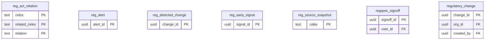

1 of these tables reference `organizations` (not drawn).

Foreign keys to other domains:

| Table | Columns | References | Domain |
|---|---|---|---|
| `regspec_signoff` | user_id | `users` | Identity & access |
| `regulatory_change` | created_by | `users` | Identity & access |

#### `reg_act_relation`

| Column | Type | Null | Default | Key / notes |
|---|---|---|---|---|
| `celex` | text | no |  | PK |
| `related_celex` | text | no |  | PK |
| `relation` | text | no |  | PK |
| `title` | text | yes |  |  |
| `entry_into_force` | jsonb | no | `'[]'::jsonb` |  |
| `in_force` | boolean | yes |  |  |
| `first_seen_at` | timestamp with time zone | no | `now()` |  |
| `last_seen_at` | timestamp with time zone | no | `now()` |  |

- Primary key: (celex, related_celex, relation)
- Check `ck_reg_act_relation`: `CHECK ((relation = ANY (ARRAY['amends'::text, 'repeals'::text, 'implicitly_repeals'::text])))`

#### `reg_alert`

| Column | Type | Null | Default | Key / notes |
|---|---|---|---|---|
| `alert_id` | uuid | no | `gen_random_uuid()` | PK |
| `org_id` | uuid | no |  |  |
| `alert_key` | text | no |  |  |
| `framework` | text | yes |  |  |
| `kind` | text | no |  |  |
| `title` | text | no |  |  |
| `effective_date` | date | yes |  |  |
| `task_id` | uuid | yes |  |  |
| `raised_at` | timestamp with time zone | no | `now()` |  |

- Unique `reg_alert_org_id_alert_key_key`: (org_id, alert_key)

#### `reg_detected_change`

| Column | Type | Null | Default | Key / notes |
|---|---|---|---|---|
| `change_id` | uuid | no | `gen_random_uuid()` | PK |
| `framework` | text | no |  |  |
| `celex` | text | no |  |  |
| `title` | text | no |  |  |
| `summary` | text | yes |  |  |
| `effective_date` | date | yes |  |  |
| `status` | text | no | `'pending_review'::text` |  |
| `url` | text | yes |  |  |
| `detected_at` | timestamp with time zone | no | `now()` |  |

- Index: `CREATE INDEX ix_reg_detected_change_fw ON public.reg_detected_change USING btree (framework, status)`

#### `reg_early_signal`

| Column | Type | Null | Default | Key / notes |
|---|---|---|---|---|
| `signal_id` | uuid | no | `gen_random_uuid()` | PK |
| `source_key` | text | no |  |  |
| `jurisdiction` | text | no |  |  |
| `url` | text | no |  | unique |
| `title` | text | no |  |  |
| `summary` | text | yes |  |  |
| `published_at` | timestamp with time zone | yes |  |  |
| `topics` | text[] | no | `'{}'::text[]` |  |
| `frameworks` | text[] | no | `'{}'::text[]` |  |
| `status` | text | no | `'unconfirmed'::text` |  |
| `confirmed_by` | uuid | yes |  |  |
| `first_seen_at` | timestamp with time zone | no | `now()` |  |

- Check `ck_reg_early_signal`: `CHECK ((status = ANY (ARRAY['unconfirmed'::text, 'register_confirmed'::text, 'dismissed'::text])))`
- Index: `CREATE INDEX ix_reg_early_signal_pub ON public.reg_early_signal USING btree (published_at DESC)`

#### `reg_source_snapshot`

| Column | Type | Null | Default | Key / notes |
|---|---|---|---|---|
| `celex` | text | no |  | PK |
| `framework` | text | no |  |  |
| `fingerprint` | text | no |  |  |
| `signal` | jsonb | yes |  |  |
| `checked_at` | timestamp with time zone | no | `now()` |  |
| `updated_at` | timestamp with time zone | no | `now()` |  |

#### `regspec_signoff`

| Column | Type | Null | Default | Key / notes |
|---|---|---|---|---|
| `signoff_id` | uuid | no | `gen_random_uuid()` | PK |
| `framework` | text | no |  |  |
| `version` | text | no |  |  |
| `sha256` | character(64) | no |  |  |
| `role` | text | no |  |  |
| `user_id` | uuid | no |  | FK → users.user_id |
| `note` | text | yes |  |  |
| `signed_at` | timestamp with time zone | no | `now()` |  |
| `sole_reviewer` | boolean | no | `false` |  |
| `seq` | bigint | no |  | unique; identity (always) |

- Check `ck_regspec_signoff_role`: `CHECK ((role = ANY (ARRAY['regulatory'::text, 'engineering'::text])))`
- Check `ck_regspec_sole_reviewer_note`: `CHECK (((NOT sole_reviewer) OR (COALESCE(length(TRIM(BOTH FROM note)), 0) > 0)))`
- Index: `CREATE INDEX ix_regspec_signoff_by_seq ON public.regspec_signoff USING btree (framework, version, seq)`
- Index: `CREATE UNIQUE INDEX ux_regspec_signoff_person ON public.regspec_signoff USING btree (framework, version, sha256, user_id) WHERE (NOT sole_reviewer)`
- Index: `CREATE UNIQUE INDEX ux_regspec_signoff_role ON public.regspec_signoff USING btree (framework, version, sha256, role)`
- Trigger `tr_regspec_signoff_worm`: BEFORE DELETE OR UPDATE for each row → `public.regspec_signoff_append_only`

#### `regulatory_change`

| Column | Type | Null | Default | Key / notes |
|---|---|---|---|---|
| `change_id` | uuid | no | `gen_random_uuid()` | PK |
| `org_id` | uuid | yes |  | FK → organizations.org_id |
| `title` | text | no |  |  |
| `framework` | text | yes |  |  |
| `summary` | text | yes |  |  |
| `citation` | text | yes |  |  |
| `stage` | text | no | `'identified'::text` |  |
| `owner` | text | no | `'platform'::text` |  |
| `impact` | text | yes |  |  |
| `effective_date` | date | yes |  |  |
| `created_by` | uuid | yes |  | FK → users.user_id |
| `created_at` | timestamp with time zone | no | `now()` |  |
| `updated_at` | timestamp with time zone | no | `now()` |  |

- Check `regulatory_change_owner_check`: `CHECK ((owner = ANY (ARRAY['platform'::text, 'tenant'::text])))`
- Check `regulatory_change_stage_check`: `CHECK ((stage = ANY (ARRAY['identified'::text, 'analysis'::text, 'scheduled'::text, 'in_dev'::text, 'testing'::text, 'released'::text])))`
- Index: `CREATE INDEX ix_reg_change_org ON public.regulatory_change USING btree (org_id)`
- Index: `CREATE INDEX ix_reg_change_stage ON public.regulatory_change USING btree (stage)`
- Trigger `trg_change_touch`: BEFORE UPDATE for each row → `public.touch_change_updated`

### 4.13 Supervision (18 tables)

```mermaid
erDiagram
  reg_case_message {
    uuid message_id PK
    uuid case_id FK
    uuid actor_user_id FK
  }
  reg_submission_case {
    uuid case_id PK
    uuid org_id FK
    uuid filing_id FK
    uuid created_by FK
  }
  supervision_assignment {
    uuid assignment_id PK
    uuid regulator_org_id FK
    uuid supervised_org_id FK
    uuid user_id FK
    uuid assigned_by FK
    uuid revoked_by FK
  }
  supervision_deadline {
    uuid deadline_id PK
    uuid regulator_org_id FK
  }
  supervision_deadline_notice {
    uuid notice_id PK
    uuid deadline_id FK
    uuid supervised_org_id FK
  }
  supervision_evidence_pack {
    uuid pack_id PK
    uuid regulator_org_id FK
    uuid supervised_org_id FK
    uuid generated_by FK
  }
  supervision_geo_prior_region {
    text geography PK
    text scenario PK
    text horizon PK
    text region PK
  }
  supervision_geo_prior_retired_20260930 {
    text geography PK
    text scenario PK
    text horizon PK
  }
  supervision_remittance {
    uuid remittance_id PK
    uuid regulator_org_id FK
    uuid supervised_org_id FK
    uuid pack_id FK
    uuid recipient_org_id FK
    uuid created_by FK
    uuid revoked_by FK
  }
  supervision_remittance_access {
    uuid access_id PK
    uuid remittance_id FK
    uuid actor_user_id FK
    uuid actor_org_id FK
  }
  supervision_request {
    uuid request_id PK
    uuid regulator_org_id FK
    uuid supervised_org_id FK
    uuid raised_by FK
    uuid closed_by FK
  }
  supervision_request_message {
    uuid message_id PK
    uuid request_id FK
    uuid author_id FK
  }
  supervision_scope {
    uuid supervision_id PK
    uuid regulator_org_id FK
    uuid supervised_org_id FK
  }
  supervisor_mandate_setting {
    uuid regulator_org_id PK,FK
    text mandate_id PK
  }
  supervisor_mandate_version_ack {
    uuid regulator_org_id PK,FK
    text mandate_id PK
    text version PK
  }
  supervisor_reference_counter {
    uuid regulator_org_id PK,FK
    integer year PK
  }
  supervisor_settings {
    uuid org_id PK,FK
  }
  supervisor_submissions {
    uuid submission_id PK
    uuid regulator_org_id FK
    uuid subject_org_id FK
  }
  reg_submission_case ||--o{ reg_case_message : "case_id"
  supervision_deadline ||--o{ supervision_deadline_notice : "deadline_id"
  supervision_evidence_pack ||--o{ supervision_remittance : "pack_id"
  supervision_remittance ||--o{ supervision_remittance_access : "remittance_id"
  supervision_request ||--o{ supervision_request_message : "request_id"
```

14 of these tables reference `organizations` (not drawn).

Foreign keys to other domains:

| Table | Columns | References | Domain |
|---|---|---|---|
| `reg_case_message` | actor_user_id | `users` | Identity & access |
| `reg_submission_case` | created_by | `users` | Identity & access |
| `reg_submission_case` | filing_id | `regulatory_filing` | Regulatory reporting & filings |
| `supervision_assignment` | assigned_by | `users` | Identity & access |
| `supervision_assignment` | revoked_by | `users` | Identity & access |
| `supervision_assignment` | user_id | `users` | Identity & access |
| `supervision_evidence_pack` | generated_by | `users` | Identity & access |
| `supervision_remittance` | created_by | `users` | Identity & access |
| `supervision_remittance` | revoked_by | `users` | Identity & access |
| `supervision_remittance_access` | actor_user_id | `users` | Identity & access |
| `supervision_request` | closed_by | `users` | Identity & access |
| `supervision_request` | raised_by | `users` | Identity & access |
| `supervision_request_message` | author_id | `users` | Identity & access |

#### `reg_case_message`

| Column | Type | Null | Default | Key / notes |
|---|---|---|---|---|
| `message_id` | uuid | no | `gen_random_uuid()` | PK |
| `case_id` | uuid | no |  | FK → reg_submission_case.case_id |
| `direction` | text | no |  |  |
| `author` | text | no |  |  |
| `body` | text | no |  |  |
| `attachment_ref` | text | yes |  |  |
| `actor_user_id` | uuid | yes |  | FK → users.user_id |
| `created_at` | timestamp with time zone | no | `now()` |  |
| `seq` | bigint | no |  | unique; identity (always) |

- Check `reg_case_message_direction_check`: `CHECK ((direction = ANY (ARRAY['outbound'::text, 'inbound'::text])))`
- Index: `CREATE INDEX ix_rcase_msg ON public.reg_case_message USING btree (case_id, created_at)`
- Index: `CREATE INDEX ix_reg_case_message_by_seq ON public.reg_case_message USING btree (case_id, seq)`
- Trigger `trg_case_msg_worm`: BEFORE DELETE OR UPDATE for each row → `public.prevent_case_message_mutation`

#### `reg_submission_case`

| Column | Type | Null | Default | Key / notes |
|---|---|---|---|---|
| `case_id` | uuid | no | `gen_random_uuid()` | PK |
| `org_id` | uuid | no |  | FK → organizations.org_id |
| `filing_id` | uuid | yes |  | FK → regulatory_filing.filing_id |
| `regulator` | text | no |  |  |
| `reference` | text | yes |  |  |
| `stage` | text | no | `'ready'::text` |  |
| `created_by` | uuid | yes |  | FK → users.user_id |
| `created_at` | timestamp with time zone | no | `now()` |  |
| `updated_at` | timestamp with time zone | no | `now()` |  |

- Check `reg_submission_case_stage_check`: `CHECK ((stage = ANY (ARRAY['ready'::text, 'submitted'::text, 'query'::text, 'answered'::text, 'closed'::text])))`
- Index: `CREATE INDEX ix_rcase_org ON public.reg_submission_case USING btree (org_id, updated_at DESC)`
- Trigger `trg_case_touch`: BEFORE UPDATE for each row → `public.touch_case_updated`

#### `supervision_assignment`

| Column | Type | Null | Default | Key / notes |
|---|---|---|---|---|
| `assignment_id` | uuid | no | `gen_random_uuid()` | PK |
| `regulator_org_id` | uuid | no |  | FK → organizations.org_id (on delete cascade) |
| `supervised_org_id` | uuid | no |  | FK → organizations.org_id (on delete cascade) |
| `user_id` | uuid | no |  | FK → users.user_id (on delete cascade) |
| `capacity` | text | no | `'lead'::text` |  |
| `assigned_at` | timestamp with time zone | no | `now()` |  |
| `assigned_by` | uuid | yes |  | FK → users.user_id |
| `revoked_at` | timestamp with time zone | yes |  |  |
| `revoked_by` | uuid | yes |  | FK → users.user_id |

- Index: `CREATE INDEX ix_supervision_assignment_user ON public.supervision_assignment USING btree (regulator_org_id, user_id) WHERE (revoked_at IS NULL)`
- Index: `CREATE UNIQUE INDEX ux_supervision_assignment_active ON public.supervision_assignment USING btree (regulator_org_id, supervised_org_id, user_id) WHERE (revoked_at IS NULL)`

#### `supervision_deadline`

| Column | Type | Null | Default | Key / notes |
|---|---|---|---|---|
| `deadline_id` | uuid | no | `gen_random_uuid()` | PK |
| `regulator_org_id` | uuid | no |  | FK → organizations.org_id (on delete cascade) |
| `mandate_id` | text | no |  |  |
| `framework` | text | no |  |  |
| `period_label` | text | no |  |  |
| `period_end` | date | no |  |  |
| `due_date` | date | no |  |  |
| `due_source` | text | no | `'registry'::text` |  |
| `note` | text | yes |  |  |
| `status` | text | no | `'draft'::text` |  |
| `published_at` | timestamp with time zone | yes |  |  |
| `published_by` | uuid | yes |  |  |
| `updated_at` | timestamp with time zone | no | `now()` |  |

- Unique `supervision_deadline_regulator_org_id_mandate_id_period_lab_key`: (regulator_org_id, mandate_id, period_label)
- Check `ck_deadline_period_label`: `CHECK ((period_label = ('FY'::text || (EXTRACT(year FROM period_end))::integer)))`

#### `supervision_deadline_notice`

| Column | Type | Null | Default | Key / notes |
|---|---|---|---|---|
| `notice_id` | uuid | no | `gen_random_uuid()` | PK |
| `deadline_id` | uuid | no |  | FK → supervision_deadline.deadline_id (on delete cascade) |
| `supervised_org_id` | uuid | no |  | FK → organizations.org_id (on delete cascade) |
| `stage` | text | no |  |  |
| `request_id` | uuid | yes |  |  |
| `sent_at` | timestamp with time zone | no | `now()` |  |

- Unique `supervision_deadline_notice_deadline_id_supervised_org_id_s_key`: (deadline_id, supervised_org_id, stage)

#### `supervision_evidence_pack`

| Column | Type | Null | Default | Key / notes |
|---|---|---|---|---|
| `pack_id` | uuid | no | `gen_random_uuid()` | PK |
| `regulator_org_id` | uuid | no |  | FK → organizations.org_id (on delete cascade) |
| `supervised_org_id` | uuid | no |  | FK → organizations.org_id (on delete cascade) |
| `version` | integer | no |  |  |
| `basis` | jsonb | no |  |  |
| `content` | jsonb | no |  |  |
| `sha256` | text | no |  |  |
| `pdf` | bytea | no |  |  |
| `pdf_bytes` | integer | no |  |  |
| `note` | text | yes |  |  |
| `generated_by` | uuid | yes |  | FK → users.user_id |
| `generated_at` | timestamp with time zone | no | `now()` |  |

- Unique `supervision_evidence_pack_regulator_org_id_supervised_org_i_key`: (regulator_org_id, supervised_org_id, version)
- Index: `CREATE INDEX ix_sup_evidence_entity ON public.supervision_evidence_pack USING btree (regulator_org_id, supervised_org_id, version DESC)`

#### `supervision_geo_prior_region`

| Column | Type | Null | Default | Key / notes |
|---|---|---|---|---|
| `geography` | text | no |  | PK |
| `scenario` | text | no |  | PK |
| `horizon` | text | no |  | PK |
| `region` | text | no |  | PK |
| `scores` | smallint[] | no |  |  |
| `hazards` | text[] | no |  |  |
| `source_note` | text | yes |  |  |
| `built_at` | timestamp with time zone | no | `now()` |  |

- Primary key: (geography, scenario, horizon, region)
- Check `ck_geo_prior_region_parallel`: `CHECK (((cardinality(scores) = cardinality(hazards)) AND (cardinality(scores) > 0)))`

#### `supervision_geo_prior_retired_20260930`

| Column | Type | Null | Default | Key / notes |
|---|---|---|---|---|
| `geography` | text | no |  | PK |
| `scenario` | text | no |  | PK |
| `horizon` | text | no |  | PK |
| `n_cells` | integer | no |  |  |
| `share_sensitive` | double precision | no |  |  |
| `p10` | double precision | yes |  |  |
| `p25` | double precision | yes |  |  |
| `p50` | double precision | yes |  |  |
| `p75` | double precision | yes |  |  |
| `p90` | double precision | yes |  |  |
| `n_regions` | integer | no | `0` |  |
| `hazard_mix` | jsonb | yes |  |  |
| `source_note` | text | yes |  |  |
| `built_at` | timestamp with time zone | no | `now()` |  |

- Primary key: (geography, scenario, horizon)

#### `supervision_remittance`

| Column | Type | Null | Default | Key / notes |
|---|---|---|---|---|
| `remittance_id` | uuid | no | `gen_random_uuid()` | PK |
| `regulator_org_id` | uuid | no |  | FK → organizations.org_id (on delete cascade) |
| `supervised_org_id` | uuid | no |  | FK → organizations.org_id (on delete cascade) |
| `pack_id` | uuid | no |  | FK → supervision_evidence_pack.pack_id (on delete cascade) |
| `reference` | text | no |  |  |
| `recipient_kind` | text | no |  |  |
| `recipient_name` | text | no |  |  |
| `recipient_org_id` | uuid | yes |  | FK → organizations.org_id (on delete set null) |
| `recipient_email` | text | yes |  |  |
| `purpose` | text | no |  |  |
| `legal_basis` | jsonb | no |  |  |
| `sections` | jsonb | no |  |  |
| `content` | jsonb | no |  |  |
| `content_sha256` | text | no |  |  |
| `pdf` | bytea | no |  |  |
| `pdf_sha256` | text | no |  |  |
| `watermark` | text | no |  |  |
| `token_hash` | text | no |  | unique |
| `expires_at` | timestamp with time zone | no |  |  |
| `max_downloads` | integer | yes |  |  |
| `n_downloads` | integer | no | `0` |  |
| `created_by` | uuid | yes |  | FK → users.user_id |
| `created_at` | timestamp with time zone | no | `now()` |  |
| `revoked_at` | timestamp with time zone | yes |  |  |
| `revoked_by` | uuid | yes |  | FK → users.user_id |
| `revoke_reason` | text | yes |  |  |

- Index: `CREATE INDEX ix_remittance_entity ON public.supervision_remittance USING btree (supervised_org_id, created_at DESC)`
- Index: `CREATE INDEX ix_remittance_recipient ON public.supervision_remittance USING btree (recipient_org_id) WHERE (recipient_org_id IS NOT NULL)`
- Index: `CREATE INDEX ix_remittance_regulator ON public.supervision_remittance USING btree (regulator_org_id, created_at DESC)`

#### `supervision_remittance_access`

| Column | Type | Null | Default | Key / notes |
|---|---|---|---|---|
| `access_id` | uuid | no | `gen_random_uuid()` | PK |
| `remittance_id` | uuid | no |  | FK → supervision_remittance.remittance_id (on delete cascade) |
| `at` | timestamp with time zone | no | `now()` |  |
| `action` | text | no |  |  |
| `outcome` | text | no |  |  |
| `actor_user_id` | uuid | yes |  | FK → users.user_id |
| `actor_org_id` | uuid | yes |  | FK → organizations.org_id |
| `ip` | text | yes |  |  |
| `user_agent` | text | yes |  |  |

- Index: `CREATE INDEX ix_remittance_access ON public.supervision_remittance_access USING btree (remittance_id, at DESC)`

#### `supervision_request`

| Column | Type | Null | Default | Key / notes |
|---|---|---|---|---|
| `request_id` | uuid | no | `gen_random_uuid()` | PK |
| `regulator_org_id` | uuid | no |  | FK → organizations.org_id (on delete cascade) |
| `supervised_org_id` | uuid | no |  | FK → organizations.org_id (on delete cascade) |
| `kind` | text | no |  |  |
| `title` | text | no |  |  |
| `body` | text | yes |  |  |
| `status` | text | no | `'open'::text` |  |
| `severity` | text | yes |  |  |
| `due_date` | date | yes |  |  |
| `source` | jsonb | yes |  |  |
| `raised_by` | uuid | yes |  | FK → users.user_id |
| `raised_at` | timestamp with time zone | no | `now()` |  |
| `updated_at` | timestamp with time zone | no | `now()` |  |
| `closed_at` | timestamp with time zone | yes |  |  |
| `closed_by` | uuid | yes |  | FK → users.user_id |
| `entity_task_id` | uuid | yes |  |  |
| `reference` | text | yes |  |  |
| `legal_basis` | jsonb | yes |  |  |
| `response_days` | integer | yes |  |  |
| `signatory` | text | yes |  |  |
| `letter_pdf` | bytea | yes |  |  |
| `letter_sha256` | text | yes |  |  |
| `issued_at` | timestamp with time zone | yes |  |  |
| `receipt_at` | timestamp with time zone | yes |  |  |
| `receipt_by` | uuid | yes |  |  |
| `responded_at` | timestamp with time zone | yes |  |  |

- Index: `CREATE INDEX ix_sup_request_entity ON public.supervision_request USING btree (supervised_org_id, status)`
- Index: `CREATE INDEX ix_sup_request_reg ON public.supervision_request USING btree (regulator_org_id, status)`
- Index: `CREATE UNIQUE INDEX ux_sup_request_reference ON public.supervision_request USING btree (regulator_org_id, reference) WHERE (reference IS NOT NULL)`

#### `supervision_request_message`

| Column | Type | Null | Default | Key / notes |
|---|---|---|---|---|
| `message_id` | uuid | no | `gen_random_uuid()` | PK |
| `request_id` | uuid | no |  | FK → supervision_request.request_id (on delete cascade) |
| `side` | text | no |  |  |
| `author_id` | uuid | yes |  | FK → users.user_id |
| `body` | text | yes |  |  |
| `status_to` | text | yes |  |  |
| `created_at` | timestamp with time zone | no | `now()` |  |
| `seq` | bigint | no |  | unique; identity (always) |

- Index: `CREATE INDEX ix_sup_request_msg ON public.supervision_request_message USING btree (request_id, created_at)`
- Index: `CREATE INDEX ix_supervision_request_message_by_seq ON public.supervision_request_message USING btree (request_id, seq)`

#### `supervision_scope`

| Column | Type | Null | Default | Key / notes |
|---|---|---|---|---|
| `supervision_id` | uuid | no | `gen_random_uuid()` | PK |
| `regulator_org_id` | uuid | no |  | FK → organizations.org_id (on delete cascade) |
| `supervised_org_id` | uuid | no |  | FK → organizations.org_id (on delete cascade) |
| `jurisdiction` | text | yes |  |  |
| `frameworks` | jsonb | yes |  |  |
| `active` | boolean | no | `true` |  |
| `created_at` | timestamp with time zone | no | `now()` |  |
| `site_access_granted_at` | timestamp with time zone | yes |  |  |
| `site_access_granted_by` | uuid | yes |  |  |
| `site_access_revoked_at` | timestamp with time zone | yes |  |  |
| `added_by` | uuid | yes |  |  |
| `ended_at` | timestamp with time zone | yes |  |  |
| `ended_by` | uuid | yes |  |  |
| `acknowledged_at` | timestamp with time zone | yes |  |  |
| `acknowledged_by` | uuid | yes |  |  |

- Unique `supervision_scope_regulator_org_id_supervised_org_id_key`: (regulator_org_id, supervised_org_id)
- Index: `CREATE INDEX ix_supervision_regulator ON public.supervision_scope USING btree (regulator_org_id) WHERE active`

#### `supervisor_mandate_setting`

| Column | Type | Null | Default | Key / notes |
|---|---|---|---|---|
| `regulator_org_id` | uuid | no |  | PK; FK → organizations.org_id (on delete cascade) |
| `mandate_id` | text | no |  | PK |
| `enabled` | boolean | no | `true` |  |
| `overrides` | jsonb | no | `'{}'::jsonb` |  |
| `note` | text | yes |  |  |
| `updated_by` | uuid | yes |  |  |
| `updated_at` | timestamp with time zone | no | `now()` |  |

- Primary key: (regulator_org_id, mandate_id)

#### `supervisor_mandate_version_ack`

| Column | Type | Null | Default | Key / notes |
|---|---|---|---|---|
| `regulator_org_id` | uuid | no |  | PK; FK → organizations.org_id (on delete cascade) |
| `mandate_id` | text | no |  | PK |
| `version` | text | no |  | PK |
| `acknowledged_by` | uuid | yes |  |  |
| `acknowledged_at` | timestamp with time zone | no | `now()` |  |
| `note` | text | yes |  |  |

- Primary key: (regulator_org_id, mandate_id, version)

#### `supervisor_reference_counter`

| Column | Type | Null | Default | Key / notes |
|---|---|---|---|---|
| `regulator_org_id` | uuid | no |  | PK; FK → organizations.org_id (on delete cascade) |
| `year` | integer | no |  | PK |
| `next_no` | integer | no | `1` |  |

- Primary key: (regulator_org_id, year)

#### `supervisor_settings`

| Column | Type | Null | Default | Key / notes |
|---|---|---|---|---|
| `org_id` | uuid | no |  | PK; FK → organizations.org_id (on delete cascade) |
| `profile` | text | no |  |  |
| `default_scenario` | text | yes |  |  |
| `default_horizon` | text | yes |  |  |
| `thresholds` | jsonb | no | `'{}'::jsonb` |  |
| `updated_at` | timestamp with time zone | no | `now()` |  |
| `updated_by` | uuid | yes |  |  |
| `reference_prefix` | text | yes |  |  |
| `signatory_title` | text | yes |  |  |

#### `supervisor_submissions`

| Column | Type | Null | Default | Key / notes |
|---|---|---|---|---|
| `submission_id` | uuid | no | `gen_random_uuid()` | PK |
| `regulator_org_id` | uuid | no |  | FK → organizations.org_id (on delete cascade) |
| `subject_org_id` | uuid | no |  | FK → organizations.org_id (on delete cascade) |
| `framework` | text | no |  |  |
| `template` | text | no |  |  |
| `period_label` | text | no |  |  |
| `basis` | jsonb | no | `'{}'::jsonb` |  |
| `cells` | jsonb | no |  |  |
| `n_cells` | integer | no |  |  |
| `source_file` | text | yes |  |  |
| `source_sha256` | text | yes |  |  |
| `column_mapping` | jsonb | no | `'{}'::jsonb` |  |
| `created_by` | uuid | yes |  |  |
| `created_at` | timestamp with time zone | no | `now()` |  |
| `channel` | text | no | `'supervisor_upload'::text` |  |

- Unique `supervisor_submissions_regulator_org_id_subject_org_id_fram_key`: (regulator_org_id, subject_org_id, framework, template, period_label)
- Index: `CREATE INDEX ix_sup_sub_subject ON public.supervisor_submissions USING btree (regulator_org_id, subject_org_id)`

### 4.14 Workflow, decisions & controls (23 tables)

```mermaid
erDiagram
  alert_configs {
    uuid config_id PK
    uuid location_id FK
  }
  alert_events {
    uuid alert_id PK
    uuid config_id FK
  }
  analytics_saved_view {
    uuid view_id PK
    uuid org_id FK
  }
  approval_policy {
    uuid org_id FK
    uuid updated_by FK
  }
  approval_requests {
    uuid request_id PK
    uuid org_id FK
    uuid maker_user_id FK
    uuid checker_user_id FK
    uuid assigned_to_user_id FK
  }
  board_pack {
    uuid pack_id PK
    uuid org_id FK
    uuid generated_by FK
  }
  board_pack_attestation {
    uuid attestation_id PK
    uuid pack_id FK
    uuid user_id FK
  }
  control_owner {
    uuid org_id PK,FK
    text control_id PK
    uuid owner_user_id FK
    uuid updated_by FK
  }
  control_test_result {
    uuid result_id PK
    uuid run_id FK
    uuid org_id FK
  }
  control_test_run {
    uuid run_id PK
    uuid org_id FK
    uuid actor_user_id FK
  }
  decision_disclosure_flag {
    uuid flag_id PK
    uuid org_id FK
    uuid flagged_by FK
    uuid resolved_by FK
  }
  decision_playbook {
    uuid org_id FK
    uuid assignee_user_id FK
    uuid updated_by FK
  }
  decision_watchlist {
    uuid watch_id PK
    uuid org_id FK
    uuid added_by FK
    uuid resolved_by FK
  }
  governance_structure {
    uuid governance_id PK
    uuid org_id FK
  }
  kri_breach_episode {
    uuid episode_id PK
    uuid org_id FK
  }
  kri_threshold {
    uuid threshold_id PK
    uuid org_id FK
    uuid updated_by FK
  }
  kri_threshold_version {
    uuid version_id PK
    uuid org_id FK
    uuid changed_by FK
    uuid approved_by FK
  }
  notifiable_event {
    uuid event_id PK
    uuid org_id FK
  }
  regulatory_task {
    uuid task_id PK
    uuid org_id FK
    uuid assignee_user_id FK
    uuid filing_id FK
    uuid created_by FK
  }
  regulatory_task_attachment {
    uuid attachment_id PK
    uuid org_id FK
    uuid task_id FK
    uuid uploaded_by FK
  }
  regulatory_task_event {
    uuid event_id PK
    uuid task_id FK
    uuid actor_user_id FK
  }
  regulatory_task_mention {
    uuid mention_id PK
    uuid org_id FK
    uuid task_id FK
    uuid mentioned_user FK
    uuid by_user FK
  }
  risk_decision {
    uuid decision_id PK
    uuid org_id FK
    uuid decided_by FK
    uuid approval_request_id FK
    uuid decided_by_checker FK
  }
  alert_configs ||--o{ alert_events : "config_id"
  board_pack ||--o{ board_pack_attestation : "pack_id"
  control_test_run ||--o{ control_test_result : "run_id"
  regulatory_task ||--o{ regulatory_task_attachment : "task_id"
  regulatory_task ||--o{ regulatory_task_event : "task_id"
  regulatory_task ||--o{ regulatory_task_mention : "task_id"
  approval_requests |o--o{ risk_decision : "approval_request_id"
```

19 of these tables reference `organizations` (not drawn).

Foreign keys to other domains:

| Table | Columns | References | Domain |
|---|---|---|---|
| `alert_configs` | location_id | `customer_locations` | Financial books (bank, insurer, real estate, portfolio) |
| `approval_policy` | updated_by | `users` | Identity & access |
| `approval_requests` | assigned_to_user_id | `users` | Identity & access |
| `approval_requests` | checker_user_id | `users` | Identity & access |
| `approval_requests` | maker_user_id | `users` | Identity & access |
| `board_pack` | generated_by | `users` | Identity & access |
| `board_pack_attestation` | user_id | `users` | Identity & access |
| `control_owner` | owner_user_id | `users` | Identity & access |
| `control_owner` | updated_by | `users` | Identity & access |
| `control_test_run` | actor_user_id | `users` | Identity & access |
| `decision_disclosure_flag` | flagged_by | `users` | Identity & access |
| `decision_disclosure_flag` | resolved_by | `users` | Identity & access |
| `decision_playbook` | assignee_user_id | `users` | Identity & access |
| `decision_playbook` | updated_by | `users` | Identity & access |
| `decision_watchlist` | added_by | `users` | Identity & access |
| `decision_watchlist` | resolved_by | `users` | Identity & access |
| `kri_threshold` | updated_by | `users` | Identity & access |
| `kri_threshold_version` | approved_by | `users` | Identity & access |
| `kri_threshold_version` | changed_by | `users` | Identity & access |
| `regulatory_task` | assignee_user_id | `users` | Identity & access |
| `regulatory_task` | created_by | `users` | Identity & access |
| `regulatory_task` | filing_id | `regulatory_filing` | Regulatory reporting & filings |
| `regulatory_task_attachment` | uploaded_by | `users` | Identity & access |
| `regulatory_task_event` | actor_user_id | `users` | Identity & access |
| `regulatory_task_mention` | by_user | `users` | Identity & access |
| `regulatory_task_mention` | mentioned_user | `users` | Identity & access |
| `risk_decision` | decided_by_checker | `users` | Identity & access |
| `risk_decision` | decided_by | `users` | Identity & access |

#### `alert_configs`

| Column | Type | Null | Default | Key / notes |
|---|---|---|---|---|
| `config_id` | uuid | no | `gen_random_uuid()` | PK |
| `customer_id` | uuid | no |  |  |
| `location_id` | uuid | yes |  | FK → customer_locations.location_id |
| `hazard_type` | character varying(50) | no |  |  |
| `scenario` | character varying(50) | no | `'''baseline'''::character varying` |  |
| `alert_threshold` | numeric(5,2) | no |  |  |
| `notification_channels` | jsonb | no |  |  |
| `maker_user_id` | character varying(255) | yes |  |  |
| `maker_at` | timestamp with time zone | yes |  |  |
| `checker_user_id` | character varying(255) | yes |  |  |
| `checker_at` | timestamp with time zone | yes |  |  |
| `is_active` | boolean | no | `false` |  |
| `activated_at` | timestamp with time zone | yes |  |  |
| `created_at` | timestamp with time zone | no | `now()` |  |

#### `alert_events`

| Column | Type | Null | Default | Key / notes |
|---|---|---|---|---|
| `alert_id` | uuid | no | `gen_random_uuid()` | PK |
| `config_id` | uuid | no |  | FK → alert_configs.config_id |
| `score_id` | uuid | no |  |  |
| `h3_cell` | character varying(20) | no |  |  |
| `hazard_type` | character varying(50) | no |  |  |
| `canonical_score` | numeric(5,2) | no |  |  |
| `alert_threshold` | numeric(5,2) | no |  |  |
| `fired_at` | timestamp with time zone | no | `now()` |  |
| `notification_status` | jsonb | yes |  |  |

#### `analytics_saved_view`

| Column | Type | Null | Default | Key / notes |
|---|---|---|---|---|
| `view_id` | uuid | no |  | PK |
| `org_id` | uuid | no |  | FK → organizations.org_id (on delete cascade) |
| `created_by` | uuid | no |  |  |
| `name` | character varying(120) | no |  |  |
| `config` | jsonb | no |  |  |
| `is_shared` | boolean | no | `false` |  |
| `is_pinned` | boolean | no | `false` |  |
| `created_at` | timestamp with time zone | yes | `now()` |  |
| `updated_at` | timestamp with time zone | yes | `now()` |  |

- Index: `CREATE INDEX idx_analytics_view_org ON public.analytics_saved_view USING btree (org_id)`

#### `approval_policy`

| Column | Type | Null | Default | Key / notes |
|---|---|---|---|---|
| `org_id` | uuid | yes |  | FK → organizations.org_id (on delete cascade) |
| `action_key` | text | no |  |  |
| `requires_approval` | boolean | no | `true` |  |
| `material_fields` | jsonb | no | `'[]'::jsonb` |  |
| `updated_at` | timestamp with time zone | no | `now()` |  |
| `updated_by` | uuid | yes |  | FK → users.user_id |
| `threshold_eur` | numeric | yes |  |  |
| `human_approvers` | smallint | no | `2` |  |

- Check `approval_policy_human_approvers_check`: `CHECK ((human_approvers = ANY (ARRAY[1, 2])))`
- Index: `CREATE UNIQUE INDEX approval_policy_default_action ON public.approval_policy USING btree (action_key) WHERE (org_id IS NULL)`
- Index: `CREATE UNIQUE INDEX approval_policy_org_action ON public.approval_policy USING btree (org_id, action_key) WHERE (org_id IS NOT NULL)`

#### `approval_requests`

| Column | Type | Null | Default | Key / notes |
|---|---|---|---|---|
| `request_id` | uuid | no | `gen_random_uuid()` | PK |
| `org_id` | uuid | no |  | FK → organizations.org_id (on delete cascade) |
| `request_type` | character varying(60) | no |  |  |
| `title` | text | yes |  |  |
| `payload` | jsonb | no | `'{}'::jsonb` |  |
| `status` | character varying(20) | no | `'pending'::character varying` |  |
| `maker_user_id` | uuid | no |  | FK → users.user_id |
| `checker_user_id` | uuid | yes |  | FK → users.user_id |
| `reason` | text | yes |  |  |
| `created_at` | timestamp with time zone | no | `now()` |  |
| `decided_at` | timestamp with time zone | yes |  |  |
| `assigned_to_user_id` | uuid | yes |  | FK → users.user_id (on delete set null) |
| `withdrawn_cause` | text | yes |  |  |
| `seq` | bigint | no |  | unique; identity (always) |

- Check `approval_requests_check`: `CHECK (((checker_user_id IS NULL) OR (checker_user_id <> maker_user_id)))`
- Check `approval_requests_status_check`: `CHECK (((status)::text = ANY ((ARRAY['pending'::character varying, 'approved'::character varying, 'rejected'::character varying, 'returned'::character varying, 'withdrawn'::character varying])::text[])))`
- Index: `CREATE INDEX ix_approval_requests_by_seq ON public.approval_requests USING btree (org_id, seq)`
- Index: `CREATE INDEX ix_approvals_org_status ON public.approval_requests USING btree (org_id, status)`

#### `board_pack`

| Column | Type | Null | Default | Key / notes |
|---|---|---|---|---|
| `pack_id` | uuid | no | `gen_random_uuid()` | PK |
| `org_id` | uuid | no |  | FK → organizations.org_id (on delete cascade) |
| `version` | integer | no |  |  |
| `period_from` | date | no |  |  |
| `period_to` | date | no |  |  |
| `basis` | jsonb | no |  |  |
| `content` | jsonb | no |  |  |
| `sha256` | text | no |  |  |
| `note` | text | yes |  |  |
| `generated_by` | uuid | yes |  | FK → users.user_id |
| `generated_at` | timestamp with time zone | no | `now()` |  |

- Unique `board_pack_org_id_version_key`: (org_id, version)
- Index: `CREATE INDEX ix_board_pack_org ON public.board_pack USING btree (org_id, version DESC)`

#### `board_pack_attestation`

| Column | Type | Null | Default | Key / notes |
|---|---|---|---|---|
| `attestation_id` | uuid | no | `gen_random_uuid()` | PK |
| `pack_id` | uuid | no |  | FK → board_pack.pack_id (on delete cascade) |
| `user_id` | uuid | no |  | FK → users.user_id |
| `capacity` | text | no |  |  |
| `statement` | text | no |  |  |
| `comment` | text | yes |  |  |
| `sha256` | text | no |  |  |
| `step_up` | boolean | no | `true` |  |
| `ip` | text | yes |  |  |
| `attested_at` | timestamp with time zone | no | `now()` |  |

- Unique `board_pack_attestation_pack_id_user_id_key`: (pack_id, user_id)

#### `control_owner`

| Column | Type | Null | Default | Key / notes |
|---|---|---|---|---|
| `org_id` | uuid | no |  | PK; FK → organizations.org_id (on delete cascade) |
| `control_id` | text | no |  | PK |
| `owner_user_id` | uuid | yes |  | FK → users.user_id |
| `review_by` | date | yes |  |  |
| `note` | text | yes |  |  |
| `updated_by` | uuid | yes |  | FK → users.user_id |
| `updated_at` | timestamp with time zone | no | `now()` |  |

- Primary key: (org_id, control_id)

#### `control_test_result`

| Column | Type | Null | Default | Key / notes |
|---|---|---|---|---|
| `result_id` | uuid | no | `gen_random_uuid()` | PK |
| `run_id` | uuid | no |  | FK → control_test_run.run_id (on delete cascade) |
| `org_id` | uuid | no |  | FK → organizations.org_id (on delete cascade) |
| `control_id` | text | no |  |  |
| `outcome` | text | no |  |  |
| `n_items` | integer | no | `0` |  |
| `n_failed` | integer | no | `0` |  |
| `detail` | jsonb | no | `'[]'::jsonb` |  |
| `at` | timestamp with time zone | no | `now()` |  |

- Index: `CREATE INDEX ix_control_result ON public.control_test_result USING btree (org_id, control_id, at DESC)`

#### `control_test_run`

| Column | Type | Null | Default | Key / notes |
|---|---|---|---|---|
| `run_id` | uuid | no | `gen_random_uuid()` | PK |
| `org_id` | uuid | no |  | FK → organizations.org_id (on delete cascade) |
| `at` | timestamp with time zone | no | `now()` |  |
| `trigger` | text | no |  |  |
| `actor_user_id` | uuid | yes |  | FK → users.user_id |
| `n_controls` | integer | no |  |  |
| `n_pass` | integer | no |  |  |
| `n_fail` | integer | no |  |  |
| `n_na` | integer | no |  |  |
| `register_version` | text | no |  |  |

- Index: `CREATE INDEX ix_control_run_org ON public.control_test_run USING btree (org_id, at DESC)`

#### `decision_disclosure_flag`

| Column | Type | Null | Default | Key / notes |
|---|---|---|---|---|
| `flag_id` | uuid | no | `gen_random_uuid()` | PK |
| `org_id` | uuid | no |  | FK → organizations.org_id |
| `entity_id` | uuid | no |  |  |
| `entity_name` | text | yes |  |  |
| `scenario` | text | yes |  |  |
| `horizon` | text | yes |  |  |
| `decision_id` | uuid | yes |  |  |
| `status` | text | no | `'open'::text` |  |
| `flagged_by` | uuid | yes |  | FK → users.user_id |
| `flagged_at` | timestamp with time zone | no | `now()` |  |
| `resolved_by` | uuid | yes |  | FK → users.user_id |
| `resolved_at` | timestamp with time zone | yes |  |  |
| `signal` | text | no | `'crossing'::text` |  |

- Check `decision_disclosure_flag_signal_check`: `CHECK ((signal = ANY (ARRAY['crossing'::text, 'loss'::text])))`
- Check `decision_disclosure_flag_status_check`: `CHECK ((status = ANY (ARRAY['open'::text, 'included'::text, 'dismissed'::text])))`
- Index: `CREATE UNIQUE INDEX ux_disclosure_flag_open ON public.decision_disclosure_flag USING btree (org_id, entity_id, signal) WHERE (status = 'open'::text)`

#### `decision_playbook`

| Column | Type | Null | Default | Key / notes |
|---|---|---|---|---|
| `org_id` | uuid | yes |  | FK → organizations.org_id |
| `action` | text | no |  |  |
| `spin_task` | boolean | no | `false` |  |
| `assignee_user_id` | uuid | yes |  | FK → users.user_id |
| `due_days` | integer | yes |  |  |
| `notify` | boolean | no | `false` |  |
| `flag_disclosure` | boolean | no | `false` |  |
| `watchlist` | boolean | no | `false` |  |
| `webhook` | boolean | no | `false` |  |
| `updated_by` | uuid | yes |  | FK → users.user_id |
| `updated_at` | timestamp with time zone | no | `now()` |  |

- Index: `CREATE UNIQUE INDEX ux_decision_playbook_default ON public.decision_playbook USING btree (action) WHERE (org_id IS NULL)`
- Index: `CREATE UNIQUE INDEX ux_decision_playbook_org ON public.decision_playbook USING btree (org_id, action) WHERE (org_id IS NOT NULL)`

#### `decision_watchlist`

| Column | Type | Null | Default | Key / notes |
|---|---|---|---|---|
| `watch_id` | uuid | no | `gen_random_uuid()` | PK |
| `org_id` | uuid | no |  | FK → organizations.org_id |
| `entity_id` | uuid | no |  |  |
| `entity_name` | text | yes |  |  |
| `scenario` | text | yes |  |  |
| `horizon` | text | yes |  |  |
| `decision_id` | uuid | yes |  |  |
| `baseline_score` | double precision | yes |  |  |
| `review_date` | date | yes |  |  |
| `status` | text | no | `'watching'::text` |  |
| `last_checked_at` | timestamp with time zone | yes |  |  |
| `last_score` | double precision | yes |  |  |
| `last_delta` | double precision | yes |  |  |
| `added_by` | uuid | yes |  | FK → users.user_id |
| `added_at` | timestamp with time zone | no | `now()` |  |
| `resolved_by` | uuid | yes |  | FK → users.user_id |
| `resolved_at` | timestamp with time zone | yes |  |  |
| `signal` | text | no | `'crossing'::text` |  |
| `baseline_share` | double precision | yes |  |  |
| `last_share` | double precision | yes |  |  |

- Check `decision_watchlist_measure_check`: `CHECK ((((signal = 'crossing'::text) AND (baseline_share IS NULL) AND (last_share IS NULL)) OR ((signal = 'loss'::text) AND (baseline_score IS NULL) AND (last_score IS NULL) AND (last_delta IS NULL))))`
- Check `decision_watchlist_signal_check`: `CHECK ((signal = ANY (ARRAY['crossing'::text, 'loss'::text])))`
- Check `decision_watchlist_status_check`: `CHECK ((status = ANY (ARRAY['watching'::text, 'cleared'::text, 'escalated'::text])))`
- Index: `CREATE UNIQUE INDEX ux_watchlist_open ON public.decision_watchlist USING btree (org_id, entity_id, signal) WHERE (status = 'watching'::text)`

#### `governance_structure`

| Column | Type | Null | Default | Key / notes |
|---|---|---|---|---|
| `governance_id` | uuid | no |  | PK |
| `org_id` | uuid | no |  | FK → organizations.org_id (on delete cascade); unique |
| `board_committee_with_climate_oversight` | character varying(255) | yes |  |  |
| `climate_risk_owner_title` | character varying(100) | yes |  |  |
| `management_level_owner_title` | character varying(100) | yes |  |  |
| `governance_policy_last_updated` | date | yes |  |  |
| `climate_risk_discussed_in_board_meetings` | integer | yes |  |  |
| `climate_risk_integrated_in_strategic_plan` | boolean | yes |  |  |
| `climate_risk_integrated_in_capital_allocation` | boolean | yes |  |  |
| `climate_risk_integrated_in_compensation` | boolean | yes |  |  |
| `governance_disclosure_status` | character varying(50) | yes |  |  |
| `created_at` | timestamp with time zone | yes | `now()` |  |
| `updated_at` | timestamp with time zone | yes | `now()` |  |

#### `kri_breach_episode`

| Column | Type | Null | Default | Key / notes |
|---|---|---|---|---|
| `episode_id` | uuid | no |  | PK |
| `org_id` | uuid | no |  | FK → organizations.org_id (on delete cascade) |
| `framework` | character varying(60) | no |  |  |
| `kri_key` | character varying(80) | no |  |  |
| `label` | character varying(200) | yes |  |  |
| `severity` | character varying(10) | no |  |  |
| `direction` | character varying(20) | yes |  |  |
| `onset_value` | numeric | yes |  |  |
| `peak_value` | numeric | yes |  |  |
| `threshold` | numeric | yes |  |  |
| `onset_at` | timestamp with time zone | no | `now()` |  |
| `last_seen_at` | timestamp with time zone | yes | `now()` |  |
| `acknowledged_at` | timestamp with time zone | yes |  |  |
| `acknowledged_by` | uuid | yes |  |  |
| `cleared_at` | timestamp with time zone | yes |  |  |
| `created_at` | timestamp with time zone | yes | `now()` |  |

- Index: `CREATE INDEX idx_kri_episode_lookup ON public.kri_breach_episode USING btree (org_id, framework, kri_key)`
- Index: `CREATE UNIQUE INDEX uq_kri_episode_open ON public.kri_breach_episode USING btree (org_id, framework, kri_key) WHERE (cleared_at IS NULL)`

#### `kri_threshold`

| Column | Type | Null | Default | Key / notes |
|---|---|---|---|---|
| `threshold_id` | uuid | no | `gen_random_uuid()` | PK |
| `org_id` | uuid | yes |  | FK → organizations.org_id |
| `framework` | text | no |  |  |
| `kri_key` | text | no |  |  |
| `amber` | double precision | yes |  |  |
| `red` | double precision | yes |  |  |
| `direction` | text | no | `'higher_worse'::text` |  |
| `updated_by` | uuid | yes |  | FK → users.user_id |
| `updated_at` | timestamp with time zone | no | `now()` |  |

- Check `kri_threshold_direction_check`: `CHECK ((direction = ANY (ARRAY['higher_worse'::text, 'lower_worse'::text])))`
- Index: `CREATE UNIQUE INDEX ux_kri_threshold_default ON public.kri_threshold USING btree (framework, kri_key) WHERE (org_id IS NULL)`
- Index: `CREATE UNIQUE INDEX ux_kri_threshold_org ON public.kri_threshold USING btree (org_id, framework, kri_key) WHERE (org_id IS NOT NULL)`

#### `kri_threshold_version`

| Column | Type | Null | Default | Key / notes |
|---|---|---|---|---|
| `version_id` | uuid | no | `gen_random_uuid()` | PK |
| `org_id` | uuid | no |  | FK → organizations.org_id (on delete cascade) |
| `framework` | text | no |  |  |
| `kri_key` | text | no |  |  |
| `version` | integer | no |  |  |
| `amber` | numeric | yes |  |  |
| `red` | numeric | yes |  |  |
| `direction` | text | yes |  |  |
| `previous` | jsonb | yes |  |  |
| `reason` | text | yes |  |  |
| `changed_by` | uuid | yes |  | FK → users.user_id |
| `approved_by` | uuid | yes |  | FK → users.user_id |
| `approval_request_id` | uuid | yes |  |  |
| `created_at` | timestamp with time zone | no | `now()` |  |
| `seq` | bigint | no |  | unique; identity (always) |

- Unique `kri_threshold_version_org_id_framework_kri_key_version_key`: (org_id, framework, kri_key, version)
- Index: `CREATE INDEX ix_kri_threshold_version ON public.kri_threshold_version USING btree (org_id, framework, created_at DESC)`
- Index: `CREATE INDEX ix_kri_threshold_version_by_seq ON public.kri_threshold_version USING btree (org_id, framework, seq)`

#### `notifiable_event`

| Column | Type | Null | Default | Key / notes |
|---|---|---|---|---|
| `event_id` | uuid | no |  | PK |
| `org_id` | uuid | no |  | FK → organizations.org_id (on delete cascade) |
| `source_type` | character varying(30) | no |  |  |
| `source_ref` | character varying(160) | yes |  |  |
| `title` | character varying(240) | no |  |  |
| `category` | character varying(40) | yes |  |  |
| `severity` | character varying(10) | yes |  |  |
| `authority` | character varying(120) | yes |  |  |
| `arose_at` | timestamp with time zone | no |  |  |
| `window_hours` | integer | no |  |  |
| `due_at` | timestamp with time zone | no |  |  |
| `status` | character varying(12) | no | `'open'::character varying` |  |
| `notified_at` | timestamp with time zone | yes |  |  |
| `notified_ref` | character varying(160) | yes |  |  |
| `notified_to` | character varying(200) | yes |  |  |
| `notified_by` | uuid | yes |  |  |
| `assignee_user_id` | uuid | yes |  |  |
| `dismiss_reason` | text | yes |  |  |
| `created_by` | uuid | yes |  |  |
| `created_at` | timestamp with time zone | yes | `now()` |  |
| `updated_at` | timestamp with time zone | yes | `now()` |  |

- Index: `CREATE INDEX idx_notifiable_org_status ON public.notifiable_event USING btree (org_id, status)`
- Index: `CREATE UNIQUE INDEX uq_notifiable_open_source ON public.notifiable_event USING btree (org_id, source_type, source_ref) WHERE ((status)::text = 'open'::text)`

#### `regulatory_task`

| Column | Type | Null | Default | Key / notes |
|---|---|---|---|---|
| `task_id` | uuid | no | `gen_random_uuid()` | PK |
| `org_id` | uuid | no |  | FK → organizations.org_id |
| `title` | text | no |  |  |
| `description` | text | yes |  |  |
| `status` | text | no | `'todo'::text` |  |
| `criticality` | text | no | `'normal'::text` |  |
| `assignee_user_id` | uuid | yes |  | FK → users.user_id |
| `filing_id` | uuid | yes |  | FK → regulatory_filing.filing_id |
| `source` | text | no | `'manual'::text` |  |
| `source_ref` | text | yes |  |  |
| `due_date` | date | yes |  |  |
| `depends_on` | uuid[] | no | `'{}'::uuid[]` |  |
| `position` | double precision | no | `0` |  |
| `created_by` | uuid | yes |  | FK → users.user_id |
| `created_at` | timestamp with time zone | no | `now()` |  |
| `updated_at` | timestamp with time zone | no | `now()` |  |

- Check `regulatory_task_criticality_check`: `CHECK ((criticality = ANY (ARRAY['low'::text, 'normal'::text, 'high'::text, 'critical'::text])))`
- Check `regulatory_task_source_check`: `CHECK ((source = ANY (ARRAY['manual'::text, 'validation'::text, 'exception'::text, 'obligation'::text, 'regulatory_change'::text, 'decision'::text, 'kri'::text, 'supervisor'::text])))`
- Check `regulatory_task_status_check`: `CHECK ((status = ANY (ARRAY['icebox'::text, 'todo'::text, 'blocked'::text, 'doing'::text, 'review'::text, 'done'::text, 'cancelled'::text])))`
- Index: `CREATE INDEX ix_reg_task_assignee ON public.regulatory_task USING btree (assignee_user_id)`
- Index: `CREATE INDEX ix_reg_task_filing ON public.regulatory_task USING btree (filing_id)`
- Index: `CREATE INDEX ix_reg_task_org_status ON public.regulatory_task USING btree (org_id, status)`
- Index: `CREATE UNIQUE INDEX ux_reg_task_source ON public.regulatory_task USING btree (org_id, source, source_ref) WHERE ((source_ref IS NOT NULL) AND (status <> 'cancelled'::text) AND (status <> 'done'::text))`
- Trigger `trg_task_touch`: BEFORE UPDATE for each row → `public.touch_task_updated`

#### `regulatory_task_attachment`

| Column | Type | Null | Default | Key / notes |
|---|---|---|---|---|
| `attachment_id` | uuid | no | `gen_random_uuid()` | PK |
| `org_id` | uuid | no |  | FK → organizations.org_id |
| `task_id` | uuid | no |  | FK → regulatory_task.task_id (on delete cascade) |
| `filename` | text | no |  |  |
| `content_type` | text | yes |  |  |
| `size_bytes` | integer | no |  |  |
| `data` | bytea | no |  |  |
| `uploaded_by` | uuid | yes |  | FK → users.user_id |
| `uploaded_at` | timestamp with time zone | no | `now()` |  |

- Index: `CREATE INDEX ix_task_attachment_task ON public.regulatory_task_attachment USING btree (task_id)`

#### `regulatory_task_event`

| Column | Type | Null | Default | Key / notes |
|---|---|---|---|---|
| `event_id` | uuid | no | `gen_random_uuid()` | PK |
| `task_id` | uuid | no |  | FK → regulatory_task.task_id |
| `kind` | text | no |  |  |
| `from_val` | text | yes |  |  |
| `to_val` | text | yes |  |  |
| `note` | text | yes |  |  |
| `actor_user_id` | uuid | yes |  | FK → users.user_id |
| `created_at` | timestamp with time zone | no | `now()` |  |
| `seq` | bigint | no |  | unique; identity (always) |

- Index: `CREATE INDEX ix_reg_task_event ON public.regulatory_task_event USING btree (task_id, created_at)`
- Index: `CREATE INDEX ix_regulatory_task_event_by_seq ON public.regulatory_task_event USING btree (task_id, seq)`
- Trigger `trg_task_event_worm`: BEFORE DELETE OR UPDATE for each row → `public.prevent_task_event_mutation`

#### `regulatory_task_mention`

| Column | Type | Null | Default | Key / notes |
|---|---|---|---|---|
| `mention_id` | uuid | no | `gen_random_uuid()` | PK |
| `org_id` | uuid | no |  | FK → organizations.org_id |
| `task_id` | uuid | no |  | FK → regulatory_task.task_id (on delete cascade) |
| `mentioned_user` | uuid | no |  | FK → users.user_id |
| `by_user` | uuid | yes |  | FK → users.user_id |
| `snippet` | text | yes |  |  |
| `created_at` | timestamp with time zone | no | `now()` |  |
| `read_at` | timestamp with time zone | yes |  |  |
| `seq` | bigint | no |  | unique; identity (always) |

- Index: `CREATE INDEX ix_regulatory_task_mention_by_seq ON public.regulatory_task_mention USING btree (org_id, mentioned_user, seq)`
- Index: `CREATE INDEX ix_task_mention_inbox ON public.regulatory_task_mention USING btree (mentioned_user, read_at, created_at)`

#### `risk_decision`

| Column | Type | Null | Default | Key / notes |
|---|---|---|---|---|
| `decision_id` | uuid | no | `gen_random_uuid()` | PK |
| `org_id` | uuid | no |  | FK → organizations.org_id |
| `entity_id` | uuid | no |  |  |
| `entity_name` | text | yes |  |  |
| `scenario` | text | no |  |  |
| `horizon` | text | no |  |  |
| `action` | text | no |  |  |
| `rationale` | text | yes |  |  |
| `status` | text | no | `'proposed'::text` |  |
| `decided_by` | uuid | yes |  | FK → users.user_id |
| `decided_at` | timestamp with time zone | no | `now()` |  |
| `approval_request_id` | uuid | yes |  | FK → approval_requests.request_id |
| `decided_by_checker` | uuid | yes |  | FK → users.user_id |
| `confirmed_at` | timestamp with time zone | yes |  |  |
| `signal` | text | no | `'crossing'::text` |  |
| `seq` | bigint | no |  | unique; identity (always) |

- Check `risk_decision_loss_today_check`: `CHECK (((signal <> 'loss'::text) OR ((scenario = 'baseline'::text) AND (horizon = 'current'::text))))`
- Check `risk_decision_signal_check`: `CHECK ((signal = ANY (ARRAY['crossing'::text, 'loss'::text])))`
- Check `risk_decision_status_check`: `CHECK ((status = ANY (ARRAY['proposed'::text, 'approved'::text, 'rejected'::text, 'withdrawn'::text])))`
- Index: `CREATE INDEX ix_risk_decision_lookup ON public.risk_decision USING btree (org_id, entity_id, scenario, horizon, decided_at DESC)`
- Index: `CREATE INDEX ix_risk_decision_signal_seq ON public.risk_decision USING btree (org_id, signal, entity_id, seq DESC)`

### 4.15 Data intake & integration (16 tables)

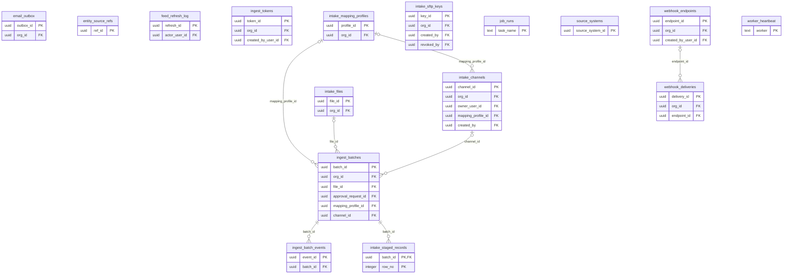

9 of these tables reference `organizations` (not drawn).

Foreign keys to other domains:

| Table | Columns | References | Domain |
|---|---|---|---|
| `feed_refresh_log` | actor_user_id | `users` | Identity & access |
| `ingest_batches` | approval_request_id | `approval_requests` | Workflow, decisions & controls |
| `ingest_tokens` | created_by_user_id | `users` | Identity & access |
| `intake_channels` | created_by | `users` | Identity & access |
| `intake_channels` | owner_user_id | `users` | Identity & access |
| `intake_sftp_keys` | created_by | `users` | Identity & access |
| `intake_sftp_keys` | revoked_by | `users` | Identity & access |
| `webhook_endpoints` | created_by_user_id | `users` | Identity & access |

#### `email_outbox`

| Column | Type | Null | Default | Key / notes |
|---|---|---|---|---|
| `outbox_id` | uuid | no | `gen_random_uuid()` | PK |
| `org_id` | uuid | yes |  | FK → organizations.org_id |
| `to_email` | text | no |  |  |
| `subject` | text | no |  |  |
| `body_html` | text | yes |  |  |
| `body_text` | text | yes |  |  |
| `kind` | text | yes |  |  |
| `ref_type` | text | yes |  |  |
| `ref_id` | uuid | yes |  |  |
| `status` | text | no | `'pending'::text` |  |
| `transport` | text | yes |  |  |
| `attempts` | integer | no | `0` |  |
| `last_error` | text | yes |  |  |
| `created_at` | timestamp with time zone | no | `now()` |  |
| `sent_at` | timestamp with time zone | yes |  |  |

- Check `email_outbox_status_check`: `CHECK ((status = ANY (ARRAY['pending'::text, 'sent'::text, 'failed'::text, 'skipped'::text])))`
- Index: `CREATE INDEX ix_email_outbox_pending ON public.email_outbox USING btree (status, created_at)`

#### `entity_source_refs`

| Column | Type | Null | Default | Key / notes |
|---|---|---|---|---|
| `ref_id` | uuid | no |  | PK |
| `org_id` | uuid | no |  |  |
| `entity_id` | uuid | no |  |  |
| `source_system_key` | character varying(64) | no |  |  |
| `source_record_id` | character varying(200) | no |  |  |
| `created_at` | timestamp with time zone | no |  |  |

- Unique `uq_entity_source_ref`: (org_id, entity_id, source_system_key)

#### `feed_refresh_log`

| Column | Type | Null | Default | Key / notes |
|---|---|---|---|---|
| `refresh_id` | uuid | no | `gen_random_uuid()` | PK |
| `feed_key` | text | no |  |  |
| `status` | text | no | `'refreshed'::text` |  |
| `note` | text | yes |  |  |
| `actor_user_id` | uuid | yes |  | FK → users.user_id |
| `created_at` | timestamp with time zone | no | `now()` |  |
| `cause` | character varying(20) | yes |  |  |
| `seq` | bigint | no |  | unique; identity (always) |

- Check `feed_refresh_log_cause_kind`: `CHECK (((cause)::text = ANY ((ARRAY['source_unreachable'::character varying, 'adapter_fault'::character varying])::text[])))`
- Check `feed_refresh_log_cause_on_failure`: `CHECK (((cause IS NULL) OR (status = 'failed'::text)))`
- Index: `CREATE INDEX ix_feed_refresh_log_feed ON public.feed_refresh_log USING btree (feed_key, created_at DESC)`
- Index: `CREATE INDEX ix_feed_refresh_log_seq ON public.feed_refresh_log USING btree (feed_key, seq DESC)`

#### `ingest_batch_events`

| Column | Type | Null | Default | Key / notes |
|---|---|---|---|---|
| `event_id` | uuid | no | `gen_random_uuid()` | PK |
| `batch_id` | uuid | no |  | FK → ingest_batches.batch_id (on delete cascade) |
| `org_id` | uuid | no |  |  |
| `at` | timestamp with time zone | no | `clock_timestamp()` |  |
| `from_state` | text | yes |  |  |
| `to_state` | text | no |  |  |
| `actor_user_id` | uuid | yes |  |  |
| `actor_token_id` | uuid | yes |  |  |
| `detail` | jsonb | no | `'{}'::jsonb` |  |

- Index: `CREATE INDEX ix_ingest_batch_events ON public.ingest_batch_events USING btree (batch_id, at)`
- Trigger `trg_ingest_event_worm`: BEFORE DELETE OR UPDATE for each row → `public.prevent_ingest_event_mutation`

#### `ingest_batches`

| Column | Type | Null | Default | Key / notes |
|---|---|---|---|---|
| `batch_id` | uuid | no | `gen_random_uuid()` | PK |
| `org_id` | uuid | no |  | FK → organizations.org_id (on delete cascade) |
| `template` | text | no |  |  |
| `via` | text | no | `'upload'::text` |  |
| `filename` | text | yes |  |  |
| `sha256` | text | no |  |  |
| `received_by` | uuid | yes |  |  |
| `received_at` | timestamp with time zone | no | `now()` |  |
| `declared` | jsonb | no | `'{}'::jsonb` |  |
| `n_total` | integer | yes |  |  |
| `n_valid` | integer | yes |  |  |
| `n_rejected` | integer | yes |  |  |
| `value_field` | text | yes |  |  |
| `value_valid` | double precision | yes |  |  |
| `receipt` | jsonb | yes |  |  |
| `transform` | jsonb | yes |  |  |
| `gate_status` | text | yes |  |  |
| `gate_reasons` | jsonb | no | `'[]'::jsonb` |  |
| `landing` | jsonb | yes |  |  |
| `imported_at` | timestamp with time zone | yes |  |  |
| `file_id` | uuid | yes |  | FK → intake_files.file_id |
| `state` | text | no | `'received'::text` |  |
| `state_changed_at` | timestamp with time zone | no | `now()` |  |
| `token_id` | uuid | yes |  |  |
| `maker_reason` | text | yes |  |  |
| `approval_request_id` | uuid | yes |  | FK → approval_requests.request_id |
| `rejected_reason` | text | yes |  |  |
| `ingest_notes` | jsonb | yes |  |  |
| `mapping_profile_id` | uuid | yes |  | FK → intake_mapping_profiles.profile_id |
| `mapping_report` | jsonb | yes |  |  |
| `match_summary` | jsonb | yes |  |  |
| `channel_id` | uuid | yes |  | FK → intake_channels.channel_id |
| `currency` | character(3) | yes |  |  |
| `book_date` | date | yes |  |  |
| `money_report` | jsonb | yes |  |  |
| `imported_seq` | bigint | yes |  | unique |
| `sheet` | text | yes |  |  |

- Check `ck_ingest_batch_4eyes`: `CHECK (((state <> 'imported'::text) OR (gate_status = 'pass'::text) OR (approval_request_id IS NOT NULL)))`
- Check `ck_ingest_batch_awaiting`: `CHECK (((state <> 'awaiting_approval'::text) OR (approval_request_id IS NOT NULL)))`
- Check `ck_ingest_batch_gate`: `CHECK (((gate_status IS NULL) OR (gate_status = ANY (ARRAY['pass'::text, 'needs_signoff'::text, 'blocked'::text]))))`
- Check `ck_ingest_batch_imported_seq`: `CHECK (((state <> 'imported'::text) OR (imported_seq IS NOT NULL)))`
- Check `ck_ingest_batch_state`: `CHECK ((state = ANY (ARRAY['received'::text, 'held'::text, 'rejected'::text, 'checked'::text, 'awaiting_approval'::text, 'imported'::text])))`
- Index: `CREATE INDEX ix_ingest_batches_imported_seq ON public.ingest_batches USING btree (org_id, imported_seq DESC)`
- Index: `CREATE INDEX ix_ingest_batches_org ON public.ingest_batches USING btree (org_id, received_at DESC)`
- Index: `CREATE INDEX ix_ingest_batches_sha ON public.ingest_batches USING btree (org_id, template, sha256)`
- Index: `CREATE INDEX ix_ingest_batches_state ON public.ingest_batches USING btree (org_id, state)`
- Trigger `trg_ingest_batch_imported_seq`: BEFORE INSERT OR UPDATE for each row → `public.ingest_batch_imported_seq`

#### `ingest_tokens`

| Column | Type | Null | Default | Key / notes |
|---|---|---|---|---|
| `token_id` | uuid | no | `gen_random_uuid()` | PK |
| `org_id` | uuid | no |  | FK → organizations.org_id (on delete cascade) |
| `created_by_user_id` | uuid | yes |  | FK → users.user_id (on delete set null) |
| `name` | text | no |  |  |
| `token_hash` | text | no |  | unique |
| `token_prefix` | character varying(16) | no |  |  |
| `is_active` | boolean | no | `true` |  |
| `created_at` | timestamp with time zone | no | `now()` |  |
| `last_used_at` | timestamp with time zone | yes |  |  |
| `expires_at` | timestamp with time zone | yes |  |  |

- Index: `CREATE INDEX ix_ingest_tokens_hash ON public.ingest_tokens USING btree (token_hash)`
- Index: `CREATE INDEX ix_ingest_tokens_org ON public.ingest_tokens USING btree (org_id)`

#### `intake_channels`

| Column | Type | Null | Default | Key / notes |
|---|---|---|---|---|
| `channel_id` | uuid | no | `gen_random_uuid()` | PK |
| `org_id` | uuid | no |  | FK → organizations.org_id |
| `template` | text | no |  |  |
| `kind` | text | no | `'drop_folder'::text` |  |
| `folder` | text | no |  | unique |
| `owner_user_id` | uuid | no |  | FK → users.user_id |
| `mapping_profile_id` | uuid | yes |  | FK → intake_mapping_profiles.profile_id |
| `enabled` | boolean | no | `true` |  |
| `created_by` | uuid | yes |  | FK → users.user_id |
| `created_at` | timestamp with time zone | no | `now()` |  |
| `last_swept_at` | timestamp with time zone | yes |  |  |
| `currency` | character(3) | yes |  |  |

- Unique `ux_channel_org_template`: (org_id, template, kind)
- Check `ck_channel_kind`: `CHECK ((kind = 'drop_folder'::text))`

#### `intake_files`

| Column | Type | Null | Default | Key / notes |
|---|---|---|---|---|
| `file_id` | uuid | no | `gen_random_uuid()` | PK |
| `org_id` | uuid | no |  | FK → organizations.org_id (on delete cascade) |
| `sha256` | text | no |  |  |
| `size_bytes` | bigint | no |  |  |
| `original_name` | text | yes |  |  |
| `detected_type` | text | no |  |  |
| `storage_uri` | text | no |  |  |
| `received_via` | text | no |  |  |
| `received_by` | uuid | yes |  |  |
| `token_id` | uuid | yes |  |  |
| `received_at` | timestamp with time zone | no | `now()` |  |
| `security_status` | text | no |  |  |
| `security_findings` | jsonb | no | `'[]'::jsonb` |  |
| `malware_status` | text | no |  |  |
| `malware_signature` | text | yes |  |  |
| `malware_engine` | text | yes |  |  |
| `scanned_at` | timestamp with time zone | yes |  |  |
| `retain_until` | date | no |  |  |

- Check `ck_intake_file_actor`: `CHECK (((received_by IS NOT NULL) OR (token_id IS NOT NULL)))`
- Check `ck_intake_file_mw`: `CHECK ((malware_status = ANY (ARRAY['clean'::text, 'infected'::text, 'error'::text, 'not_configured'::text, 'not_scanned'::text])))`
- Check `ck_intake_file_sec`: `CHECK ((security_status = ANY (ARRAY['passed'::text, 'warned'::text, 'blocked'::text])))`
- Check `ck_intake_file_via`: `CHECK ((received_via = ANY (ARRAY['upload'::text, 'api'::text, 'sftp'::text])))`
- Index: `CREATE INDEX ix_intake_files_org ON public.intake_files USING btree (org_id, received_at DESC)`
- Index: `CREATE INDEX ix_intake_files_sha ON public.intake_files USING btree (org_id, sha256)`
- Trigger `trg_intake_file_protect`: BEFORE DELETE OR UPDATE for each row → `public.protect_intake_file`

#### `intake_mapping_profiles`

| Column | Type | Null | Default | Key / notes |
|---|---|---|---|---|
| `profile_id` | uuid | no | `gen_random_uuid()` | PK |
| `org_id` | uuid | no |  | FK → organizations.org_id (on delete cascade) |
| `template` | text | no |  |  |
| `name` | text | no |  |  |
| `version` | integer | no |  |  |
| `column_map` | jsonb | no |  |  |
| `transforms` | jsonb | no | `'{}'::jsonb` |  |
| `created_by` | uuid | no |  |  |
| `created_at` | timestamp with time zone | no | `now()` |  |
| `source_fingerprint` | text | yes |  |  |
| `source_columns` | jsonb | yes |  |  |

- Unique `intake_mapping_profiles_org_id_template_name_version_key`: (org_id, template, name, version)
- Index: `CREATE INDEX ix_mapping_profile_fp ON public.intake_mapping_profiles USING btree (org_id, template, source_fingerprint) WHERE (source_fingerprint IS NOT NULL)`
- Trigger `trg_mapping_profile_worm`: BEFORE DELETE OR UPDATE for each row → `public.prevent_mapping_profile_mutation`

#### `intake_sftp_keys`

| Column | Type | Null | Default | Key / notes |
|---|---|---|---|---|
| `key_id` | uuid | no | `gen_random_uuid()` | PK |
| `org_id` | uuid | no |  | FK → organizations.org_id |
| `label` | text | no |  |  |
| `key_type` | text | no |  |  |
| `public_key` | text | no |  |  |
| `fingerprint` | text | no |  |  |
| `bits` | integer | yes |  |  |
| `created_by` | uuid | yes |  | FK → users.user_id |
| `created_at` | timestamp with time zone | no | `now()` |  |
| `revoked_at` | timestamp with time zone | yes |  |  |
| `revoked_by` | uuid | yes |  | FK → users.user_id |

- Check `ck_sftp_key_revoked`: `CHECK (((revoked_at IS NULL) = (revoked_by IS NULL)))`
- Index: `CREATE UNIQUE INDEX ux_sftp_key_active ON public.intake_sftp_keys USING btree (fingerprint) WHERE (revoked_at IS NULL)`

#### `intake_staged_records`

| Column | Type | Null | Default | Key / notes |
|---|---|---|---|---|
| `batch_id` | uuid | no |  | PK; FK → ingest_batches.batch_id (on delete cascade) |
| `row_no` | integer | no |  | PK |
| `status` | text | no |  |  |
| `record` | jsonb | no |  |  |
| `problems` | jsonb | no | `'[]'::jsonb` |  |
| `match_status` | text | yes |  |  |
| `target_entity_id` | uuid | yes |  |  |
| `diff` | jsonb | yes |  |  |

- Primary key: (batch_id, row_no)
- Check `ck_staged_match`: `CHECK (((match_status IS NULL) OR (match_status = ANY (ARRAY['new'::text, 'update'::text, 'unchanged'::text, 'ambiguous'::text]))))`
- Check `ck_staged_status`: `CHECK ((status = ANY (ARRAY['accepted'::text, 'rejected'::text])))`

#### `job_runs`

| Column | Type | Null | Default | Key / notes |
|---|---|---|---|---|
| `task_name` | text | no |  | PK |
| `last_started_at` | timestamp with time zone | yes |  |  |
| `last_finished_at` | timestamp with time zone | yes |  |  |
| `last_status` | text | yes |  |  |
| `last_error` | text | yes |  |  |
| `last_duration_ms` | integer | yes |  |  |
| `n_runs` | integer | no | `0` |  |
| `n_failures` | integer | no | `0` |  |

- Check `ck_job_runs_status`: `CHECK (((last_status IS NULL) OR (last_status = ANY (ARRAY['running'::text, 'ok'::text, 'failed'::text]))))`

#### `source_systems`

| Column | Type | Null | Default | Key / notes |
|---|---|---|---|---|
| `source_system_id` | uuid | no |  | PK |
| `org_id` | uuid | no |  |  |
| `key` | character varying(64) | no |  |  |
| `name` | character varying(120) | no |  |  |
| `kind` | character varying(40) | no |  |  |
| `deep_link_template` | text | no |  |  |
| `active` | boolean | no |  |  |
| `created_by` | character varying(255) | yes |  |  |
| `created_at` | timestamp with time zone | no |  |  |

- Unique `uq_source_system_org_key`: (org_id, key)

#### `webhook_deliveries`

| Column | Type | Null | Default | Key / notes |
|---|---|---|---|---|
| `delivery_id` | uuid | no | `gen_random_uuid()` | PK |
| `org_id` | uuid | no |  | FK → organizations.org_id (on delete cascade) |
| `endpoint_id` | uuid | yes |  | FK → webhook_endpoints.endpoint_id (on delete cascade) |
| `event_type` | character varying(60) | no |  |  |
| `payload` | jsonb | yes |  |  |
| `status` | character varying(12) | no |  |  |
| `http_status` | integer | yes |  |  |
| `error` | text | yes |  |  |
| `attempts` | integer | no | `1` |  |
| `created_at` | timestamp with time zone | no | `now()` |  |
| `seq` | bigint | no |  | unique; identity (always) |

- Check `webhook_deliveries_status_check`: `CHECK (((status)::text = ANY ((ARRAY['delivered'::character varying, 'failed'::character varying])::text[])))`
- Index: `CREATE INDEX ix_webhook_deliveries_by_seq ON public.webhook_deliveries USING btree (org_id, seq)`
- Index: `CREATE INDEX ix_webhook_deliveries_org_time ON public.webhook_deliveries USING btree (org_id, created_at DESC)`

#### `webhook_endpoints`

| Column | Type | Null | Default | Key / notes |
|---|---|---|---|---|
| `endpoint_id` | uuid | no | `gen_random_uuid()` | PK |
| `org_id` | uuid | no |  | FK → organizations.org_id (on delete cascade) |
| `created_by_user_id` | uuid | yes |  | FK → users.user_id (on delete set null) |
| `name` | text | no |  |  |
| `url` | text | no |  |  |
| `secret` | text | no |  |  |
| `events` | text[] | no | `'{}'::text[]` |  |
| `is_active` | boolean | no | `true` |  |
| `created_at` | timestamp with time zone | no | `now()` |  |
| `last_delivery_at` | timestamp with time zone | yes |  |  |

- Index: `CREATE INDEX ix_webhook_endpoints_org ON public.webhook_endpoints USING btree (org_id)`

#### `worker_heartbeat`

| Column | Type | Null | Default | Key / notes |
|---|---|---|---|---|
| `worker` | text | no |  | PK |
| `queue` | text | no |  |  |
| `hostname` | text | no |  |  |
| `last_seen` | timestamp with time zone | no |  |  |
| `version` | text | no |  |  |
| `started_at` | timestamp with time zone | no | `now()` |  |
| `jobs` | text[] | yes |  |  |

- Index: `CREATE INDEX ix_worker_heartbeat_last_seen ON public.worker_heartbeat USING btree (last_seen DESC)`

### 4.16 Reference data, FX, settings & audit (14 tables)

```mermaid
erDiagram
  migration_meta_applied_file {
    text revision PK
  }
  alembic_version {
    varchar version_num PK
  }
  audit_log {
    uuid audit_id PK
  }
  fx_client_rates {
    bigint client_rate_id PK
    uuid org_id FK
    uuid submitted_by FK
  }
  fx_pegs {
    character ccy PK
    date valid_from PK
  }
  fx_rate_history {
    bigint history_id PK
  }
  fx_rates {
    varchar ccy PK
    date rate_date PK
    text source PK
    text basis PK
  }
  fx_source_checks {
    character ccy PK
    text source PK
    text reference PK
  }
  geocode_cache {
    text provider PK
    text query_norm PK
    integer limit_n PK
  }
  org_calc_settings {
    uuid org_id PK,FK
    uuid updated_by FK
  }
  org_calc_settings_equity_retired_20261001 {
    uuid org_id
  }
  org_calc_settings_retired_20260930 {
    uuid org_id
  }
  ref_countries {
    character iso2 PK
  }
  ref_country_names {
    text name_norm PK
    character iso2 FK
  }
  ref_countries ||--o{ ref_country_names : "iso2"
```

2 of these tables reference `organizations` (not drawn).

Foreign keys to other domains:

| Table | Columns | References | Domain |
|---|---|---|---|
| `fx_client_rates` | submitted_by | `users` | Identity & access |
| `org_calc_settings` | updated_by | `users` | Identity & access |

#### `migration_meta.applied_file`

| Column | Type | Null | Default | Key / notes |
|---|---|---|---|---|
| `revision` | text | no |  | PK |
| `sha256` | text | no |  |  |
| `applied_at` | timestamp with time zone | no | `now()` |  |
| `schema_sha256` | text | yes |  |  |

#### `alembic_version`

| Column | Type | Null | Default | Key / notes |
|---|---|---|---|---|
| `version_num` | character varying(32) | no |  | PK |

#### `audit_log`

| Column | Type | Null | Default | Key / notes |
|---|---|---|---|---|
| `audit_id` | uuid | no | `gen_random_uuid()` | PK |
| `table_name` | character varying(100) | no |  |  |
| `record_id` | uuid | no |  |  |
| `action` | character varying(50) | no |  |  |
| `performed_by` | character varying(255) | no |  |  |
| `performed_at` | timestamp with time zone | no | `now()` |  |
| `details` | jsonb | yes |  |  |

#### `fx_client_rates`

| Column | Type | Null | Default | Key / notes |
|---|---|---|---|---|
| `client_rate_id` | bigint | no | `nextval('fx_client_rates_client_rate_id_seq'::regclass)` | PK |
| `org_id` | uuid | no |  | FK → organizations.org_id |
| `ccy` | character(3) | no |  |  |
| `basis` | text | no |  |  |
| `period_start` | date | yes |  |  |
| `rate_date` | date | no |  |  |
| `units_per_eur` | numeric(18,8) | no |  |  |
| `source_note` | text | yes |  |  |
| `submitted_by` | uuid | yes |  | FK → users.user_id |
| `submitted_at` | timestamp with time zone | no | `clock_timestamp()` |  |

- Check `ck_client_rate_basis`: `CHECK ((basis = ANY (ARRAY['closing'::text, 'period_average'::text])))`
- Check `ck_client_rate_period`: `CHECK (((basis = 'period_average'::text) = (period_start IS NOT NULL)))`
- Check `ck_client_rate_positive`: `CHECK ((units_per_eur > (0)::numeric))`
- Index: `CREATE INDEX ix_client_rates_key ON public.fx_client_rates USING btree (org_id, ccy, basis, rate_date, client_rate_id DESC)`
- Trigger `trg_fx_client_rates_worm`: BEFORE DELETE OR UPDATE for each row → `public.fx_client_rates_worm`

#### `fx_pegs`

| Column | Type | Null | Default | Key / notes |
|---|---|---|---|---|
| `ccy` | character(3) | no |  | PK |
| `units_per_eur` | numeric(18,8) | no |  |  |
| `valid_from` | date | no |  | PK |
| `valid_to` | date | yes |  |  |
| `legal_basis` | text | no |  |  |

- Primary key: (ccy, valid_from)
- Check `ck_peg_positive`: `CHECK ((units_per_eur > (0)::numeric))`

#### `fx_rate_history`

| Column | Type | Null | Default | Key / notes |
|---|---|---|---|---|
| `history_id` | bigint | no | `nextval('fx_rate_history_history_id_seq'::regclass)` | PK |
| `ccy` | character varying(3) | no |  |  |
| `rate_date` | date | no |  |  |
| `source` | text | no |  |  |
| `basis` | text | no |  |  |
| `units_per_eur` | numeric(18,6) | yes |  |  |
| `eur_per_unit` | numeric(18,8) | yes |  |  |
| `fetched_at` | timestamp with time zone | yes |  |  |
| `replaced_at` | timestamp with time zone | no | `clock_timestamp()` |  |
| `new_units_per_eur` | numeric(18,6) | yes |  |  |
| `change` | text | no |  |  |

- Check `ck_fx_history_change`: `CHECK ((change = ANY (ARRAY['corrected'::text, 'removed'::text])))`
- Index: `CREATE INDEX ix_fx_history_key ON public.fx_rate_history USING btree (ccy, rate_date, source, basis, replaced_at)`
- Trigger `trg_fx_rate_history_worm`: BEFORE DELETE OR UPDATE for each row → `public.fx_rate_history_worm`

#### `fx_rates`

| Column | Type | Null | Default | Key / notes |
|---|---|---|---|---|
| `ccy` | character varying(3) | no |  | PK |
| `rate_date` | date | no |  | PK |
| `eur_per_unit` | numeric(18,8) | no |  |  |
| `source` | text | no | `'ecb'::character varying` | PK |
| `created_at` | timestamp with time zone | no | `now()` |  |
| `units_per_eur` | numeric(18,6) | yes |  |  |
| `fetched_at` | timestamp with time zone | yes |  |  |
| `basis` | text | no |  | PK |

- Primary key: (ccy, rate_date, source, basis)
- Check `ck_fx_basis`: `CHECK ((basis = ANY (ARRAY['reference_daily'::text, 'month_end'::text, 'period_average'::text, 'seed'::text])))`
- Index: `CREATE INDEX ix_fx_rates_ccy_date ON public.fx_rates USING btree (ccy, rate_date DESC)`
- Trigger `trg_fx_rates_history`: BEFORE DELETE OR UPDATE for each row → `public.fx_rates_keep_history`

#### `fx_source_checks`

| Column | Type | Null | Default | Key / notes |
|---|---|---|---|---|
| `ccy` | character(3) | no |  | PK |
| `source` | text | no |  | PK |
| `reference` | text | no |  | PK |
| `n_compared` | integer | no |  |  |
| `median_pct` | numeric(8,3) | no |  |  |
| `p95_pct` | numeric(8,3) | no |  |  |
| `max_pct` | numeric(8,3) | no |  |  |
| `verdict` | text | no |  |  |
| `reason` | text | yes |  |  |
| `checked_at` | timestamp with time zone | no | `now()` |  |

- Primary key: (ccy, source, reference)
- Check `ck_fx_check_verdict`: `CHECK ((verdict = ANY (ARRAY['accepted'::text, 'refused'::text])))`

#### `geocode_cache`

| Column | Type | Null | Default | Key / notes |
|---|---|---|---|---|
| `provider` | text | no |  | PK |
| `query_norm` | text | no |  | PK |
| `limit_n` | integer | no |  | PK |
| `results` | jsonb | no |  |  |
| `hit_count` | integer | no | `0` |  |
| `created_at` | timestamp with time zone | no | `now()` |  |
| `last_used_at` | timestamp with time zone | no | `now()` |  |

- Primary key: (provider, query_norm, limit_n)

#### `org_calc_settings`

| Column | Type | Null | Default | Key / notes |
|---|---|---|---|---|
| `org_id` | uuid | no |  | PK; FK → organizations.org_id (on delete cascade) |
| `assetmgmt_var_method` | character varying(20) | no | `'haircut'::character varying` |  |
| `updated_by` | uuid | yes |  | FK → users.user_id |
| `updated_at` | timestamp with time zone | no | `now()` |  |
| `interpretation` | jsonb | no | `'{}'::jsonb` |  |

- Check `org_calc_settings_assetmgmt_var_method_check`: `CHECK (((assetmgmt_var_method)::text = ANY ((ARRAY['haircut'::character varying, 'monte_carlo'::character varying])::text[])))`

#### `org_calc_settings_equity_retired_20261001`

| Column | Type | Null | Default | Key / notes |
|---|---|---|---|---|
| `org_id` | uuid | yes |  |  |
| `equity_consolidation` | jsonb | yes |  |  |

#### `org_calc_settings_retired_20260930`

| Column | Type | Null | Default | Key / notes |
|---|---|---|---|---|
| `org_id` | uuid | yes |  |  |
| `severity_model` | character varying(20) | yes |  |  |
| `insurance_return_period_model` | character varying(20) | yes |  |  |

#### `ref_countries`

| Column | Type | Null | Default | Key / notes |
|---|---|---|---|---|
| `iso2` | character(2) | no |  | PK |
| `iso3` | character(3) | yes |  |  |
| `numeric_code` | character(3) | yes |  |  |
| `name_en` | text | no |  |  |
| `currency` | character(3) | yes |  |  |
| `currency_from` | date | yes |  |  |
| `source_version` | text | no |  |  |
| `loaded_at` | timestamp with time zone | no | `now()` |  |
| `is_country` | boolean | no | `true` |  |

#### `ref_country_names`

| Column | Type | Null | Default | Key / notes |
|---|---|---|---|---|
| `name_norm` | text | no |  | PK |
| `iso2` | character(2) | no |  | FK → ref_countries.iso2 (on delete cascade) |
| `name` | text | no |  |  |
| `locale` | text | yes |  |  |
| `kind` | text | no |  |  |

- Check `ck_country_name_kind`: `CHECK ((kind = ANY (ARRAY['code'::text, 'name'::text, 'variant'::text, 'curated'::text])))`
- Index: `CREATE INDEX ix_country_names_iso2 ON public.ref_country_names USING btree (iso2)`

## 5. Views

| View | Columns | Reads |
|---|---|---|
| `v_asset_climate_risk_summary` | 6 | `climate_risk_scores` |
| `v_assetmgmt_holding_physical_risk` | 12 | `assetmgmt_holdings`, `canonical_scores` |
| `v_bank_asset_physical_risk` | 13 | `bank_assets`, `canonical_scores` |
| `v_csrd_reporting_role_live` | 14 | `csrd_reporting_role` |
| `v_insurance_policy_physical_risk` | 12 | `canonical_scores`, `insurance_policies` |
| `v_issuer_facility_physical_risk` | 11 | `canonical_scores`, `issuer_facilities` |
| `v_portfolio_entity_physical_risk` | 14 | `canonical_scores`, `portfolio_entities` |
| `v_protected_h3_current` | 7 | `protected_dataset_loads`, `protected_h3_cell` |
| `v_realestate_property_physical_risk` | 12 | `canonical_scores`, `realestate_properties` |
| `v_sc_commodity_calibration` | 14 | `sc_commodity_calibration`, `sc_commodity_fit`, `sc_model_validation` |
| `v_sc_plot_physical_risk` | 13 | `canonical_scores`, `sc_crop_calendar_score`, `sc_sourcing_plots` |
| `v_sc_site_physical_risk` | 12 | `canonical_scores`, `sc_company_sites` |
| `v_scenario_financial_summary` | 7 | `scenario_financial_impact` |
| `v_site_period_values_live` | 16 | `site_period_values` |

## 6. Functions

Functions other than trigger functions:

- `public.hazard_headline_eligible(hz text, cls text, mv text) → boolean`
- `public.iso_date_or_null(t text) → date`
- `public.period_closed(o uuid, e uuid, pe date) → boolean`
- `public.uuid_or_null(t text) → uuid`
