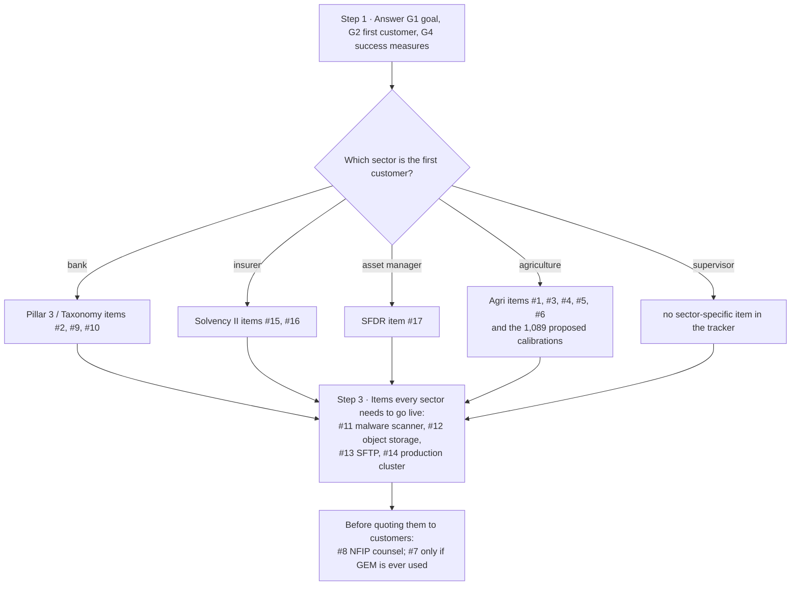

# Implementation plan — Tellumen climate platform

> **History is exact; the priorities are a proposal the product owner accepted.** Sections 1–2 are read from git, the change log
> ([SOFTWARE_DESCRIPTION.md](SOFTWARE_DESCRIPTION.md) §12) and the error log
> ([ENGINEERING_PROCESS.md](ENGINEERING_PROCESS.md) §3) as of commit `b2a1481` (2026-10-17); they are quoted, not
> summarised. Section 3 lists the recorded work still open. Section 4 orders it: proposed by Claude and accepted by
> the product owner on 2026-10-16 ([PRODUCT_REQUIREMENTS.md](PRODUCT_REQUIREMENTS.md) §8, G6). Written by hand; not
> generated.

## 1. The record at a glance

- **Git:** first commit 2026-06-26 (`ffd8d07`, "Climate Intelligence Platform - Phase 0 Foundation Complete"); last commit counted 2026-10-17 (`b2a1481`). **1,197 commits** on 83 days.
- **Change log:** 330 rows, from version 1.0 (2026-07-04) to 2.224 (2026-10-16). Version numbers are as the log writes them; some are used twice (1.96, 1.97, 1.98, 1.99, 2.12, 2.146, 2.149).
- **Error log:** 179 rows, E1 (2026-09-28) to E180 (2026-10-16); there is no row E91.
- **Regulatory-change route:** 7 runs, 2026-09-28 to 2026-09-30.

| Month | Commits | Change-log rows | Error-log rows |
|---|---|---|---|
| 2026-06 | 92 | 0 | 0 |
| 2026-07 | 227 | 56 | 0 |
| 2026-08 | 415 | 93 | 0 |
| 2026-09 | 386 | 118 | 70 |
| 2026-10 | 77 | 63 | 109 |

## 2. Phases

Cut at recorded markers — the first commit, the first change-log version of each major number, and the first
error-log row — not at themes. Each phase lists what its records say, in their own words (a long title is cut at
150 characters, marked …).

| Phase | Dates | Opened by | Commits | Days with commits | Change-log rows | Error-log rows |
|---|---|---|---|---|---|---|
| A | 2026-06-26 → 2026-07-03 | the first commit (`ffd8d07`) | 118 | 6 | 0 | 0 |
| B | 2026-07-04 → 2026-08-05 | change log version 1.0 (2026-07-04) | 330 | 26 | 102 (1.0 … 1.101) | 0 |
| C | 2026-08-06 → 2026-09-27 | change log version 2.00 (2026-08-06) | 609 | 40 | 118 (2.00 … 2.116, and 1.97–1.99 a second time) | 0 |
| D | 2026-09-28 → 2026-10-17 | error log row E1 and run 1 of the regulatory-change route (2026-09-28) | 140 | 11 | 110 (2.117 … 2.224) | 179 (E1 … E180) |

### Phase A · 2026-06-26 → 2026-07-03

Commits per day: 2026-06-26 (59), 2026-06-27 (29), 2026-06-28 (4), 2026-07-01 (5), 2026-07-02 (15), 2026-07-03 (6).

The 118 commit subjects (no change log existed yet)

| Date | Commit | Subject |
|---|---|---|
| 2026-06-26 | `ffd8d07` | Climate Intelligence Platform - Phase 0 Foundation Complete |
| 2026-06-26 | `2e1c619` | Phase 2 Week 1: Real-Time Alerting Infrastructure |
| 2026-06-26 | `00e4af3` | Phase 2 Week 2: Notification Service & Alert Dashboard APIs |
| 2026-06-26 | `b2d6c57` | Integrate Regulatory Alerts Dashboard into Apple-style UI |
| 2026-06-26 | `f4fc5f6` | Fix AppleRegulatoryPage: Scrollable, animated backgrounds, working buttons |
| 2026-06-26 | `f3ac313` | Add Tabbed Risk Map Interface (Seismic) |
| 2026-06-26 | `351164d` | Add Tabbed Risk Map Interface for all hazard types |
| 2026-06-26 | `56f8b45` | Integrate RiskMap component into all Tabbed Risk Pages |
| 2026-06-26 | `0c7cf25` | Restructure Risk Maps: Option B - Scrollable with Hero + Tabs + Map |
| 2026-06-26 | `a8dcbe1` | Add video background support to all Risk Map pages |
| 2026-06-26 | `1f7c394` | Add video background setup guide |
| 2026-06-26 | `a9f8f5f` | Add 3D Cesium Globe to all Risk Map pages |
| 2026-06-26 | `9d9af2e` | Temporarily revert to RiskMap while debugging Cesium integration |
| 2026-06-26 | `8824dd5` | Add video download script and placeholder background videos |
| 2026-06-26 | `68103ac` | Replace videos with animated CSS gradients |
| 2026-06-26 | `f2417b5` | Simplify backgrounds to Tailwind solid gradients |
| 2026-06-26 | `b7f295b` | Fix: Remove bg-white to show gradient backgrounds |
| 2026-06-26 | `25bab32` | Revert to white background - keep it clean |
| 2026-06-26 | `efbca56` | Fix: Add h-screen to enable scrolling on Risk Map pages |
| 2026-06-26 | `19f385b` | Add Risk Map landing page with hazard selection |
| 2026-06-26 | `2878545` | Fix scrolling on all app pages |
| 2026-06-26 | `42d1ddc` | Redesign RiskMapHome with BCG style - simpler, professional |
| 2026-06-26 | `fda7fa7` | Fix: Change maps from dark to light theme |
| 2026-06-26 | `d433156` | Add Regulatory Reporting Module Home Page |
| 2026-06-26 | `342623a` | Complete: Full Regulatory Reporting Module (11 pages) |
| 2026-06-26 | `2ebd44a` | Replace all icons with simple BCG/McKinsey minimalist style |
| 2026-06-26 | `7c64c3c` | Fix: Create shared SimpleIcon component and remove duplicates |
| 2026-06-26 | `653f26c` | Fix: Remove stray closing brace from RegulatoryRiskDashboardPage |
| 2026-06-26 | `59eb3b9` | Fix: Clean up all syntax errors in regulatory reporting pages |
| 2026-06-26 | `a3eb96f` | Fix: Add SimpleIcon import to CompliancePage |
| 2026-06-26 | `59fb402` | Fix: Add SimpleIcon import to all pages using it |
| 2026-06-26 | `ff95c47` | Update: Rename 'Regulatory Alerts' to 'Regulatory Reporting for Banks' |
| 2026-06-26 | `9e718f4` | Add Banking Workflow Engine & Data Ingestion System |
| 2026-06-26 | `daf059a` | Add Bank Data Templates for Regulatory Reporting Workflows |
| 2026-06-26 | `0743918` | Add Drag & Drop File Upload to Data Ingestion Page |
| 2026-06-26 | `d6e1766` | Fix: Enable CSV file downloads directly from Data Ingestion page |
| 2026-06-26 | `3354204` | Fix: Use Blob API for CSV downloads (more reliable) |
| 2026-06-26 | `396a575` | Add Output File Downloads for Workflow Results |
| 2026-06-26 | `c2708a3` | Add Real Data Processing Engine - Calculate Actual Regulatory Metrics |
| 2026-06-26 | `a3425bb` | Fix: Generate Proper PDF Reports with Professional Formatting |
| 2026-06-26 | `04dbca5` | Add TCFD-Compliant Data Templates & Enhanced Data Processor |
| 2026-06-26 | `ba31240` | Add TCFD/Taxonomy/CSRD Compliance Reference & Deep-Research Findings |
| 2026-06-26 | `de69f78` | Add TCFD CSV Parser & Update DataIngestionPage |
| 2026-06-26 | `053e326` | Fix: File Upload Using TCFD CSV Parser in DragDropZone |
| 2026-06-26 | `7c4b9b4` | Fix: Correct Template CSV Data - Remove Invalid Scenario Rows |
| 2026-06-26 | `5362646` | Fix: Fill in Undefined Values in Materiality Report |
| 2026-06-26 | `1f654aa` | Add Complete TCFD Report Generator - All 11 Mandatory Disclosures |
| 2026-06-26 | `d827b34` | Fix: Remove undefined emissionsData parameter from TCFD Report Generator |
| 2026-06-26 | `62260d4` | Fix: Export as CSV instead of broken .xlsx format |
| 2026-06-26 | `981c833` | Fix: Remove undefined values from CSV export |
| 2026-06-26 | `f769ecd` | Wire Up Dashboard to Display Live Workflow Results |
| 2026-06-26 | `d8e0484` | Update Dashboard Alert Message |
| 2026-06-26 | `b908286` | Implement Bank-Specific Governance Data Upload & Integration |
| 2026-06-26 | `4e8e7d3` | Add Risk Response & Implementation Module - TCFD Disclosure 5 |
| 2026-06-26 | `b09616c` | Unify controlled vocabulary across platform, DB, and UI |
| 2026-06-26 | `4231430` | Wire bank vertical onto canonical_scores (reconciliation #1) |
| 2026-06-26 | `db17217` | Wire React bank UI to canonical_scores projection (reconciliation #1, UI) |
| 2026-06-26 | `0645e38` | Fold bank vertical into Alembic — one DDL source of truth (reconciliation #3) |
| 2026-06-26 | `b6b5330` | Add insurance as a second sector — multi-sector consistency proof |
| 2026-06-27 | `97682d9` | Fix seed insert: supply UUID PKs via gen_random_uuid() (smoke-test fix) |
| 2026-06-27 | `beca7de` | Calibrate insurance loss curve from OutcomeFeedback |
| 2026-06-27 | `1d51bbc` | Add agriculture sector + complete the drought hazard substrate |
| 2026-06-27 | `45f4881` | Build the drought model (ensemble) + fix ML/test-infra blockers |
| 2026-06-27 | `cabf94b` | Sort the database foundation: one driver, one identity, one source of truth |
| 2026-06-27 | `a9bf877` | Point the foundation at the real data (platform@climate, 51M rows) |
| 2026-06-27 | `2fd9530` | End-to-end on real data: train flood, score, populate canonical_scores |
| 2026-06-27 | `7bb941b` | Correct the scoring foundation: calibration, traceability, immutability |
| 2026-06-27 | `389590f` | Finish runnable follow-ups: wildfire end-to-end + current scoring + data_vintage |
| 2026-06-27 | `e68ff1d` | Multi-industry platform UI: overview + 8 industry modules, wired to live scores |
| 2026-06-27 | `da32340` | Add honest spatial backtest tool for hazard models |
| 2026-06-27 | `4d6f6c5` | De-claim AUC: record honest Average Precision + caveat, surface in UI (#1) |
| 2026-06-27 | `1e43d38` | Document backtest-data status + runbook (#2) |
| 2026-06-27 | `7abb500` | Out-of-event backtest: flood model has NO generalisation (empirical) |
| 2026-06-27 | `ab05aa3` | Multi-event flood model: real forecasting skill (LOEO AUC 0.645) |
| 2026-06-27 | `5dd0746` | b: 16-event flood model — LOEO AUC 0.674 (more events, bimodal skill) |
| 2026-06-27 | `f3b1c91` | Add global USGS seismic ingester (captures Venezuela; --watch for live) |
| 2026-06-27 | `e6f2e0d` | Point seismic scoring at the new global events (Venezuela M7.5) |
| 2026-06-27 | `9b2ce1d` | a: deploy multi-event flood model to live scoring + corrected precip |
| 2026-06-27 | `bb4c8c4` | c: multi-event wildfire FAILS (AUC 0.444) — honest negative result |
| 2026-06-27 | `7756194` | Tag flood events by mechanism + test the split decision rule |
| 2026-06-27 | `759489d` | Wildfire: real FIRMS labels + ERA5 fuel features → 0.444 to 0.568 (real skill) |
| 2026-06-27 | `e3acb94` | Seismic: replace degenerate ML with real physics (IPE + Omori-Utsu) |
| 2026-06-27 | `392c488` | Daily aftershock forecast verification — Venezuela M7.5 |
| 2026-06-27 | `2fb3251` | Add public platform API for the consolidated UI |
| 2026-06-27 | `8c16739` | Consolidate the UI into four data-flow tiers (with a live H3 map) |
| 2026-06-27 | `39e61ef` | Map polish: reliable basemap tiles + readable hazard zoom |
| 2026-06-27 | `c643a7e` | Unify look & feel: Apple-store light aesthetic across all tiers |
| 2026-06-27 | `ae83ed2` | Phase 1: banking flagship — one connected operational flow |
| 2026-06-28 | `c727f0f` | Fix map basemap reliability: CARTO Positron raster tiles |
| 2026-06-28 | `2fe0467` | Phase 2+3: Signals + Reports — close the operational loop |
| 2026-06-28 | `061d238` | Keep demo loan-book assets on land (no assets in the sea) |
| 2026-06-28 | `fcd1468` | Scenario analysis works + model drill-through + data fixes |
| 2026-07-01 | `0b4b8ff` | Landing hero: live Earth from the ISS (Sen SpaceTV-1) |
| 2026-07-01 | `cf71753` | Redesign software page as an entitlement-filtered drill-down catalog |
| 2026-07-01 | `f50ea5c` | Add outward-facing landing + tabbed Solutions page |
| 2026-07-01 | `c782570` | Backtest: fetch ERA5 at 23:00 instead of 12:00 |
| 2026-07-01 | `01eeb51` | Add real auth: login, tenant/role scoping, admin, 4-eyes |
| 2026-07-02 | `fb300ce` | Add agriculture vertical: supply-chain COGS-at-risk |
| 2026-07-02 | `de5d211` | Backtest supply impact fns; add stock-to-use amplification (v0.1) |
| 2026-07-02 | `914e0fc` | Ag foundation 1: region-parameterized ingestion + crop-yield ground truth |
| 2026-07-02 | `a62c36a` | Ag foundation 2 (start): live West-Africa ERA5 + drought extractor + native backtest |
| 2026-07-02 | `4772cf5` | Rebrand to Tellumen (Tellus + lumen — "light on the Earth") |
| 2026-07-02 | `4f569b3` | Ag foundation 2+3: heat scoring for cocoa — off "pending" on real data |
| 2026-07-02 | `99fbfc0` | Ag foundation 2(a): calibrate cocoa heat→yield→COGS chain (v0.2) |
| 2026-07-02 | `333a1fe` | LiveEarthHero: live/offline detection, info-tooltip badge, offline fallback |
| 2026-07-02 | `f2b6e78` | Ag foundation 2(b): seasonal (harmattan) heat for cocoa |
| 2026-07-02 | `5ca2fc9` | Brand polish: fix Tellumen gap, enlarge mark, center live badge |
| 2026-07-02 | `75f7e87` | Ag foundation 2(c): extend the recipe to Brazil coffee — generalizes, new driver |
| 2026-07-02 | `c76ea16` | Fix ISS badge tooltip: drop below the nav so hover registers |
| 2026-07-02 | `c5adaec` | Add drought & frost hazard scorers + coffee wiring |
| 2026-07-02 | `bcef2db` | supply_cogs: add calibrated Coffee commodity params |
| 2026-07-02 | `cb632e4` | Finish agriculture — Phase A: defensible science, surfaced |
| 2026-07-03 | `0889078` | Finish agriculture: complete & defensible (match banking) |
| 2026-07-03 | `ecb5044` | Fix login landing on banking for non-banking tenants |
| 2026-07-03 | `e122822` | Guard Solutions 'See it live' against cross-industry sessions |
| 2026-07-03 | `07320da` | Add volcanic hazard — banking + agriculture, backtested on Fuego 2018 + Taal 2020 |
| 2026-07-03 | `072248c` | Add storm hazard — banking + agriculture, backtested on Hurricane Maria 2017 |
| 2026-07-03 | `41f8ab6` | Landing: hide the Sen/NASA provenance caption |

### Phase B · 2026-07-04 → 2026-08-05

Commits per day: 2026-07-04 (12), 2026-07-05 (2), 2026-07-06 (1), 2026-07-07 (10), 2026-07-08 (17), 2026-07-09 (8), 2026-07-10 (7), 2026-07-11 (16), 2026-07-12 (24), 2026-07-13 (10), 2026-07-16 (16), 2026-07-17 (6), 2026-07-18 (18), 2026-07-19 (5), 2026-07-20 (3), 2026-07-22 (3), 2026-07-25 (1), 2026-07-27 (14), 2026-07-29 (1), 2026-07-30 (20), 2026-07-31 (7), 2026-08-01 (21), 2026-08-02 (42), 2026-08-03 (33), 2026-08-04 (15), 2026-08-05 (18).

The 102 change-log rows (version — its title or first sentence)

| Date | Version | Change |
|---|---|---|
| 2026-07-04 | 1.0 | Initial Software Description Document created. |
| 2026-07-11 | 1.1 | Added asset-manager securities book + reference-data resolution layer (open-data ISIN→issuer→footprint via GLEIF + Nominatim, with provenance and a… |
| 2026-07-11 | 1.2 | Added SFDR PAI statement (the filing): ml/regulatory/sfdr_pai.py assembles the mandated RTS Annex I Table 1 (14 investee indicators — computed wher… |
| 2026-07-12 | 1.3 | Client issuer-data enrichment: onboarding accepts optional NACE/revenue/scope1-3 per holding to fill more of the SFDR statement. |
| 2026-07-12 | 1.4 | Emissions estimation gap-fill: services/reference/emissions_estimation.py estimates scope 1+2 = NACE sector-average intensity × revenue when no sco… |
| 2026-07-12 | 1.5 | Sovereign & real-estate PAI tables (RTS Annex I indicators 15–18). |
| 2026-07-12 | 1.6 | Universe pre-load scaling: geocoder is now config-driven (NOMINATIM_URL + NOMINATIM_MIN_INTERVAL_S) so a self-hosted Nominatim drops in without cod… |
| 2026-07-12 | 1.7 | Financed emissions PAI 1/2 via EVIC. |
| 2026-07-12 | 1.8 | Filing-grade output. |
| 2026-07-12 | 1.9 | Design-partner self-serve: GET /v1/holdings/template.csv returns a documented holdings template (required isin+value; |
| 2026-07-12 | 1.10 | Data-quality hardening: tests around the make-or-break math — emissions estimation (intensity×revenue, safe degradation, no scope-3 estimate), refe… |
| 2026-07-12 | 1.11 | Coefficient calibration & externalisation. |
| 2026-07-12 | 1.12 | EXIOBASE calibration RUN. |
| 2026-07-12 | 1.13 | Non-carbon PAI indicators (5-14) made fillable. |
| 2026-07-12 | 1.14 | Filing identity + readiness. |
| 2026-07-12 | 1.15 | Prior-year comparison (SFDR year-2 requirement). |
| 2026-07-12 | 1.16 | Remaining filing pieces. |
| 2026-07-12 | 1.17 | Correctness/honesty audit fixes (fresh-eyes review of the SFDR module). |
| 2026-07-12 | 1.18 | EU Taxonomy alignment. |
| 2026-07-12 | 1.19 | Look-through expansion. |
| 2026-07-12 | 1.20 | Article 8/9 periodic report (SFDR RTS Annex IV/V). |
| 2026-07-13 | 1.21 | Enterprise completeness sweep (8 gaps closed to widen the beachhead). |
| 2026-07-18 | 1.22 | Agriculture crop calibration — the 'ranged' tier + honest cyclical-crop validation. |
| 2026-07-19 | 1.23 | Water-availability layer + Confidence Grade + rain-fed proof + the honest reservoir null-result. |
| 2026-07-19 | 1.24 | Projections upgrade — regional warming amplification (AR6-grounded, parametric v1) + two more grade-A rain-fed crops. |
| 2026-07-20 | 1.25 | Rain-fed book expansion + the method's discrimination shown honestly. |
| 2026-07-20 | 1.26 | Second commodity validates — barley. |
| 2026-07-20 | 1.27 | Projections v2 — AR6 Mediterranean precipitation-decline term. |
| 2026-07-22 | 1.28 | Projections v3 — RAW multi-model CMIP6 (delta-change), replacing the parametric warming/precip terms where covered. |
| 2026-07-22 | 1.29 | Projections v3 — 3-model CMIP6 ensemble (up from the 1-model ship). |
| 2026-07-25 | 1.30 | Wildfire-region stress check — the instrument matters (a documented capability insight). |
| 2026-07-27 | 1.31 | Global diversity / EUDR crop session — the discrimination story proven at world scale (8 tested, 0 forced, all honestly held). |
| 2026-07-27 | 1.32 | Multi-event / multi-driver crop backtest (fork 2) — verdict: heat is maize's true driver, but even so national maize stays honestly HELD; HEAT wire… |
| 2026-07-27 | 1.33 | EUDR/CSRD build — Phase 0a: plot geometry foundation (no PostGIS). |
| 2026-07-27 | 1.34 | EUDR/CSRD build — Phase 0b: forest-loss layer (Hansen GFC, read per plot). |
| 2026-07-27 | 1.35 | EUDR/CSRD build — Phase 1: deforestation-free determination engine (computed, replaces the declared flag). |
| 2026-07-27 | 1.36 | EUDR/CSRD build — Phase 2 Tier 1: Due Diligence Statement assembler + reference capture (build it ourselves). |
| 2026-07-27 | 1.37 | Greenfield agriculture UI (reinvention) — foundation + flagship EUDR Disclosure. |
| 2026-07-29 | 1.38 | Risk map reborn as the H3 hex grid — the "Earth broken into cells" data model made visible. |
| 2026-07-29 | 1.39 | Base coverage for a food/agri company — own operations, business-interruption, a reusable detail workspace, and the CSRD/ESRS E1 report. |
| 2026-07-30 | 1.40 | Sourcing self-upload + location governance (edit/delete under 4-eyes, full audit, admin console in the agri app). |
| 2026-07-30 | 1.41 | Control center — a customer-admin cockpit + a platform-operator cross-tenant console (two personas). |
| 2026-07-30 | 1.42 | Consolidated entry points — one governance door (customer) + "View as tenant" (us). |
| 2026-07-30 | 1.43 | ESRS Climate & Nature disclosure pack + regulatory-scope strategy. |
| 2026-07-30 | 1.44 | ESRS pack made filing-grade: XBRL tagging + EU Taxonomy climate-adaptation. |
| 2026-07-30 | 1.45 | Ops-hardening: configurable reporting basis + immutable report snapshots + ops-readiness runbook. |
| 2026-07-30 | 1.46 | Point-1 workstream A — real Inline XBRL (iXBRL/ESEF) + a drop-in taxonomy binding + a validator. |
| 2026-07-30 | 1.47 | Point-1 workstream C — assurance evidence pack (auditor-ready ZIP, keyed to a snapshot). |
| 2026-07-30 | 1.48 | Point-1 workstream B — EUDR Tier-2 TRACES submission client (prepared-by-default, config-flip to live). |
| 2026-07-30 | 1.49 | Regulated side finished — geocoder productionization + golden-source freshness. |
| 2026-07-31 | 1.50 | Golden-source registry expanded to the real source breadth + investor functional-architecture diagram. |
| 2026-07-31 | 1.51 | Calc-engine audit (6 parallel agents + live-DB verification) and the top-tier fixes. |
| 2026-07-31 | 1.52 | Tier-2 T1 — snapshots made reproducible + tamper-evident (WORM). |
| 2026-07-31 | 1.53 | Tier-2 T2 — deterministic Monte-Carlo VaR. |
| 2026-07-31 | 1.54 | Tier-2 T4 (staleness layer) — a filing can't be built on a stale golden source. |
| 2026-07-31 | 1.55 | Tier-2 filing coherence (T3 + T5 + T7). |
| 2026-08-01 | 1.56 | Tier-2 T6 — calc/reporting-config changes are audited and 4-eyes-governable (closes tier-2). |
| 2026-08-01 | 1.57 | Tier-3 calc-engine hardening (T8–T13 + invariants) — closes the audit. |
| 2026-08-01 | 1.58 | T4b — input-quality fail-safes reach the filing gate (closes the calc-engine audit). |
| 2026-08-02 | 1.59 | Horizon front door completed across sectors + financial operating surface. |
| 2026-08-02 | 1.60 | Financial compliance surface + drill-down provenance (finishes the financial shell). |
| 2026-08-02 | 1.61 | Enterprise-complete: the full customer lifecycle wired end-to-end (4 workstreams). |
| 2026-08-02 | 1.62 | Core engine WS1 — the hazard→€ damage function made continuous &amp; vulnerability-aware (within band). |
| 2026-08-02 | 1.63 | Core engine WS2 — an independent challenger model corroborates every published crop euro. |
| 2026-08-02 | 1.64 | Core engine WS3a — root-zone water stress &amp; frost are now scoreable ON DEMAND at any address (coverage gap closed). |
| 2026-08-02 | 1.65 | Core engine WS3b — irrigation as an honest water-management context flag (completes WS3). |
| 2026-08-02 | 1.66 | Core engine WS4a — an honest CMIP6 model-disagreement band on every forward projection. |
| 2026-08-02 | 1.67 | Core engine WS4b — two crops can share one belt without overwriting each other (crop-calendar overlay). |
| 2026-08-02 | 1.68 | Core engine WS4c — financial projections made REAL: CMIP6-driven flood/storm/wildfire with an honest band. |
| 2026-08-02 | 1.69 | Core engine WS4d — sea-level rise / coastal flooding, the biggest financial gap, now modelled. |
| 2026-08-02 | 1.70 | Core engine — consolidated 4-stage review (WS1–WS4) + fixes. |
| 2026-08-03 | 1.71 | Forward-change decision signal — the engine's unique projections turned into a customer decision. |
| 2026-08-03 | 1.72 | Reporting cockpit (financial institutions) — Phase 1: filing register, lifecycle & obligations calendar. |
| 2026-08-03 | 1.73 | Reporting cockpit — Phase 2: pre-submission validation engine that gates approval. |
| 2026-08-03 | 1.74 | Reporting cockpit — Phase 3: bidirectional data lineage (a filed number ↔ the satellite/agency feed). |
| 2026-08-03 | 1.75 | Reporting cockpit — Phase 4: restatement + variance-vs-prior explainer (cockpit program complete). |
| 2026-08-03 | 1.76 | Reporting cockpit — close the 3 workflow gaps (parameters, confirm-data, diagrams). |
| 2026-08-03 | 1.78 | Workflow layer — Modules A–D (Regnology-parity), on top of the cockpit. |
| 2026-08-03 | 1.79 | Workflow layer — Modules E–G complete (full Regnology-parity module set). |
| 2026-08-03 | 1.80 | Workflow layer is now all-sector, sector-named |
| 2026-08-03 | 1.81 | Drill-down everywhere — most items are now clickable and go deep to the granular info underneath. |
| 2026-08-03 | 1.82 | Deeper drill-down — lineage/variance generalised + KRI hazard drill. |
| 2026-08-04 | 1.83 | "Exception Monitor" renamed to "Control Tower" |
| 2026-08-04 | 1.84 | Pieces talk to each other — Transmission ↔ Filing joined, and the oversight lenses surfaced in-app. |
| 2026-08-04 | 1.85 | Control Tower → task round-trip closed. |
| 2026-08-04 | 1.86 | FIN Portfolio can now import its book (+ a root multipart fix). |
| 2026-08-04 | 1.87 | FIN Portfolio: per-asset drill + the analyst's actions (valuation override / parametric trigger). |
| 2026-08-04 | 1.88 | Two wiring fixes finish FIN operational parity. |
| 2026-08-04 | 1.89 | SFDR / funds workspace — the asset manager's core surface now has a front door (was a fully-built backend with NO UI). |
| 2026-08-04 | 1.90 | Funds workspace — advanced actions (completes the SFDR surface). |
| 2026-08-04 | 1.91 | Group consolidation — foundation (epic slice 3a): the reporting‑entity hierarchy + entity‑scoped book read. |
| 2026-08-04 | 1.92 | Group consolidation — the engine (epic slice 3b): entity-scoped + consolidated filings. |
| 2026-08-04 | 1.93 | Group consolidation — the cockpit (epic slice 3c): choose the scope, see it in the register. |
| 2026-08-04 | 1.94 | Consistent left nav on the Horizon front door (+ globe/rail sizing). |
| 2026-08-04 | 1.95 | Portfolio book is search-driven, not a full dump. |
| 2026-08-04 | 1.96 | Fix: drawers/overlays rendered blank when the page was scrolled. |
| 2026-08-04 | 1.96 | No internal codes leak to the UI — platform-wide. |
| 2026-08-04 | 1.97 | Consolidation follow-up: the reporting-entity hierarchy is now user-editable (was script-seeded). |
| 2026-08-04 | 1.98 | Consolidation scope made honest per framework (the CSRD/SFDR question, resolved correctly). |
| 2026-08-04 | 1.99 | Light theme by default + a dark toggle (legibility pass). |
| 2026-08-04 | 1.100 | Reporting requirements view (filing-workflow slice 1). |
| 2026-08-04 | 1.101 | Final-form viewer (filing-workflow slice 2). |

### Phase C · 2026-08-06 → 2026-09-27

Commits per day: 2026-08-06 (31), 2026-08-07 (21), 2026-08-08 (16), 2026-08-10 (24), 2026-08-11 (9), 2026-08-12 (16), 2026-08-13 (13), 2026-08-15 (2), 2026-08-16 (8), 2026-08-17 (5), 2026-08-18 (10), 2026-08-19 (32), 2026-08-20 (22), 2026-08-21 (11), 2026-08-25 (2), 2026-08-26 (10), 2026-08-27 (34), 2026-08-28 (14), 2026-08-31 (6), 2026-09-02 (4), 2026-09-03 (28), 2026-09-04 (19), 2026-09-05 (9), 2026-09-06 (28), 2026-09-07 (42), 2026-09-08 (6), 2026-09-09 (40), 2026-09-10 (18), 2026-09-11 (10), 2026-09-12 (12), 2026-09-17 (1), 2026-09-19 (4), 2026-09-20 (5), 2026-09-21 (3), 2026-09-22 (41), 2026-09-23 (20), 2026-09-24 (11), 2026-09-25 (4), 2026-09-26 (14), 2026-09-27 (4).

The 118 change-log rows (version — its title or first sentence)

| Date | Version | Change |
|---|---|---|
| 2026-08-06 | 1.97 | Reporting workflow rebuilt, official annexes, analytics, and task collaboration. |
| 2026-08-06 | 1.98 | Analytics charts + live what-if, drill-down, the Act decision loop, and the SFDR narratives editor. |
| 2026-08-06 | 1.99 | Decisions hardened (4-eyes + Kanban) and an Analytics honesty fix. |
| 2026-08-06 | 2.00 | Decision 4-eyes is now a customer choice, set at onboarding — not hard-coded. |
| 2026-08-06 | 2.01 | Decision playbook — what runs automatically when a forward-risk decision is approved (per-customer). |
| 2026-08-06 | 2.02 | KRIs are now monitored controls, not just numbers — a per-customer risk-appetite layer (KRI framework sweep, Phase 1). |
| 2026-08-06 | 2.03 | SFDR PAI indicator VALUES are now KRIs (framework sweep, Phase 2). |
| 2026-08-06 | 2.04 | Agri/manufacturer KRIs rebuilt on the real ESRS E1 climate financial-effects (framework sweep, Phase 3) — and honestly NOT on GHG. |
| 2026-08-06 | 2.05 | Agri/manufacturer KRI dashboard extended to the full ESRS nature pack — E3 Water + E4 Biodiversity (framework sweep, Phase 4). |
| 2026-08-06 | 2.06 | KRI → Analytics cross-link (framework sweep, Phase 5 — the surfaces stay separate). |
| 2026-08-06 | 2.07 | KRI dashboard reshaped regulator-backwards — "what your regulator expects before you file" + submission-readiness, and the metric gaps closed. |
| 2026-08-06 | 2.08 | Honest filing-coverage map — "how much of each filing Tellumen produces from your data". |
| 2026-08-06 | 2.09 | Canonical datapoint catalog — the single source of truth for data sourcing & ingestion (foundation). |
| 2026-08-07 | 2.10 | Lane 2 — provided datapoints: bring-your-own-number, reconciled + attested. |
| 2026-08-07 | 2.11 | First free-gov external feed: EEA Natura 2000 → ESRS E4 protected-area overlap (now fully computed). |
| 2026-08-07 | 2.12 | Customer-facing "how to provide" — the data-onboarding loop closed. |
| 2026-08-07 | 2.12 | Global biodiversity coverage (free) + authoritative-via-customer, and the data-onboarding programme closed out. |
| 2026-08-07 | 2.13 | Banks now file more than TCFD — Pillar 3 ESG added, and the KRI surface goes multi-framework. |
| 2026-08-07 | 2.14 | Supervisory view — the whole institution on one screen, the way a regulator or board reviews it (Phase B). |
| 2026-08-07 | 2.15 | Engine deepening — the insurance premium & real-estate NOI drag are now vulnerability-differentiated, closing the last €-path that ignored building… |
| 2026-08-07 | 2.16 | UI professionalism pass — native `alert()` dialogs replaced by a proper toast system; workflow-wiring & chart audit. |
| 2026-08-07 | 2.17 | Navigation re-sequenced to the operational loop, with a stage-colour system. |
| 2026-08-07 | 2.18 | Light-mode text legibility — secondary/label text darkened for comfortable contrast. |
| 2026-08-07 | 2.19 | KRI dashboard — computed-vs-integrated provenance legend + filter (standard, all sectors). |
| 2026-08-07 | 2.20 | KRI tiles are now click-through — a data-rich drill drawer behind every indicator (all sectors). |
| 2026-08-08 | 2.22 | Resizable + collapsible panels, and a Support Center. |
| 2026-08-08 | 2.23 | Regulation & form — the official form opens in-app, beside our regulation summary. |
| 2026-08-08 | 2.24 | Sentinel-1 SAR flood adapter closed — observed-flood upgrade, code-complete via CDSE (no SNAP). |
| 2026-08-11 | 2.27 | Bank regulatory build finished, polished & verified end-to-end (awaiting sign-off). |
| 2026-08-11 | 2.28 | Bank KRI dashboard — added the decision/concentration KRIs it was missing. |
| 2026-08-11 | 2.29 | KRI tile click-through drills to the individual exposures, and appetite is set in-context. |
| 2026-08-11 | 2.30 | KRI drawer — exhaustive drill, scoped forward-exploration & per-indicator charts. |
| 2026-08-11 | 2.31 | Pillar 3 transition Templates 3 & 4 built to the ITS 2022/2453 methodology (primary-source verified). |
| 2026-08-11 | 2.32 | KRI dashboard — TCFD and Pillar 3 tabs now carry the right indicators for each regime. |
| 2026-08-18 | 2.33 | Export & Connect (3 tiers) + the five reg-reporting gap-closers — checked against the field plan, then closed, honesty-first. |
| 2026-08-19 | 2.34 | CI pipeline made green — the gate now enforces real quality against the schema the product actually ships. |
| 2026-08-19 | 2.35 | Partial-functionality sweep — finished the regulatory change-detection engine; removed a dead notification stack. |
| 2026-08-19 | 2.36 | Official-form fidelity + assurance-pack polish — the last three in-scope partial items. |
| 2026-08-19 | 2.37 | Per-sector engine program — six new risk capabilities across all five sectors. |
| 2026-08-19 | 2.38 | Governed regulatory-interpretation layer + two compliance fidelity fixes. |
| 2026-08-20 | 2.39 | Realized Exposure — the observed past — plus three product lines built on it. |
| 2026-08-26 | 2.40 | Commercial onboarding lifecycle — signed contract → first login, built end-to-end and benchmarked to enterprise-SaaS provisioning. |
| 2026-08-26 | 2.41 | Enterprise SSO (OIDC) + SCIM 2.0 auto-provisioning — the identity path benchmarked in the onboarding lifecycle, wired for real. |
| 2026-08-26 | 2.42 | SAML 2.0 SSO + a "Sign in with SSO" login entry — the enterprise identity path completed both ends. |
| 2026-08-26 | 2.43 | Enterprise-hardening program — closing the SaaS-readiness gaps in four waves (P1 security → P4 scale). |
| 2026-08-27 | 2.44 | Standardized decision spine — one Signal→Decide→Act engine across every sector, and agri gets internal decisions. |
| 2026-08-27 | 2.45 | Navigation condensed into role-shaped hubs + a canonical card layout across the whole app. |
| 2026-09-03 | 2.46 | ESRS E4-5 protected-area overlap wired into the filing — the biodiversity engine surfaced where it counts. |
| 2026-09-04 | 2.47 | EU-Taxonomy hazard coverage 16 → 20 of 28 — four physical hazards built on real authoritative data, engine + data + UI. |
| 2026-09-04 | 2.48 | EU-Taxonomy hazard coverage 20 → 25 of 28 — the long-tail hazards, on real data or honest proxies. |
| 2026-09-04 | 2.49 | EU-Taxonomy hazard coverage reaches 28 / 28 — every physical climate hazard in Appendix A now scores. |
| 2026-09-07 | 2.50 | Regulator module: per-person visibility and Requests & findings. |
| 2026-09-08 | 2.51 | Supervision scope respects the profile; scope managed in Settings; one demo body per sector. |
| 2026-09-08 | 2.52 | One cell-shape service: no map hexagon ever spills into the sea. |
| 2026-09-08 | 2.53 | Tier-1 plausibility band — judging a submitted template with no granular data. |
| 2026-09-09 | 2.54 | Hardening: raster reads and heavy jobs leave the API process. |
| 2026-09-09 | 2.55 | Evidence pack (case file) and population export. |
| 2026-09-09 | 2.56 | Trend, timeliness and anchor coverage. |
| 2026-09-09 | 2.57 | Demo population: eight supervised entities per sector; scenario shift as one grouped query. |
| 2026-09-09 | 2.58 | Regulatory mandate registry — who is regulated, by which article, what they must deliver, through which channel, by when, and how the act changed. |
| 2026-09-09 | 2.59 | Supervisor-set deadlines with automatic follow-up. |
| 2026-09-09 | 2.60 | Submission channel for entities not on Tellumen — the supervisory portal. |
| 2026-09-09 | 2.61 | Formal correspondence. |
| 2026-09-09 | 2.62 | Transmission adapters — filings reach the authority through a defined channel, with receipts. |
| 2026-09-09 | 2.63 | Governed remittance — an evidence pack shared onward to another authority, college or committee. |
| 2026-09-09 | 2.64 | Board climate-risk pack with named attestation |
| 2026-09-09 | 2.65 | Reporting control register |
| 2026-09-09 | 2.66 | Model-risk register with model cards |
| 2026-09-09 | 2.67 | GRC assessment closed — the five remaining items. |
| 2026-09-09 | 2.68 | Hazard relevance — which scales may set a headline (foundation fix). |
| 2026-09-10 | 2.69 | Three open items closed at the foundation. |
| 2026-09-10 | 2.70 | Engine read path at the foundation. |
| 2026-09-10 | 2.71 | Backtesting pass: three screening channels earn CALIBRATED against station observations; two foundation defects fixed on the way. |
| 2026-09-10 | 2.72 | Storm holdout on the full record: negative, recorded. |
| 2026-09-10 | 2.73 | Cyclone earns CALIBRATED on a held-out-in-time backtest; two validator defects fixed at the foundation. |
| 2026-09-10 | 2.74 | Sea-level rise / coastal flood earns CALIBRATED: the generic surge constant is replaced by observed tide-gauge extremes. |
| 2026-09-10 | 2.75 | Subsidence tested against observed GNSS ground motion: negative, on the ledger. |
| 2026-09-10 | 2.76 | Flood earns CALIBRATED on the JRC global river-flood maps; the ERA5 multi-event model retires from the standing lane. |
| 2026-09-11 | 2.77 | Subsidence tested against Copernicus EGMS InSAR ground motion: negative, and it tells us what the next channel must be. |
| 2026-09-11 | 2.78 | Four backtests in parallel; subsidence earns CALIBRATED for Europe on the measurement itself. |
| 2026-09-11 | 2.79 | Coverage tiers say why, not just whether. |
| 2026-09-11 | 2.80 | Tier labels describe the category, not a verdict. |
| 2026-09-12 | 2.81 | Windstorm synoptic field built and tested: three times the skill, still an indicator. |
| 2026-09-12 | 2.82 | A scale belongs to a model, not to a hazard id — headline eligibility per model version. |
| 2026-09-12 | 2.83 | Six of the seven parked regulator-module items closed, in parallel. |
| 2026-09-12 | 2.84 | Soil-degradation raster materialised locally. |
| 2026-09-17 | 2.85 | `permafrost_thaw` promoted SCREENING -&gt; CALIBRATED. |
| 2026-09-17 | 2.86 | `soil_erosion` independent backtest run: fails the gate, stays SCREENING. |
| 2026-09-17 | 2.87 | `soil_degradation` independent backtest run: fails the gate, stays SCREENING. |
| 2026-09-17 | 2.88 | `soil_erosion` sediment-delivery-ratio (SDR) follow-up: tested the honest hypothesis from v2.86, still fails the gate, stays SCREENING. |
| 2026-09-17 | 2.89 | `soil_degradation` source-credibility investigation: Trends.Earth vs Li et al. LPD — no bug found, no swap, tier unchanged. |
| 2026-09-17 | 2.90 | `saline_intrusion` independent backtest run: fails the gate, stays SCREENING. |
| 2026-09-19 | 2.91 | Global-scope validation, step 0: pre-registered gates, region-aware evidence, stratified reporting. |
| 2026-09-19 | 2.92 | Monotone-band check now computed for every rank/discrimination result; reporting deferred by pre-registered policy. |
| 2026-09-19 | 2.93 | Windstorm bug fix + station-gust backtest. |
| 2026-09-19 | 2.94 | Step-1 validators recorded (no tier changed). |
| 2026-09-20 | 2.95 | Cyclone scope claim corrected: pooled-global → regional (Latin America & Caribbean). |
| 2026-09-20 | 2.96 | Scope claims updated from the step-1 evidence. |
| 2026-09-20 | 2.97 | All-basin cyclone holdout (`storm_oos_allbasin`) → cyclone claim now global. |
| 2026-09-21 | 2.98 | Windstorm promoted Screening → Calibrated (ranking; Europe + North America), approved by user. |
| 2026-09-21 | 2.99 | Permafrost beyond Europe + Global Flood Database recorded; claims updated. |
| 2026-09-21 | 2.100 | GHCN global-station validators recorded (`*_stations_global`, scope `global_stations`); claims updated. |
| 2026-09-25 | 2.101 | Customer data intake controls — receipt, transformation, gate, landing — on every sector's import, plus the `ingest_batches` ledger. |
| 2026-09-25 | 2.102 | Customer data intake pipeline — phase 1: received files, security, batch states, 4-eyes. |
| 2026-09-25 | 2.103 | Customer data intake — phase 2: column mapping, engine-readiness, matching a re-sent book to the assets we hold. |
| 2026-09-25 | 2.104 | Customer data intake — one field catalogue, automatic mapping, value matching, repeat layouts, drop folders; the same for every sector. |
| 2026-09-26 | 2.105 | Scheduled jobs actually run, and a stopped scheduler is visible. |
| 2026-09-26 | 2.106 | FX rates: a live feed direct from the ECB. |
| 2026-09-26 | 2.107 | Countries: a reference list, so 'Deutschland', 'DEU' or 'UK' is matched — for every sector. |
| 2026-09-26 | 2.108 | Drop folders on a storage layer, one pick-up at a time, and SFTP key registration. |
| 2026-09-26 | 2.109 | FX as a multi-source foundation: ECB, rates fixed by law, and the IMF as the second official source. |
| 2026-09-26 | 2.110 | Multi-currency phase 1a — every intake batch declares its currency and book date; conversion by the agreed rate policy, for every sector. |
| 2026-09-26 | 2.111 | Multi-currency phase 1b — every other money input declares its currency (never assumed) and converts by the rate policy. |
| 2026-09-26 | 2.112 | Multi-currency phase 1c + 1d — exports never sum or relabel currencies; ownership weights follow the chain. |
| 2026-09-26 | 2.113 | Multi-currency phase 2 — the currency foundation. |
| 2026-09-27 | 2.114 | Multi-currency phase 3 — filings in their own currency; group-internal exposures eliminated. |
| 2026-09-27 | 2.115 | Multi-currency phase 4 — model accuracy. |
| 2026-09-27 | 2.116 | Share classes + European ESG Template (EET), end to end. |

### Phase D · 2026-09-28 → 2026-10-17

Commits per day: 2026-09-28 (14), 2026-09-29 (21), 2026-09-30 (28), 2026-10-01 (22), 2026-10-02 (17), 2026-10-03 (9), 2026-10-04 (9), 2026-10-06 (6), 2026-10-07 (10), 2026-10-16 (3), 2026-10-17 (1).

The 110 change-log rows (version — its title or first sentence)

| Date | Version | Change |
|---|---|---|
| 2026-09-28 | 2.117 | PAI 5/6 company energy data: reported → vendor → estimated, with a unit-slip check. |
| 2026-09-28 | 2.118 | Results check — three corrections. |
| 2026-09-28 | 2.119 | Pending items closed, rebuilt on reference data — no hand-kept lists. |
| 2026-09-28 | 2.120 | Screen walkthrough (Chrome, one-click demo sign-in) + fixes from it. |
| 2026-09-28 | 2.121 | Two loose ends closed. |
| 2026-09-28 | 2.122 | Multi-currency phase 5 — one money formatter, and screens in the organisation's currency. |
| 2026-09-28 | 2.123 | Intake phase 3 — every asset fact per source, with history, and a queue for differences. |
| 2026-09-28 | 2.124 | Intake phase 4 — every freeze records its engine run: what it read, and the checks its output passed. |
| 2026-09-28 | 2.125 | Intake phase 5 — three views of the book, and per reported figure the client's number or ours. |
| 2026-09-28 | 2.126 | Intake phase 6 — filings pinned to their run; new data flags a restatement, never touches the filing. |
| 2026-09-28 | 2.127 | CRCS (Continuous Regulatory Compliance Service) — legacy engine retired; version pinning. |
| 2026-09-28 | 2.128 | CRCS record retention and early warning. |
| 2026-09-28 | 2.129 | Regulatory-change route, first run: Pillar 3 rebuilt to its specification. |
| 2026-09-29 | 2.130 | Regulatory-change route, run 2: SFDR PAI statement to its specification; sign-off for a team of one. |
| 2026-09-29 | 2.131 | Nothing regulatory typed in code (part 1). |
| 2026-09-29 | 2.132 | Pillar 3 entirely to its specification; one mechanism for supplied values. |
| 2026-09-29 | 2.133 | Demo GAR facts; alignment only where established. |
| 2026-09-29 | 2.134 | Legacy CRCS ORM classes removed. |
| 2026-09-29 | 2.135 | Tenant isolation, and migrations that undo exactly (E24, E25). |
| 2026-09-29 | 2.136 | CI green again; filings prepared for exactly their obligation (E26, E27). |
| 2026-09-29 | 2.137 | A draft filing can be withdrawn. |
| 2026-09-29 | 2.138 | One modal dialog and one side drawer for every overlay. |
| 2026-09-29 | 2.139 | EU Taxonomy Art. 8 for banks, built to the specification (route run 3). |
| 2026-09-29 | 2.140 | One GAR (E29). |
| 2026-09-29 | 2.141 | The Taxonomy's activity list, and a classifier that reads it (E30). |
| 2026-09-29 | 2.142 | Everything a mouse can open, a keyboard can open; dead filing-requirements component removed. |
| 2026-09-29 | 2.143 | EU Taxonomy Art. 8 for building owners, built to the specification (E31). |
| 2026-09-29 | 2.144 | EU Taxonomy phase-in applied at activity level (E32). |
| 2026-09-30 | 2.145 | SFDR product templates on the change route; the fund as a filing subject; one store per fact (route run 4, E34, E35). |
| 2026-09-30 | 2.146 | The last two narrative stores join the one store of template answers (E34). |
| 2026-09-30 | 2.146 | Insurance engine made scenario-correct before the ORSA and recovery reports (E37); one template-answer store. |
| 2026-09-30 | 2.147 | Countries stored as ISO codes, one code per country (E38). |
| 2026-09-30 | 2.148 | Solvency II nat-cat standard formula rebuilt to the Articles (E39-E41). |
| 2026-09-30 | 2.149 | A narratives save no longer overwrites the manager's legal name. |
| 2026-09-30 | 2.149 | S.27.01.01 on the regulatory change route (run 5). |
| 2026-09-30 | 2.150 | S.27.01.01 end to end: every gap closed (E43, E44). |
| 2026-09-30 | 2.151 | S.27.01.01 as an XBRL instance in EIOPA's Solvency II taxonomy (E45). |
| 2026-09-30 | 2.152 | Severe convective storms (Solvency II 'hail') now project forward (E46). |
| 2026-09-30 | 2.153 | ORSA climate analysis (Solvency II Art. 45a) and the IRRD recovery-plan nat-cat stress (Directive (EU) 2025/1 Art. 5(7)-(8)) as governed document r… |
| 2026-09-30 | 2.154 | The reporting year in the database (E50, E51) — layer 1 of the ESRS foundation. |
| 2026-09-30 | 2.155 | Data intake for the reporting year — layer 2 of the ESRS foundation, part 1 (E53, E54). |
| 2026-09-30 | 2.156 | ESRS E1/E3/E4 as specifications, and the undertaking's own figures on them — layer 2 of the ESRS foundation, part 2 (E55, E56). |
| 2026-09-30 | 2.157 | The ESRS calculation, to the text — layer 3 of the ESRS foundation (E57, E58). |
| 2026-09-30 | 2.158 | ESRS calculation checked line by line against the texts (E59). |
| 2026-09-30 | 2.159 | The ESRS statement, validated and filed end to end — layers 4 and 5 of the ESRS foundation (E60-E63). |
| 2026-09-30 | 2.160 | Everything that reads the ESRS statement now reads the statement itself (E64-E67). |
| 2026-09-30 | 2.161 | The documents describe the code as it is (E68). |
| 2026-10-01 | 2.162 | Every money figure rests on facts or your stated method (E69-E74). |
| 2026-10-01 | 2.163 | Group consolidation follows the governing text; missing emissions are never zero (E75, E76). |
| 2026-10-01 | 2.164 | Official texts held in the platform; every total covers exactly what it sums; consolidation rules signed (E78–E80). |
| 2026-10-01 | 2.165 | TCFD-style report types retired; bank_tcfd labelled for what it is (E87, E88). |
| 2026-10-01 | 2.166 | EUDR rebuild, layer 1 — the records the regulation asks for (E90). |
| 2026-10-01 | 2.167 | EUDR rebuild, layer 2 — the records arrive through the governed intake (E92). |
| 2026-10-01 | 2.168 | The bank's EU Taxonomy Art. 8 report prints the Annex VI templates only (E95). |
| 2026-10-01 | 2.169 | EUDR rebuild, layer 3 — the evidence and the operator's assessment (E94, E100, E101). |
| 2026-10-01 | 2.170 | Pillar 3 ESG prints what its templates print; Template 5 KRIs per row; bank submissions retired (E97-E99). |
| 2026-10-01 | 2.171 | EUDR rebuild, layer 4 — the checks (E107). |
| 2026-10-01 | 2.172 | EUDR rebuild, layer 5 — the statement as a filing, and the EUDR page (E108). |
| 2026-10-02 | 2.173 | Pillar 3 Template 1 columns i–k to the instructions; Pillar 3 XBRL removed; Template 5 lineage (E103–E106). |
| 2026-10-02 | 2.174 | Assurance pack: a basis of preparation per report family (E112). |
| 2026-10-02 | 2.175 | SFDR PAI XBRL removed (E113). |
| 2026-10-02 | 2.176 | Feed refreshes never write a git-tracked file (E114). |
| 2026-10-02 | 2.177 | EUDR on the regulatory-change route, and the simplified declaration (E115–E117). |
| 2026-10-02 | 2.178 | Histories read in the order they were written, everywhere (E118). |
| 2026-10-02 | 2.179 | EUDR Article 5: what downstream operators and traders hold and keep, and concerns for every role (E122). |
| 2026-10-02 | 2.180 | Pillar 3 Template 1: one counterparty, one figure; column k to the text; sector-average scope 3; the scope 3 phase-in (E119–E121). |
| 2026-10-02 | 2.181 | Prior filings are filings of an undertaking for a period (E123). |
| 2026-10-02 | 2.182 | SFDR principal adverse impacts statement to Delegated Regulation (EU) 2022/1288 (E124–E126). |
| 2026-10-02 | 2.183 | Every authored text and stated choice is frozen with its filing (E127–E129). |
| 2026-10-02 | 2.184 | ESRS comparative information to ESRS 1 chapter 7.1 of the governing version (E130). |
| 2026-10-02 | 2.185 | Regulatory lineage of every filing. |
| 2026-10-02 | 2.186 | Source texts and the reference year (E131). |
| 2026-10-02 | 2.187 | Fund PAI analytics, and ISO 639 (E132). |
| 2026-10-02 | 2.188 | Revenue-based sector-average scope 3 (E133). |
| 2026-10-03 | 2.189 | Counterparty ids on loans already in the book, and demo counterparties (E134). |
| 2026-10-03 | 2.190 | Demo banks: Template 1 complete. |
| 2026-10-03 | 2.191 | Demo banks: Pillar 3 ready to prepare. |
| 2026-10-03 | 2.192 | Demo data for every demo company. |
| 2026-10-03 | 2.193 | Foundation fixes found by the demo seeding (E136–E140). |
| 2026-10-03 | 2.194 | Fossil gas / nuclear facts, the supervisory undertaking choice (E141, E142). |
| 2026-10-03 | 2.195 | Funds, books and identities (E143–E146). |
| 2026-10-03 | 2.196 | Demo holds fictional companies only (E147); retired drafts closed. |
| 2026-10-03 | 2.197 | World crop — what happened (context). |
| 2026-10-03 | 2.198 | FAOSTAT on the refresh schedule, with review (E148). |
| 2026-10-03 | 2.199 | Small screens (E149). |
| 2026-10-04 | 2.200 | FAOSTAT July 2026 release landed after review. |
| 2026-10-04 | 2.201 | Supply outlook foundation, phase 1: registry, every country, one approver (E150–E152). |
| 2026-10-04 | 2.202 | Supply outlook data: every source reviewed, more crops, the datasets in (E153, E154). |
| 2026-10-04 | 2.203 | USDA FAS as a reviewed yield source (E155). |
| 2026-10-04 | 2.204 | One reader of crop yields; regions in the store (E156). |
| 2026-10-04 | 2.205 | USDA NASS state series; region reference (E157). |
| 2026-10-04 | 2.206 | Eurostat regional crop series (E158); global ERA5 download plan (E159). |
| 2026-10-04 | 2.207 | Statistics Canada as a reviewed yield source (E160). |
| 2026-10-04 | 2.208 | US county yields (E161). |
| 2026-10-04 | 2.209 | One calibration pipeline (E162). |
| 2026-10-04 | 2.210 | Weather where each crop grows (E163). |
| 2026-10-04 | 2.211 | Supply outlook (E164). |
| 2026-10-04 | 2.212 | Crop coverage view (E165). |
| 2026-10-04 | 2.213 | Worker can no longer crash-loop (E166). |
| 2026-10-04 | 2.214 | Seasons only in full (E167). |
| 2026-10-04 | 2.215 | Crop calendars must describe the crop; calibrations go live for review (E168). |
| 2026-10-06 | 2.216 | Loss foundation: the data model (E169). |
| 2026-10-06 | 2.217 | The documents describe the code as it is (found building the stakeholder deck). |
| 2026-10-06 | 2.218 | Loss from the hazard itself (E171), and five data and check defects fixed at the source (E172). |
| 2026-10-06 | 2.219 | The 30 m flood refinement tested at building scale. |
| 2026-10-07 | 2.220 | Projected flood loss from WRI Aqueduct Floods (the product owner's decisions of 2026-10-07). |
| 2026-10-07 | 2.221 | The JRC flood damage curves as a published family (the product owner's decisions of 2026-10-07). |
| 2026-10-07 | 2.222 | The demo books state their buildings (the product owner's decision of 2026-10-07). |
| 2026-10-16 | 2.223 | The real Tellumen mark in the browser tab and one brand component (built and verified 2026-10-05). |
| 2026-10-16 | 2.224 | Flood defences in the loss engine, on the JRC European flood maps (the product owner's decisions of 2026-10-16; E177–E180). |

The 179 error-log rows (what happened — first sentence)

| Row | Date | What happened |
|---|---|---|
| E1 | 2026-09-28 | A "rolled-back" test renamed four demo sites for real. |
| E2 | 2026-09-28 | Tests left 202 rows in an append-only table. |
| E3 | 2026-09-28 | A new module overwrote an unrelated existing file of the same name. |
| E4 | 2026-09-28 | A live check ran against an API still serving the previous code. |
| E5 | 2026-09-28 | Security headers and metrics were silently off. |
| E6 | 2026-09-28 | Two helper agents were launched with unfilled placeholders in their instructions. |
| E7 | 2026-09-28 | Pillar 3 filings were prepared under an act the register shows replaced. |
| E8 | 2026-09-28 | A task-approval test left an approved request (and a finished task) behind on every run — 60 by the time the E2 guard caught it on its first run. |
| E9 | 2026-09-28 | Pillar 3 Template 5 did not match the regulation: |
| E10 | 2026-09-28 | The XBRL element map cited Template 1 "Scope 1" and "Scope 2" columns that the template does not have. |
| E11 | 2026-09-28 | The pre-commit gate carried on after a lint failure. |
| E12 | 2026-09-28 | A test found a form section by its title and broke when titles began to follow the regulation. |
| E13 | 2026-09-29 | Two optional SFDR indicators did not match the regulation: |
| E14 | 2026-09-29 | The adopted Table 2 / 3 indicators never appeared on the SFDR form. |
| E15 | 2026-09-29 | Sign-off tests failed once real sign-offs existed. |
| E16 | 2026-09-29 | Regulatory lists and citations still typed in code after two runs: |
| E17 | 2026-09-29 | Qualitative Tables 2 and 3 were typed with 13 and 4 rows; |
| E18 | 2026-09-29 | Values typed into a template cell lived in one org-wide overlay — not tied to a reporting period, not frozen into the filing, not in its exports —… |
| E19 | 2026-09-29 | A filing was recorded for "last calendar year-end" while its snapshot used the organisation's configured reporting period. |
| E20 | 2026-09-29 | A GAR total that names a total printed below it (Template 7 row 1 → row 2) read it before it was computed. |
| E21 | 2026-09-29 | Removing a code block by "up to the next blank lines" deleted unrelated models and helpers. |
| E22 | 2026-09-29 | The GAR engine read a Taxonomy status of "eligible" as "assessed, not aligned", so a book classified to eligibility only would report a GAR of 0 %. |
| E23 | 2026-09-29 | A capture agent handed back before the agents it had started finished; |
| E24 | 2026-09-29 | A record could be read by id across organisations without signing in (bank asset, insurance policy, supply plot and site, property, holding); |
| E25 | 2026-09-29 | Migrations could not be undone faithfully: |
| E26 | 2026-09-29 | CI had been red since 2026-09-12 and nobody saw it: |
| E27 | 2026-09-29 | The Pillar 3 walkthrough found: |
| E28 | 2026-09-29 | Three sessions (this one and two suggested background tasks) worked in the same checkout at once: |
| E29 | 2026-09-29 | The Pillar 3 GAR (Templates 7-9) valued general-purpose lending to undertakings by the exposure's own stated Taxonomy status. |
| E30 | 2026-09-29 | The Taxonomy classifier marked every NACE 35.11 exposure (electricity generation) eligible under a non-existent 'Annex I §4', from a two-entry NACE… |
| E31 | 2026-09-29 | The classifier held that a building's Taxonomy alignment could never be established because do-no-significant-harm to all six objectives is never a… |
| E32 | 2026-09-29 | The Art 10(7) phase-in was quoted in the bank spec with its activity list, but the engine applied only its objective part: |
| E33 | 2026-09-29 | The migration round-trip check failed with 'database already exists' and then 'database does not exist' while two sessions ran the gate on one mach… |
| E34 | 2026-09-30 | The same facts lived in two stores each: |
| E35 | 2026-09-30 | Found while walking the new filing live: |
| E36 | 2026-09-30 | A cleanup I added to the EET integration test (which runs against the real database) deleted every pre-contractual answer in the demo asset manager… |
| E37 | 2026-09-30 | Checking the insurance engine before building the ORSA and recovery reports on it (foundations first): |
| E38 | 2026-09-30 | Reading the Solvency II nat-cat standard formula against the EU text: |
| E39 | 2026-09-30 | The Solvency II nat-cat standard formula, read against the EU text before the ORSA and recovery reports stand on it: |
| E40 | 2026-09-30 | A commit went to main empty: |
| E41 | 2026-09-30 | An uploaded CSV's postal codes became numbers: |
| E42 | 2026-09-30 | Found relabelling S.27.01.01 on the reports list: |
| E43 | 2026-09-30 | Closing the S.27.01.01 end-to-end gaps: |
| E44 | 2026-09-30 | Found walking the premium entry live (analyst enters, approver attests, analyst refreshes): |
| E45 | 2026-09-30 | Building the S.27.01.01 XBRL export against EIOPA's own taxonomy and rules: |
| E46 | 2026-09-30 | The ORSA climate analysis (Art. |
| E47 | 2026-09-30 | Building the ORSA (Art. |
| E48 | 2026-09-30 | Wiring the two documents into the platform: |
| E49 | 2026-09-30 | Found in the live walkthrough of the ORSA filing: |
| E50 | 2026-09-30 | Audited before starting the ESRS route run (the user's build order: |
| E51 | 2026-09-30 | Found by the layer-1 test: |
| E52 | 2026-09-30 | Follow-up flagged in E51: |
| E53 | 2026-09-30 | Adding the periods router with a wrong import: |
| E54 | 2026-09-30 | Layer 2 of the ESRS foundation (data intake): |
| E55 | 2026-09-30 | Capturing ESRS E1/E3/E4 (2023/2772 as amended, 2026/1563) — the independent reviewers found the machine split wrong in four ways before it was used: |
| E56 | 2026-09-30 | Moving the undertaking's ESRS figures onto the specification: |
| E57 | 2026-09-30 | Layer 3 of the ESRS foundation (calculation): |
| E58 | 2026-09-30 | Calculating ESRS physical risk to the text: |
| E59 | 2026-09-30 | Checked every choice of the ESRS calculation against the text (the user: |
| E60 | 2026-09-30 | Layers 4-5 of the ESRS foundation (validation, the report end to end). |
| E61 | 2026-09-30 | The first ESRS answer saved failed in the database: |
| E62 | 2026-09-30 | The E2E test showed Terra's assets at material physical risk at EUR 10m today and EUR 0 in the medium and long term: |
| E63 | 2026-09-30 | A reference check found 'water consumption = withdrawal − discharge' encoded as a blocking relation for the 2026 version; |
| E64 | 2026-09-30 | The ESRS KRI set and the national authority's ESRS questions still read the legacy builders after E60: |
| E65 | 2026-09-30 | A prior ESRS filing could not be uploaded (E60 removed the catalog entry its reader required: |
| E66 | 2026-09-30 | The CSRD package (POST /v1/packages framework CSRD) built a third ESRS E1 report outside the filing lifecycle, with its own conventions, and export… |
| E67 | 2026-09-30 | The CSRD mandate (csrd_esrs_e1) decided who reports from the organisation's 'public-interest entity' and '&gt; 500 employees' attributes — the first-w… |
| E68 | 2026-09-30 | Verifying the backlog before building (step 0), four documents still described code that no longer exists: |
| E69 | 2026-09-30 | An audit of every money figure (bank, insurer, REIT/AM, agri) found nearly all of them computed from numbers the platform chose: |
| E70 | 2026-10-01 | 'At material physical risk' had three definitions: |
| E71 | 2026-10-01 | Gaps became numbers: |
| E72 | 2026-10-01 | The crop € could leave on a code constant: |
| E73 | 2026-10-01 | A retired framework (csrd_e1) could still be refreshed or restated, re-freezing with its retired engine (a v0 BI curve and a fixed 'material' line… |
| E74 | 2026-09-30 | An alembic revision id longer than alembic_version.version_num (32 characters) failed only when the migration ran. |
| E75 | 2026-10-01 | A group filing consolidated an equity-method associate at the parent's ownership share of its book ('economic_share', the platform's default) unles… |
| E76 | 2026-10-01 | Emissions a counterparty does not state were counted as 0: |
| E77 | 2026-10-01 | The feed scheduler test failed on alternate runs: |
| E78 | 2026-10-01 | The check that every regulatory quote appears word for word in the official text ran only when someone had a scratch download on their machine (ski… |
| E79 | 2026-10-01 | After E76 a missing scope was no longer 0 but totals still mixed scopes across counterparties: |
| E80 | 2026-10-01 | The consolidation readings Tellumen declares (bank TCFD → CRR prudential scope, insurer climate → Solvency II method 1, REIT and asset-manager TCFD… |
| E81 | 2026-10-01 | The full gate failed once the consolidation rule file was signed for real (E80): |
| E82 | 2026-10-01 | After E69 no demo company had stated a method (0 of 18 parameters for every demo), so every demo money figure was a gap. |
| E83 | 2026-10-01 | Writing the SFDR PAI lifecycle test: |
| E84 | 2026-10-01 | The pre-contractual document of a new Art. |
| E85 | 2026-10-01 | Seeding the demo methods (E82) broke 15 tests: |
| E86 | 2026-10-01 | A gate run failed once on test_supervisor_closing_logs_the_move_to_done (passed 15 of 15 alone): |
| E87 | 2026-10-01 | Retiring the TCFD-style report types (reit_tcfd, assetmgmt_tcfd, insurer_climate — the user's decision: |
| E88 | 2026-10-01 | Found with E87: |
| E89 | 2026-10-01 | Storing the EUDR texts I wrote that the consolidated English text of 18.9.2026 'carries corrigenda R(01)-R(05)' (commit a1aabbd); |
| E90 | 2026-10-01 | Audited before the EUDR route run (build order): |
| E92 | 2026-10-01 | EUDR layer 2 (intake): |
| E93 | 2026-10-01 | An asset manager with several Art. |
| E94 | 2026-10-01 | EUDR layer 3 (calculation): |
| E95 | 2026-10-01 | The report type bank_tcfd was relabelled 'EU Taxonomy Art. |
| E96 | 2026-10-01 | After the bank report was trimmed to the Taxonomy templates (E95) the consolidation rule file still called it 'the bank TCFD filing' and recorded i… |
| E97 | 2026-10-01 | Pillar 3 ESG (bank_p3esg) still froze and printed what no ITS template prints: |
| E98 | 2026-10-01 | Template 5 prints physical risk per sector / collateral row and geography with no book total, so after E95 the bank's physical-risk KRIs were all l… |
| E99 | 2026-10-01 | /v1/bank/submissions froze the bank's whole disclosure snapshot under its own framework field ('TCFD_EU_TAXONOMY') with its own maker / checker rel… |
| E100 | 2026-10-01 | While I wrote the layer-3 migration, a gate run started the API, whose start-up migrates the shared database to head: |
| E101 | 2026-10-01 | The platform could not say, for a given date, whether a product code falls under EUDR Annex I or what risk class a country of production carries. |
| E102 | 2026-10-01 | Two gates failed for reasons that were not theirs: |
| E103 | 2026-10-02 | Pillar 3 Template 1 column i summed the counterparties' reported scope 1–3 emissions with no attribution to the exposure, and j summed raw scope 3. |
| E104 | 2026-10-02 | The Pillar 3 export wrote XBRL under a Tellumen-made namespace (taxonomy.tellumen.eu/p3esg/2024) with 13 facts we named ourselves, four of them not… |
| E105 | 2026-10-02 | Filing lineage told a new-shape Pillar 3 filing "no hazard cell to trace", so no Template 5 figure could be traced to the exposures it sums. |
| E106 | 2026-10-02 | services/scoring/pcaf.py calls itself PCAF attribution, but it divides every exposure by EVIC, whatever the asset class, and caps the factor at 1. |
| E107 | 2026-10-01 | EUDR layer 4 (checks): |
| E108 | 2026-10-01 | EUDR layer 5 (the statement as a filing): |
| E109 | 2026-10-01 | The gate failed on the consolidation sign-off test: |
| E110 | 2026-10-01 | In the EUDR walkthrough 'Read plots' said the plots were being read; |
| E111 | 2026-10-01 | The EUDR JSON export failed: |
| E112 | 2026-10-02 | The assurance pack shipped one basis of preparation (methodology.md) for every report type except EUDR: |
| E113 | 2026-10-02 | The SFDR PAI export wrote XBRL and Inline XBRL under a Tellumen-made namespace (taxonomy.tellumen.eu/sfdr/pai/2022, schema pai.xsd) with element na… |
| E114 | 2026-10-02 | The volcano catalogue feed (volcanic_gvp) rewrote data/reference/gvp_holocene_volcanoes.json, a git-tracked file, on its scheduled refresh: |
| E115 | 2026-10-02 | The EUDR route run (spec capture → diff) showed what layer 5 left out: |
| E116 | 2026-10-02 | A declaration and its update came back in either order: |
| E117 | 2026-10-02 | The statement's form failed for every EUDR filing once the family governed it: |
| E118 | 2026-10-02 | A sweep of every read still ordered by a timestamp after E116: |
| E119 | 2026-10-02 | Pillar 3 Template 1 column i divides by the counterparty's total liabilities ('their exposures ... |
| E120 | 2026-10-02 | Column k was left blank when the institution states it is not yet estimating, though the text has a blank rule for column j only and k is 'the perc… |
| E121 | 2026-10-02 | Column j's instruction 'in line with PCAF approach and the phased-in approach for scope 3 emissions included in Article 5 of Delegated Regulation (… |
| E122 | 2026-10-02 | Layer 5 of the EUDR plan named 'a records view for downstream operators and traders'; |
| E123 | 2026-10-02 | A previously published report uploaded as a prior filing named no undertaking and could take its period end from its label: |
| E124 | 2026-10-02 | scripts/commit_paths.sh always moved refs/heads/main: |
| E125 | 2026-10-02 | The entity's SFDR PAI statement was not built to Delegated Regulation (EU) 2022/1288: |
| E126 | 2026-10-02 | Every filing's xlsx rebuilt its annex with no datapoints, so a datapoint-bound cell printed '—' (all of SFDR Table 1) and an audited override never… |
| E127 | 2026-10-02 | The interpretation switches a filing was prepared under (the governed choices the regulation leaves to the organisation) were stamped in report_sna… |
| E128 | 2026-10-02 | An EUDR due diligence statement printed point 6 of Annex II only as its format ('Signed for and on behalf of: |
| E129 | 2026-10-02 | Pillar 3 ESG qualitative Tables 1-3 were stored once per organisation with no institution and no reference date; |
| E130 | 2026-10-02 | The ESRS statement's comparatives (ESRS 1 chapter 7.1) were listed in its checks' description but never checked: |
| E131 | 2026-10-02 | Three open points from the pending list: |
| E132 | 2026-10-02 | Two labels claimed more than the facts: |
| E133 | 2026-10-02 | Pillar 3 Template 1's sector-average scope 3 offered only an intensity per EUR million of total liabilities; |
| E134 | 2026-10-03 | A loan already in the book could be given its counterparty id only by re-sending the whole loan tape, matched by external_ref — so a book without e… |
| E135 | 2026-10-03 | Removing two leftover upload-test loans from Meridian's demo book ('API Warehouse Sevilla', 'CSV Regression Berlin', 2026-08-02; |
| E136 | 2026-10-03 | PAI 6 (energy consumption intensity per high impact climate sector) could never be 'computed' for a fund holding anything outside the high-impact s… |
| E137 | 2026-10-03 | The comparatives of the ratios ESRS defines (GHG intensity per net revenue, energy intensity of high-impact sectors, water intensity) always showed… |
| E138 | 2026-10-03 | POST /v1/provided returned an approval_request_id that /v1/approvals/{id}/decide, called at once, answered 404 'Approval request not found' — the r… |
| E139 | 2026-10-03 | An exempt subsidiary (Art. |
| E140 | 2026-10-03 | Seeding the demo with complete data (agri ESRS statements and closed FY2025 periods, insurers' attested FY2025 capital and treaties, the asset mana… |
| E141 | 2026-10-03 | The supervisory view answered the national authority's ESRS questions only when exactly one undertaking prepared a statement: |
| E142 | 2026-10-03 | The SFDR periodic template's question 'did the product invest in fossil gas and/or nuclear energy related activities complying with the EU Taxonomy… |
| E143 | 2026-10-03 | An organisation's LEI was checked against GLEIF on one write path only (the SFDR filing profile): |
| E144 | 2026-10-03 | No route created a fund: |
| E145 | 2026-10-03 | A position could never leave a fund's book: |
| E146 | 2026-10-03 | An organisation could not withdraw issuer data it stated by mistake (emissions, ESG, Taxonomy KPIs, voluntary PAI, confirmations) — e.g. |
| E147 | 2026-10-03 | The demo held invented data for real listed companies (rule: |
| E148 | 2026-10-03 | FAOSTAT crop production — the input of the crop calibrations, realised-exposure, seasonal-arrears and world-crop views — was loaded by hand and OVE… |
| E149 | 2026-10-03 | The app had no small-screen layout: |
| E150 | 2026-10-04 | Four eyes was required for every platform change, but the organisation has one approver (the product owner, stated in chat 2026-10-04): |
| E151 | 2026-10-04 | FAOSTAT was read for a hand list of 35 areas (one hand-coded rule to keep 'China, mainland' and not the 'China' aggregate), and alternate bearing w… |
| E152 | 2026-10-04 | Each FAOSTAT check compared the publisher's ETag / Last-Modified with the last RELEASE's — a release staged from a file on disk has none, so every… |
| E153 | 2026-10-04 | Only FAOSTAT went through review: |
| E154 | 2026-10-04 | The country reference (ref_countries) held 'EU' — accepted on uploads — and was read as 'the countries': |
| E155 | 2026-10-04 | USDA FAS PSD — the only worldwide source for the current season — could not be added safely: |
| E156 | 2026-10-04 | The yield store mixed sources and regions under every reader: |
| E157 | 2026-10-04 | Adding USDA NASS (US national + state series) exposed four gaps a sub-national source needs closed first: |
| E158 | 2026-10-04 | Eurostat's regional crop dataset (apro_cpshr) cannot be read like the national one: |
| E159 | 2026-10-04 | The global ERA5-Land download (one year per request, ~50 min CDS queue each) would take ~28 h; |
| E160 | 2026-10-04 | Canada (durum wheat, provinces) had no source, and Statistics Canada's field-crop table needs three facts stated before it can be read: |
| E161 | 2026-10-04 | US county yields (gap 6) had no source and no county codes: |
| E162 | 2026-10-04 | Calibrations were hand-assembled and their record incomplete: |
| E163 | 2026-10-04 | Every calibration read hand-drawn weather boxes (22 regional files ending 2024), so a new crop or country needed hand work, the weather was not whe… |
| E164 | 2026-10-04 | No customer-facing output used the calibrations' upside, and the risk engine must never read it (volume at risk is downside by definition). |
| E165 | 2026-10-04 | What the platform publishes per crop and country was visible only to operators, recipe by recipe. |
| E166 | 2026-10-04 | The background worker crash-looped for two days unseen: |
| E167 | 2026-10-04 | A season's drought, soil-water or frost figure was reported from PART of the season: |
| E168 | 2026-10-04 | (1) Canadian wheat was given a Jan–Jul season (Oct–Jul winter-wheat calendar) though ~95% of it is spring wheat sown in May: |
| E169 | 2026-10-06 | No loss could be computed from the hazard itself, so the platform trailed on damage curves, cat-model depth and projected loss: |
| E170 | 2026-10-06 | Four production readers opened rasters in-process, against the rule set after a libtiff crash killed the API (2026-09-07): |
| E171 | 2026-10-06 | Building the loss engine on the E169 model exposed three traps a loss figure would have fallen into unseen. |
| E172 | 2026-10-06 | Four defects in data and reads the platform already relied on, found building the 30 m flood refinement. |
| E173 | 2026-10-07 | The approved Aqueduct Floods download (93 files, 8.61 GB) stopped after 18 files: |
| E174 | 2026-10-07 | The Loss page never showed a run it had started when an earlier run existed: |
| E175 | 2026-10-07 | The flood score's depth–damage curve was cited as 'Huizinga, de Moel & Szewczyk 2017, Table 3', but the report has no such table for Europe: |
| E176 | 2026-10-07 | Building the UN M49 region reference, a new module was written to services/reference/regions.py — the path of the existing crop region reference (E… |
| E177 | 2026-10-16 | Fetching the JRC European flood maps, the three small text files beside them (README, change log, copyright notice) never completed: |
| E178 | 2026-10-16 | The gate failed on its demo-data guard — approval_requests 2224 → 2225 — though all 2,544 tests passed: |
| E179 | 2026-10-16 | Previewing flood defences, the Loss page showed the JRC European maps as 'candidate — not used' after their registered check had put them in use, a… |
| E180 | 2026-10-16 | Found while building flood defences: |

Runs of the regulatory-change route ([ENGINEERING_PROCESS.md](ENGINEERING_PROCESS.md) §1):

| Run | Date | Change |
|---|---|---|
| 1 | 2026-09-28 | Pillar 3 ESG: ITS 2022/2453 → ITS 2024/3172; EBA/ITS/2026/02 captured as draft |
| 2 | 2026-09-29 | SFDR PAI statement: RTS 2022/1288 captured (2023/363 confirmed not to touch Annex I); ESAs JC 2023 55 as draft |
| 3 | 2026-09-29 | EU Taxonomy Art. 8 (Del. Reg. 2021/2178 and amendments 2022/1214, 2023/2486, 2026/73): credit institutions (Annex V/VI) and non-financial undertakings (Annex I/II), four versions each |
| 4 | 2026-09-30 | SFDR product templates: RTS 2022/1288 Annexes II–V (pre-contractual and periodic, Art. 8 and Art. 9), as adopted and as replaced by 2023/363 |
| 5 | 2026-09-30 | Solvency II nat-cat reporting: S.27.01.01 of ITS 2023/894 (natural-catastrophe part), family sii_qrt_natcat, governing insurer_solvency; amendments checked on the EU Cellar (none; three corrigenda) |
| 6 | 2026-09-30 | Solvency II climate (ORSA Art. 45a, 51(1b)(e) as inserted by Directive (EU) 2025/2; family sii_climate, dir_2025_2) and the IRRD pre-emptive recovery plan's nat-cat stress and capital indicators (Directive (EU) 2025/1 Art. 5(7)-(8); family irrd_recovery, dir_2025_1), both applying from 30 January 2027 |
| 7 | 2026-09-30 | ESRS E1, E3, E4 — Delegated Regulation (EU) 2023/2772 (FY2024), as amended by 2025/1416 (FY2025-2026, ESRS 1 Appendix C only), and as amended by 2026/1563 (FY2027 on; early use for FY2026 by election); family esrs, three versions, basis financial_year_start (new) |

## 3. Forward plan — the recorded work still open

### 3.1 External dependencies

From [GO_LIVE_EXTERNAL_DEPENDENCIES.md](GO_LIVE_EXTERNAL_DEPENDENCIES.md) ("Last reviewed: 2026-10-02"), which says of
each item that "the mechanism for each is already built and tested" and the remaining step is external. Sorted by
number; *Blocking* is the tracker's own cell.

| # | Item | Area | Blocking, as the tracker states it |
|---|---|---|---|
| 1 | EFRAG ESRS Set 1 taxonomy element map | Agri / CSRD iXBRL | the finalised taxonomy for the ESRS as amended (Aug-2024 set being superseded, draft at SRB 29-Jul-2026); mandatory tagging suspended until the ESEF RTS is updated |
| 2 | EBA Pillar 3 ESG taxonomy (P3DH DPM) | Bank Pillar 3 XBRL | the EBA's DPM and XBRL taxonomy for the Pillar 3 Data Hub |
| 3 | EUDR information-system registration + interface spec | Agri / EUDR statements | customer registration (EU Login) |
| 4 | Production geocoder provider + key | Agri (address→coords) | provider choice + licence |
| 5 | More crop calibration data | Agri model | real climate-attributable data |
| 6 | WDPA global protected-area layer | ESRS E4 (support for the undertaking's site count) | commercial data licence (IBAT) |
| 7 | **GEM Global Exposure Model commercial licence** | Exposure / hazard→loss | CC BY-NC-SA 4.0 forbids commercial use + share-alike; **must be resolved before go-live / first customer** if GEM is ever used |
| 8 | OpenFEMA NFIP attribution + counsel confirmation | Validation evidence (`loss_us_nfip_flood`) | counsel to confirm reading before quoting NFIP numbers to customers |
| 9 | EBA Template 3 "Chemicals" NACE code list | Bank Pillar 3 Template 3 | **EBA itself has not published it** — confirmed via their own Q&A (not a research gap) |
| 10 | NACE Rev. 2.1 transition (Template 3 only — Templates 1/5 already handled) | Bank Pillar 3, all templates using NACE | EBA/JBRC guidance for Template 3 specifically not yet published as of the June-2025 JBRC advice |
| 11 | **Malware scanner (ClamAV daemon)** for customer data intake | All sectors — data intake | a running `clamd` with signature updates (`freshclam`) in each deployment |
| 12 | **Object storage for received customer files** | All sectors — data intake | an S3-compatible bucket (versioning + object lock, encryption at rest, region per data-residency) per deployment |
| 13 | **SFTP server for drop-folder channels** | All sectors — data intake | an SFTP endpoint per deployment (OpenSSH chroot or a managed service such as AWS Transfer Family), one login per organisation, key-based, chrooted to `INTAKE_DROP_DIR/<org_id>` |
| 14 | **Production Kubernetes cluster** | All sectors — deployment | a cluster (namespace `climate-platform`), its secrets pre-created (`infra/k8s/secret.yaml`), and the GitHub `production` environment approval gate |
| 15 | S.27.01.01 rows added from 2027 (EIOPA taxonomy 2.10.0) | Insurer Solvency II | the amending ITS / legal act not yet identified (Cellar: none, 2026-09-30) |
| 16 | EIOPA XBRL validation files | Insurer Solvency II XBRL | EIOPA / Eurofiling files are not redistributed in the repository |
| 17 | Official SFDR PAI XBRL taxonomy | Asset manager SFDR PAI XBRL / iXBRL | no official SFDR PAI XBRL taxonomy is held |

### 3.2 Waiting in the platform

- **Crop calibrations awaiting review:** 1,089 runs in status `proposed` and 40 `published` in
  `crop_calibration_runs` (development database, 2026-10-16); they are reviewed on the Calibrations page
  (`/calibrations`, permission `calibration.review`).

### 3.3 Decisions only the product owner can make

The named gaps of [PRODUCT_REQUIREMENTS.md](PRODUCT_REQUIREMENTS.md) §7 still open after the product owner's answers
of 2026-10-16 (§8 there): the goal's date (G1), personas (G3) and customer-facing service levels (G5); and target
values for the success measures chosen in G4.

## 4. Priorities — proposed, then accepted on 2026-10-16

> **Proposed by Claude on 2026-10-16; the product owner accepted it the same day** (G6). It orders the recorded work
> above; it says what comes first, not when anything will be done.
>
> The product owner answered G2 "all modules together", so step 2 has no single sector: it holds the sector items of
> every sector — #1–#6, #9, #10, #15, #16, #17 — and the 1,089 proposed crop calibrations. The goal (G1) is a paid
> pilot first; its date is not set.

1. **Answer G1, G2 and G4 first.** Every later step depends on which customer comes first; ranking the dependencies
   before that would be a guess.
2. **The first customer's sector items** — the tracker's *Area* column ties each item to a sector (above).
3. **The items marked "All sectors"** (#11–#14) — needed for any live customer, whichever comes first.
4. **#8 and #7** — the tracker ties #8 to quoting NFIP numbers to customers and #7 to GEM being used at all
   (GEM "was never downloaded").
