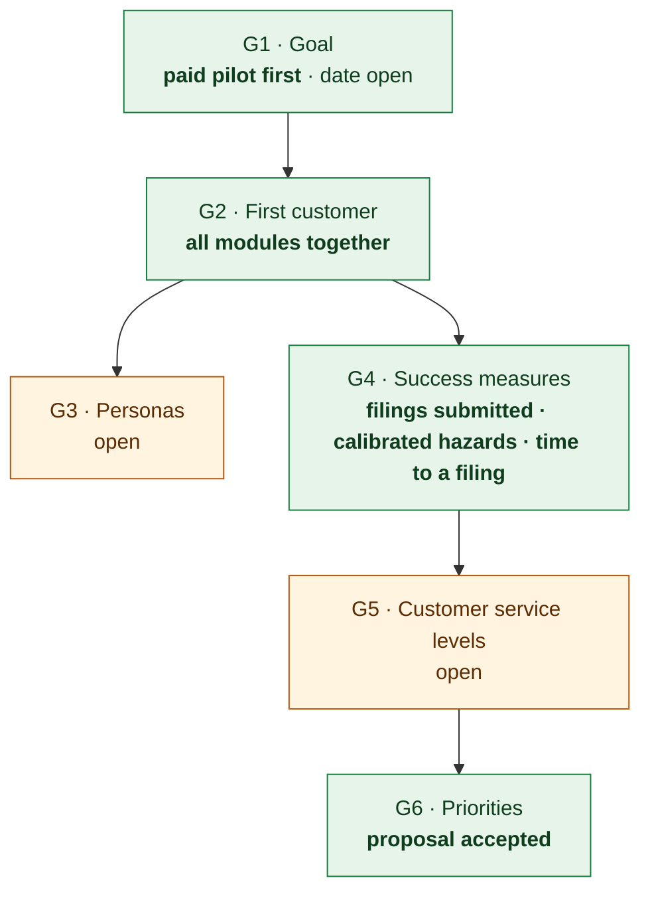

# Product requirements — Tellumen climate platform (as built)

> **Facts only.** Each statement is quoted from, or counted in, the source named beside it. What was never written
> down is a **named gap** (section 7) and is not filled in here. Written by hand on 2026-10-16 against commit
> `b2a1481`; it is not generated, so re-check it when its sources change. The open questions for the product owner
> are in section 8.

Related: what the code does screen by screen is [APP_FLOW.md](APP_FLOW.md); the stack is
[TECHNICAL_REQUIREMENTS.md](TECHNICAL_REQUIREMENTS.md); the database is [BACKEND_SCHEMA.md](BACKEND_SCHEMA.md); the
visual system is [DESIGN_BRIEF.md](DESIGN_BRIEF.md); history and the forward plan are
[IMPLEMENTATION_PLAN.md](IMPLEMENTATION_PLAN.md).

## 1. What the product is, as recorded

[SOFTWARE_DESCRIPTION.md](SOFTWARE_DESCRIPTION.md) §1:

> Tellumen is a multi-tenant climate-risk intelligence platform. It ingests satellite, reanalysis and agency data
> and scores physical climate hazards at H3-cell resolution.

and, of whom it serves:

> The scores serve five sectors — bank, insurer, asset manager, REIT and agri-food — plus a supervisor workspace for
> regulators, through an API, a web UI and regulatory filings exported from frozen snapshots (formats per report type
> in §8).

Scope, §2: in scope are "hazard ingestion and scoring, the operational loop (Sense → Score → Project → Act),
multi-tenant auth/RBAC, the three go-to-market verticals, regulatory reporting exports". The section does not name
the three verticals.

[BRAND.md](BRAND.md) §1: tagline "Light on the Earth"; category descriptor "climate & physical-risk intelligence".

## 2. Who it serves, as built

Organisation types a tenant can be created as (`VALID_ORG_TYPES`, `services/governance/tenant_provisioning.py`), with
the offerings each gets by default (`DEFAULT_ENTITLEMENTS`, same file; every tenant gets `trust`):

| Organisation type | Default entitlements |
|---|---|
| `bank` | physical-risk, reporting, trust |
| `insurer` | underwriting, parametric, trust |
| `asset_manager` | portfolio-var, securities, trust |
| `reit` | portfolio-risk, trust |
| `manufacturer` (agriculture / food) | supply-chain, reporting, trust |
| `regulator` | supervision, trust |

Two further kinds of organisation exist in code: a supervised entity on the `respondent` plan, whose people "only
answer their supervisor" (`RESPONDENT_ROLE_PERMS`, same file), and Tellumen's own platform organisation (type
`platform`, `scripts/seed_platform_operator.py`). The roles each one starts with, and what each role sees, are in
[APP_FLOW.md](APP_FLOW.md) §4.

For supervisors, [SUPERVISION_MODEL.md](SUPERVISION_MODEL.md) records: "Agreed 2026-09-07. First customer class:
**banking supervisor** (SSM / national competent authority)", with seven user groups (line supervisor, horizontal
risk analyst, data & reporting, policy & methodology, inspector, head of division / board, platform admin). The
document does not say who agreed it.

## 3. What is built

Counts read from the code at commit `b2a1481` (2026-10-16):

| What | Count | Source |
|---|---|---|
| Pages in the signed-in workspace | 68 | `web/src/App.tsx` ([APP_FLOW.md](APP_FLOW.md)) |
| Public pages (no sign-in) | 6 | `web/src/App.tsx` |
| API operations | 651 on 574 paths | the API's OpenAPI schema ([TECHNICAL_REQUIREMENTS.md](TECHNICAL_REQUIREMENTS.md) §4) |
| Database tables | 261 | migrations at head ([BACKEND_SCHEMA.md](BACKEND_SCHEMA.md)) |
| Periodic background jobs | 12 | Celery beat schedule |
| EU Taxonomy hazards covered | 28 of 28 | `core/hazard_taxonomy.py` `coverage_summary()` |

### 3.1 By stage of the operational loop

The customer workspace's sidebar is ordered as the loop Sense → Assess → Decide → Disclose → Operate, then Set up
(`web/src/components/Shell.tsx`). Every entry, the hub tabs behind it, the sectors it serves and the permission it
needs are listed in [APP_FLOW.md](APP_FLOW.md) §2–§3. Supervisors have their own seven-entry menu (§4.2 there).

### 3.2 Hazards

28 hazards of the EU Taxonomy checklist, each at a maturity tier (`core/hazard_taxonomy.py`): 14 calibrated,
7 screening, 6 by nature, 1 reference; 0 on the roadmap.

### 3.3 Regulatory outputs

The report types a filing can be prepared under (`FRAMEWORKS` and `EXPORT_FORMATS`,
`services/governance/filings.py`): 12 live, 4 retired.

| Key | Report type | Sector | Export formats | Status |
|---|---|---|---|---|
| `bank_tcfd` | EU Taxonomy Art. 8 — credit institutions | bank | json, xlsx | live |
| `bank_p3esg` | Pillar 3 ESG risk disclosures | bank | json, xlsx | live |
| `insurer_solvency` | Solvency II · natural catastrophe risk (S.27.01.01) | insurer | json, xlsx, xbrl | live |
| `insurer_orsa_climate` | ORSA — climate change scenario analysis (Art. 45a) | insurer | json | live |
| `insurer_recovery_stress` | Pre-emptive recovery plan — nat-cat stress and capital indicators | insurer | json | live |
| `sfdr_pai` | SFDR Principal Adverse Impacts statement | asset_manager | json, xlsx | live |
| `sfdr_precontractual` | SFDR pre-contractual disclosure | asset_manager | json, html | live |
| `sfdr_periodic` | SFDR periodic disclosure | asset_manager | json, html | live |
| `reit_taxonomy` | EU Taxonomy Article 8 KPIs (property book) | reit | json, xlsx | live |
| `esrs_pack` | ESRS sustainability statement — E1, E3, E4 | manufacturer | json | live |
| `eudr_dds` | EUDR due diligence statement | manufacturer | — (not in `EXPORT_FORMATS`) | live |
| `eudr_simplified` | EUDR simplified declaration | manufacturer | — (not in `EXPORT_FORMATS`) | live |
| `assetmgmt_tcfd` | TCFD · physical-risk & concentration disclosure (holdings book) | asset_manager | json, xlsx | retired 2026-10-01 |
| `reit_tcfd` | TCFD · EU-Taxonomy disclosure (property book) | reit | json, xlsx | retired 2026-10-01 |
| `insurer_climate` | Climate / NatCat exposure disclosure | insurer | json, xlsx | retired 2026-10-01 |
| `csrd_e1` | CSRD · ESRS E1 physical-risk report | manufacturer | json | retired 2026-09-30, replaced by `esrs_pack` |

What each output can and cannot carry yet (for example, which formats have no official XBRL taxonomy bound) is in
[SOFTWARE_DESCRIPTION.md](SOFTWARE_DESCRIPTION.md) §8 and [GO_LIVE_EXTERNAL_DEPENDENCIES.md](GO_LIVE_EXTERNAL_DEPENDENCIES.md).

## 4. Recorded scope statements

- **Agriculture** — [AGRI_REGULATORY_SCOPE.md](AGRI_REGULATORY_SCOPE.md) ("Audience: product + investor
  conversations"; build status dated 2026-07-30, XBRL line corrected 2026-10-06). Its rule: "own what shares that
  engine; integrate or decline what does not." Its stances: EUDR — own (built); ESRS E1 physical risk — own (built);
  ESRS E3 water — own (building); ESRS E4 biodiversity — own (building); EU Taxonomy adaptation KPIs — own (planned);
  ESRS E1 GHG accounting — integrate, do not build; ESRS E2, E5 — integrate / decline; ESRS S1–S4, G1 — decline;
  CSDDD — partial / future; national laws (LkSG, Devoir de Vigilance) — decline; SFDR — not applicable to
  agriculture. The document names no approver.
- **A published € figure needs a validated chain** — the same document: "A euro is only ever published where the
  hazard→yield/asset chain is validated (r² ≥ 0.40)".
- **Supervision** — [SUPERVISION_MODEL.md](SUPERVISION_MODEL.md), agreed 2026-09-07 (section 2 above): other
  supervisory sectors are served "by configuration … never by sector-specific code".

## 5. The product owner's recorded decisions

Only decisions whose record names the product owner (or "the user") are listed.

| Date | Decision, as recorded | Where |
|---|---|---|
| 2026-10-01 | Retire the TCFD-style report types `reit_tcfd`, `assetmgmt_tcfd`, `insurer_climate` — "the user's decision: no regulatory text, TCFD disbanded 2023" | [ENGINEERING_PROCESS.md](ENGINEERING_PROCESS.md) E87 |
| 2026-10-04 | "the organisation has one approver (the product owner, stated in chat 2026-10-04)"; the number of human approvers (1 or 2, default 2) is now stated per platform action (`approval_policy.human_approvers`) | [ENGINEERING_PROCESS.md](ENGINEERING_PROCESS.md) E150 |
| 2026-10-04 | Crop-upside calibration rules "agreed 2026-10-04 with the product owner, before the rules were run (replacement for the split-half test)" | `data/reference/calibration_protocol.json` (`upside.agreed`) |
| by 2026-10-06 | A building-scale test of the 30 m refinement, "stated before the building-scale test was built or run, at the product owner's request" (run and reported in change log 2.219, 2026-10-06) | `data/reference/loss_protocol.json` (`terrain_refinement.building_scale_test`) |
| 2026-10-07 | 30 m flood refinement: "keep the 90 m maps (jrc_river_flood)"; revisit when "a test at building scale against observed losses or a finer observed extent shows a gain beyond the registered noise margin" | `data/reference/hazard_intensity_layers.json` (`jrc_flood_30m.decision`) |
| 2026-10-07 | WRI Aqueduct Floods for "projected runs only; today's official flood figure stays jrc_river_flood" | `data/reference/hazard_intensity_layers.json` (`aqueduct_river_flood.use`); change log 2.220 |
| 2026-10-07 | "a published curve's figures are 'published' only after it passes this test; untested curves are shown as 'untested'" | `data/reference/loss_protocol.json` (`published_curve_test.statement`) |
| 2026-10-07 | The JRC flood damage curves adopted as a published family; continents mapped to countries by UN M49 ("which countries a continental damage curve covers") | change log 2.221; `data/reference/un_m49_regions.json` (`adopted`) |
| 2026-10-07 | Datasets approved: Aqueduct riverine maps ("93 files, about 8.5 GB") and the JRC flood curves ("about 6 MB") | `data/reference/supply_datasets.json` |
| 2026-10-07 | The demo books state their buildings (building use and building value) | change log 2.222 |
| 2026-10-16 | The UI standard for every screen, built and to be built: customer language only; as little text as possible on the main screen, detail in a drill-down pop-up; as much visual representation as possible (section 6) | `data/reference/ui_standard.json`; [DESIGN_BRIEF.md](DESIGN_BRIEF.md) §1 |
| 2026-10-18 | Legal citations sit one click away: an article, annex, regulation or template number, or a standard's metric code, goes in the drill-down pop-up and in filings and exports, never on the main screen; category names customers use stay ('Article 8 fund', Pillar 3, SFDR) — "Pop-up only", the product owner's answer to the screen-guard session (section 6) | `data/reference/ui_standard.json` (`legal_citations`); [ENGINEERING_PROCESS.md](ENGINEERING_PROCESS.md) E199 |

## 6. Non-functional requirements, as recorded

- **Every screen — the UI standard (governing).** Stated by the product owner on 2026-10-16 for everything built and
  everything still to be built (`data/reference/ui_standard.json`; [DESIGN_BRIEF.md](DESIGN_BRIEF.md) §1):
  1. only external-facing, customer language on screen — no internal keys, file paths, layer or registry names,
     E-numbers, version strings, "product owner's decision" or engineering jargon (for example "named gap",
     "append-only");
  2. as little text as possible on the main UI, further detail in a drill-down pop-up (Dialog or Drawer) with
     professionally written, structured text;
  3. as much visual representation as possible on the main UI (charts, maps, chips, gauges, diagrams);
  4. (stated on 2026-10-18) legal citations one click away: article, annex, regulation and template numbers and
     standard codes in the drill-down pop-up and in filings and exports, not on the main screen; category names
     customers use (an 'Article 8 fund', Pillar 3, SFDR) stay.

  The screens of [APP_FLOW.md](APP_FLOW.md) describe the UI as it is today; this standard is its target. The Loss page
  (`/loss`) is recorded as breaking it and is to be reworked.
- [SOFTWARE_DESCRIPTION.md](SOFTWARE_DESCRIPTION.md) §9: "TBD — no verified SLAs, throughput, or scaling benchmarks
  exist yet."
- `docs/observability/slo.yaml` holds service-level targets that its header calls "INTERNAL design targets we build
  to; they become a published, contractual SLA only when the product is client-ready" (listed in
  [TECHNICAL_REQUIREMENTS.md](TECHNICAL_REQUIREMENTS.md) §8).

## 7. Named gaps — not recorded in the repository before 2026-10-16

The product owner answered some of them on 2026-10-16 (section 8); *Now* says which.

| # | Gap | What the repository held | Now |
|---|---|---|---|
| G1 | **Product goals** — what the product must achieve, for whom, by when | none | answered, except the date |
| G2 | **Target customer, platform-wide** — which sector and segment comes first | a first customer class for the supervision module only (banking supervisor, 2026-09-07); a "beachhead commodity" (cocoa, then coffee) in [SUPPLY_CHAIN_COGS_VAR_SPEC.md](SUPPLY_CHAIN_COGS_VAR_SPEC.md) of 2026-07-02; §2 of SOFTWARE_DESCRIPTION mentions "three go-to-market verticals" without naming them | answered |
| G3 | **Users as people** — personas, their jobs and what they need first | role templates (permissions) and the supervisory user groups | open |
| G4 | **Success measures** — the numbers that say the product works (adoption, filings, accuracy, time to file) | none as product requirements; the board business case (below) models one customer's economics | answered |
| G5 | **Non-functional commitments** — SLAs a customer is promised | §9 is TBD; `slo.yaml` is internal | open |
| G6 | **Priorities** — which sector, dependency or capability comes next | the go-live dependency list, unranked ([IMPLEMENTATION_PLAN.md](IMPLEMENTATION_PLAN.md) §3) | answered |

Recorded elsewhere, and not product requirements (not restated here):

- [docs/board/business_case.html](board/business_case.html) — "Does One Customer Pay?", modelled Aug 2026: prices one
  mid-sized customer per sector (bank "regional / €5–50bn", insurer "mid-tier P&C", asset manager "€5–50bn AUM",
  REIT "mid-cap", agri / corporate "mid-cap").
- The root-level planning files (`IMPLEMENTATION_ROADMAP_PHASED.md`, `PRODUCTION_ROADMAP.md`,
  `BUILD_PLAN_COMPREHENSIVE.md`, `STRATEGIC_USP_DEFINITION.md`, `ROADMAP_COMPLETE_12DAYS.md`, the `PHASE_*.md` files)
  were written on 2026-06-26, the repository's first day, and have not changed since (git history); they were not
  checked against the code here.

## 8. Open questions for the product owner

Asked on 2026-10-16 as multiple-choice questions (each option said where it came from); the product owner's answers
are recorded below as decisions of that date. A question not yet answered stays a gap.

| Question | The product owner's answer | Date |
|---|---|---|
| G1 · What must the product achieve next? | **Paid pilot first** — "a customer runs it on their own data under a pilot before a full contract". No target date was given: the date stays open. | 2026-10-16 |
| G2 · Which customer comes first? | **"All modules together"** — no single sector or segment first. | 2026-10-16 |
| G3 · Personas | *open* — with G2's answer, the users of every sector. | |
| G4 · Which numbers say it works? | **Filings submitted** (regulatory filings prepared and submitted through the platform); **calibrated hazards** (hazards at the calibrated tier — 14 of 28 on 2026-10-16); **time to a filing** (days from a customer's data upload to a filing ready to submit). No target values were given. | 2026-10-16 |
| G5 · Customer-facing service levels | *open* — not asked yet. | |
| G6 · Priorities | **The proposal in [IMPLEMENTATION_PLAN.md](IMPLEMENTATION_PLAN.md) §4 is accepted.** | 2026-10-16 |
